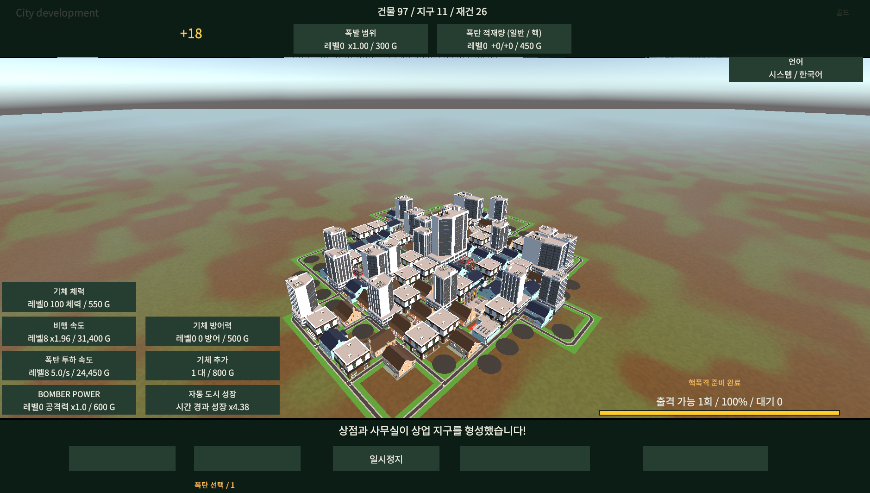

## 작업 결과

변경 전 오류 구조 재현·변경 후 실제 Text153개·그리기 순서·행 높이 정적 검사 통과. 화면 표시 미검증.

## 변경 내용

### 재현 조건

Unity6000.0.83f1 / URP17.0.4 / UGUI / Noto Sans CJK KR

### 재현 순서

사용자 실행 화면에서 버튼 라벨·발전도/골드 숫자 누락 확인. 이전 씬과 실제153개 Text·Canvas sibling순서·OTF hhea와RectTransform을 대조.

### 기대 동작

모든 언어의 버튼/점수/라벨이 배경 앞에서 읽히며 실제 번역된 문구를 유지.

### 실제 동작

변경 전 실제Text번역불일치46건·배경보다앞서그려지는라벨56개·CJK행높이보다작은Text영역6개 확인. 사용자 화면에서도 하단라벨/큰숫자누락·일부영문잔류가 관찰됨.

### 원인

언어별 라벨이 부모 m_Children의 배경 앞에 저장되어 뒤에 그려지는 배경에 가려지는 연결을 확인했습니다. 일부 복제Text에는카탈로그번역값대신원문이남았습니다. 스코어는폰트42/영역높이52였지만Noto hhea는1000units당상승1160·하강288로42px의행높이가약60.8px입니다. Truncate설정으로잘릴수있는구성을확인했습니다. 실제 엔진 렌더 인과 검증은 미실행입니다.

### 적용 내용

정적153개 Text의9언어문구를 실제오브젝트에저장. 언어라벨이배경보다나중에그려져화면앞에표시되도록씬sibling목록정렬. 큰숫자영역높이52→72,나머지부족한Text영역도폰트기준여유확보. 발전도숫자색을밝게하고하단주요버튼글자17→24. 폰트·색·문구·배치는씬에저장했으며 런타임UI생성·스타일/폰트대입은없습니다.
[파란 특수 건물·파괴 연출](2026-11-06-result-20261106190410645-v1.0.0.html) · [9언어 문서](../assets/localization/Documentation/index.html)

## 검증

QA/VisualFeedback/before.unity와수정씬비교로번역불일치46→0·배경뒤라벨56→0·행높이부족6→0. 실제Text내용과순서를기존Localization검사에연결해이전의카탈로그검사만으로통과하던누락을보완했습니다. 동적531종·nativeText178개글리프매핑누락0. 씬1193객체·2675로컬참조·528외부참조·14이벤트와부모/자식상호연결통과. 외부원본5840개해시변경0. 언어/쿨타임699개assertion,Runtime/Editor참조컴파일통과. 실제표시해결완료를의미하지않습니다.
[Unity6 Truncate 공식 설명](https://docs.unity3d.com/cn/6000.0/ScriptReference/VerticalWrapMode.Truncate.html)

변경 전: 사용자 첨부 실행 화면. 변경 후: GUI금지로 캡처하지 않았습니다. 원본390005바이트를편집·압축없이첨부하여원본을보존했습니다.
교훈: 실제Text문구·그리기순서·폰트행높이대조를프로젝트지침과회귀검사에반영. 기존전역실제표시검증규칙과중복되어전역변경없음.

## 남은 사항

사용자 화면 조작 금지로 Unity/플레이어 실행·Play·씬 재열기·수정 후 캡처·실제9언어 가독성은 미검증입니다. 제공된 변경 전 화면만 원본 그대로 참고로 첨부합니다. 브라우저 렌더도 실행하지 않았습니다.

## 작업 시간

- 제안 시간: 15~25분
- 실제로 완료된 시간: 시작2026-11-07 03:46:01 KST. 구현·독립/참조 검사 후 공개 배포 확인 진행. 실제 Play 미실행.
- XERJ: 미사용 — XERJ 도구 미제공 — rg·실제 씬/소스/폰트 파일·독립 검사 사용
