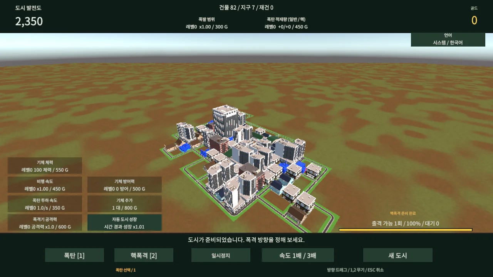
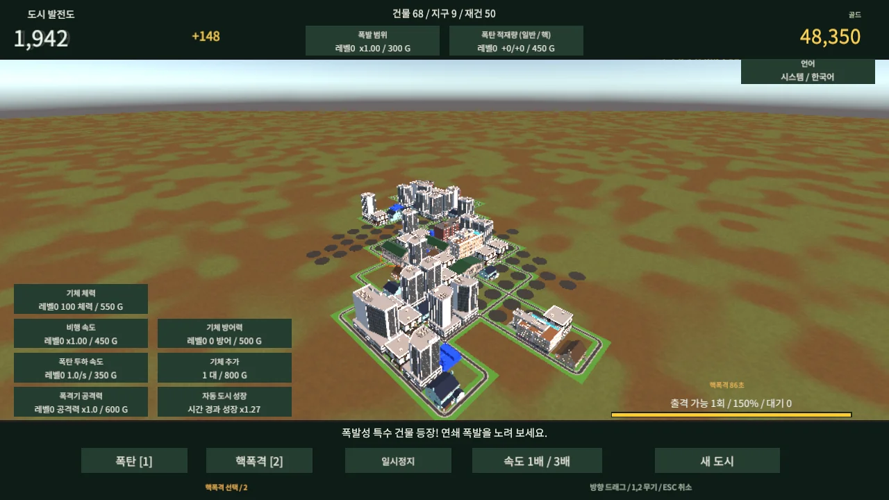

## 작업 결과

[게임 실행](https://mdj0126.github.io/growing-city/) · [GitHub 저장소](https://github.com/MDJ0126/growing-city) · [시스템 언어 다큐먼트](https://mdj0126.github.io/growing-city/Documentation/)

공개 주소에서 실제 게임 시작과 드래그 핵폭격이 동작했습니다. 사용자 화면·기존 브라우저를 조작하지 않고 독립 headless Chrome으로 확인했습니다.

## 변경 내용

### 적용 내용

- Fantasya README의 중앙 제목·배지·문서·소개·구조·기능·환경 구성을 적용하고 실제 WebGL 스크린샷을 첨부했습니다. 다른 제품 로고는 복제하지 않았습니다.
- Unity 6000.0.83f1로 게임 씬을 빌드하고 gzip + decompression fallback을 적용했습니다. Pages는 고정된 33.45MB 산출물을 배포합니다. 파일별 SHA-256 목록을 포함합니다.
- 시스템 언어 기본값과 9개 언어 문서를 보존했습니다. Actions에서 공개 파일 해시·문서·이미지를 검사합니다.
- 공개 저장소에는 프로젝트 소유 소스·설정·OFL 폰트만 포함했습니다. 유료 Low Poly Epic City 원본은 제외하고 게임에 내장된 컴파일 결과만 게시했습니다. 소스 재빌드는 별도 구매·가져오기가 필요합니다.
- 교훈 검토: 산출물 고정, 원본 보존, 공개 범위 분리 규칙을 적용했습니다. 기존 전역 지침과 중복되므로 추가·변경하지 않았습니다.

## 검증

- Unity WebGL 배치 빌드 종료 코드 0. 외부 원본 5,840개 SHA-256 대조: 변경 0. 씬 직렬화·참조 검사 통과.
- 독립 검사: 233개 시나리오 + 699개 언어·핵 쿨타임 검증 통과.
- 로컬 및 공개 URL에서 Chrome headless, 1280×720, ko-KR, 실제 Unity ready=true. JS 예외·HTTP 오류·Unity 오류 배열 모두 0.
- 공개 배포의 18개 산출물 SHA-256 일치. 9개 언어 HTML과 실제 화면 이미지 2개 HTTP 성공.
- 실제 표시: 한글 버튼·발전도·골드, 파란 특수 건물 확인. 핵폭격 후 건물 감소·폐허·골드 증가·쿨타임 진행 확인.

두 화면은 코드 수정 전후 비교가 아니라 같은 공개 빌드의 실제 플레이 상태 비교입니다. 이번 작업 이전의 WebGL 배포 화면은 없었습니다. 원본 캡처를 편집하지 않았으며 각 200KB 이하입니다.

초기 headless 검사는 Chrome 실행 제한으로 실패했으나 승인된 실행 권한으로 복구했습니다. 이후 첫 실행의 favicon 404를 로딩 페이지의 빈 아이콘 선언으로 수정하고 재검증했습니다. 출격 입력은 프레임 간격을 두어 실제 실행을 검증했습니다. 검증용 Chrome·빌드 Unity 프로세스는 종료 확인했고 기존 사용자 앱은 보존했습니다.

## 남은 사항

요청한 소스 공개·README·Pages 실행은 완료했습니다. 모든 브라우저·모바일 실기기 성능, 전체 언어의 모든 플레이 상태, 장시간 밸런스는 이번 검증 범위가 아닙니다. 도시 저장 기능은 없습니다. 공식 로고 원본 미확인으로 중앙 프로젝트 logo:null을 유지했습니다.

## 작업 시간

- 제안 시간: 30~50분 (시작 2026-11-07 04:56:30 KST)
- 실제로 완료된 시간: 게임 구현·공개 실행 확인: 26분 55초, 2026-11-07 05:23:24 KST. 중앙 보고서 게시·접근 확인은 후속 배포 단계입니다.
- XERJ: 미사용 — XERJ 연결 도구가 제공되지 않아 rg와 현재 소스·실행 결과로 확인했습니다.
