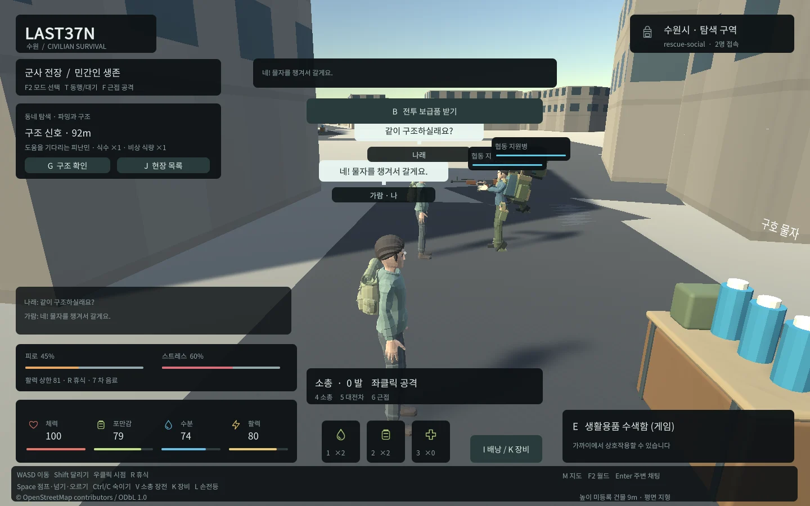

## 작업 결과

현재 Web의 한국어 이름·양방향 채팅·말풍선/만료와 기본8788 입력을 재검증했습니다.

## 변경 내용

### 재현 조건

Unity6000.0.83f1 WebGL, Edge156.0.4314.50, Windows.

### 재현 순서

기존 IMGUI 채팅에 한국어 문장을 입력하고 다른 접속자의 수신 내용을 확인했습니다.

### 기대 동작

입력한 한국어 이름과 문장이 서버/다른 플레이어에 유지됩니다.

### 실제 동작

초기 실제 Web 검사에서 한국어가 ?로만 전송되어 검증에 실패했습니다.

### 원인

Unity6.0 Web IME 제한을 공식 버전 문서와 실제 입력 실패로 확인했습니다. 게임 기본 입력 경로가 한국어 조합을 보존하지 못했습니다.

### 적용 내용

브라우저 HTML 입력 폼, UTF-8 SendMessage, 조합 중 Enter 전송 방지, Unity WebGLInput.captureAllKeyboardInput 전환/복원을 구현했습니다. 이름과 채팅에 같은 입력 경로를 사용합니다.

## 검증

서버의 발신자 위조/중복·거리/월드 범위 검사, 실제 두 Edge에서 한국어 왕복/이름표/말풍선/6초 만료·조합 Enter·새 이름, 기본8788 실제 입력과 엔진 오류0을 확인했습니다. 실패 자료는 docs/qa/rescue/attempt-web-01에 보존했습니다. 공식 Unity6.0 입력 문서: https://docs.unity.com/en-us/engine/6000.0/manual/platform-specific/webgl/develop/input . 교훈은 기존 버전/실행 근거 지침에 포함되어 전역 변경 없음입니다.

## 남은 사항

수정한 범위를 실제 재검증했습니다. 모든 OS IME/장비 조합과 운영 환경의 검증을 의미하지 않습니다.

## 작업 시간

- 제안 시간: 최초60~100분, 장비35~60분, 행동40~70분의 추가 범위에 포함.
- 실제로 완료된 시간: 수정·실행 검증 기록 2026-10-31 03:55:20 KST. 전체 작업 시작2026-10-31 01:35:00 KST.
- XERJ: 미사용 — XERJ 미제공, rg·소스/Unity 로그·실제 헤드리스 게임으로 검증했습니다.
