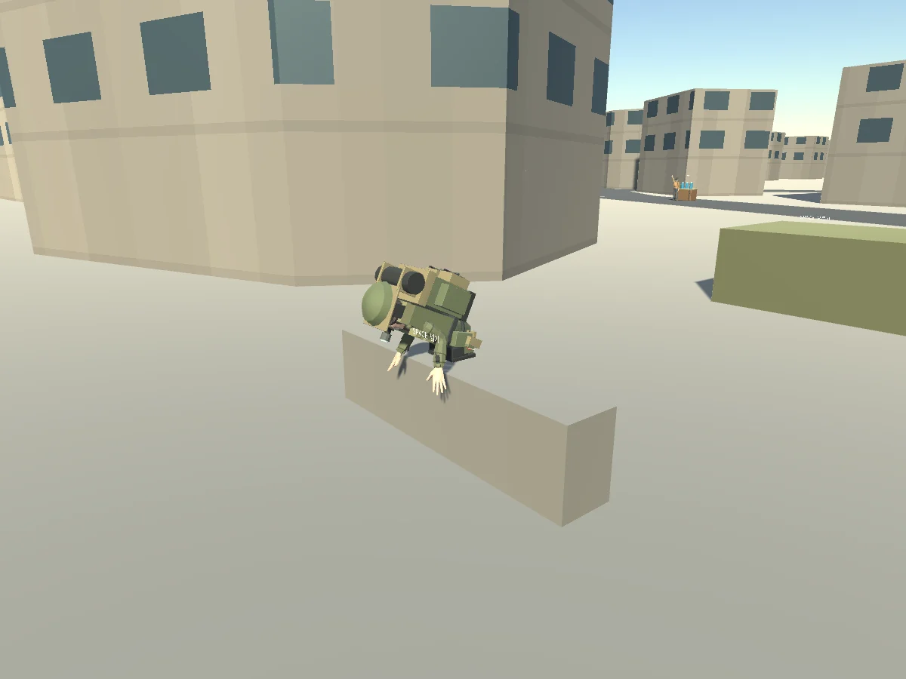

## 작업 결과

행동10클립 본 변화·23개 Native 검사·실제 Web 행동14개·양방향 구조물 장면과 엔진 예외0을 확인했습니다.

## 변경 내용

### 재현 조건

Unity6000.0.83f1 Generic rig, Blender5.2.3 LTS, Windows/WebGL.

### 재현 순서

애니메이션 전용 FBX를 기존 Survivor에 연결하고 여러 시점의 본 회전을 비교했습니다. 이어 서버에서 motion이 없는 기본 캐릭터로 실행했습니다.

### 기대 동작

기존 캐릭터의 동일 본 경로로 클립이 연결되고 비활성 이동 상태에서도 게임이 실행됩니다.

### 실제 동작

Blender 원본/FBX 곡선은 있었지만 기존 CharacterArmature/Root와 새 Root 경로가 달라 Unbound action clip이 발생했습니다. 이후 실제 실행에서 비어 있는 motion.from을 읽으며 ActionPosition NullReferenceException이 발생했습니다.

### 원인

Unity가 메쉬 없는 FBX의 CharacterArmature 부모를 생략해 Generic 경로가 달랐습니다. JsonUtility에서 비어 있는 중첩 객체를 받을 때 from/to가 존재한다고 가정한 접근도 확인했습니다.

### 적용 내용

기존 캐릭터와 같은 계층으로 FBX를 내보내고10클립을 실제 본에서 여러 프레임 비교합니다. from/to/기간이 없는 중첩 이동 상태는 일반 위치로 처리합니다. 종료 코드뿐 아니라 실행 예외 로그도 검사합니다.

## 검증

10클립 모두 본 변화, 숙인 머리 약0.419m 감소/발0.041m, 장비14부착, 실제 Web14개·최종82서버 테스트·양쪽 traverse 시선1.0, Native/Web 실행 예외0을 확인했습니다. 실패/곡선/렌더 근거는 docs/qa/actions에 보존했습니다. 현재 Generic FBX 계층의 프로젝트 상세를 docs/EQUIPMENT_ACTIONS.md에 기록했고 기존 전역 검증 지침과 중복되어 전역 변경 없음입니다.

## 남은 사항

수정한 범위를 실제 재검증했습니다. 모든 OS IME/장비 조합과 운영 환경의 검증을 의미하지 않습니다.

## 작업 시간

- 제안 시간: 최초60~100분, 장비35~60분, 행동40~70분의 추가 범위에 포함.
- 실제로 완료된 시간: 수정·실행 검증 기록 2026-10-31 03:55:20 KST. 전체 작업 시작2026-10-31 01:35:00 KST.
- XERJ: 미사용 — XERJ 미제공, rg·소스/Unity 로그·실제 헤드리스 게임으로 검증했습니다.
