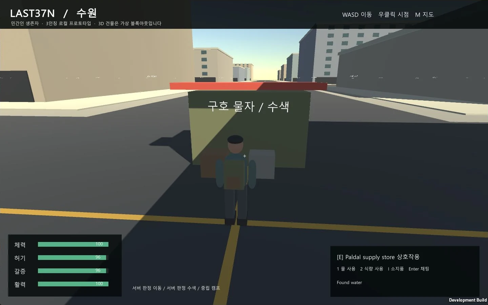
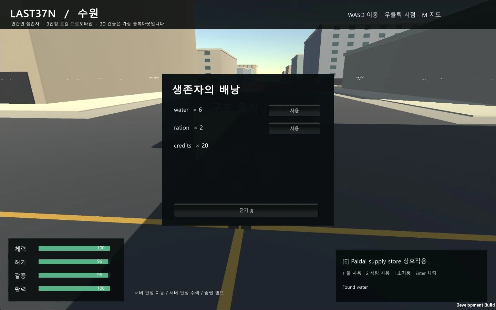

## 작업 결과

Unity 6000.0.83f1에서 지도 중심 첫 화면을 3인칭 생존게임 화면으로 전환했습니다. 가방을 멘 민간인 캐릭터와 거리·건물·구호 물자, 한국어 HUD가 실제 Windows 실행 파일에서 표시됩니다. 지도는 M 키로 여는 보조 화면으로 유지합니다. 구현과 Windows 빌드는 완료했으며 수동 이동 입력 검증은 남아 있습니다.

## 변경 내용

### 적용 내용

WASD 방향 입력을 서버로 전송하고, 서버가 4.5 m/s 속도·대각선 정규화·400 ms 입력 만료·건물 충돌을 결정하도록 구현했습니다. 10 Hz 상태를 클라이언트에서 보간합니다. 이동 입력은 아이템 거래 영수증을 소모하지 않습니다.

추적 카메라와 우클릭 시점 회전, 간단한 팔다리 보행 모션, 3D 건물 스트리밍, 수색 물자와 NPC 모델, I 배낭·1/2 물/식량 사용·E 상호작용·Enter 채팅·M 보조 지도를 추가했습니다. 초기 실행에서 확인한 셰이더 누락과 정지 상태 보간 문제도 보완했습니다.

3D 공간은 수원 WGS84 좌표에 연결한 가상 블록아웃이며 실제 수원 건물 형상을 재현한 결과가 아닙니다. 캐릭터와 도시 미술은 기본 도형 기반 프로토타입입니다. README와 아키텍처에 조작법·네트워크 규칙·구현 제한을 반영했습니다.

## 검증

Node.js v24.22.1: node --test server/test/*.test.ts 결과 9개 통과. 서버 이동 시간, 입력 속도 제한과 대각선 속도, 입력 해제 후 정지, 서버 건물 충돌, 수색 중복 방지·거리·쿨다운, NPC 거래/치료, 중립 영역, 경제 명령 영수증, 실제 WebSocket 접속·서버 재시작 후 상태 복원을 확인했습니다.

Unity 6000.0.83f1에서 Windows 빌드 성공 및 종료 코드 0을 확인했습니다. 실제 게임 창에 TPS 캐릭터·카메라·거리·HUD가 나타났고 E 키 수색으로 Found water가 표시됐으며 I 키 배낭에서 물 6개를 확인했습니다. 마지막 실행의 Player.log에서 초기화 후 예외는 확인되지 않았습니다. 수동 A 키 검증 직전에 사용자가 물리 Esc 키로 Computer Use를 중단해 해당 입력은 실행하지 않았습니다. 따라서 실제 WASD·마우스 회전·M 지도 전환까지 통과했다고 기록하지 않습니다.

실제 게임 캡처를 창 테두리 제거 후 1440×900 WebP로 압축했습니다. TPS 화면은 PNG 94,070 → WebP 51,202바이트, 배낭 화면은 PNG 95,386 → WebP 50,476바이트입니다. 원본은 로컬 보존하고 압축본만 보고서에 첨부했습니다.

## 남은 사항

수동 WASD 이동·우클릭 카메라·M 지도 전환·단축키 소모품 사용과 실제 동시 플레이 시각 검증이 남아 있습니다. Computer Use는 사용자 Esc 중단 이후 추가 입력하지 않았습니다.

PostgreSQL/PostGIS 연결은 아직 구현하지 않았으며 현재 단일 프로세스 JSON 저장입니다. Unity Web 모듈과 브라우저 WebSocket 연결 계층, 실제 수원 건물/도로/경계/위험도 데이터, 100명 부하 검증, 완성형 캐릭터 애니메이션, 전투는 남은 단계입니다. 서버의 건물 충돌은 가상 블록 형상 기준이며 작은 장식 물자에는 충돌을 적용하지 않았습니다. 운영용 명령 영수증 정리와 인증/TLS도 필요합니다. 공식 로고는 미확인으로 null을 유지합니다.

## 작업 시간

- 제안 시간: 초기 환경 확인 1~3분, 초기 로컬 프로토타입 30~60분. 추가 TPS 전환 예상 20~40분으로 안내했습니다.
- 실제로 완료된 시간: TPS 전환 시작 2026-10-30 17:16:44 KST(Asia/Seoul). 구현·빌드와 수색/배낭 시각 확인 후 기록 2026-10-30 17:29:12 KST, 12분 29초 경과. 전체 작업 최초 시작은 2026-10-30 16:44:32 KST입니다. 수동 이동 검증이 중단되어 전체 검증 완료 시각은 기록하지 않습니다.
- XERJ: 미사용 — XERJ MCP/검색 도구가 제공되지 않아 현재 소스와 설정을 직접 검색하고 실행 결과로 확인했습니다.
