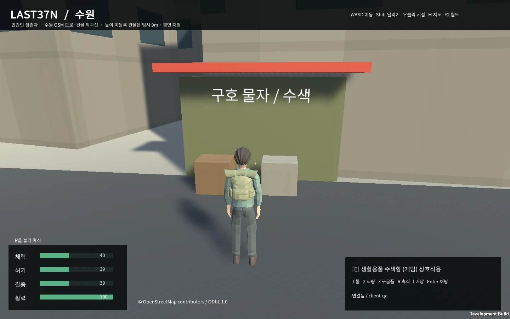
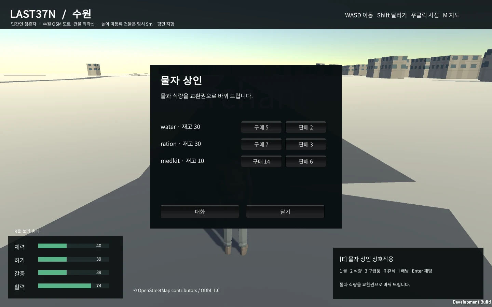

## 작업 결과

최초 프로토타입 전체 작업을 계속 진행 중입니다. PostgreSQL/PostGIS 실제 저장, 수원 원본 공간, Windows 기능 실행과 멀티플레이, Web 빌드·무창 브라우저 기동까지 확인했습니다. 전체 완료 보고가 아닙니다.

## 변경 내용

### 적용 내용

Unity 6000.0.83f1과 Blender 5.2.3 LTS 기반 생존자 캐릭터를 사용합니다. 서버가 이동·생존·물자·거래를 결정하고 PostgreSQL 17.11/PostGIS 3.6.2 트랜잭션으로 결과와 요청 영수증을 함께 저장합니다. 기존 JSON과 백업을 보존해 이관했습니다.

실제 수원 OSM 경계, 건물 37,308개, 도로 15,722개, 물가/접근 제한 영역 96개, 다리 610개 구간을 반영했습니다. 출처·ODbL 라이선스·SHA-256을 기록했습니다. 미등록 건물 높이는 임시 9m, 지형은 평면이며 실제 측정 디지털 트윈으로 주장하지 않습니다.

생존·휴식·배낭 무게·수색 재고·NPC 구매/판매·치료·대사와 월드 선택·월드별 캐릭터·자동 재접속·동일 ID 재시도를 구현했습니다. 미정 규칙은 provisional 설정에 분리했습니다.

실제 Web 게임의 캐릭터·지형·한글 생존 HUD입니다. 이미지 생성이나 합성 화면을 사용하지 않았습니다.

실제 상점 대화·재고·가격·구매/판매 버튼과 생존 상태를 확인한 화면입니다.

## 검증

서버·DB 전체 테스트 36개 통과, 실패 0·미실행 0 및 TypeScript 검사 통과. 실제 DB 강제 실패 롤백, 중복 동시 요청, 300개 이후 영수증 재시도, 프로세스 재시작과 JSON 원본/백업 동일성을 검사했습니다.

실제 Windows 게임 5개 시나리오에서 걷기·달리기·수색·소비·휴식·상점·치료·4종 NPC 대화를 검사했습니다. 실제 Unity 클라이언트 3개 동시 실행에서 위치·채팅·월드 격리, 서버 재시작 자동 복구, offline 요청 한 번 처리, 다른 월드 방문 후 원래 인벤토리 복원을 통과했습니다. 실제 WebSocket 100명 연결·101번째 거부·재접속 슬롯·다른 월드 접속도 통과했습니다. 이는 지속 부하 시험 완료를 뜻하지 않습니다.

공식 Unity Web 모듈 설치·Web 빌드가 성공했고, 실제 headless Edge 156.0.4314.50에서 세션·인벤토리·수원 공간 로딩과 한글 HUD를 확인했습니다. 첫 엔진 stripping 오류와 추가 serialization 오류는 보존하고 보존 설정·클린 빌드 후 JS/Unity 오류 0개를 확인했습니다.

브라우저 입력 검증 첫 회차는 이동량 0m 판정으로 실패했습니다. 실제 화면·활력 변화와 서버 상태 갱신 시점을 대조 중이며 원인은 미확인입니다. 실패를 통과로 처리하지 않았습니다. 이미지 2개는 WebP로 압축한 뒤 원본/출력 바이트·해상도를 검사했습니다.

교훈 검토: 바깥 테스트 도구의 통과만으로 대상 게임의 성공을 판단하면 안 됩니다. 실제 Unity 오류 로그와 화면을 함께 검사하도록 검증 도구를 수정했습니다. 전역 지침 통합 여부는 전체 작업 종료 전 중복 대조 후 확정하겠습니다.

## 남은 사항

브라우저 실제 입력·NPC UI·Windows 상호운용·재접속 회귀, 100명 지속 부하와 장애 검증, 재현 실행 도구/README 최종 갱신, 전체 최종 QA와 결과 보고서가 남았습니다. 최초 전체 12개 작업과 실패 이력은 메뉴얼에 유지합니다. 전투·세력·차량·월드 이벤트는 최초 기획의 후속 확장으로 이번 초기 프로토타입 범위에 포함하지 않습니다.

## 작업 시간

- 제안 시간: 전체 잔여 범위 4~10시간, 최초 DB·생존 단계 30~60분 예상. 작업 시작 2026-10-30 18:17:30 KST.
- 실제로 완료된 시간: 중간 보고 작성 2026-10-30 20:11:50 KST(Asia/Seoul). 시작 후 114분 경과. 전체 작업은 진행 중이며 전체 완료 시각이 아닙니다.
- XERJ: 미사용 — XERJ 도구가 제공되지 않아 rg와 현재 소스·설정·실제 로그·실행 화면으로 검증했습니다.
