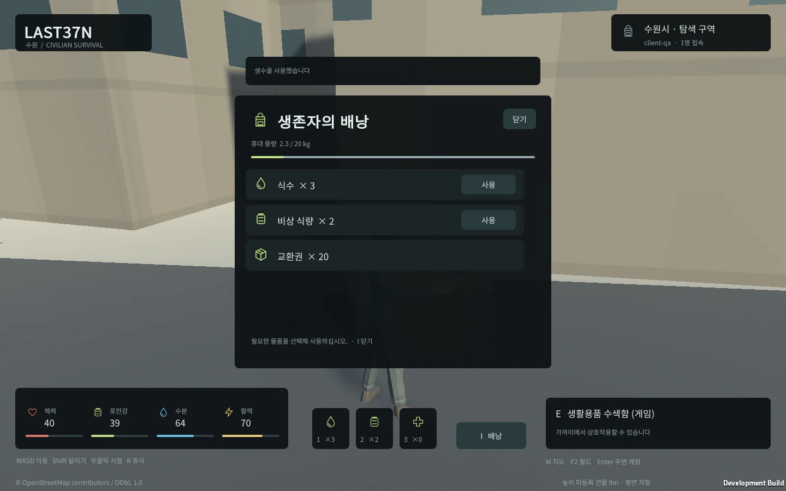
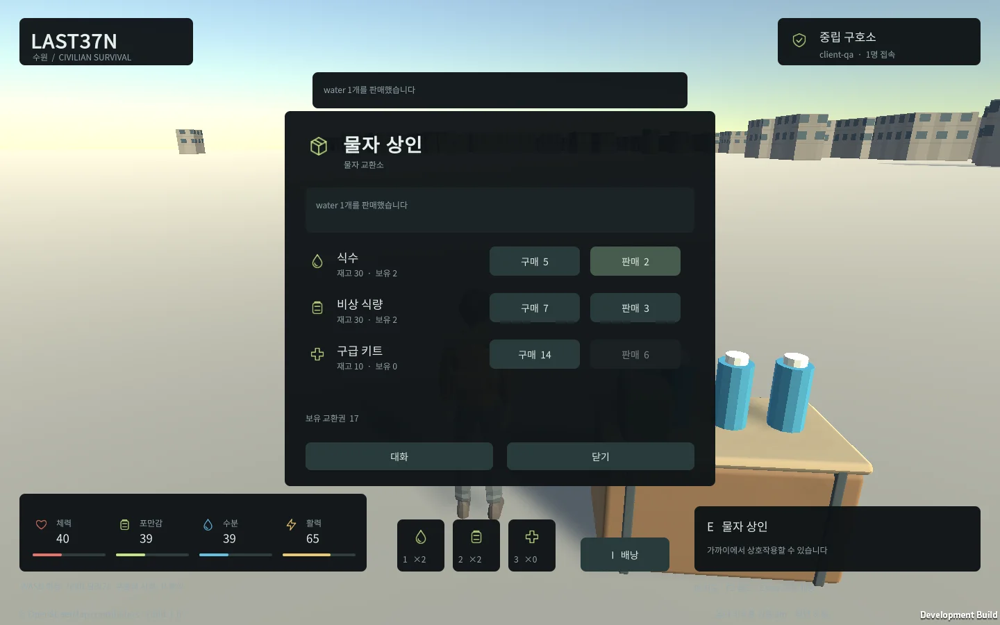
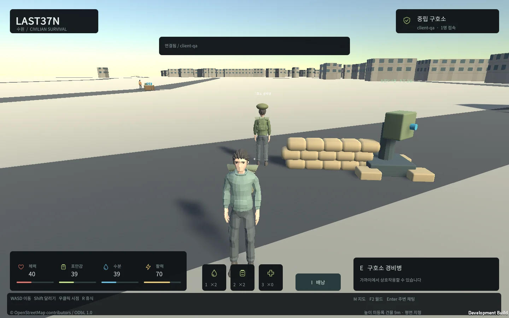
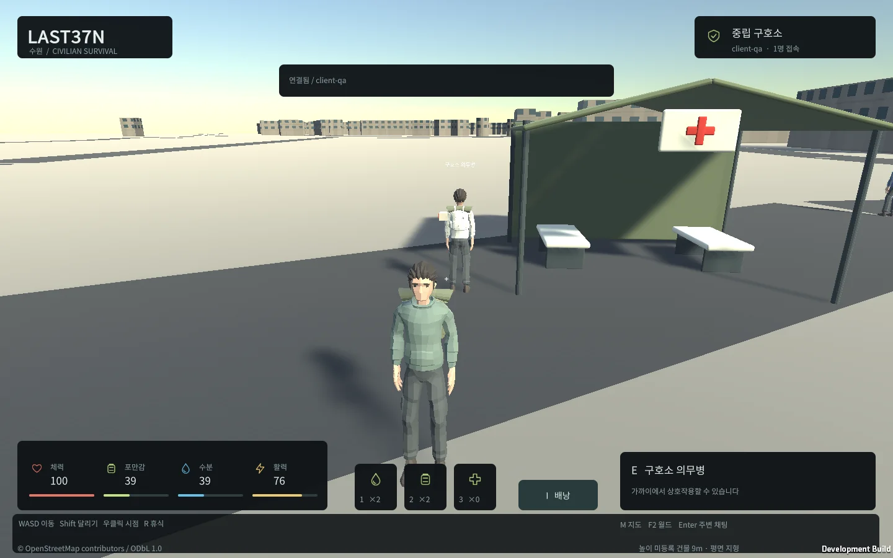

## 작업 결과

추가 요청의 UI·소품·역할별 NPC·세이프존 경계 터렛을 구현하고 실제 실행 검증했습니다. 최초 전체 프로토타입은 최종 QA와 아카이브 검증 단계입니다.

## 변경 내용

### 적용 내용

생존 HUD를 작은 카드와 개별 아이콘으로 재구성했습니다. 배낭은 한글 물품·수량·휴대 중량·사용 버튼을, 거래창은 재고·보유량·가격과 구매/판매 가능 상태를 표시합니다.

실제 Unity Web 배낭 화면입니다.

실제 버튼으로 식수를 구매·판매하고 서버 재고·교환권 변화를 확인했습니다.

Blender5.2.3 LTS에서 물병·비상 식량·의료 가방·보급 상자·모래주머니·야전 천막/침대·경계 터렛을 제작하고 편집 가능한 .blend와 FBX를 보존했습니다. NPC는 경비·상인·의무병·생존자 색상/장비와 기능을 구분했습니다.

터렛은 서버 시간에 맞춰 회전하고 같은 월드의 온라인 민간인 접근 상태를 감지합니다. 발사·피해 판정은 구현하지 않았습니다. 최초 기획에서 NPC 전투는 후속 확장입니다.

게임 전용 의료 시설이며 실제 피난·안전 정보가 아닙니다.

## 검증

전체 서버/DB 테스트37개 통과, 실패0·미실행0, TypeScript 검사 통과. 실제 Windows 기능5개 시나리오와 Web 입력·이동·수색·소비·휴식·구매/판매·치료를 확인했습니다. Web와 Windows가 서로를 보고 채팅하며 서버 재시작 뒤 같은 캐릭터를 복원했고 offline 요청이 한 번만 반영됐습니다. 다른 월드 방문 후 원래 인벤토리도 유지됐습니다.

100개 실제 WebSocket과 PostgreSQL로 약92초간 이동80명·거래/채팅·재접속10명을 실행했습니다. 명령9900개, 응답900개, p95 83.90ms, 최대 스냅샷 간격220.10ms, 오류0. 로컬 프로토타입 측정이며100개 Unity 화면 렌더링이나 인터넷 운영 SLA를 주장하지 않습니다.

실제 캡처에서 흰색 패널 색상 오류와 천막 입구 방향을 발견해 수정하고 화면 재QA를 수행했습니다. Affinity3.3.1.4940은 연결됐지만 파일 접근 PERMISSION_DENIED로 실패해 권한을 우회하지 않고 SVG 원본에서 PNG를 렌더링했습니다. Affinity 출력 성공으로 보고하지 않습니다. MCP 게임 탭에서 새 배낭도 실제 표시됐습니다.

시작→DB 체크포인트 후 종료→재시작 명령과 pnpm frozen install을 실제 실행했습니다. 교훈 검토: 대상 게임 로그와 실제 화면을 함께 검증한다는 기존 전역 지침이 이번 오류에도 적용되므로 중복 규칙은 추가하지 않았습니다. Blender 썸네일 캐시 쓰기 경고는 원본/FBX 저장과 게임 로딩 성공 여부를 별도로 확인했습니다.

## 남은 사항

최초 전체 작업 T12의 최종 회귀 집계·소스 정리·완료 보고서·외부 배포 확인이 남았습니다. 상용 수준 도시 미술, 전투·세력·차량·생산 인증은 이번 초기 프로토타입 범위가 아닙니다. 평면 지형과 미등록 건물9m 임시 높이는 유지됩니다.

## 작업 시간

- 제안 시간: 전체4~10시간(시작18:17:30 KST), 추가 UI·시설 범위60~120분(시작20:44:21 KST).
- 실제로 완료된 시간: 중간 보고 작성 2026-10-30 21:12:51 KST(Asia/Seoul). 추가 범위 시작 후 약28분. 전체 작업 최종 완료 시각은 아닙니다.
- XERJ: 미사용 — XERJ 도구가 제공되지 않아 rg·현재 소스·서버 로그·실제 게임 화면으로 확인했습니다.
