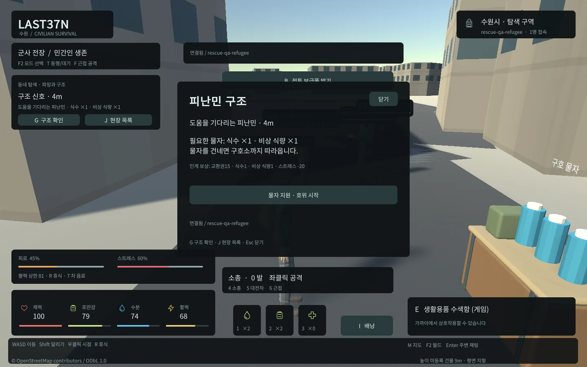
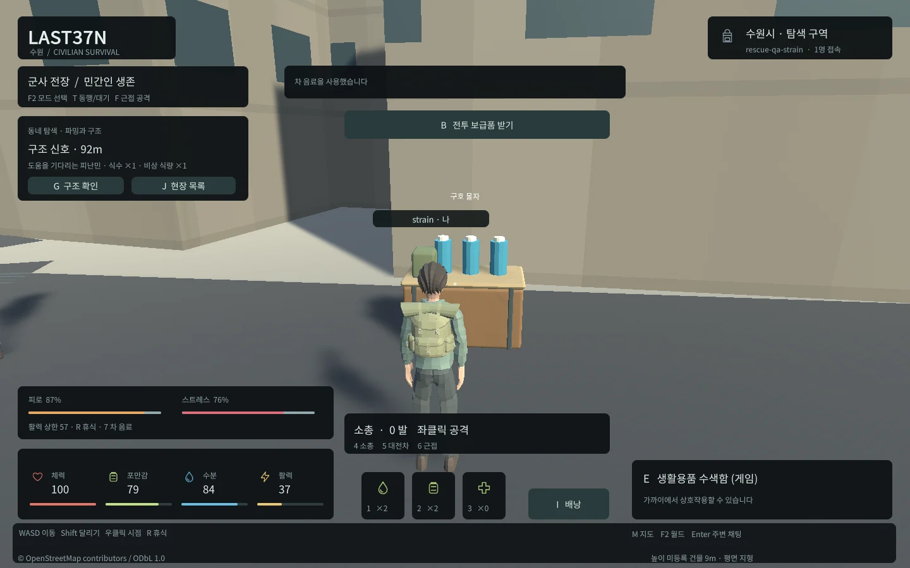
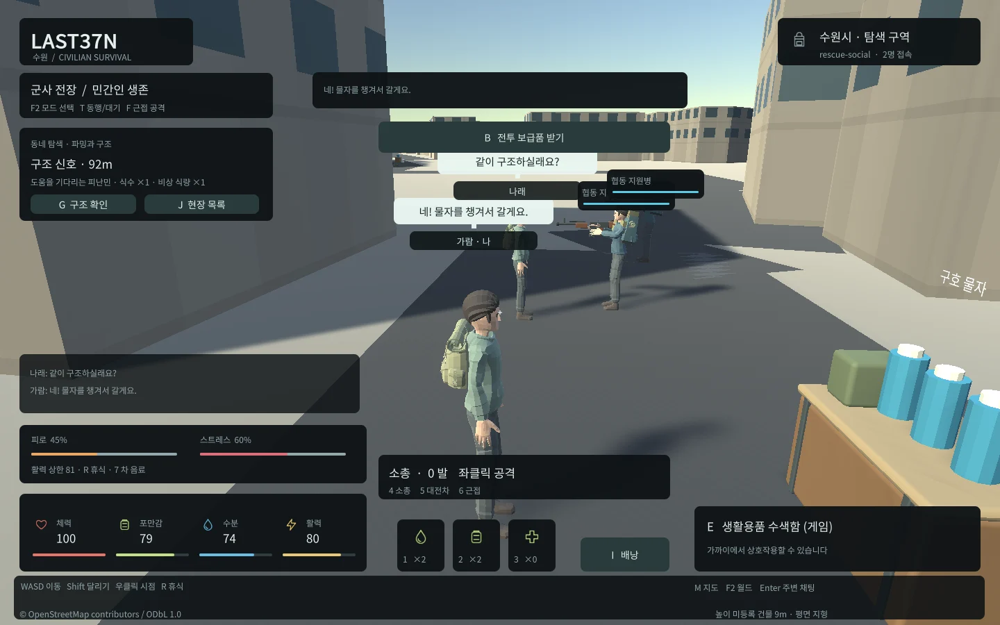

## 작업 결과

서버65개·실제 웹20개와 기존 전투/생존 회귀를 통과했습니다. 실제 구호소까지의 장거리 실시간 호위와 기본 로컬 적용은 진행 중입니다.

## 변경 내용

### 적용 내용

주요 활동을 동네를 돌아다니며 물자를 모으는 흐름으로 보강했습니다. 시작85~600m의 실제 도로 주변18개 수색 지점에 식수·식량·의료품·차 음료를 분산했습니다. 구조는 강제 퀘스트가 아닌 선택 활동입니다.

G로 피난민에게 식수/식량, 조난민에게 구급 키트를 건네고 구호소 의무병까지 천천히 호위합니다. 인계하면 교환권15·식수1·식량1과 스트레스20 완화를 받습니다. 서버가 소유권·물자·거리/건물 사선·NPC 경로·보상/중복을 검사합니다. 배낭 공간이 부족하면 정리 후 인계할 수 있습니다. 월드당3개 이벤트가 만료/교체되며 비접속60초 뒤 호위가 풀립니다.

실제 게임에서 물자 지원과 호위 시작을 확인한 화면입니다. 짧은 UI 검증은20m 사설 QA 코스를 사용했습니다. 기본 게임 목적지는 구호소입니다.

허기0.8/분·갈증1.2/분, 걷기/달리기/정지 피로와 적 근처/피격 스트레스를 적용했습니다. 휴식·안전한 구호소·차 음료·구조 완료로 완화합니다. 높은 피로/스트레스는 활력 상한과 달리기에 영향을 줍니다. 비접속 생존 감소는 기본 비활성을 유지합니다. 모든 수치는 provisional 설정입니다.

실제 시간 경과·휴식·차 음료 사용 뒤 서버 상태와 UI를 대조했습니다.

Enter로 주변 채팅, 머리 위 이름표와6초 말풍선, F2의 한국어 새 캐릭터 이름 입력을 추가했습니다. 이름/발신자 ID는 서버 값이며 같은 월드/주변 범위에서 전달합니다. Unity6.0 Web 기본 입력에서 한국어가 ?만 전송되는 실패를 확인한 뒤 브라우저 HTML 입력과 키보드 포커스/조합 Enter를 연결했습니다.

실제 두 헤드리스 Edge의 양방향 한국어 입력·송수신·이름표·말풍선입니다. 가람/나래는 검증용 캐릭터입니다.

## 검증

실제 서버65개 실패0/건너뜀0. 실제 PostgreSQL 구조 동시 중복1회·인계 기록 실패의 물자/보상/상태 롤백·재시작 후 피로/스트레스/구조 상태/영수증 복원·월드 격리를 확인했습니다. 실제 WebSocket은 발신자 이름 위조·중복 방송·거리/월드 격리를 검사했습니다.

실제 Web 20개: 파밍·피난민 물자/재접속/호위/인계·조난민 의료/중단·주기 생존/휴식/차·한글 양방향 대화·이름표/말풍선/만료·조합 Enter·새 이름 입력·모델3·엔진 오류0. 기존 Web 전투14개, 기존 생존 UI3개, Windows 전투4종/생존5종도 실행했습니다. Native/Web 회귀 fixture 공유로 수색 쿨다운이 남아 실패한 검사도 보존하고 새 스키마로 재실행했습니다.

웹 초기4개 파일10,537,657bytes로12MiB 예산을 통과했습니다.100개 실제 PostgreSQL/WebSocket 약92초, 이동80·재접속10·9900명령, 응답 p95 120.30ms·오류0입니다. 이는100개 Unity 렌더링이나 인터넷 운영 용량 검증을 뜻하지 않습니다.

공식 Unity6.0 입력/포커스 문서: https://docs.unity.com/en-us/engine/6000.0/manual/platform-specific/webgl/develop/input .6000.0 Web IME 제한: https://issuetracker-mig.prd.it.unity3d.com/issues/ime-languages-are-not-recognized-when-entering-input-in-mobile-and-webgl-builds . 실제 OS/모바일 IME 전체 조합을 검증했다고 확대하지 않습니다.

실제 캡처를 WebP로 압축하고 바이트/해상도·가독성을 확인합니다. 교훈 검토: 실행 근거·실패 보존·버전별 공식 문서·독립 QA 등 기존 전역 지침과 중복되어 전역 추가/변경 없음입니다. 프로젝트 상세는 docs/RESCUE_SURVIVAL.md에 남겼습니다. 사용자 화면/마우스/키보드를 제어하지 않았습니다.

## 남은 사항

실제 구호소까지 약625m 실시간 호위 확인, 기본 localhost8788 적용/최종 접속, 현재 버전 전체 최종QA와 완료 메뉴얼/보고 배포가 남았습니다.

## 작업 시간

- 제안 시간: 60~100분. 시작2026-10-31 01:35:00 KST(Asia/Seoul).
- 실제로 완료된 시간: 기록 2026-10-31 02:35:36 KST. 시작 후 60분 36초. 진행 중이며 전체 완료 시각이 아닙니다.
- XERJ: 미사용 — XERJ 도구 미제공, rg·현재 소스·실제 서버/DB/Unity/헤드리스 브라우저로 검증했습니다.
