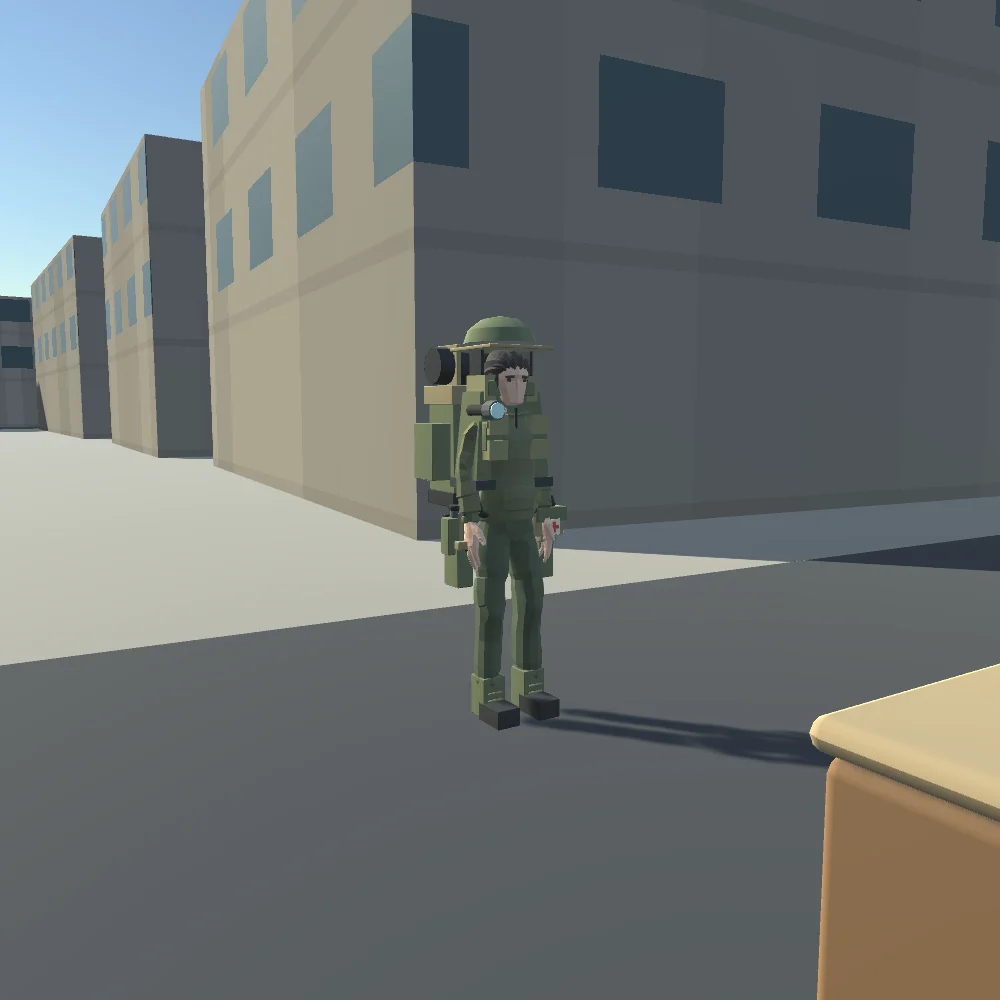

## 작업 결과

기본 localhost8788에서 실행 가능합니다.12개 작업의 현재 수정 버전 최종 QA가 모두 통과했습니다.

## 변경 내용

### 적용 내용

Space로 점프/착지·근처 방벽 넘기·발판 오르기, Ctrl/C로 숙인 대기/이동, V로 소총 장전, 좌클릭/F로 무기·근접 공격,1/2/3/7로 물품을 사용합니다. K는 장비 교체, L은 장착한 손전등입니다. 현재 등반 범위는 검증한0.8m 방벽과1.4m 발판입니다.

모두 실제 게임 캡처이며 Blender 편집 원본과 실패/재검증 근거를 보존했습니다.

[전체 변경·게임 규칙·화면이 있는 상세 보고서](https://mdj0126.github.io/codex-config/projects/last37n/reports/2026-10-30-result-20261030185416169-v1.0.0.html) · [12개 작업 완료 메뉴얼](https://mdj0126.github.io/codex-config/projects/last37n/reports/2026-10-30-manual-rescue-survival-neighborhood-20261030190326023-v1.0.15.html)

## 검증

현재 서버82개, Web 행동14개/구조·채팅20개/장비9개/기존전투14개/수색·거래·치료3개, Native 전투4종/생존5종·장비/10클립·실제 구조물2장면을 검증했습니다. 현재100접속92초·9900명령·이동80·재접속10·900응답/p95 66.98ms/오류0입니다. 초기 전송11,020,608bytes로12MiB 예산을 통과했습니다.100명 Unity 동시 렌더링 성능 검증은 아닙니다.

기본8788의 최신 파일 해시와 실제 새 월드 구조3/장비12/구조물2·한글 이름/채팅·점프/숙이기·DPR2의1440x900·엔진 오류0을 확인했습니다. 상세 공개 HTML 본문과 게임 이미지10개·메인 링크, 공개 데스크톱/모바일 레이아웃, 완료 메뉴얼 원본 JSON의12개 현재 버전/최종 QA를 대조했습니다.

보고서 저장소429문서/14926링크·원본/이전 문서 보존 검사와37개 테스트를 실행했습니다. Windows CRLF 체크아웃의 템플릿 정규식 실패1개는 원본을 바꾸지 않고 독립 LF 사본에서37개 전부 재검증했습니다. GitHub Actions 배포도 성공으로 확인했습니다.

교훈 검토: 버전·소스·실행 증거, 독립 QA와 실패 보존은 기존 전역 규칙에 포함되어 전역 지침 추가/변경 없음입니다. Generic FBX 부모 경로와 프로젝트 QA 조건은 docs/EQUIPMENT_ACTIONS.md에 기록했습니다. 사용자 화면/마우스/키보드를 제어하지 않았습니다.

## 남은 사항

모든 건물 자유 등반·추락 피해·낮은 통로/은신 판정·수통 충전/정수·내구도는 후속 기능입니다. 모든 장비 조합의 관통·손 접촉 IK, 모바일/저사양/100명 동시 Unity 렌더링과 인터넷 전송량 최적화는 별도 검증이 필요합니다.

## 작업 시간

- 제안 시간: 최초60~100분 + 사용자 추가 장비35~60분 + 이동/무기 애니메이션40~70분. 추가 범위 포함 전체 약150~230분.
- 실제로 완료된 시간: 시작2026-10-31 01:35:00 KST. 구현·적용·필수QA·외부 상세 보고/완료 메뉴얼 검증 완료 2026-10-31 04:10:50 KST(Asia/Seoul), 실제 155분 50초. 이 완료 확인서의 게시/전달 시각은 최종 전달 기록에 구분합니다.
- XERJ: 미사용 — XERJ 도구 미제공, rg·현재 소스와 실제 서버/DB/Unity/헤드리스 Edge 실행으로 대체했습니다.
