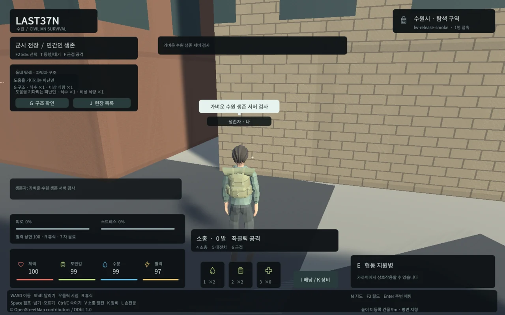
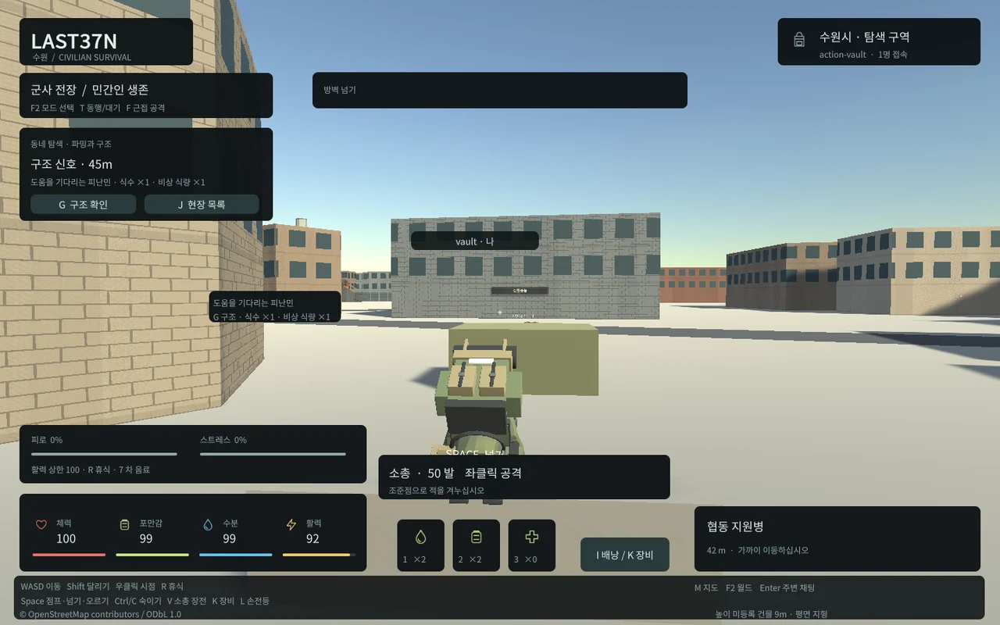

## 작업 결과

전체8개 순차 작업 중 기준 측정·하드 용량 게이트·파일/엔진/모션/캐시 경량화3개를 검증했습니다. 현재는 네트워크 반복 전송 개선 단계입니다. 기본 게임에는 같은 기능의 깨끗한5파일만 적용했고, 새 경량 후보는 아직 최종 적용하지 않았습니다.

## 변경 내용

### 적용 내용

불변 출발 기준은 초기4파일11095729bytes/전체5파일11097504bytes입니다. 과거 파일 누적114817961bytes는 활성 게임 용량과 구분하고 비공개 백업에 보존했습니다. 현재 기본 게임은5파일11097472bytes이며 초기 파일 바이트는 동일합니다. 상한은 최초 기준과 마지막 승인 릴리스 중 더 낮은 값으로 검사합니다. 실제 로더의 공백1바이트 증가도 차단했습니다.

동일 압축해제 해시의 Brotli 재압축만으로8503386bytes, 이어 명시적인 게임 부트스트랩·엔진 축소·기본 스플래시/미참조 마스크 정리·엄격한 키프레임 축소로 현재 초기6775800bytes/전체6777674bytes 후보를 만들었습니다. 최초 초기 대비 약38.9% 감소이며 게임 기능을 없애거나 대형 필수 다운로드로 옮기지 않았습니다. 전체 한글 글꼴과 원본FBX를 유지했습니다.

콘텐츠 해시16자리 파일명은 실제 파일 내용과 일치해야 하며 immutable 캐시를 사용합니다. HTML은 최신 진입점을 가져옵니다. 같은 브라우저 컨텍스트의 실제 콜드/웜 측정에서 게임4파일 전송6776884→0bytes를 확인했습니다. HTML·지도·WS 전송과 별도이며 인터넷 지연이나 브라우저 재시작 후의 캐시를 보증하지 않습니다.

## 검증

시작 상태에서 현재89개/실제PostGIS·TypeScript와100명90초/10재접속/9900명령/오류0을 통과했습니다. 압축 전 네트워크 합계3987492590bytes는 다음 최적화의 실제 기준입니다. 현재21개 패키지/HTTP 검사, 실제 패키지/기본게임/엔진/자산13검사, Native23행동검사, Web14행동/원격동기화, 현재 군사/좀비9/12NPC·오류0을 확인했습니다.14클립61시점73444본자세의 최대 위치 차이0.001101m/측정회전0도·원본FBX보존·반복생성 파일동일을 통과했습니다. 최초Optimal압축2회는 약1.48cm/2.61도 오차로 실패해 미적용했고 이력을 보존했습니다.

실제 후보의 짧은 로컬 Edge 표본은 약59~60FPS, Unity할당43~45MB였습니다. 시작 위치/청크가 달라 이전 표본 대비 FPS/메모리 개선율로 제시하지 않습니다.100개 렌더·저사양/모바일은 아직 미검증입니다. 근거 docs/qa/lightweight, source commit 4f4c34ab77806273b9c39cc8578f8bda4bebc3c9.

Unity6.0 API: https://docs.unity3d.com/6000.0/Documentation/ScriptReference/WebGLCompressionFormat.Brotli.html . Unity Personal의 스플래시 선택 기능은6.0 릴리스 원문으로 확인했습니다: https://unity.com/releases/editor/whats-new/6000.0.0f1 . 원본과 실제 빌드 결과를 함께 대조했습니다.

## 남은 사항

네트워크 반복 전송 감소, 기존 에셋 기반 생존/피난/전쟁/좀비 루프 보강, 실제 군중 렌더/메모리 검증, 현재 전체 회귀 및 최종 로컬 적용과 전달이 남았습니다.6시간 목표는 계속 진행합니다. 외부 인터넷·저사양/모바일 성능은 미확인입니다. 교훈 검토: 프로젝트에 상한/가역 적용 지침을 등록했습니다. PowerShell 외부 도구의 리터럴 경로 와일드카드 오류는 전체 전역 지침과 대조 후 재사용 규칙 필요 여부를 검토할 후보로 기록했으며 아직 전역 변경은 하지 않았습니다.

## 작업 시간

- 제안 시간: 6시간 예산. 시작2026-10-31 05:16:01 KST, 종료 예산11:16:01 KST.
- 실제로 완료된 시간: 중간 기록 63분45초 경과, 2026-10-31 06:19:45 KST. 전체 작업은 진행 중이며 완료 시각이 아닙니다.
- XERJ: 미사용 — XERJ 도구 미제공 확인 후 rg·현재 소스/실제 실행·해시로 대체했습니다.
