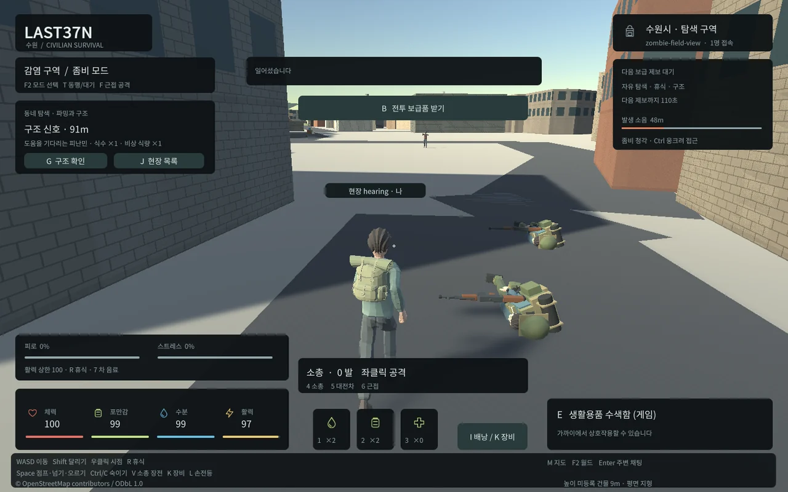
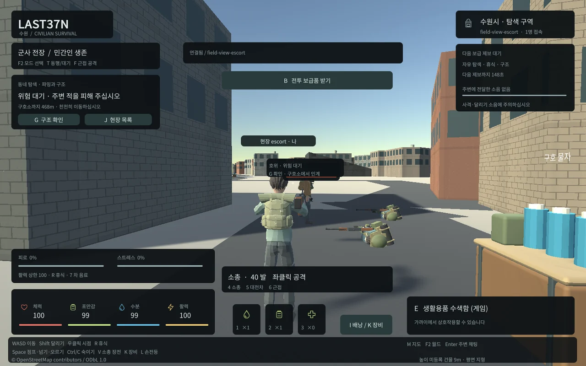
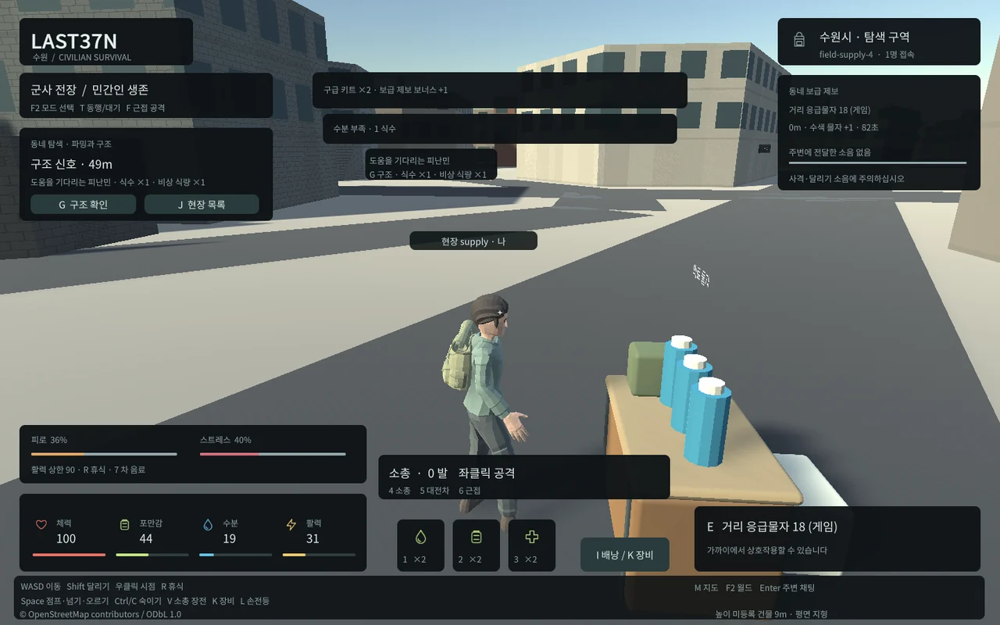

## 작업 결과

전체8개 순차 작업 중5개를 검증했습니다. 현재 동일 조건 군중 렌더링·메모리 측정 단계이며 기본 게임의 최종 적용은 아직 남았습니다.

## 변경 내용

### 적용 내용

100개 WebSocket·80명 이동·10명 재접속·9900명령의 약92초 시험에서 전체 상태 환산3933910684→실제 상태739112372bytes로81.2% 줄었습니다.10Hz 갱신과 정확한 좌표·서버 판정은 유지하고, 연결별 변경 루트와 플레이어 속성을 전송합니다. 순서 누락 시 전체 복구,10초 주기 전체 상태, 기존 클라이언트 호환을 구현했습니다.

좀비는 웅크린 이동보다 달리기·수색·사격 소음에 더 멀리 반응합니다. 월드당32개/5초 신호이며 새 음원을 추가하지 않았습니다.

피난민/조난민은 보이는 적18m 안에서 기다리고 적을 제거하거나 피하면 호위를 재개합니다. 중립 구호소와 벽의 보호를 유지합니다.

6분 주기 중2분 동안 기존 동네 장소의 성공 수색에 같은 물자1개를 더하는 선택형 제보를 넣었습니다. 생존 수치 경고와 기존 회복 행동을 연결했습니다. 모든 밸런스는 provisional 설정입니다. 새 대형 자산/필수 후속 다운로드가 없습니다. 현재 배포 후보는 초기6782209/실제5파일 패키지6784083bytes이며 출발11095729/11097504와 마지막 적용11097472bytes 상한 이하입니다. 앞선 메뉴얼의6784067bytes는 해시 파일명 포장 전 후보였고, 실제 포장 후 패키지는6784083bytes입니다.

## 검증

서버122개 검사/TypeScript, 실제 PostGIS 보너스 지급 실패 롤백·동시 중복·재시작, Unity12개 루트 캐시 보존, Web14개 현장/14개 기존 행동/13개 기본 검사를 통과했습니다. 실제 Web에서1개 패킷 누락→전체 복구와 재접속 소지품/신원·군사/좀비 월드 전환6검사도 통과했습니다.100WS 부하 오류/미처리0,p95 68.22ms이며100개의 Unity 렌더링 시험과 구분합니다.

빠른 HUD 클릭 후 중앙으로 포인터 이동 시 탄약이 줄어드는 재현을 보존했습니다.350ms 뒤 이동하면 기존 후보에서도 발생하지 않았습니다. 누른 시작 위치를 별도로 보존하는 수정 후 같은 빠른 재현과 정상 무기 행동을 재검증했습니다. 엔진 내부 이벤트 순서의 상세 원인은 미확인입니다. fixture의 잘못된 전체 객체 복사는 실제 DB에서 발견해 좌표만 복사하도록 수정했습니다. 근거 docs/qa/lightweight/field*, network*, load-entities와 source commit 5461cba469c5d90a7464c2a4e15659ffd3996514.

## 남은 사항

동일 고정 장면의99원격접속+1실제Unity관찰자 비용 비교, 장시간 이동/월드 전환, 최종 전체 회귀·실제 기본 게임 적용·최종 보고가 남았습니다. 저사양/모바일·인터넷 환경은 미검증입니다. 교훈은 프로젝트 FIELD_RULES에 검증된 fixture 좌표 복사 주의사항을 남겼으며 새 전역 규칙은 아직 추가하지 않았습니다.

## 작업 시간

- 제안 시간: 6시간 예산. 시작2026-10-31 05:16:01 KST·종료 예산11:16:01 KST.
- 실제로 완료된 시간: 중간 기록 120분41초 경과, 2026-10-31 07:16:42 KST. 전체 완료 시각이 아닙니다.
- XERJ: 미사용 — XERJ 도구 미제공 확인 후 rg·현재 소스/실제 실행/해시로 대체했습니다.
