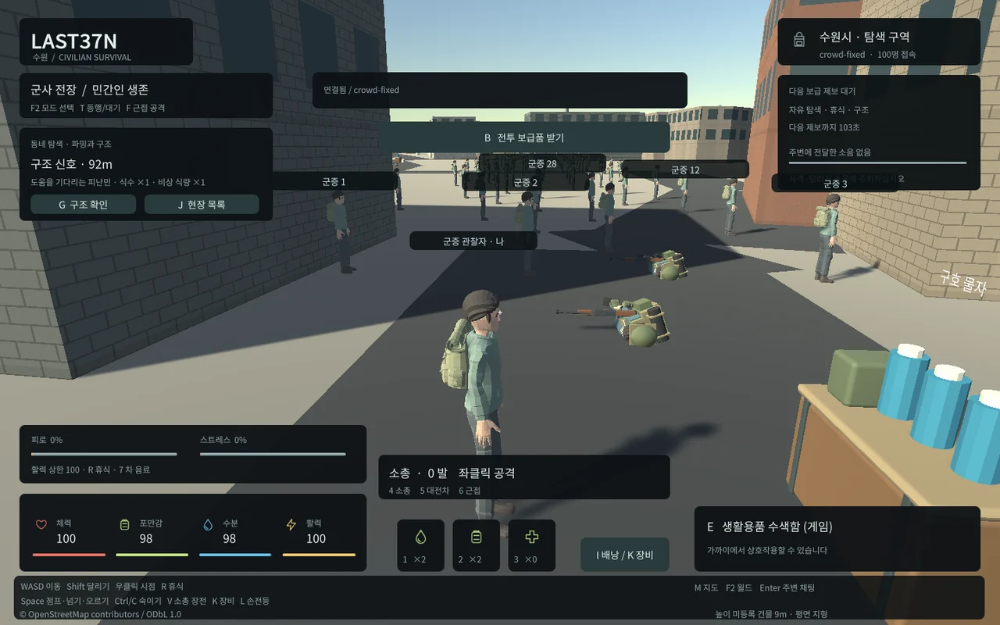

## 작업 결과

전체8단계 중5단계 검증 완료 상태에서6단계 런타임/장시간 회귀를 진행하고 있습니다. 기본 게임에는 아직 최종 후보를 적용하지 않았습니다.

## 변경 내용

### 적용 내용

같은100개 신원/좌표, 같은 카메라/1440x900,9개 비활성 군사 유닛·3개 대기 구조대상과 시간 조건을 고정한 뒤 원본/개선 후보를 연속 측정했습니다. 실제 Unity 웹 관찰자1개와99개 WebSocket 피어이며100개 Unity 클라이언트 실행과 구분합니다.

| 측정 | 원본 후보 | 개선 후보 |
|---|---:|---:|
|3회10초 평균 브라우저 rAF FPS|19.35|52.99|
|프레임당 WebGL 호출|7236|약1776|
|Unity3초 렌더 표본 FPS|19.26|53.07|
|Unity 추적 할당|114.7MB|81.6MB|

기존 캐릭터/뼈대/근거리 장비와14개 애니메이션을 유지했습니다. 단색 재질을 런타임 팔레트로 묶고 먼 캐릭터에는 같은 원본에서 Blender로 파생한 메시를 사용합니다. 근거리 원본 복귀와 히스테리시스가 있으며 화면 밖 애니메이션·먼 그림자·보조광·중복 처리 비용을 줄였습니다. 이름표와 말풍선은 가까운 사람/대화를 우선해 개수를 제한하며 원격 플레이어 자체와 채팅 기록은 유지합니다.

현대 브라우저용 WebAssembly2023 기능을 확인하고 적용했습니다. 실제 Edge156/ANGLE D3D11/GTX970에서 검증한 표본이며 모바일·밀집 전투 성능 보장은 아닙니다. Unity 공식 기능/호환 안내: https://docs.unity3d.com/6000.0/Documentation/ScriptReference/PlayerSettings.WebGL-wasm2023.html .

현재 수정 후보는 초기6746062/실제 패키지6747936bytes로 출발 기준과 마지막 적용 상한 이하입니다. 캐릭터 원본FBX는 보존했으며 새로운 대형 필수 다운로드를 추가하지 않았습니다.

## 검증

고정 비교의 실제 좌표/신원 일치와 각3개10초 표본, 실제GPU 문자열, Unity 할당량을 JSON으로 보존했습니다. 이전 표본은 구조 이벤트 만료 시간이 달라질 수 있어 탐색 기록으로 유지하고 최종 비교는 고정 조건에서 다시 실행했습니다.14클립1852704정점의 팔레트 변형 오차0, 재질구간14→5, 거리LOD의252개 실루엣 비교 최저0.981441/평균0.990232·근거리복귀·메시캐시10개 상한을 통과했습니다. 최초 실루엣 검사는 원본 전체를 담지 못한 투영 오류를 발견해 동일 전체 bounds로 교정했고 실패 기록과0.9 판정 기준은 유지했습니다.

첫 실제10분 반복 전환은99회 월드 전환/100개 표본에서 재질843→1293개로 증가해 실패했습니다. 메시1295개는 유지됐습니다. 해당 청크의 수역 영역5개마다 새 재질을 만들던 소스와 실행량을 확인했고 색별 공유/소유 재질 정리를 구현했습니다. 실제 Unity1002호출에서 서로 다른 두 색의 재질2개만 생성되는 검사를 통과했습니다. 수정 후보의 동일10분 재시험은 현재 진행 중이며 아직 통과로 보고하지 않습니다.

빌드 전후 코드·원본 자산 핑거프린트를 대조하는 입력 변경 차단도 실제 후보에서 통과했습니다. 편집기 자동 메타/씬 저장은 별도 범위입니다. 근거 docs/qa/lightweight/crowd-control-*, character-palette.json, character-lod-verification.json, runtime-soak/result.json, geographic-materials.json, runtime-build-inputs.json.

## 남은 사항

반복 전환 재질 누적 수정의 전체10분 재검증, 현재 후보의 모든 행동/장비/채팅 회귀, 실제 기본 게임 적용과 최종 보고가 남았습니다. 제안6시간 범위 안에서 계속 진행합니다. 교훈: 재질 소유/공유와 실루엣 프레이밍은 검증된 프로젝트별 근거로 남기며 일반 규칙은 기존 전역 지침과 중복 여부를 검토 중입니다.

## 작업 시간

- 제안 시간: 6시간 예산. 시작2026-10-31 05:16:01 KST·종료 예산11:16:01 KST.
- 실제로 완료된 시간: 중간 기록 203분24초 경과, 2026-10-31 08:39:24 KST. 전체 완료 시각이 아닙니다.
- XERJ: 미사용 — XERJ 도구 미제공 확인 후 rg·현재 소스/실제 실행/해시로 대체했습니다.
