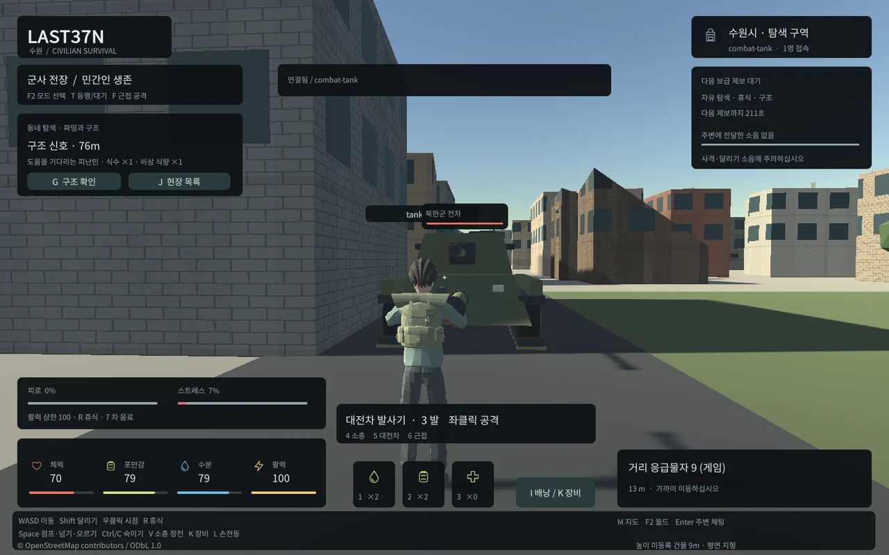

## 작업 결과

누른 시작 위치와 현재 HUD 위치를 함께 검사하도록 수정했고 동일 빠른 입력과 정상 무기 행동을 재검증했습니다.

## 변경 내용

### 재현 조건

Unity6000.0.83f1 WebGL·Edge156·Windows·Node24·PostgreSQL17/PostGIS

### 재현 순서

독립 field escort fixture에서 탄약 수를 기록합니다. 실제 웹 canvas의 하단(720,865)을 클릭한 직후 중앙(720,440)으로 포인터를 이동합니다. 지연 없는 경우와350ms 지연 후 이동을 대조합니다.

### 기대 동작

하단 HUD를 눌렀던 동작은 중앙 게임 영역으로 포인터가 옮겨져도 무기 발사로 처리하지 않습니다.

### 실제 동작

최초 지연 없는 조건은 footer-click-does-not-fire 검사에서 실패하고 탄약이 감소했습니다.350ms 지연 대조는 통과했습니다. 내부 Unity/브라우저 이벤트 처리 순서 전체는 미확인입니다.

### 원인

기존 발사 제한은 현재 포인터 좌표만 보아 누른 시작 위치를 구분하지 못했습니다. 실제 빠른 입력/지연 대조와 해당 조건 소스로 확인한 범위이며 엔진 내부 원인은 단정하지 않습니다.

### 적용 내용

Last37NPointer.jslib가 왼쪽 pointerdown의 canvas 상대 시작 좌표를 보존합니다. FieldPresentation.PointerOverHud는 시작/현재 HUD 지점을 함께 검사하고 CombatPresentation의 기존 발사 조건에서 사용합니다. 우클릭 시점 회전은 왼쪽 시작 좌표를 덮지 않습니다.

## 검증

최초실패 attempts/field-footer-click-01.json과지연대조field-footer-delay-02.json을보존했습니다.수정후 field-browser/result.json·final-field-browser/result.json의동일빠른조건과정상전투14·무기/행동14검사를통과했습니다.재접속과실제8788실행도통과했습니다.현재좌표만검사하던코드와브라우저시작위치보존을소스에서대조했습니다.

## 남은 사항

새로운 포인터/브라우저 입력 방식과 모바일 터치는 별도 검증 범위입니다.

## 작업 시간

- 제안 시간: 사용자가 지정한6시간 작업 예산에 포함. 시작2026-10-31 05:16:01 KST·예산종료11:16:01 KST.
- 실제로 완료된 시간: 해당 수정의 검증 기록 시각 2026-10-31 09:10:41 KST,전체6시간 작업 시작 후234분41초. 전체 목표는 계속 진행 중입니다.
- XERJ: 미사용 — XERJ 도구 미제공 확인 후 rg·현재 소스·실제 실패/대조/재실행으로 검증했습니다.
