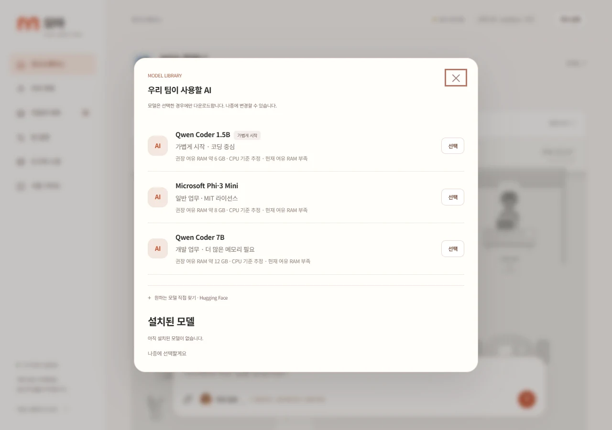
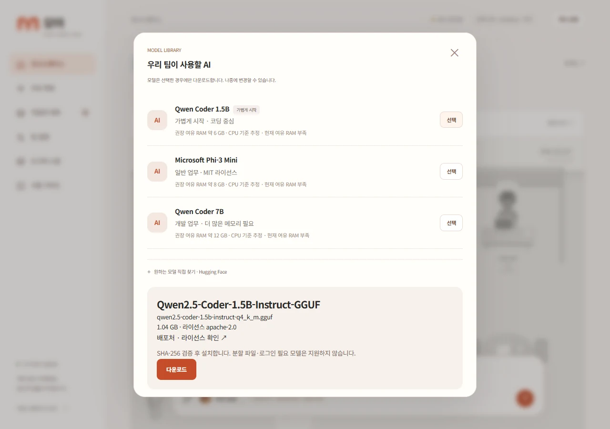

## 작업 결과

구현·새 설치 화면 실행·필수 회귀 테스트·Windows 설치 파일 빌드를 완료했습니다. 기존 설치 모델은 보존하고 신규 설치에는 모델을 포함하지 않습니다.

최초 설문 후 표시되는 실제 프로그램 화면입니다. 설치된 모델이 없는 상태에서 추천 목록이 열립니다.

## 변경 내용

### 적용 내용

변경 전: 첫 준비 과정이 특정 Qwen 7B 모델을 자동 다운로드하고, 모델 파일이 없으면 supervisor 실행이 중단됐습니다.

변경 후: 모델 없이 화면이 열리며 최초 설문 후 모델 팝업이 표시됩니다. Qwen Coder 1.5B·Microsoft Phi-3 Mini·Qwen Coder 7B 또는 공개 Hugging Face 저장소의 단일 GGUF 파일을 선택할 수 있습니다. 다운로드 전에 실제 크기·라이선스를 표시하고 진행률·취소·재개, SHA-256·GGUF 헤더 검사, 설치 목록과 사용 모델 전환을 지원합니다. 진행 중·대기 중 업무가 있으면 모델 변경을 막습니다. 모델 서버 준비·시작 실패 상태도 구분합니다.

설문과 모델 팝업 겹침 및 모델 전송 회귀 테스트에서 발견한 단일 담당자 구성의 planner 키 오류를 수정했습니다. 설치 안내와 진단·문서도 변경했습니다.

프로젝트 로고 출처: MOA 저장소 docs/assets/moa-logo.png.

## 검증

실제 빈 설치용 supervisor와 프로그램 API를 실행했습니다. 모델 파일과 설치 목록이 없는 상태에서 모델 프로세스를 시작하지 않고 앱이 열리는 것을 확인했습니다. 실제 Edge 헤드리스에서 최초 표시·공식 메타데이터 조회·닫기·재열기·잘못된 직접 지정 입력을 검사했고 페이지 오류가 없었습니다.

공식 모델 메타데이터에서 파일 크기·SHA-256·고정 revision을 확인했습니다. 모델 관련 50개 테스트와 모델 라이브러리·리더 접수 54개 테스트가 통과했습니다(서로 중복되는 테스트를 포함합니다). 실제 로컬 HTTP 전송으로 취소·이어받기·진행률·체크섬 실패를 검증했습니다. 새 배포 manifest 565개 파일에 models/ 경로와 .gguf가 없음을 확인했고 NSIS 설치 파일 빌드가 성공했습니다. 캡처는 1280×900 PNG 154,384/160,184 bytes에서 WebP 26,210/39,238 bytes로 압축해 확인했습니다.

## 남은 사항

추천 모델 전체를 새로 다운로드해 실제 추론 품질·업무 성공률을 비교하지는 않았습니다. 직접 지정 모델의 구조별 llama.cpp 호환성은 별도 확인이 필요합니다. 분할 GGUF와 인증이 필요한 모델은 현재 지원하지 않습니다. RAM 권장값은 추정값입니다. 설치 파일 실행을 통한 별도 Windows 계정 설치 시험은 미실행이며 기존 사용자 모델은 삭제하지 않았습니다.

## 작업 시간

- 제안 시간: 15~25분
- 실제로 완료된 시간: 구현·필수 검증 완료: 11분 7초 · 2026-10-30 15:50:09 KST. 보고서 등록·게시 시간은 별도입니다.
- XERJ: 미사용 — 제공된 XERJ 도구가 없어 rg와 현재 소스·실행 결과로 확인했습니다.
