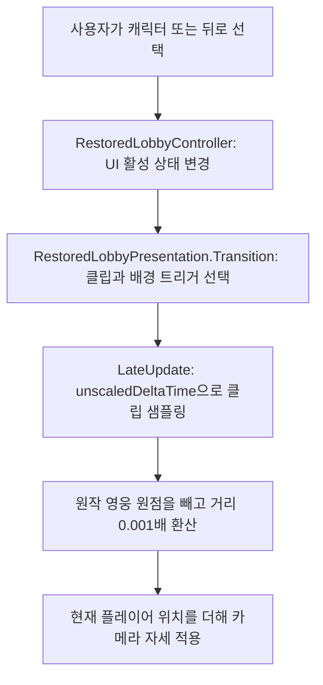
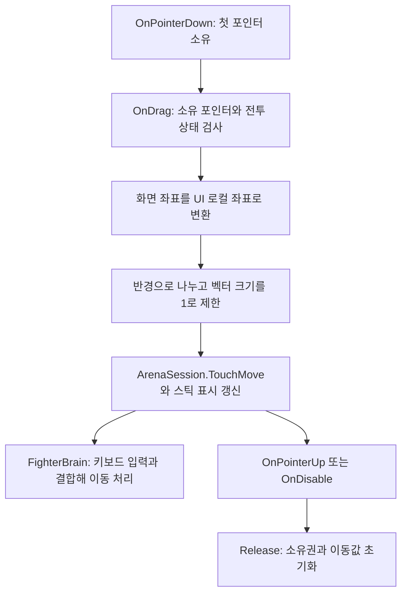
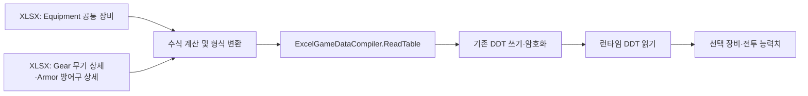

# 흐름과 책임

## 로비 화면과 카메라

`LobbyToEquipment`와 `EquipmentToLobby`는 원작 곡선에서 만든 별도 legacy 클립입니다. 원작 영웅 기준점은 `(-1051, 60, 3984)`입니다. 로비 전용 연출이 활성화되면 기존 `ArenaCamera`가 로비 카메라 자세를 덮어쓰지 않도록 역할을 나눕니다. 전투 카메라 동작은 별도로 유지합니다.

클립의 재생 시간은 장비 진입 약 1.233초, 홈 복귀 1초입니다. UI 활성 상태는 현재 즉시 바뀝니다. 원작과 같은 UI 페이드·전환 중 재입력 처리의 일치 여부는 미확인입니다.

## 포인터 이동

다른 포인터의 해제는 현재 이동을 취소하지 않습니다. Inspector에서 `knob`, `arrow`, 양수인 `radius`가 연결되어야 합니다. 반경 0과 필수 참조 누락을 처리하는 방어 코드는 현재 없으므로 임의 구성에서는 사용하지 않습니다.

## Excel과 DDT

`Equipment`는 무기와 방어구를 함께 담는 119행의 공통 마스터입니다. `Gear` 38행과 `Armor` 81행은 상세 데이터이며 ID로 대응합니다. `Weapons`와 `ArmorCatalog`는 프로젝트 편의용 뷰이며 원작 테이블 이름과 구분합니다. XLSX를 편집 원본으로 유지하고 CSV를 작성 원본으로 사용하지 않습니다.
