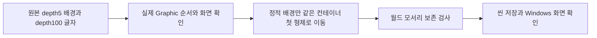
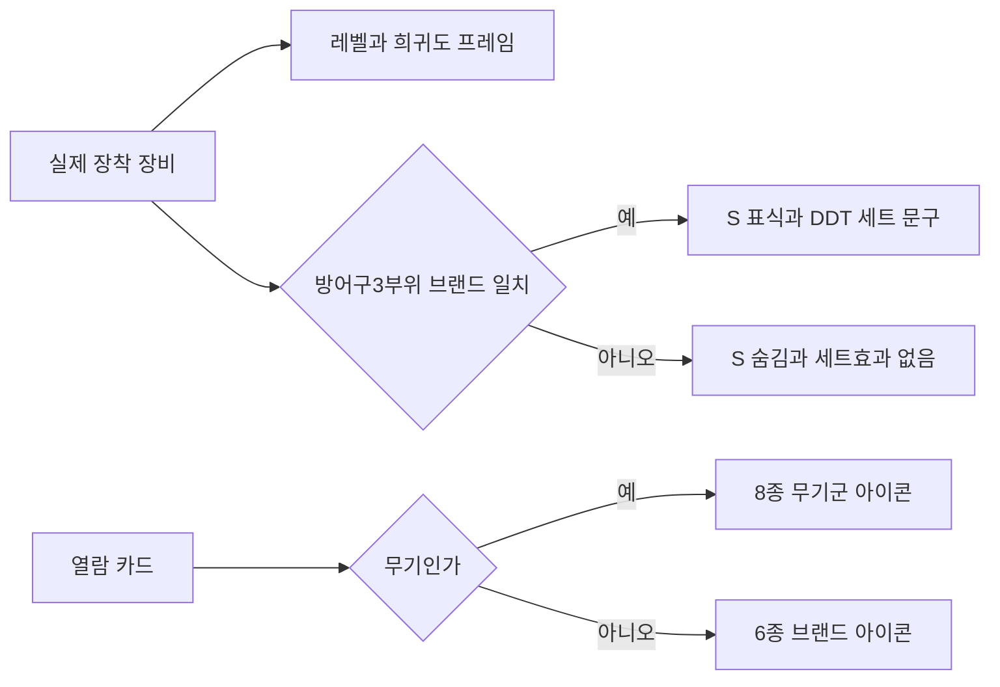

# 장비 표시와 추가 UI depth 수정

2026-11-13 22:11:09 KST 시작. 구현·실행 예상30~60분. 구현22:32:55, DDT 확인22:36:21, Windows Build27 빌드22:38:04 KST 완료. 전체 복원은 진행 중입니다.

현재 남녀 아바타·리깅 참조 네 파일은 변경 전후 SHA256이 같습니다. 별도 리깅 변경의 정확한 차이와 모든 애니메이션의 적합성은 미확인입니다. 원작 추출 파일은 수정하지 않았습니다.

## 세트 제목을 가린 배경

원본 ID35057 제목은 NGUI depth100, 그 자식 ID38064 검정 그라데이션은 depth5입니다. uGUI에서는 실제 Graphic.depth가 각각273·274여서 배경이 글자를 덮었습니다. 현재 플레이용 씬의 정적 배경만 SetOption38500의 첫 형제로 옮겼습니다. 전후 월드 모서리 최대 차이는9.536743E-07이며 별도 Canvas·복제 이미지·매 프레임 동기화는 없습니다. 수정 후 실제 depth55 배경→57 제목, Windows 화면에서도 읽힙니다. 겹침 후보 수는 Rect 교차이지 모든 픽셀의 불투명도를 증명하는 값은 아닙니다.

다른 가지의 UI까지 일반 재부모화하는 도구가 아닙니다. 기존 재생성 흐름의 RestoredLobbyBinder에도 연결했습니다. 메뉴 OVERDOX/Restore/Bind native equipment display는 저장된 씬·재생 종료 상태에서 실행합니다. Inspect native equipment draw order는 장비 창을 연 Play 상태에서 사용합니다.

## 실제 장착 값과 원본 의미

이전 문서의 ‘녹색S등급’은 잘못된 해석이었습니다. 원본 EquippedItemSlot.UpdateUI(RVA0x1831BB8)에서 S는 SetMark이며 같은 브랜드 방어구3부위일 때만 켭니다. 서로 다른 모델도 브랜드가 같으면 켜고 무기에는 켜지 않습니다. 희귀도는 원본 STRONG Color32와 전설 전용 프레임으로 구분합니다.

RestoredEquipmentPresentation은 실제 장착 장비의 시작 레벨+훈련 오프셋, 프레임, 세트 표식을 갱신합니다. 포커스 카드만 바꾸면 장착 값은 바뀌지 않습니다. 브랜드 이름·세트 조건·설명은 저장 XLSX에서 컴파일된 ArmorBrand·EquipmentSetAbility·LocalizedText DDT를 기존 리더로 읽습니다. 비율9·35·59는 원작 배율100으로 표시하며 크레딧34는 그대로입니다. 세트가 없으면 원작 한국어 ‘세트효과 없음’을 표시하고 설명을 끕니다.

무기 제목의 잘못된 DCompany 로고를 원작8종 무기군 아이콘으로 교체했습니다. EquipmentCard.UpdateTitle와 GetTitleIconSpriteName의 ELF 재배치 포인터에서 Sword·Hammer·DualSword·GiantSword·GiantHammer·Halberd·QuarterStaff·LongSword를 확인했습니다. 표시 문자열 캐시는 원본4302행 중 필요한 한국어14키만 보관합니다. 초기 읽기는 기존 전체 DDT 리더이며 메모리·FPS 개선량을 측정한 결과는 아닙니다.

## 실행 근거와 제한

- 실제 저장 DDT Equipment119행(무기38·방어구81)의 rarity·startLevel·category 매핑과 카드풀10개의 무기군8·브랜드6 참조 경로를 대조해 오류0건입니다. 첫 진단은 Sprite.name의 LobbyUI_ 접두어를 놓쳐20건 실패했으며, 실제 AssetDatabase 경로로 검사기를 수정했습니다. 실패 기록을 보존했습니다.
- Build27 실제 Windows: 기본 Four Stars 방어구 S×3·공격력50, 같은 브랜드 다른 머리 모델 교체 후 S 유지·HP350, 다른 브랜드 Blackdog 머리 장착 후 S 숨김·세트효과 없음·Lv6·HP400·공격력48을 확인했습니다. 남녀 전환을 확인했고 기본 머리를 복구하면 S×3·공격력50으로 돌아왔습니다. 여성 전설 Hydra 장착 후 무기 Lv11·전설 프레임·공격력214, 무기 S 숨김을 확인했습니다.
- 왼쪽 이전 버튼 좌표 클릭은 포커스 변화가 기록되지 않았습니다. 히트 영역과 입력 차단 여부는 미확인입니다. 빈 영역 휠 이전 선택은 실제 동작했습니다. OS 드래그 성공으로 해석하지 않습니다.
- 이번 빌드에서 수동 전투 재진입·119장비 실제 전투·모든 브랜드 화면·10시간 완료는 미확인입니다. 후속 고정 사본은23:04:31.414 KST부터 기존 Arena 직접 진입 옵션으로 실제1라운드·카메라 캡처·텔레메트리를 확인하고10시간 진행 중입니다. 이전 Build11의10시간을 새 빌드 증거로 쓰지 않습니다. 기존 원작 FX 누락 스크립트 경고1건이 남습니다.
- 런타임 조사 예외 패턴0건은 조사한 패턴 범위입니다. 전체 UI 동일성, NEW99·업그레이드·TP 등 템플릿 값과 추가 depth는 계속 점검합니다.

Build27 고정 사본150파일 해시와 수동 흐름은 Docs/Verification/EquipmentDisplay에 있습니다. 런타임 DLL SHA256은3C3E7C5FB6563DBAFF953797BBC9510F6CD04CD53BB5488C41D063BE216490C5입니다. 샘플 c7b40e5의 네이밍·함수·주석 문서를 참고해 한국어 XML·중괄호·Runtime/Editor 책임을 유지했습니다. 고유 원작 ID·NGUI 자료·DDT 조건에 의존하는 구현이라 샘플 환류는 보류합니다. 전역 지침 변경 없이 프로젝트 전용 depth·SetMark 교훈을 통합합니다.

장시간 준비 중 샌드박스 내부 프로세스 조회가 일반 권한 실행을 누락했습니다. 중복3개는 일반 권한에서 정확한 경로·PID를 확인하고 종료했습니다. 초기 낮은 무결성 실행은 실제 종료됐습니다. 로비 자동 진입은 ArenaSession.Start 시점의 GameFlowController._loading=true로 EnterArena가 거부되는 기존 문제입니다. 새 코드를 넣지 않고 기존 -gear-combat-review 직접 Arena 옵션으로 실행했으며, 로비 자동 진입 자체를 해결한 것으로 표시하지 않습니다. 작업용 Affinity 전후2문서는 저장·닫기·재열기와 dirty=false를 확인하고 닫았으며 기존6문서는 보존했습니다.
