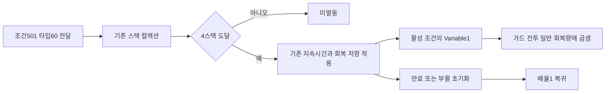
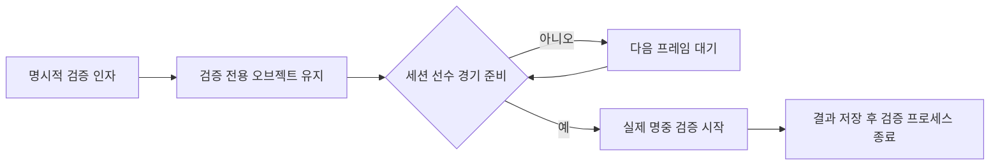

# 탈진 회복 배율과 검증기 생명주기

2026-11-13 23:48:02 KST에 시작한 후속 회차입니다. 첫 구현·실행 확인 예상은45~75분이며 전체 복원 완료 예상이 아닙니다.

## 구현과 근거

ConditionEffect501은 타입60·4스택·10초·Variable1=0.2입니다. 기존 Fighter.ApplyCondition이 타입60을 지원하지 않아 히드라의 HitReference1024가 조건을 전달해도 버렸습니다. 상태 컬렉션에 탈진을 등록하고 스태미나 회복 계산에 활성 조건의 배율을 곱했습니다. 만료·재발동·부활 초기화는 기존 상태 컬렉션을 재사용합니다. 별도 타이머나 매 프레임 할당을 추가하지 않습니다.

원본 계산 근거는 main81 표와 APK87(2.2.3) arm64 클라이언트입니다. APK2.2.1 바이너리의 해시가 다르므로 동일 버전·서버 계산까지 입증한 것이 아닙니다. 일반 ELF/Capstone 분석이며 REA 출력으로 표시하지 않습니다. XERJ는 연결하지 않았습니다.

- BuffStat.Init RVA0x169099C:0x2DB02C0의 벡터(0,1,1,0)를0x20에 저장하므로 StaminaIncrease+0x28은1입니다.
- AddToBuffStat RVA0x16909E8:조건60의 점프 테이블 목적지는0x1690AC0입니다.0x1690AC8~0x1690AD4에서 StaminaIncrease에 Variable1을 곱합니다.
- HeroInfo.UpdateStat RVA0xCEBDA8:0xCEBFCC~0xCEBFE4에서 같은 배율을 가드·전투·일반 회복량에 곱합니다.
- 따라서0.2는 남는 회복량입니다. 감소율20%로 해석해0.8을 적용하지 않습니다. UI의 퍼센트 치환식·해당 FX와 실제 히드라 명중에서의 발동은 별도 검증이 남습니다.

## 실제 Windows 전후 측정

Build29는 새 검증기만 포함하고 제품 런타임은 Build28과 동일한 SHA256입니다. Build30은 제품 수정 후의 별도 고정 사본입니다. 기본 스플래시→로비→전투 흐름을 거친 뒤 다른 봇·구역·승패를 검증용으로 정지하고 실제 Fighter.Update에서0.6초간 측정했습니다. 스태미나·전투 시각만 검증 초기 조건으로 설정했습니다. 모의 Update나 조건 배율 함수만 호출한 단위 테스트가 아닙니다.

|자세|건강할 때 초당 회복|Build29 탈진 적용 시|Build30 탈진 적용 시|
|---|---:|---:|---:|
|가드|30|30|6|
|전투|35|35|7|
|일반|60|60|12|

Build29는 미발동·배율1로 실패했고 Build30은3스택 미발동·4스택 발동·세 자세 비율0.2·실제10초 만료·부활 초기화를 통과했습니다. 종료는2026-11-14 00:06:12.671 KST입니다. 직접 DDT 조건 적용 검증이므로 히드라의 실제 투척 명중·FX·서버 일치 통과로 확대하지 않습니다.

실행: `Overdox.exe -batchmode -exhaustion-review -evidence <전용 폴더> -logFile <전용 로그>`. `-soak`와 섞지 않습니다. 검사 결과는 exhaustion-review.json과 EXHAUSTION_RATE 로그에 기록합니다.

## 시작 예외와 장시간 실행 정정

이전 전체 무기 검증기는 AfterSceneLoad에서 바로 ArenaSession을 요구했습니다. 스플래시에는 해당 세션이 없어 Build27의 장시간 로그에 `InvalidOperationException: ArenaSession is required` 한 건이 있었습니다. 전투는 이어졌지만 무오류10시간 검증으로 통과할 수 없습니다. 이전 회차의 ‘진행 중·고정 파일 보존’ 관찰은 맞으며, 예외 발견 전 상태를 무오류 판정으로 재해석하지 않습니다.

해당 실행은2026-11-14 00:06:51 KST에 실제 경로·PID29152를 확인하고 중단했습니다. 프로세스 경과3742.600초·마지막 텔레메트리31라운드이며10시간 완료가 아닙니다. 원본 로그와 중단 사유를 보존했습니다.

새 검증기는 명시적 인자로 설치하며 씬 전환 중 파괴되지 않도록 유지한 뒤 실제 세션·선수·경기 준비를 기다립니다. 기존 StartMatch 중복 호출은 제거했습니다. Build30에서 원본38무기의 실제 명중 검증을 별도로 실행합니다. 이 검증은 약10분이며10시간 soak가 아니고 정상 공격 명중과 고유 능력 의미 검증도 구분합니다.

실제 전체 무기 검증은2026-11-14 00:17:02.683 KST에38/38 일반 공격 명중으로 종료했습니다. 히드라는 일반9회·특수2회 피해를 기록했지만 검증기의 targetCondition은 타입1~4만 확인하므로 해당false를 탈진 미발동 판정으로 해석하지 않습니다. 조건60의 실제 명중 발동 판정은 후속 검증으로 남습니다.

새 Build30Soak은00:17:33.660 KST에 시작했습니다.148개 빌드 파일이 Build30과 일치하며00:20 관찰에서 기본Lobby→Arena·라운드1·예외0을 확인했습니다.36000초 종료 예정은10:17경이며 아직 완료가 아닙니다. 이전 실행 시간과 합치지 않습니다.

## 아바타와 UI 경계

현재 남녀 프리팹·비주얼 라이브러리·비주얼 코드4개 및 수식 XLSX의 해시를 이전 증거와 대조했습니다. 이번 제품 수정은 상태 계산이며 원본 모델·리깅·UI 씬을 바꾸지 않습니다. 실제 Windows 장비 창에서 남녀 전환과 표시를 관찰하고1600×900 카메라 캡처를 남겼습니다. 장비 창 상단의 어두운 ‘전설’ 템플릿은 여전히 보이며 원본 값·그리기 순서의 추가 대조가 필요합니다. 전체 UI depth·전 장비 리깅·카메라·FX 동일성은 미완료입니다.

실제 Affinity3.3.3에서 두 캡처를 열어 AF로 저장·닫기·재열기했고 dirty=false를 확인했습니다. 여성 화면은 WebP 고품질139132B로 내보냈습니다. 남성 PNG의 추가 압축은 미완료입니다. 이 두 이미지는 현행 아바타 보존 점검 화면이며 탈진 회복량의 전후 증거를 대신하지 않습니다. 회복량 변경 근거는 위 실측 JSON·로그입니다.

샘플 프로젝트의 SceneEntry와 주석·조건 분기 문서를 참고했습니다. 한국어 주석, 명시적 검증 어셈블리 분리, 기존 준비 흐름 재사용을 적용했습니다. 원작 특정 조건ID·배율은 공통 샘플로 옮기지 않습니다. 준비 후 검증 시작 원칙은 기존 샘플의 초기화 원칙과 중복되므로 샘플 환류를 보류합니다. 전역 지침 변경은 없습니다.
