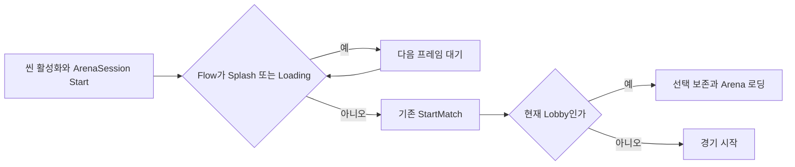
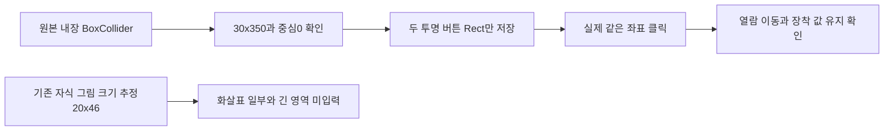

# 로딩 뒤 자동 전투 진입과 원본 버튼 입력 영역

2026-11-13 23:12:32 KST 시작, 구현·실행 확인30~60분 예상. 이전 회차는 구현·빌드·공개 보고로 실제 진전이 있었으며 현재 고정 Build27 장시간 검증은 별도로 유지합니다.

## 자동 시작 명령이 사라진 원인

ArenaSession.Start는 LoadSceneAsync의 씬 활성화 완료보다 먼저 실행될 수 있습니다. 기존 StartMatch는 로비에서 GameFlowController.EnterArena를 호출하지만, 이 시점에는 _loading=true여서 요청이 거부됐습니다. 기본 -soak 실행이 로비 준비 로그 뒤 멈춘 실제 Build27 기록과 코드가 일치합니다. 일반 권한 프로세스를 샌드박스 조회가 누락한 문제와 이 초기화 문제를 혼동하지 않습니다.

StartMatchAfterLoading 코루틴은 현재 Flow의 Splash·Loading이 끝날 때까지 기다린 다음 기존 StartMatch를 호출합니다. 별도 타이머·매 프레임 영구 Update·중복 세션은 만들지 않습니다. 씬이 사라지면 세션의 코루틴도 함께 정리됩니다. 수동 Lobby Battle과 현재 Arena 진입의 기존 명령을 유지합니다.

Build28은 직접 Arena 우회 옵션 없이 Splash→Lobby 준비→Arena 로딩→Arena 준비→1라운드 시작 순서를 확인했습니다. -soak -duration20으로20.00948초 후 완료 파일·OVERDOX_SOAK_COMPLETE·프로세스 종료를 확인했습니다. 이것은 짧은 흐름 검증이며 새10시간 완료 증거가 아닙니다.

## 이전 버튼 연결과 실제 원본 크기

초기 진단에서 부모 버튼 중심은 정상 레이캐스트·클릭 수신자였습니다. 실제 중심 클릭은3→2를 이동시켰습니다. 따라서 이전 버튼 자체가 연결되지 않았거나 다른 UI에 가려졌다고 단정하지 않습니다. 원본 화살표 자식은 이전x=-10·다음x=10이고 그림 크기는20×46입니다. 기존 Wire는 그 그림 크기만 부모 버튼 Rect에 적용했습니다.

보존한 main81 level3의 내장 BoxCollider60978·60999를 UnityPy 타입 트리로 읽으니 두 버튼 크기는30×350·중심(0,0,0)·enabled=true·isTrigger=true였습니다. 플레이용 두 부모 Rect만30×350으로 저장했습니다. 위치·자식 화살표·회전·그림·그리기 순서는 변경하지 않습니다. 기존 초기 연결과 표시 수정 흐름에 적용해 재생성 시 작은 추정 크기로 돌아가지 않게 했습니다. 범용 Wire를 모든 UI에서 임의 확대하지 않습니다.

실제1282×752 Windows 창의(644,381)은 Build27에서 변화·포커스 로그가 없었고 Build28에서는3→2로 이동했습니다. 추가(654,230)은2→1, 다음(1264,420)은1→2로 이동했습니다. 열람만 바꿔 실제 장착10140·공격력50은 유지됩니다. 여성 전환→로비→Battle→전투 진입→0HP 관찰→Esc 로비 복귀도 확인했습니다. 전투 캡처는 초기 생존 순간이 아니라0HP 시점입니다.

## 검증과 사용

- Unity6000.0.83f1 Windows Build28 성공258,972,698B. 런타임 DLL110080B, SHA256 5D1DAEE3CBA83209C8094B4E9D483196A3AD97F87D254AA024D968B6C6F10D42. 기존 실행 Evidence 폴더를 제외한 실제 빌드148파일을 고정 사본으로 보존했습니다.
- 씬 diff는 두 m_SizeDelta만 변경했습니다. 현재 남녀 프리팹·비주얼 라이브러리·비주얼 코드4파일과 수식 XLSX SHA256이 같습니다. 이번 수정은 새 모델링·리깅 변경이 아닙니다.
- 메뉴 OVERDOX/Restore/Restore native equipment button hit areas는 저장된 씬·재생 종료 상태에서 적용합니다. Inspect native equipment input은 Play의 실제 장비 창에서 버튼 크기·중심·레이캐스트 수신자를 기록합니다. 원본 Collider 조사 도구는 Tools/inspect_original_button_colliders.py입니다.
- Build27 고정 장시간 사본의 기존150파일 해시가 그대로이며 전투 프로세스가 실제 동작합니다.150목록에는 시작 전 Evidence/coverage.json·telemetry.log2개도 포함됩니다. 새 기록은 별도 Evidence27Arena에 저장됩니다. 새 Build28 검증과 혼합하지 않습니다.
- 실제 OS 드래그는 포커스·시작/종료 로그 변화가 없어 미확인입니다. EventSystem 이벤트 재생과 실제 OS 입력을 구분합니다. 버튼 원본 크기를 복구했다고 전체 조작감이 같다고 판정하지 않습니다.
- 전체119장비 실제 능력·남녀 리깅, 추가 UI depth·템플릿 값·카메라·FX와 새 Build28의10시간은 미완료입니다. 기존 원작 FX 누락 스크립트 경고1건이 남습니다.

샘플 c7b40e5의 함수·한국어 XML·생명주기 문서와 SceneEntry를 다시 확인했습니다. 원본 특정ID·치수에 의존하는 입력 복구는 공통 샘플로 옮기지 않습니다. 로딩 준비 후 명령하는 원칙은 기존 샘플 SceneEntry가 이미 수행하므로 중복 환류를 보류합니다. 전역 지침은 변경하지 않고 프로젝트 전용 교훈에 통합합니다.
