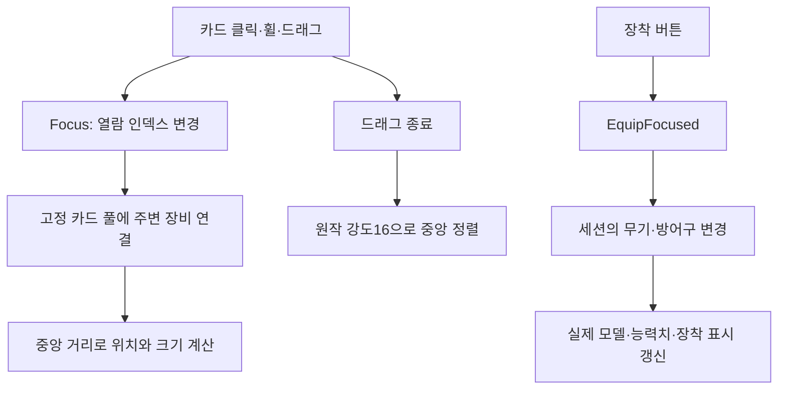

# 장비 캐러셀과 사망 애니메이션

## 원작 근거

원작 로비의 직렬화 데이터를 엄격한 필드 스키마로 읽어 `UIGrid.cellWidth=210`, `UICenterOnChild.springStrength=16`, 가로 스크롤 구성을 확인했습니다. 공개 장비 화면에는 중앙의 큰 카드와 양옆의 작은 카드가 보입니다. 주변 카드 축소율 0.65는 화면 대조에 따른 대응값이며 원작 코드 상수로 확인한 값은 아닙니다.

원본 `EquipmentListController`에는 카드 중심 변경과 별도의 `OnClickEquipButton`·`ReqEquipChange`가 있습니다. 현재 복원본도 카드 열람과 장착을 분리했습니다. 카드 열람만으로 실제 장비를 바꾸지 않으며, 장착 버튼에서 세션에 명령을 전달합니다. 열람 중 캐릭터 미리보기 교체와 원작의 관성 곡선은 아직 일치 검증이 남았습니다.

## 구성과 입력 흐름

`RestoredEquipmentCarousel`은 위치·크기·포인터 소유권을, `RestoredLobbyController`는 열람 인덱스와 장착 명령을 맡습니다. 카드 10개를 재사용하므로 무기 38종·방어구 각 부위 27종을 위해 카드를 계속 생성하지 않습니다. 중앙 인덱스 주변만 연결하고 범위 밖 카드는 숨깁니다. 정적 참조·원작 클리핑 영역·장착 버튼 이벤트는 에디터 도구가 씬에 저장합니다.

드래그 시작 좌표는 임계 거리를 넘은 현재 위치가 아닌 `PointerEventData.pressPosition`을 사용합니다. UI 로컬 좌표로 계산하므로 Canvas 배율을 이동량에 다시 곱하지 않습니다. 다른 포인터가 현재 드래그를 취소하지 않도록 소유권을 검사하고, 창이 닫히면 소유권을 해제합니다.

## 사망 포즈

기존 라이브러리는 모든 무기군에 `Die_01`을 연결했습니다. 이 클립은 영웅과 다른 뼈 경로를 사용하여 영웅 리그에서 330개 커브가 모두 연결되지 않았습니다. 무기군별 `*_die_01`과 확인되는 전설 전용 클립을 선택하도록 바꿨습니다. 원본은 보존하고 기존 변환 클립의 참조를 수정합니다.

`Fighter.StateElapsed`는 지속 시간이 0인 사망 상태에서도 진입 후 경과 시간을 제공합니다. 시각 컴포넌트는 사망 클립의 처음부터 재생하고 마지막 자세를 유지합니다. 이전처럼 첫 사망 프레임에서 클립 끝으로 즉시 건너뛰지 않습니다.

## 검증과 한계

- `OVERDOX > Restore > Bind hero death animations`는 사망 후보의 경로 18개를 먼저 걸러 전체 1,293개 전투 클립을 불필요하게 로드하지 않습니다.
- `Verify hero death rig bindings`는 남녀·8개 무기군과 전설 전용을 합친 18개 경우에서 실제 커브 연결과 포즈 변화를 측정합니다. 18개 모두 회전 변화가 확인됐으며 13개는 커브가 모두 연결됐습니다. 나머지에는 머리카락·성별 추가 뼈·회수되지 않은 해시 경로가 있어 세부 일치는 미완료입니다.
- `Verify equipment drag events`는 실제 카드 레이캐스트와 Unity EventSystem을 사용한 0→1 이동 검사입니다. OS 마우스의 실제 드래그 성공을 대신하지 않습니다.
- 고정 Windows Build22에서 카드 클릭·휠 열람, 장착 버튼, 모델 교체와 공격력 50→158→50, 전투 진입·로비 복귀를 확인했습니다. 열람만으로 실제 장비가 바뀌지 않았습니다.
- Windows에서 남성 검·방패 캐릭터의 0HP 사망 자세를 확인했습니다. 나머지 무기군·성별은 리그 샘플링 검사 범위이며 실제 경기 화면 검증은 남았습니다.
- OS 마우스 드래그는 자동 조작에서 시작·종료 이벤트가 기록되지 않아 미확인입니다. 휠·클릭 성공 및 EventSystem 재생 검사와 구분합니다. 이전 고정 빌드의 10시간 결과를 이번 변경의 검증으로 사용하지 않습니다.

근거는 `Docs/Research/equipment-carousel-serialized.json`, `Docs/Verification/DeathAnimations/rig-bindings.json`, `Docs/Verification/EquipmentCarousel/drag-events.json`, `Docs/Verification/NativeUI/build22-verification.json`에 보존합니다. Build22 수동 실행 확인은 2026-11-13 19:44:06 KST에 끝났습니다. 새 UI·입력 변경의 10시간 검증은 수행하지 않았습니다.
