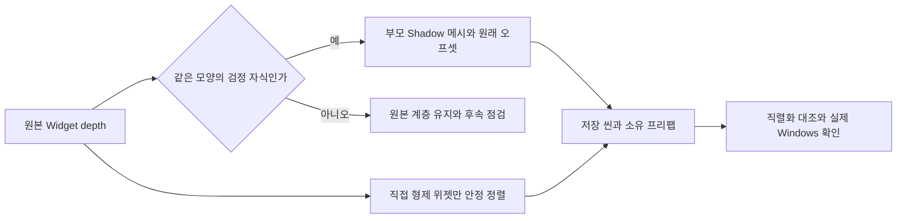

# UI depth 복구와 아바타 참조 보존

2026-11-13 21:28:21 KST 시작. 첫 수정·확인 예상20~40분. 원작 전체 UI 동일성을 완료한 보고가 아닙니다.

원작 NGUI는 계층보다 Widget.depth로 그리는 순서를 결정할 수 있습니다. 변환기는 원본 계층 순서만 복구해 낮은 depth의 검정 자식 그림자가 부모 아이콘을 덮었습니다. 같은 부모의 위젯 순서에도 depth를 반영하지 않았습니다.

`RestoredUiShadowBuilder.RestoreNativeShadows`는 동일 atlas·sprite·크기·pivot·flip, 검정색, 단위 스케일·회전 조건이 맞는 낮은 depth 자식8쌍만 uGUI Shadow 메시로 옮깁니다. 자식 Transform·Image·바인딩을 보존하고 중복 Image만 비활성화합니다. 동적 아이콘의 스프라이트를 그대로 따라가며 별도 Canvas·매 프레임 위치 동기화는 추가하지 않습니다.

`RestoreSiblingDepth`는 직접 부모가 같은 위젯끼리 depth 오름차순으로 정렬합니다. 동률은 기존 순서, 비위젯 자식은 기존 슬롯을 유지합니다. 재부모화·좌표 이동·다른 가지의 전역 정렬은 하지 않습니다. 변환기에도 두 함수를 연결해 재생성 시 누락을 방지했습니다.

메뉴 `OVERDOX/Restore/Repair native UI depth`는 재생 종료·저장된 씬에서 사용합니다. 원본 추출 JSON은 수정하지 않습니다. 실제 적용21:41:27.800 KST. Lobby 프리팹178개·씬168개, GameRoom 프리팹·Arena 씬 각160개 부모 그룹 순서가 바뀌었습니다.8쌍 그림자는 Lobby 두 대상에 각각 적용했습니다.

수정 전 기준은 보존한 Build25를 실제 실행해 재현 촬영했습니다. 수정 후 Build26은 Unity6000.0.83f1에서21:43:41 KST 빌드 성공258,962,218B. 고정 복사150파일 해시를 보존했습니다. Splash→Lobby→장비→남녀 전환→여성 무기10150 장착(공격력50→214)→10140 복구(50)→남성→Lobby→전투→Esc 로비 복귀를 실제 조작했습니다. 공격 버튼 입력 후 스태미나215→210을 관찰했습니다. 대시 입력 후 즉시 결과 화면은 보존되지 않아 수동 대시 성공은 미확인입니다. 텔레메트리의 공격·대시 집계는 봇을 포함하므로 수동 성공의 대체 증거로 사용하지 않습니다.

아바타·리깅 변경 안내를 반영해 현재 Basic_Male/Female, 비주얼 라이브러리·스크립트·본 메타데이터5파일을 보존했습니다. 전후 해시가 같습니다. 두 씬·두 UI 프리팹의 기존 직렬화 객체 전체를 기준 커밋a8d2a28과 비교해 자식 순서·Shadow 추가·Image 비활성화 외 변경이 없었습니다. 사용자께서 말씀하신 별도 리깅 변경의 구체적 차이와 모든 애니메이션 적합성은 미확인입니다.

## 실제 전후 화면

### 로비: 재화 그림자와 아이콘, 상점 상자·채팅

### 장비: 남성·여성 현재 아바타와 UI 순서

### 전투 HUD

전투는 같은10140 남성이나 별도 매치라 타이머02:46/02:42, 생존 수10/8과 봇 위치가 다릅니다. UI 배치 점검이며 동일 전투 프레임의 픽셀 비교가 아닙니다.

## 남은 점검

- 다른 모양·크기의 부모보다 낮은 depth 자식은 그대로입니다. 직접 역전 후보는 Lobby90·GameRoom56이며 그 전부가 오류라는 뜻은 아닙니다. 그림자·배경·등급 프레임의 의도와 화면 겹침을 추가 확인해야 합니다.
- 서로 다른 가지 사이의 원작 전역 depth 순서는 이번 직접 형제 정렬로 보장되지 않습니다.
- 드러난 녹색S등급과 일부 브랜드 문자열은 원본 템플릿 값의 동적 바인딩이 미완료입니다. 가리거나 잘못된 값을 정상이라고 처리하지 않았습니다.
- 원작 전체 UI·카메라·FX·모든 장비·남녀 리깅 전수와 새 Build26의10시간 검증은 미완료입니다. 기존 오래된 Build11 장시간 결과를 이번 결과로 재사용하지 않습니다.

근거: `Docs/Verification/UiDepth`의 source-audit, shadow-repair, serialized-preservation, avatar-preserved, build26-manifest, build26-flow·coverage·telemetry. 원본 전체 Player.log는 공개하지 않습니다.
