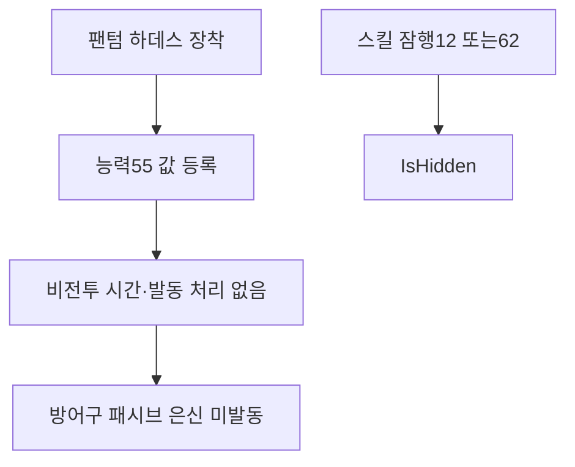

## 작업 결과

팬텀 하데스 머리·몸통·망토의 원작 모델·데이터 연결과 해당 비전투 은신 패시브 실행은 서로 다른 범위입니다. 현재 패시브 실행은 미구현입니다.

## 변경 내용

### 재현 조건

Unity6000.0.83f1, 검토용 build16. 사용자 PC 사용·검토 요청 후 새 게임 실행이나 GUI 입력 없이 기존 소스·원작 표를 정적으로 대조했습니다.

### 재현 순서

Armor20631·20632·20633의 AbilityType55와 값5·5·7을 대조합니다. EquipmentEffects.Build가 값을 등록하는지, Fighter 및 관련 실행 코드가55를 소비해 비전투 시간·은신을 적용하는지 검색합니다.

### 기대 동작

해당 장비를 착용하고 원작 조건에 맞는 비전투 상태를 유지하면 은신이 발동해야 합니다.

### 실제 동작

EquipmentEffects에는 타입55가 들어가지만 이를 소비하는 실행 경로가 없습니다. IsHidden은 스킬의 shadowUntil 또는 버프 타입12/62를 확인하며, 방어구의 비전투 패시브55를 발동시키지 않습니다.

### 원인

원작 표의 데이터 보존·시각 참조 성공을 패시브 동작 검증과 분리한 독립 항목이 없었습니다. 기존 명중 fixture도 해당 패시브의 비전투 대기·은신을 검사하지 않습니다.

### 적용 내용

Parity·README·장비별 검토 목록에 미구현을 기록했습니다. 기존 스킬 잠행이 있다는 이유로 이 방어구 패시브가 구현됐다고 판단하지 않습니다. 원작 FactorREF/SingleServer의 정적 근거는 로컬 조사 문서에 보존했습니다. 실행 코드 변경 없음.



다음은 능력 등록 메서드 전체입니다. 등록된 모든 타입이 구현됐다는 뜻은 아닙니다.

```csharp
public void Build(GearRow weapon, GearRow[] armor)
{
    _entries.Clear();
    Add(weapon.ability1Type, weapon.ability1Value, weapon.ability1Value2);
    foreach (var piece in armor)
    {
        Add(piece.ability1Type, piece.ability1Value, piece.ability1Value2);
        Add(piece.ability2Type, piece.ability2Value, piece.ability2Value2);
    }
    Brand = armor[0].brand == armor[1].brand && armor[1].brand == armor[2].brand ? armor[0].brand : -1;
    switch (Brand)
    {
        case 0: Add(34, 100, 0); break;
        case 1: Add(9, .10f, 0); break;
        case 2: Add(35, .05f, 0); break;
        case 3: Add(59, .05f, 0); break;
        case 4: Add(36, 1, 0); break;
        case 5: Add(37, 1, 0); break;
    }
}
```

현재 은신 조회와 비어 있는 스킬 효과 tick 메서드입니다.

```csharp
public bool IsHidden => Time.time < _shadowUntil || HasBuffType(12) || HasBuffType(62);

private void TickSpecialEffects() { }
```

## 검증

[소스·데이터 정적 대조 기록](../assets/review16/known-omissions.json). Source SHA256와 원작 ID 경로를 기록했습니다. 실제 실행에서 해당 효과만 분리한 재검증은 아직 하지 않았습니다. 기존35개 검사와38종 명중 검사는 이 누락을 검사하지 않으므로 통과 근거로 사용하지 않습니다.

## 남은 사항

사용자 검토 요청에 따라 실행 빌드와 전투 코드는 변경하지 않았습니다. 원작 효과 공식 확인, 구현과 독립 런타임 검증이 남아 있습니다. 이 글은 문제 해결 보고가 아닙니다.

## 작업 시간

- 제안 시간: 추가 기능 구현은 중단하고 전달 기록을 정리하는 범위입니다. 별도 구현 소요는 아직 산정하지 않았습니다.
- 실제로 완료된 시간: 2026-11-13 14:34 KST 무렵 정적 대조에서 확인했습니다. 검토본 전달14:03 KST 이후 문서만 정정했으며, 실행 수정 완료 시각은 없습니다.
- XERJ: 미사용 — XERJ 연결·검색 없음. rg와 기존 소스·원작 표를 대조했습니다.
