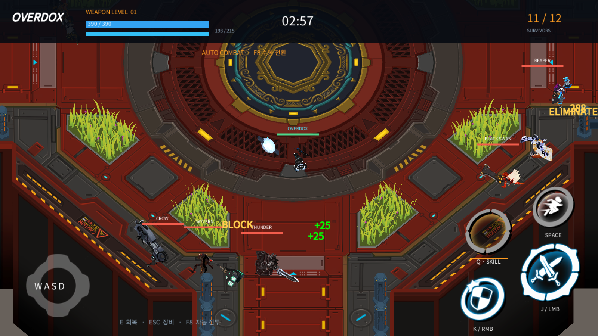

## 목표와 완료 기준

OVERDOX를 Unity 로컬 봇 전투로 재현하고 모든 장비·브랜드를 원작 근거로 복원합니다.

완료 기준: Unity 소스·Windows 실행 빌드, 실제 Blender·Affinity 네이티브 원본, DDT 장비 데이터, 실제10시간 실행 증거와 남은 차이 목록, 공개 결과 보고서.

후속 2회차 · 순차 진행 · 전체 7개 · 이번 실행 T01, T04, T05, T06, T07

## 순차 작업 메뉴얼

| 순서 | 작업 | 실행 절차 | 완료 기준 | QA 절차 | 상태 |
| --- | --- | --- | --- | --- | --- |
| T01 | 원작 조사·데이터·DDT 연결 | 공식 자료·실제 영상·원작 패키지 정적 자료를 대조하고 DDT 테이블로 연결한다. | 무기38·방어구81·브랜드6, 성장 수치 및 한국어 원문 근거 보존. | DDT 로딩·성장 원작 화면203/420·스키마·전체 장비 참조 테스트. | 완료 |
| T02 | 원작 모델·기본 봇 전투 복원 | 원작 스킨·뼈·애니메이션을 프로젝트 소유 표현 어댑터에 연결한다. | 남녀 장비 전체 참조와 실제 로컬 전투 실행. | 전체 장비 순환 렌더 및 봇 실전 로그·화면 대조. | 완료 |
| T03 | Blender 편집 가능한 장비 원본 | 원작 메시·UV·텍스처·스킨 가중치를 Blender 네이티브 라이브러리로 만든다. | 장비119종, 남녀 변형 및 packed textures 재열기. | 실제 Blender 재열기, 장비ID 수·텍스처 내장·렌더 확인. | 완료 |
| T04 | 고유스킬·혼합 장착·실제 입력 QA | 원작 스킬 설명·수치와 능력을 대조하고 전체 장비/성별/성장/전투를 재현한다. | 지원 동작·미확인 동작을 분리하고 재현 가능한 빌드 제공. | 고유스킬별 실행, UI 입력·전투 로그·재현 후 수정·재검증. | QA 대기 |
| T05 | Affinity 네이티브 디자인 저장·재열기 | 실제 Affinity 문서와 렌더를 저장하고 미저장 상태를 해소한다. | 네이티브 원본의 파일·재열기·dirty=false 확인. | CLI 및 실제 앱 문서 상태와 출력 바이트 확인. | 대기 |
| T06 | 실측 10시간 연속 검증 | 고정한 복원 빌드로 자동 봇 전투·장비 순환·메모리·오류를 기록한다. | 실제36000초 이상 완료 JSON과 실행 로그, 발견 오류 재검증. | 해시·시작/종료·텔레메트리·장비별 공격/스킬 커버리지 대조. | 대기 |
| T07 | 최종 소스·빌드·보고서 공개 | 검증 결과와 실제 전후 화면, 변경 핵심 메서드·흐름, 대화 요약·제한을 정리한다. | 소스·실행 파일, HTTPS 개별 본문 및 첨부 외부 접근 확인. | 현재 버전 빌드/최종 QA, 보고서 스키마·사이트 검사, 커밋·푸시·배포 분리 확인. | 대기 |

## QA 반복 기록

### Q03 · step · 2026-11-12T20:30:15.716228+00:00

Blender 검증 JSON 실제 기록 시각 기준

- T03 r1 · pass: 119장비ID·198/198 FILE image 내장 확인 및 실제 렌더. · 근거: 로컬 blender-restored-validation.json, blender-reopen-02.log, blender-restored-preview.png. 초기 assertion 실패 로그도 보존.
### Q02 · step · 2026-11-12T20:50:48.6441267Z

기존 실제 실행 증거의 종료 시각 기준

- T02 r1 · pass: CatalogReview03 구성예외0. RestoredSmoke06 실제 전투 및 이동 높이 정상. · 근거: 로컬 CatalogReview03/catalog-review.json, RestoredSmoke06/telemetry.log·combat-3.png. 원작 T-pose 실패는 앞선 CatalogReview01에 보존.
### Q01 · step · 2026-11-12T20:58:25Z

DDT·성장·참조·원작 무게 경계·혼합 브랜드 회귀 검사

- T01 r1 · pass: 29/29 passed, failed0. · 근거: 로컬 Docs/Verification/editmode-03.xml, 원작 장비 화면203/420 대조 테스트 포함.
### Q04 · regression · 2026-11-13T04:59:40Z

최신35개 회귀 검사 모두 통과.

- T01 r1 · pass: 최신35개 회귀 검사 모두 통과. · 근거: Docs/Verification/editmode-05.xml
### Q05 · step · 2026-11-13T05:01:44.0579923Z

전체 무기 일반 명중38/38과 충전 소비38/38 관찰. 전체 원작 효과 동일성은 미검증으로 남김.

- T04 r1 · not_run: 전체 무기 일반 명중38/38과 충전 소비38/38 관찰. 전체 원작 효과 동일성은 미검증으로 남김. · 근거: Docs/Verification/GearContact15/gear-contact-results.json, Manual15 실제 입력 캡처
### Q06 · step · 2026-11-13T05:19:39.8918059Z

초기 빌드36000.0078초·1422라운드 완료. 복원 build11의 별도10시간은 미완료.

- T06 r1 · not_run: 초기 빌드36000.0078초·1422라운드 완료. 복원 build11의 별도10시간은 미완료. · 근거: Docs/Verification/Soak10h/soak-complete.json, long-run-summary.json

## 남은 작업과 다음 반복

T04 유틸리티 효과·원작 동작 정확성의 미확인 범위, T05 임시 Affinity 문서 저장/정리, T06 복원 build11 실제10시간 최종 판정, T07 최종 공개 근거. 추가 기능 구현·GUI 조작은 사용자 검토 및 PC 사용 요청에 따라 멈춤. 기존 자동 검증은 유지.

이전 회차: [메뉴얼 열기](../../../projects/overdox/reports/2026-11-12-manual-20261112210344423-v1.0.0.html)

## 작업 시간

- 제안 시간: 첫 실행 가능 빌드90~150분, 이후 사용자가 요청한 별도 실제10시간 검증.
- 실제로 완료된 시간: 작업 시작2026-11-13 03:50:50 KST. build16 검토용 전달14:03 KST. 초기 빌드10시간 검증14:19:39 KST 완료. 복원 build11의10시간 종료 예정15:58 KST. 전체 목표 완료 아님.
- XERJ: 미사용 — 사용자 지침에 따라 XERJ 연결·검색 없음. rg·공식 자료·영상 관찰·공개 원작 파일의 정적 데이터 대조 사용.
