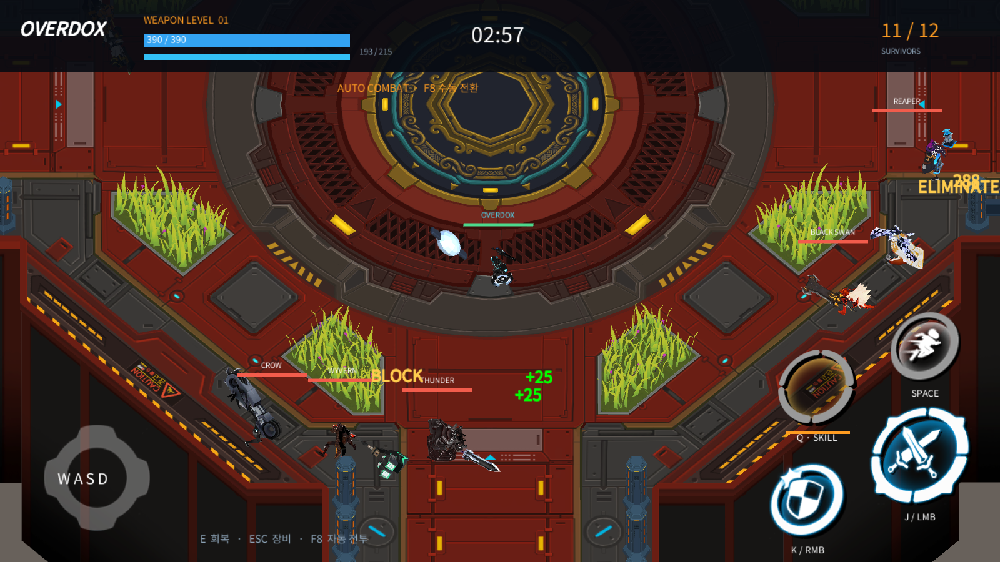

## 목표와 완료 기준

OVERDOX를 Unity 로컬 봇 전투로 재현하고 모든 장비·브랜드를 원작 근거로 복원합니다.

완료 기준: Unity 소스·Windows 실행 빌드, 실제 Blender·Affinity 네이티브 원본, DDT 장비 데이터, 실제10시간 실행 증거와 남은 차이 목록, 공개 결과 보고서.

후속 3회차 · 순차 진행 · 전체 12개 · 이번 실행 T04, T06, T08, T09, T10

## 순차 작업 메뉴얼

| 순서 | 작업 | 실행 절차 | 완료 기준 | QA 절차 | 상태 |
| --- | --- | --- | --- | --- | --- |
| T01 | 원작 조사·데이터·DDT 연결 | 공식 자료·실제 영상·원작 패키지 정적 자료를 대조하고 DDT 테이블로 연결한다. | 무기38·방어구81·브랜드6, 성장 수치 및 한국어 원문 근거 보존. | DDT 로딩·성장 원작 화면203/420·스키마·전체 장비 참조 테스트. | 완료 |
| T02 | 원작 모델·기본 봇 전투 복원 | 원작 스킨·뼈·애니메이션을 프로젝트 소유 표현 어댑터에 연결한다. | 남녀 장비 전체 참조와 실제 로컬 전투 실행. | 전체 장비 순환 렌더 및 봇 실전 로그·화면 대조. | 완료 |
| T03 | Blender 편집 가능한 장비 원본 | 원작 메시·UV·텍스처·스킨 가중치를 Blender 네이티브 라이브러리로 만든다. | 장비119종, 남녀 변형 및 packed textures 재열기. | 실제 Blender 재열기, 장비ID 수·텍스처 내장·렌더 확인. | 완료 |
| T04 | 고유스킬·혼합 장착·실제 입력 QA | 원작 스킬 설명·수치와 능력을 대조하고 전체 장비/성별/성장/전투를 재현한다. | 지원 동작·미확인 동작을 분리하고 재현 가능한 빌드 제공. | 고유스킬별 실행, UI 입력·전투 로그·재현 후 수정·재검증. | QA 대기 |
| T05 | Affinity 네이티브 디자인 저장·재열기 | 실제 Affinity 문서와 렌더를 저장하고 미저장 상태를 해소한다. | 네이티브 원본의 파일·재열기·dirty=false 확인. | CLI 및 실제 앱 문서 상태와 출력 바이트 확인. | 대기 |
| T06 | 실측 10시간 연속 검증 | 고정한 복원 빌드로 자동 봇 전투·장비 순환·메모리·오류를 기록한다. | 실제36000초 이상 완료 JSON과 실행 로그, 발견 오류 재검증. | 해시·시작/종료·텔레메트리·장비별 공격/스킬 커버리지 대조. | 완료 |
| T07 | 최종 소스·빌드·보고서 공개 | 검증 결과와 실제 전후 화면, 변경 핵심 메서드·흐름, 대화 요약·제한을 정리한다. | 소스·실행 파일, HTTPS 개별 본문 및 첨부 외부 접근 확인. | 현재 버전 빌드/최종 QA, 보고서 스키마·사이트 검사, 커밋·푸시·배포 분리 확인. | 대기 |
| T08 | Excel 수식 원본과 DDT 연동 | 원작 표·119종 장비를 수식 포함 XLSX로 편집하고 기존 DDT 엔진으로 계산·컴파일한다. | 변경 수식의 실제 DDT·실행 값 반영과 복구를 확인한다. | XLSX 수식 변경→Unity 메뉴 컴파일→DDT 값 비교→원본 복구. | 대기 |
| T09 | 스플래시·로비·전투 진입 | 저장 씬·비동기 로딩·장비 선택 전달·전투 시작·로비 복귀를 연결한다. | Unity와 Windows에서 기본 진입·장비/성별 선택 유지·복귀가 동작한다. | 실제 버튼·입력과 플레이어 로그로 기본 흐름을 확인한다. | 완료 |
| T10 | 원본 로비·장비·전투 HUD | 원작 직렬화 UI의 계층·스프라이트·색상·폰트를 저장 프리팹으로 복원하고 전투·장비 값에 연결한다. | 원작 배치 대조와 실제 장비 선택·전투 HUD 표시·화면 전후 근거. | 원본 영상·이미지와 실제 Unity/Windows 화면을 비교한다. | 대기 |
| T11 | 원본 이펙트·음향과 효율 | 원작 이벤트·FX·오디오를 프로젝트 소유 어댑터·파생 자산으로 연결하고 중복 자원 사용을 측정한다. | 장비 공격·스킬·피격의 실제 타이밍과 자원 사용 근거. | 각 이벤트와 실제 렌더·음향·할당을 대조한다. | 대기 |
| T12 | 카메라·입력·장비 동작 세부 복원 | 원본 카메라·추적·피격·사망 시점과 입력 반응을 대조하고 누락 능력을 구현한다. | 카메라·조작·핵심 장비 동작의 실제 전후 대조와 알려진 차이 기록. | 직접 조작·장비별 검증·원본 자료와 수치 대조. | 대기 |

## QA 반복 기록

### Q03 · step · 2026-11-12T20:30:15.716228+00:00

Blender 검증 JSON 실제 기록 시각 기준

- T03 r1 · pass: 119장비ID·198/198 FILE image 내장 확인 및 실제 렌더. · 근거: 로컬 blender-restored-validation.json, blender-reopen-02.log, blender-restored-preview.png. 초기 assertion 실패 로그도 보존.
### Q02 · step · 2026-11-12T20:50:48.6441267Z

기존 실제 실행 증거의 종료 시각 기준

- T02 r1 · pass: CatalogReview03 구성예외0. RestoredSmoke06 실제 전투 및 이동 높이 정상. · 근거: 로컬 CatalogReview03/catalog-review.json, RestoredSmoke06/telemetry.log·combat-3.png. 원작 T-pose 실패는 앞선 CatalogReview01에 보존.
### Q01 · step · 2026-11-12T20:58:25Z

DDT·성장·참조·원작 무게 경계·혼합 브랜드 회귀 검사

- T01 r1 · pass: 29/29 passed, failed0. · 근거: 로컬 Docs/Verification/editmode-03.xml, 원작 장비 화면203/420 대조 테스트 포함.
### Q04 · regression · 2026-11-13T04:59:40Z

최신35개 회귀 검사 모두 통과.

- T01 r1 · pass: 최신35개 회귀 검사 모두 통과. · 근거: Docs/Verification/editmode-05.xml
### Q05 · step · 2026-11-13T05:01:44.0579923Z

전체 무기 일반 명중38/38과 충전 소비38/38 관찰. 전체 원작 효과 동일성은 미검증으로 남김.

- T04 r1 · not_run: 전체 무기 일반 명중38/38과 충전 소비38/38 관찰. 전체 원작 효과 동일성은 미검증으로 남김. · 근거: Docs/Verification/GearContact15/gear-contact-results.json, Manual15 실제 입력 캡처
### Q06 · step · 2026-11-13T05:19:39.8918059Z

초기 빌드36000.0078초·1422라운드 완료. 복원 build11의 별도10시간은 미완료.

- T06 r1 · not_run: 초기 빌드36000.0078초·1422라운드 완료. 복원 build11의 별도10시간은 미완료. · 근거: Docs/Verification/Soak10h/soak-complete.json, long-run-summary.json
### Q07 · step · 2026-11-13T06:58:16.6933687Z

고정 복원 build11의10시간 연속 실행 완료. 알려진 경고1건과 해시 검증 범위2개를 함께 기록.

- T06 r1 · pass: 고정 build11 36000.0195초·350경기 완료. 38/81 장비 및38종 공격·스킬 명령 기록. 시작 시 기록한2개 해시 일치. 알려진 FX 스크립트 누락1건. 최신 build17 결과와 구분. · 근거: Docs/Verification/RestoredSoak10h/soak-complete.json; long-run-summary.json
### Q08 · step · 2026-11-13T07:41:53.693651+00:00

build17 기본 진입·선택 전달·복귀를 실제 Unity 및 Windows에서 확인한 결과 등록.

- T09 r1 · pass: build17 고정 사본과 실제 Windows 흐름 확인. Unity에서10150 유지, Windows에서 여성 선택 유지. 전체 UI 동일성·모든 해상도 검증은 별도. · 근거: Docs/Verification/Phase2Flow/verification.json; build17-manual-player.log

## 남은 작업과 다음 반복

T04 원작 전투 효과, T05 Affinity 후속 디자인, T07 공개 근거 갱신, T08 Excel→DDT 수식 변경 왕복 검증, T10 원본 UI 연동, T11 FX/음향, T12 카메라·입력 세부 동일성. 전체 목표 진행 중.

이전 회차: [메뉴얼 열기](../../../projects/overdox/reports/2026-11-13-manual-overdox-reconstruction-20261113-20261113052537799-v1.0.1.html)

## 작업 시간

- 제안 시간: 재개 첫 개선 회차90~150분 예상. 원작 UI/FX 전체 복원의 완료 예상과 구분합니다.
- 실제로 완료된 시간: 재개2026-11-13 15:06:39 KST. build17 빌드16:12:56 KST 완료(약66분17초). 실제 Windows 진입·성별 선택·전투·복귀 확인16:18 KST 무렵. 복원 build11 10시간은15:58:16.693 KST 완료. 전체 복원 완료 시각 미정.
- XERJ: 미사용 — 사용자 지침에 따라 XERJ 연결·검색 없음. rg·공식 자료·영상 관찰·공개 원작 파일의 정적 데이터 대조 사용.
