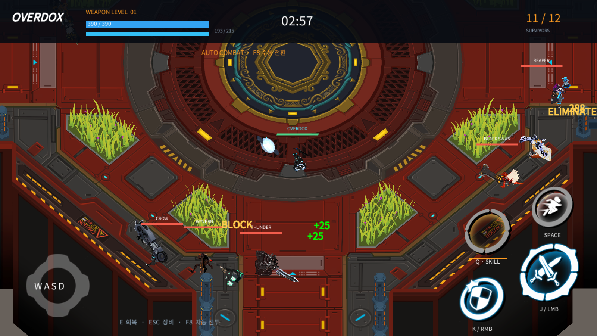
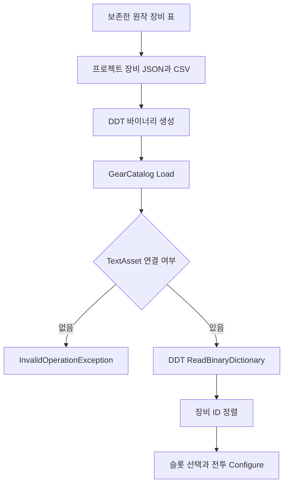

## 작업 결과

구현·실행 중간 결과입니다. 전체 복원 완료나10시간 검증 완료 보고가 아닙니다.



Windows 로컬12인 봇 전투, 무기38종·방어구81종과 남녀 외형, 브랜드6종, 원작 맵·텍스처·애니메이션을 프로젝트 소유 실행 코드에 연결했습니다. 원작 서버 로직은 확보되지 않았으며 일부 동작은 원문 설명에 따른 재구현입니다.

## 변경 내용

### 적용 내용

공식 장비 설명·실제 영상·공개 배포 패키지를 대조했습니다. 외부 원본은 보존하고, 원작 스크립트를 제거한 시각 자산과 프로젝트 소유 C# 전투 구현을 구분했습니다. 원작 APK는 설치하거나 실행하지 않았습니다.

| 범위 | 현재 결과 |
| --- | --- |
| DDT | 기존 DesignDataTable 런타임을 가져와 장비와 원작 표를 바이너리로 읽습니다. |
| 장비 | 무기38종, 방어구81종, 방어구 남녀 변형과 개별 슬롯 선택을 연결했습니다. |
| 브랜드 | D-Company, New East, BEAST, Four Stars, OVERDOX, Hazard의 원작 명칭·아이콘·세트 효과를 연결했습니다. |
| 언어 | 한국어·영어 각각4302개 문자열을 복원하여 장비·스킬 이름과 설명을 대조했습니다. |
| Blender | 실제5.2.3 LTS에서 원작 장비119종의 편집 가능한 메시·UV·리그를 저장하고 재열었습니다. 이미지198개를 파일에 포함했습니다. |
| Affinity | 실제3.3.3에서 wordmark.af를 저장했습니다. 초기 임시 브랜드 atlas는 원작 심볼로 대체했으며, 해당 임시 문서의 네이티브 저장은 미완료입니다. |

`Assets/Scripts/Management/GearCatalog.cs`의 전체 Load 메서드입니다. 기존 임시 수치 목록에서 DDT 바이너리 로딩으로 변경했습니다. TextAsset 연결이 없으면 실패를 숨기지 않고 예외를 냅니다. 이 메서드는 전체 전투 동작의 동일성을 증명하지 않습니다.

```csharp
private static List<GearRow> Load(TextAsset binary)
        {
            if (binary == null) { throw new InvalidOperationException("DDT 장비 바이너리가 연결되지 않았습니다."); }
            var rows = new List<GearRow>(DataLoader.ReadBinaryDictionary<GearRow>(binary.bytes, BINARY_KEY).Values);
            rows.Sort((a, b) => a.id.CompareTo(b.id));
            return rows;
        }
```



원작은 Unity2018.4.31f1이며 재현 프로젝트는 Unity6000.0.83f1입니다. 공개 OBB main81의 자산·표와 APK87의 메타데이터를 함께 분석했습니다. 두 버전의 MonoScript 경로 ID가 일치하지 않는 사례가 확인되어 원작 MonoBehaviour 타입 이름에 의존하지 않고 원본 모델·표·실제 화면을 대조했습니다. 원작 실행 코드·계정·네트워크 연결을 재사용하지 않습니다.

출처: [공식 장비 설명](https://help-overdox.haegin.kr/hc/en-us/articles/1500002419481-Equipment), [공식 영상](https://www.youtube.com/watch?v=zexUfAF9K2g), [실제 플레이 영상](https://www.youtube.com/watch?v=w96VFxKtJyw), [원작 장비 화면](https://cdn-media.sforum.vn/storage/app/media/quangduy/review-overdox-vu-khi.jpg). 원작 자료의 권리는 원권리자에게 있으며 공개 보고서에는 필요한 실행 화면과 프로젝트 자체 구현만 첨부합니다.

## 검증

[EditMode 결과 XML](../assets/reconstruction/editmode-03.xml):29개 통과. 원작 성장 수치 Black Swan Lv11 공격력203, Dragon Rogue Lv6 체력420을 공개 장비 화면과 대조했습니다. 이후 수정분은 별도 재검증 대상입니다.

[Blender 저장·재열기 결과](../assets/reconstruction/blender-restored-validation.json):오브젝트384개, 메시222개, armature162개, 장비ID119개, FILE 이미지198/198개 packed를 실제 파일 재열기로 확인했습니다. Blender 원본에 모든 전투 애니메이션까지 들어 있다는 의미는 아닙니다.

[build11 현재 행동 커버리지](../assets/reconstruction/coverage-progress.json):{"weaponsSeen": 38, "armorSeen": 81, "weaponsAttacked": 38, "weaponsSkilled": 38}. 장비 사용·공격·스킬 명령 실행을 기록한 값이며 명중 정확성·원작 동작 일치까지 입증하지 않습니다.

실측 장시간 검증은 초기 빌드04:19:39 KST, 원작 자산 복원 build11은05:58:12 KST에 서로 다른 고정 복사본으로 시작했습니다. build11의10시간 도달 예정은15:58:12 KST입니다. 본 중간 보고 시점에는 완료되지 않았습니다. 최신 소스의 부착 위치·상태 중첩·충전 수 수정은 build11 장시간 결과와 구분하여 빌드·테스트합니다.

## 남은 사항

- 실측10시간 종료 증거와 오류·메모리·장비별 행동 집계.
- 최신 빌드의 무기 부착 위치·일반 공격 명중·각 고유 스킬 검증 및 실제 수동 입력 확인.
- 전설 검의 투척·순간이동, 변신 장비 외형, 일부 범위·투사체·효과와 서버 전용 계산은 미완료 또는 미확인입니다.
- 방어 피해 감소율·일부 감전 계산·시작 스킬 충전량은 프로토타입 가정입니다. 전체 장비 데이터가 있다고 모든 원작 서버 동작이 동일하다고 보고하지 않습니다.
- Affinity 임시 atlas 저장을 가리는 Windows 보안 대화상자는 허용하지 않았습니다. 편집 가능한 저장본·미저장 상태를 최종 확인해야 합니다.
- 최종 소스·Windows 빌드·원본 경로, 출처·누락 목록, 전후 비교와 공개 첨부 접근 검증.

교훈 검토: 원작 최적화 리그·클립 재바인딩·APK/OBB 버전 차이는 프로젝트 전용 지침으로 정리할 대상입니다. 기존 SampleProjectForUnity의 Camera.Render 캡처 패턴을 사용했으며 검증 전 범용 샘플 변경은 하지 않았습니다. 전역 규칙 변경 없음.

## 작업 시간

- 제안 시간: 최초 플레이 가능 구현90~150분 예상. 구현 후 별도 실측10시간 검증 요청. 원작 복원 build11 기준 검증 종료 예정2026-11-13 15:58:12 KST.
- 실제로 완료된 시간: 작업 시작2026-11-13 03:50:50 KST. 본 문서는13:40 KST 무렵 작성한 중간 보고로 전체 완료 시각은 미정입니다. 경과 시간에는 자동 실행·관찰 대기가 포함되며 연속 수작업 시간으로 보고하지 않습니다.
- XERJ: 미사용 — XERJ 연결 확인·검색 모두 하지 않았습니다. 공식 웹 자료·실제 영상·공개 패키지 정적 자료·로컬 실행 로그를 사용했습니다.
