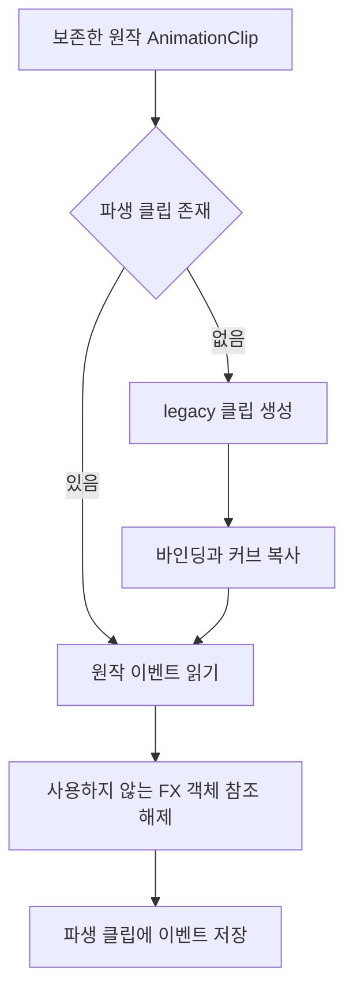
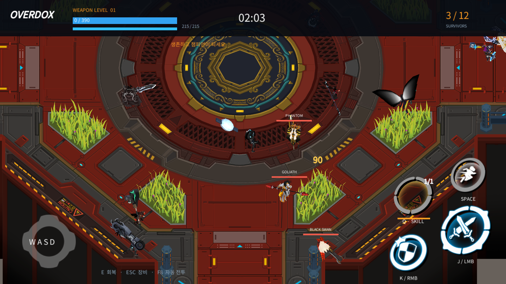
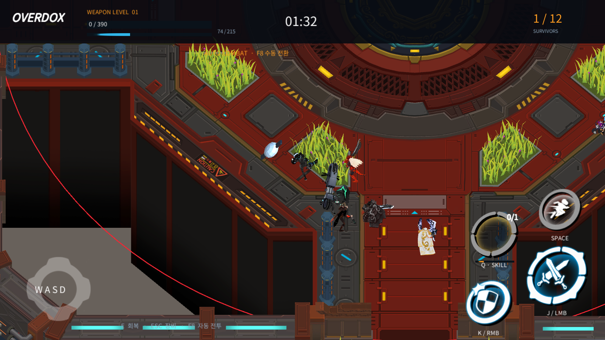
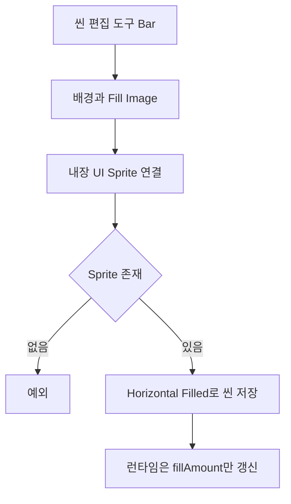

## 작업 결과

원작 FX 프리팹 참조 경고와0HP 체력 막대 표시를 수정한 실제 검토 결과입니다. 원본 클립은 변경하지 않았습니다.

## 변경 내용

### 적용 내용

원작 클립의 단순 복제에서는 자세가 재생되지 않았습니다. 에디터에서 바인딩·커브·이벤트를 새 legacy 클립에 옮겼습니다. 이후 이벤트의 objectReferenceParameter가 불필요한 원작 FX 프리팹과 누락 MonoBehaviour를 빌드에 끌어오는 경고를 실제 실행에서 발견했습니다. 로컬 전투가 사용하는 시간·이름은 남기고, 파생 클립에서만 해당 객체 참조를 제거했습니다.



`Assets/Scripts/Editor/RestoredProjectBuilder.cs`

```csharp
private static AnimationClip RebuildLegacyClip(string path)
{
    var source = AssetDatabase.LoadAssetAtPath<AnimationClip>(path);
    if (source == null) { return null; }
    string output = "Assets/Art/Restored/Animations/" + Path.GetFileName(path);
    var clip = AssetDatabase.LoadAssetAtPath<AnimationClip>(output);
    if (clip == null)
    {
        clip = new AnimationClip { name = source.name, legacy = true, frameRate = source.frameRate };
        foreach (var binding in AnimationUtility.GetCurveBindings(source))
        {
            AnimationUtility.SetEditorCurve(clip, binding, AnimationUtility.GetEditorCurve(source, binding));
        }
        AssetDatabase.CreateAsset(clip, output);
    }
    // 이벤트의 원작 FX 프리팹 참조는 원작 MonoBehaviour까지 빌드에 끌어옵니다.
    // 로컬 전투는 시간/이름만 사용하므로 프로젝트 파생 클립에서만 참조를 해제합니다.
    var events = AnimationUtility.GetAnimationEvents(source);
    foreach (var evt in events) { evt.objectReferenceParameter = null; }
    AnimationUtility.SetAnimationEvents(clip, events);
    EditorUtility.SetDirty(clip);
    return clip;
}
```

수동 검토에서0HP인데 체력 막대가 가득 찬 화면을 확인했습니다. uGUI Image가 Sprite 없이 Filled 메시를 생성하지 않으므로, 씬에 실제 Sprite를 저장했습니다. 폰트·위치·스타일을 런타임에서 다시 만들지 않습니다.







`Assets/Scripts/Editor/ProjectBuilder.cs`

```csharp
private static Image Bar(Transform parent,string name,Vector2 position,Vector2 size,Color color)
{
    var background=Panel(parent,name,position,size,new Color(.04f,.07f,.10f),new Vector2(0,1));var fill=Panel(background,"Fill",Vector2.zero,size,color,new Vector2(0,1)).GetComponent<Image>();
    // Sprite가 없으면 uGUI가 Filled 메시 대신 전체 사각형을 그립니다.
    fill.sprite=AssetDatabase.GetBuiltinExtraResource<Sprite>("UI/Skin/UISprite.psd");
    if(fill.sprite==null) { throw new InvalidOperationException("UI bar sprite is missing"); }
    fill.type=Image.Type.Filled;fill.fillMethod=Image.FillMethod.Horizontal;return fill;
}
```

## 검증

[최신 회귀 검사](../assets/review16/editmode-05.xml):35/35통과, 종료2026-11-13 13:59:40 KST. [실제 무기 명중 결과](../assets/review16/gear-contact-results.json):고정 build15의38/38종 일반 공격 명중,38종 모두 고유 스킬 충전 소비. 완료14:01:44 KST. build16은 이후 UI 막대와 사용하지 않는 원작 FX 참조를 수정했습니다.

[장비 집계](../assets/review16/equipment-review-summary.json), [무기별 CSV](../assets/review16/weapon-review.csv), [방어구별 CSV](../assets/review16/armor-review.csv). 스킬 피해24종과 체력 증가8종을 관찰했습니다. 체력 증가에는 장비 패시브가 포함될 수 있어 스킬 회복량 독립 검증으로 사용하지 않습니다.

원본 이미지의 크기와 작은 UI 글자를 보존했습니다. Affinity 저장 모달과 사용자 PC 사용 제약으로 추가 이미지 편집·압축은 하지 않았으며200KB 목표를 초과한 PNG를 사용합니다. GIF를 대신한 실제 정지 전후 증거입니다.

## 남은 사항

실측10시간 종료·최종 장비/오류/메모리 집계는 아직 진행 중입니다. 전체 장비 데이터·외형 연결을 원작 서버 계산 전체 동일성으로 보고하지 않습니다. 변신 외형·일부 범위 버프·드론 능력·몬스터·상점·보급품, 일부 스킬 효과·애니메이션이 남아 있습니다. 가드 피해 비율·기본 회피·일부 감전·시작 충전량은 프로토타입 가정입니다.

사용자가 검토와 PC 사용을 요청하여 추가 기능 구현·창 표시·입력·포커스 변경을 멈췄습니다. 기존 자동 검증만 유지합니다. 실제 Affinity wordmark.af는 저장했지만 초기 임시 atlas 네이티브 저장은 미완료입니다. 제품에서는 원작 아이콘으로 대체했습니다. 전역 지침 변경 없음. 프로젝트 전용 지침에 검증된 리그·클립·버전 차이·검증 사본 보존 기준을 기록했습니다.

## 작업 시간

- 제안 시간: 최초 플레이 가능90~150분, 구현 후 실측10시간 검증. 원작 복원 고정 빌드의10시간 도달 예정2026-11-13 15:58 KST.
- 실제로 완료된 시간: 작업 시작2026-11-13 03:50:50 KST. 검토용 build16 전달14:03 KST, 경과약10시간12분(자동 검증·대기 포함). 이 문서는 전달본의 후속 근거 기록이며 전체 목표 완료 보고가 아닙니다.
- XERJ: 미사용 — 연결 확인을 포함해 XERJ를 사용하지 않았습니다. 기존 원작 정적 자료·실행 증거·프로젝트 소스만 사용했습니다.
