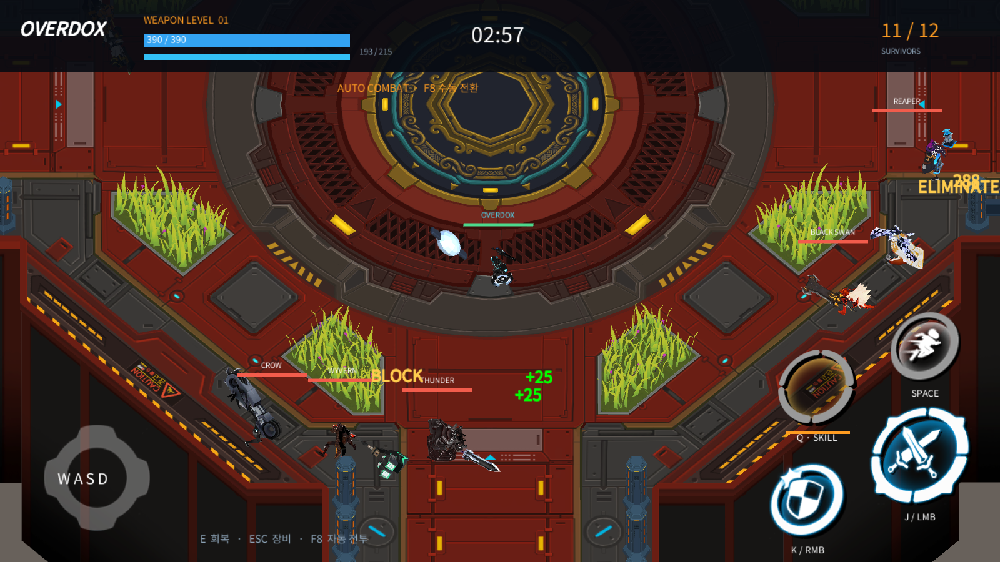
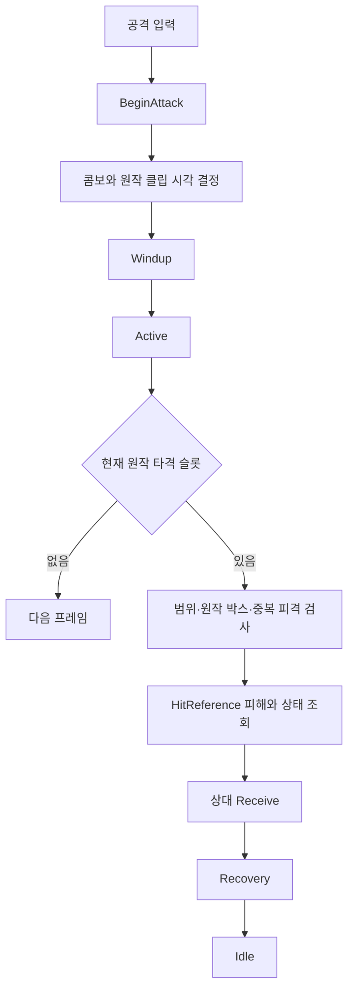

## 작업 결과

검토용 build16의 전투 흐름입니다. 장비별 실제 명중 근거는 고정 build15에서 수집했습니다.



`Assets/Scripts/InGame/Fighter.cs`

```csharp
private void BeginAttack(bool skill)
{
    _combo = NextCombo();
    if(_conditions.TryActive(4,Time.time,out var shock)&&UnityEngine.Random.value<shock.Variable2)
    {
        Receive(null,AttackDamage*shock.Variable1,0);
        if(!IsAlive) { return; }
    }
    _skillAttack = skill;
    if (skill) { ApplyReferencedConditions(ArenaSession.Instance.originalData?.GetSkill(weapon, _combo, true), this, true); }
    AnimationRate = !skill && (weapon.family == 3 || weapon.family == 4) ? 1 + Effects.Sum(38 + Mathf.Min(2, _combo)) : 1;
    _lastAttack = Time.time;
    _hit.Clear();
    _hitSlots.Clear();
    _windupDuration = weapon.duration * (skill ? .55f : .30f);
    _activeDuration = weapon.duration * .28f;
    _recoveryDuration = weapon.duration * .42f;
    if (_restoredVisual != null && _restoredVisual.GetAttackTiming(_combo, skill, out float windup, out float active, out float recovery))
    {
        _windupDuration = windup;
        _activeDuration = active;
        _recoveryDuration = recovery;
    }
    _windupDuration /= AnimationRate; _activeDuration /= AnimationRate; _recoveryDuration /= AnimationRate;
    SetState(CombatState.Windup, _windupDuration);
    ArenaSession.Instance.RecordAction("attack",this);
}
```

`Assets/Scripts/InGame/Fighter.cs`

```csharp
private void SetState(CombatState state, float duration)
{
    State = state;
    _stateStart = Time.time;
    _stateDuration = duration;
}
```

Fighter는 상태·스태미나·공격 시각을 관리합니다. 원작 AnimationEvent의 타격 슬롯과 HitReference의 피해·가드·패링·상태 플래그를 조회합니다. 일반 공격은 원작224개 박스와 로컬 수직 capsule을 대조하며, 스킬은 별도 범위 또는 실행 경로를 사용합니다. 물리 교차 알고리즘 전체가 원작 서버와 같다고 확인하지 않았습니다.

## 변경 내용

### 적용 내용




`Assets/Scripts/InGame/Fighter.cs`

```csharp
private void TickState()
{
    if (State == CombatState.Active)
    {
        int hitSlot = _restoredVisual != null ? _restoredVisual.ActiveHitSlot(AttackElapsed * AnimationRate) : 1;
        float range = weapon.reach * (_skillAttack ? 1.55f : 1);
        float angle = _skillAttack ? 175 : weapon.family == 5 || weapon.family == 6 ? 40 : 75;
        foreach (var other in ArenaSession.Instance.Fighters)
        {
            if (hitSlot == 0 || other == this || !other.IsAlive) { continue; }
            int mask = 1 << hitSlot;
            if (_hitSlots.TryGetValue(other, out int hitMask) && (hitMask & mask) != 0) { continue; }
            bool? touching=!_skillAttack&&_restoredVisual!=null?_restoredVisual.WeaponTouches(other,_combo,hitSlot):null;
            if(touching.HasValue) { if(!touching.Value) { continue; } }
            else if (!CombatRules.InArc(transform.position, transform.forward, other.transform.position, range, angle)) { continue; }
            _hit.Add(other);
            _hitSlots[other] = hitMask | mask;
            float damage = AttackDamage * (1 + _combo * .12f) * (_skillAttack ? 1.9f : 1);
            damage *= SpecialDamageMultiplier;
            float staminaDamage = weapon.stamina * 1.5f;
            bool canGuard = true, canParry = true;
            int damageEffect = 0;
            Overdox.OriginalData.ConditionEffect condition = null;
            int conditionStacks=1;
            if (ArenaSession.Instance.originalData != null)
            {
                var database = ArenaSession.Instance.originalData;
                var skill = database.GetSkill(weapon, _combo, _skillAttack);
                int hitId = hitSlot switch { 2 => skill.Hit2, 3 => skill.Hit3, 4 => skill.Hit4, _ => skill.Hit1 };
                if (hitId == 0) { continue; }
                if (database.Hits.TryGetValue(hitId, out var hit))
                {
                    damage = AttackDamage * SpecialDamageMultiplier * hit.DamageVariable + Mathf.Min(other.MaxHealth * hit.AdditionalDamageVariable, hit.AdditionalDamageLimit);
                    staminaDamage = hit.StaminaDamage * (1 + Effects.Sum(51));
                    canGuard = hit.CanGuard != 0; canParry = hit.CanParrying != 0;
                    damageEffect = hit.DamageEffectIndex;
                    database.Conditions.TryGetValue(hit.ConditionEffectIndex, out condition);
                    conditionStacks=Mathf.Max(1,hit.ConditionEffectParameter1);
                }
            }
            damage *= 1 + Effects.Sum(31) + Effects.Sum(28 + Mathf.Min(2, _combo));
            if (Health < 500) { damage *= 1 + Effects.Sum(25); }
            damage += Effects.Sum(52);
            float chance = Mathf.Max(0, CriticalChance + Effects.Sum(9) + Effects.Sum(46) * _killCritStacks + BuffValue(35) - other.CriticalResistance);
            var factors=ArenaSession.Instance.originalData.Factors;
            chance=Mathf.Min(factors.CharacterCriticalchanceMax,chance);
            if (UnityEngine.Random.value < chance) { damage *= 1 + Mathf.Clamp(CriticalDamage + Effects.Sum(5) - other.Effects.Sum(62),0,factors.CharacterCriticaldamageMax); }
            float beforeHealth = other.Health;
            if (other.HasCondition(2)) { damage *= 1 + Effects.Sum(54); }
            other.Receive(this, damage, staminaDamage, null, canGuard, canParry, damageEffect);
            float dealt = Mathf.Max(0, beforeHealth - other.Health);
            if (condition != null && other.IsAlive && dealt > 0) { other.ApplyCondition(condition,conditionStacks); }
            if (_skillAttack && dealt > 0) { ApplyReferencedConditions(ArenaSession.Instance.originalData.GetSkill(weapon, _combo, true), other, false); }
            float drain = Effects.Lifesteal(Health);
            if (drain > 0 && dealt > 0) { Heal(dealt * drain); }
            ArenaSession.Instance.SpawnSlash(transform.position + transform.forward * .7f, transform.rotation, _skillAttack);
        }
    }
    if (_stateDuration <= 0 || Time.time - _stateStart < _stateDuration) { return; }
    switch (State)
    {
        case CombatState.Windup: { SetState(CombatState.Active, _activeDuration); ArenaSession.Instance.SpawnSlash(transform.position + transform.forward, transform.rotation, _skillAttack); break; }
        case CombatState.Active: { SetState(CombatState.Recovery, _recoveryDuration); break; }
        case CombatState.Recovery:
        case CombatState.Dash:
        case CombatState.Stunned: { SetState(CombatState.Idle, 0); break; }
    }
}
```

## 검증

[최신 회귀 검사](../assets/review16/editmode-05.xml):35/35통과, 종료2026-11-13 13:59:40 KST. [실제 무기 명중 결과](../assets/review16/gear-contact-results.json):고정 build15의38/38종 일반 공격 명중,38종 모두 고유 스킬 충전 소비. 완료14:01:44 KST. build16은 이후 UI 막대와 사용하지 않는 원작 FX 참조를 수정했습니다.

[장비 집계](../assets/review16/equipment-review-summary.json), [무기별 CSV](../assets/review16/weapon-review.csv), [방어구별 CSV](../assets/review16/armor-review.csv). 스킬 피해24종과 체력 증가8종을 관찰했습니다. 체력 증가에는 장비 패시브가 포함될 수 있어 스킬 회복량 독립 검증으로 사용하지 않습니다.

원본 이미지의 크기와 작은 UI 글자를 보존했습니다. Affinity 저장 모달과 사용자 PC 사용 제약으로 추가 이미지 편집·압축은 하지 않았으며200KB 목표를 초과한 PNG를 사용합니다. GIF를 대신한 실제 정지 전후 증거입니다.

## 남은 사항

실측10시간 종료·최종 장비/오류/메모리 집계는 아직 진행 중입니다. 전체 장비 데이터·외형 연결을 원작 서버 계산 전체 동일성으로 보고하지 않습니다. 변신 외형·일부 범위 버프·드론 능력·몬스터·상점·보급품, 일부 스킬 효과·애니메이션이 남아 있습니다. 가드 피해 비율·기본 회피·일부 감전·시작 충전량은 프로토타입 가정입니다.

사용자가 검토와 PC 사용을 요청하여 추가 기능 구현·창 표시·입력·포커스 변경을 멈췄습니다. 기존 자동 검증만 유지합니다. 실제 Affinity wordmark.af는 저장했지만 초기 임시 atlas 네이티브 저장은 미완료입니다. 제품에서는 원작 아이콘으로 대체했습니다. 전역 지침 변경 없음. 프로젝트 전용 지침에 검증된 리그·클립·버전 차이·검증 사본 보존 기준을 기록했습니다.

## 작업 시간

- 제안 시간: 최초 플레이 가능90~150분, 구현 후 실측10시간 검증. 원작 복원 고정 빌드의10시간 도달 예정2026-11-13 15:58 KST.
- 실제로 완료된 시간: 작업 시작2026-11-13 03:50:50 KST. 검토용 build16 전달14:03 KST, 경과약10시간12분(자동 검증·대기 포함). 이 문서는 전달본의 후속 근거 기록이며 전체 목표 완료 보고가 아닙니다.
- XERJ: 미사용 — 연결 확인을 포함해 XERJ를 사용하지 않았습니다. 기존 원작 정적 자료·실행 증거·프로젝트 소스만 사용했습니다.
