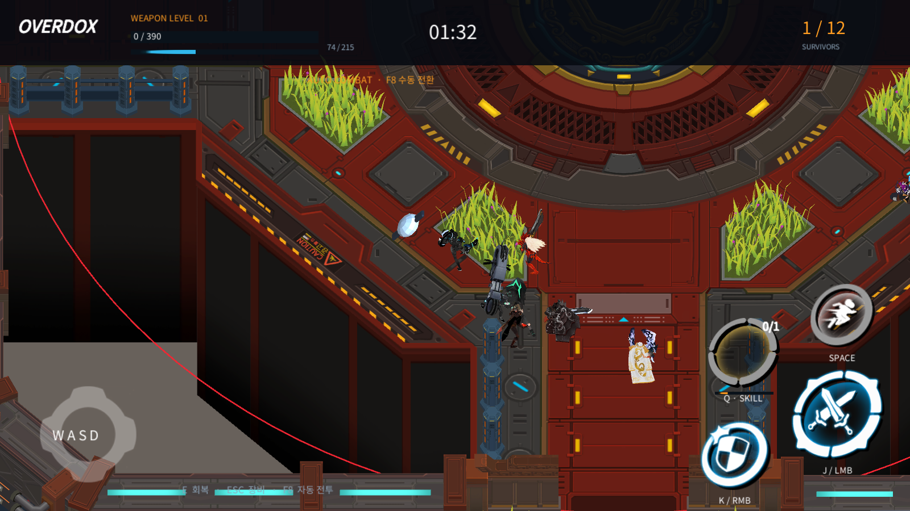
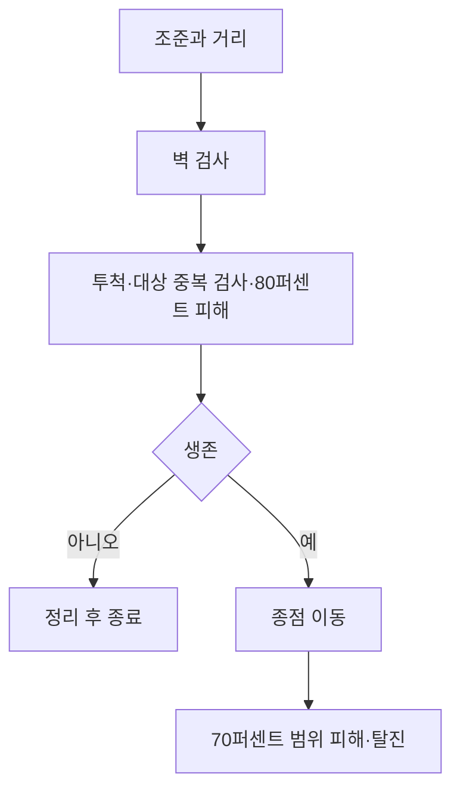

## 작업 결과

고유 스킬 재구현은 원작 Skill·HitReference·ConditionEffect와 한국어 설명을 근거로 합니다. 원작 서버 구현을 확보한 것은 아니며, 미확인 표현·타이밍은 별도로 기록했습니다.



검기 또한 명중 시점에 스킬 피해 종류를 명시적으로 전달합니다.

`Assets/Scripts/InGame/FighterSpecialSkills.cs`

```csharp
private IEnumerator EnergyWave(float rate,float speed,float distance)
{
    yield return new WaitForSeconds(.2f);
    if(!IsAlive) { yield break; }
    Vector3 direction=AimIntent.sqrMagnitude>.01f?AimIntent.normalized:transform.forward;
    var hit=new HashSet<Fighter>();Vector3 origin=transform.position;float travelled=0;
    var visual=new GameObject("Sword energy · original skill 10011");
    Destroy(visual,distance/speed+1);
    var line=visual.AddComponent<LineRenderer>();line.sharedMaterial=ArenaSession.Instance.slashMaterial;line.positionCount=2;line.widthMultiplier=.25f;
    while(travelled<distance&&IsAlive)
    {
        travelled+=speed*Time.deltaTime;Vector3 point=origin+direction*travelled;
        line.SetPosition(0,point+Vector3.up*.6f-direction*.45f);line.SetPosition(1,point+Vector3.up*.6f+direction*.45f);
        foreach(var target in ArenaSession.Instance.Fighters)
        {
            Vector3 delta=target.transform.position-point;delta.y=0;
            if(target!=this&&target.IsAlive&&!hit.Contains(target)&&delta.sqrMagnitude<.8f*.8f)
            {
                hit.Add(target);target.Receive(this,AttackDamage*rate,60,null,true,false,0,true);
            }
        }
        yield return null;
    }
    Destroy(visual);
}
```

## 변경 내용

### 적용 내용

투척80%·추가70%·탈진은 원작 설명과 HitReference1024 근거입니다. 비행 속도·선 표현은 프로토타입 값입니다.



`Assets/Scripts/InGame/FighterSpecialSkills.cs`

```csharp
private IEnumerator ThrowAndTeleport(Skill skill)
{
    // 투척80%·순간이동 후70%와 탈진은 원문 설명/HitReference1024 근거입니다.
    // 비행 속도·선 표현은 로컬 프로토타입 표현이며 원작 서버 값은 미확인입니다.
    Vector3 origin=transform.position;
    Vector3 direction=AimIntent.sqrMagnitude>.01f?AimIntent.normalized:transform.forward;
    float distance=skill.GuideUiPointerLength;
    if(Physics.SphereCast(origin+Vector3.up*.6f,.25f,direction,out var wall,distance,1,QueryTriggerInteraction.Ignore))
    {
        distance=Mathf.Max(0,wall.distance-.3f);
    }
    Vector3 destination=origin+direction*distance;
    SetState(CombatState.Recovery,.55f);
    var hit=new HashSet<Fighter>();
    float travelled=0;
    var visual=new GameObject("Thrown sword · original skill 10014");
    Destroy(visual,1);
    var line=visual.AddComponent<LineRenderer>();line.sharedMaterial=ArenaSession.Instance.slashMaterial;line.positionCount=2;line.widthMultiplier=.3f;
    while(travelled<distance&&IsAlive)
    {
        travelled=Mathf.Min(distance,travelled+15*Time.deltaTime);
        Vector3 point=origin+direction*travelled;
        line.SetPosition(0,point+Vector3.up*.6f-direction*.4f);line.SetPosition(1,point+Vector3.up*.6f+direction*.4f);
        foreach(var target in ArenaSession.Instance.Fighters)
        {
            Vector3 delta=target.transform.position-point;delta.y=0;
            if(target!=this&&target.IsAlive&&!hit.Contains(target)&&delta.sqrMagnitude<.8f*.8f)
            {
                hit.Add(target);target.Receive(this,AttackDamage*SpecialDamageMultiplier*.8f,0,null,true,false,0,true);
            }
        }
        yield return null;
    }
    Destroy(visual);
    if(!IsAlive) { yield break; }
    _controller.enabled=false;transform.position=destination;_controller.enabled=true;
    var database=ArenaSession.Instance.originalData;
    if(database.Hits.TryGetValue(skill.Hit1,out var impact))
    {
        foreach(var target in TargetsInRange(skill.GuideUiRangeRadius))
        {
            float before=target.Health;
            target.Receive(this,AttackDamage*SpecialDamageMultiplier*impact.DamageVariable,impact.StaminaDamage,null,impact.CanGuard!=0,impact.CanParrying!=0,impact.DamageEffectIndex,true);
            if(target.Health<before&&database.Conditions.TryGetValue(impact.ConditionEffectIndex,out var condition))
            {
                target.ApplyCondition(condition,Mathf.Max(1,impact.ConditionEffectParameter1));
            }
        }
    }
    ArenaSession.Instance.SpawnSlash(destination,transform.rotation,true);
    SetState(CombatState.Recovery,.3f);
}
```

## 검증

[최신 회귀 검사](../assets/review16/editmode-05.xml):35/35통과, 종료2026-11-13 13:59:40 KST. [실제 무기 명중 결과](../assets/review16/gear-contact-results.json):고정 build15의38/38종 일반 공격 명중,38종 모두 고유 스킬 충전 소비. 완료14:01:44 KST. build16은 이후 UI 막대와 사용하지 않는 원작 FX 참조를 수정했습니다.

[장비 집계](../assets/review16/equipment-review-summary.json), [무기별 CSV](../assets/review16/weapon-review.csv), [방어구별 CSV](../assets/review16/armor-review.csv). 스킬 피해24종과 체력 증가8종을 관찰했습니다. 체력 증가에는 장비 패시브가 포함될 수 있어 스킬 회복량 독립 검증으로 사용하지 않습니다.

원본 이미지의 크기와 작은 UI 글자를 보존했습니다. Affinity 저장 모달과 사용자 PC 사용 제약으로 추가 이미지 편집·압축은 하지 않았으며200KB 목표를 초과한 PNG를 사용합니다. GIF를 대신한 실제 정지 전후 증거입니다.

[관련 partial 파일 전체](../assets/review16/FighterSpecialSkills.cs)도 함께 보존합니다.

## 남은 사항

실측10시간 종료·최종 장비/오류/메모리 집계는 아직 진행 중입니다. 전체 장비 데이터·외형 연결을 원작 서버 계산 전체 동일성으로 보고하지 않습니다. 변신 외형·일부 범위 버프·드론 능력·몬스터·상점·보급품, 일부 스킬 효과·애니메이션이 남아 있습니다. 가드 피해 비율·기본 회피·일부 감전·시작 충전량은 프로토타입 가정입니다.

사용자가 검토와 PC 사용을 요청하여 추가 기능 구현·창 표시·입력·포커스 변경을 멈췄습니다. 기존 자동 검증만 유지합니다. 실제 Affinity wordmark.af는 저장했지만 초기 임시 atlas 네이티브 저장은 미완료입니다. 제품에서는 원작 아이콘으로 대체했습니다. 전역 지침 변경 없음. 프로젝트 전용 지침에 검증된 리그·클립·버전 차이·검증 사본 보존 기준을 기록했습니다.

## 작업 시간

- 제안 시간: 최초 플레이 가능90~150분, 구현 후 실측10시간 검증. 원작 복원 고정 빌드의10시간 도달 예정2026-11-13 15:58 KST.
- 실제로 완료된 시간: 작업 시작2026-11-13 03:50:50 KST. 검토용 build16 전달14:03 KST, 경과약10시간12분(자동 검증·대기 포함). 이 문서는 전달본의 후속 근거 기록이며 전체 목표 완료 보고가 아닙니다.
- XERJ: 미사용 — 연결 확인을 포함해 XERJ를 사용하지 않았습니다. 기존 원작 정적 자료·실행 증거·프로젝트 소스만 사용했습니다.
