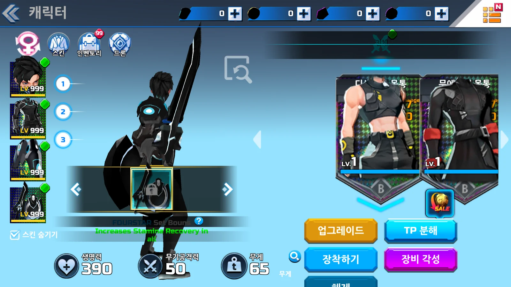
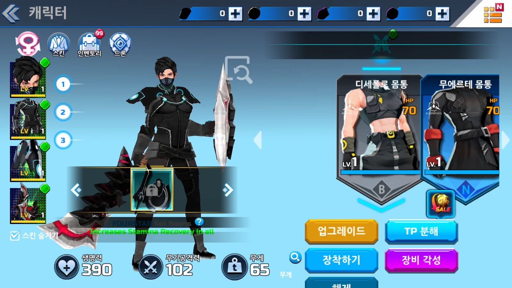
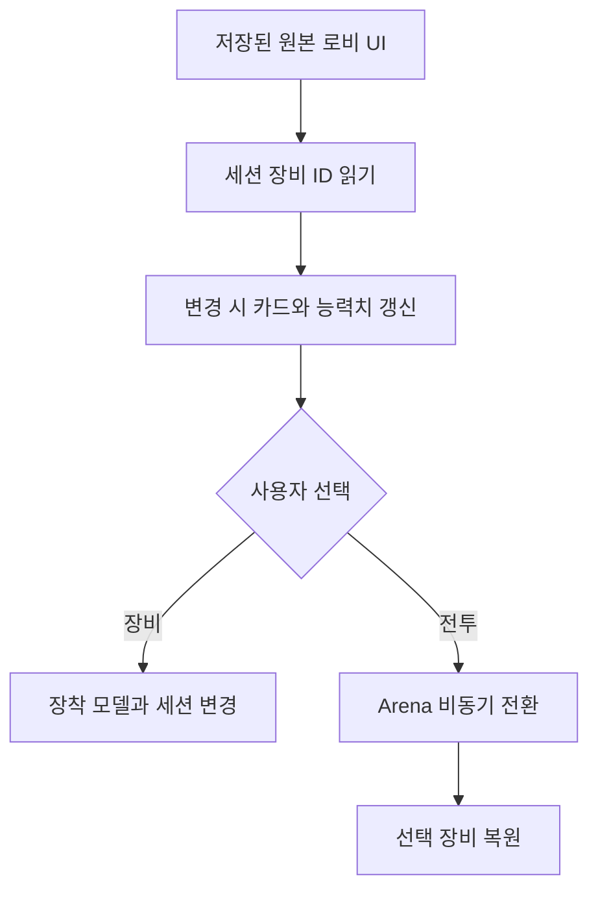

## 작업 결과

원본 폰트·아틀라스·상대 배치와 장비 아이콘119개를 연결했습니다. 원본 자료를 보존하고 플레이용 로비 씬에 정적 UI 속성·버튼 연결을 저장했습니다. 일부 프리팹 내부 수정이 저장되지 않는 현상을 실제 Build18에서 확인한 뒤, 플레이용 인스턴스를 씬으로 풀어 Build19에서 다시 확인했습니다.





전후는 몸통 목록 화면입니다. 자세·레이어·레벨 표시가 달라졌으며 프레임 시점은 동일하지 않습니다.

`Assets/Scripts/UI/RestoredGearCard.cs` 전체:

```csharp
using UnityEngine;
using UnityEngine.UI;

namespace Overdox
{
    public sealed class RestoredGearCard : MonoBehaviour
    {
        public Text title, level, stat, statName;
        public Image thumbnail, frame, brand;
        public Sprite[] rarityFrames, brandIcons;
        public GameObject selectedMark, legendaryEffect;
        private RestoredLobbyController _owner;
        private int _index;
        public void Select() { _owner?.Select(_index); }
        public void Bind(RestoredLobbyController owner, int index, GearRow row, Sprite icon, bool selected, bool weapon, int gearLevel, float value)
        {
            _owner = owner;
            _index = index;
            title.text = row.name;
            level.text = gearLevel.ToString();
            stat.text = value.ToString("0");
            if (statName != null) { statName.text = weapon ? "Damage" : "HP"; }
            if (legendaryEffect != null) { legendaryEffect.SetActive(row.rarity == 4); }
            if (frame != null && rarityFrames != null && row.rarity < rarityFrames.Length) { frame.sprite = rarityFrames[row.rarity]; }
            if (brand != null && brandIcons != null && row.brand < brandIcons.Length) { brand.sprite = brandIcons[row.brand]; }
            thumbnail.sprite = icon;
            thumbnail.enabled = icon != null;
            selectedMark.SetActive(selected);
        }
    }
}

```

## 변경 내용

### 적용 내용



`Assets/Scripts/UI/RestoredLobbyController.cs` 전체:

```csharp
using System;
using UnityEngine;
using UnityEngine.UI;

namespace Overdox
{
    [Serializable] public sealed class RestoredGearIcon
    {
        public int gearId;
        public Sprite male, female;
    }

    /// <summary>저장된 원본 UI에 세션 장비 데이터와 화면 전환만 연결한다.</summary>
    public sealed class RestoredLobbyController : MonoBehaviour
    {
        public GameObject home, equipment, profile, back;
        public Text windowTitle, nickname, health, damage, weight;
        public RestoredGearCard[] cards;
        public Image[] equippedIcons;
        public RestoredGearIcon[] icons;
        private ArenaSession _session;
        private int _slot = -1, _first;
        private int _revision = int.MinValue;

        public void OpenEquipment() { home.SetActive(false); equipment.SetActive(true); profile.SetActive(false); back.SetActive(true); windowTitle.text = "캐릭터"; Refresh(); }
        public void OpenHome() { home.SetActive(true); equipment.SetActive(false); profile.SetActive(true); back.SetActive(false); }
        public void Battle() { _session?.StartMatch(); }
        public void Gender() { _session?.ToggleGender(); Refresh(); }
        public void Weapons() { ChooseSlot(-1); }
        public void Head() { ChooseSlot(0); }
        public void Body() { ChooseSlot(1); }
        public void Cape() { ChooseSlot(2); }
        public void Previous() { Page(-1); }
        public void Next() { Page(1); }
        private void ChooseSlot(int slot) { _slot = slot; _first = 0; Refresh(); }
        private int Count => _slot < 0 ? _session.catalog.Weapons.Count : _session.catalog.Armor.Count / 3;
        private void Page(int direction) { if (_session == null) { return; } _first = (_first + direction + Count) % Count; Refresh(); }

        private void LateUpdate()
        {
            _session ??= ArenaSession.Instance;
            if (_session == null || _session.Player == null) { return; }
            var player = _session.Player;
            int revision = HashCode.Combine(player.weapon.id, player.armor[0].id, player.armor[1].id, player.armor[2].id, player.isFemale, _session.TrainingOffset);
            if (_revision == revision) { return; }
            _revision = revision;
            Refresh();
        }

        public void Select(int index)
        {
            if (_session == null) { return; }
            if (_slot < 0) { _session.ChangeWeapon(index - _session.SelectedWeapon); }
            else { _session.ChangeArmorSlot(_slot, index - _session.Player.armor[_slot].setId); }
            Refresh();
        }

        private Sprite Icon(int id)
        {
            var entry = Array.Find(icons, icon => icon.gearId == id);
            return entry == null ? null : _session.PlayerIsFemale ? entry.female : entry.male;
        }

        private void Refresh()
        {
            if (_session == null || _session.Player == null) { return; }
            var player = _session.Player;
            nickname.text = "OVERDOX";
            health.text = player.MaxHealth.ToString("0");
            damage.text = player.AttackDamage.ToString("0");
            int totalWeight = player.weapon.weight;
            for (int slot = 0; slot < 3; slot++) { totalWeight += player.armor[slot].weight; equippedIcons[slot].sprite = Icon(player.armor[slot].id); }
            equippedIcons[3].sprite = Icon(player.weapon.id);
            weight.text = totalWeight.ToString();
            for (int cardIndex = 0; cardIndex < cards.Length; cardIndex++)
            {
                int index = (_first + cardIndex) % Count;
                GearRow row = _slot < 0 ? _session.catalog.Weapons[index] : _session.catalog.GetArmor(index, _slot);
                bool selected = _slot < 0 ? player.weapon.id == row.id : player.armor[_slot].id == row.id;
                int level = Mathf.Clamp(row.startLevel + _session.TrainingOffset, 1, row.maxLevel);
                float value = _slot < 0 ? _session.originalData.WeaponDamage(row, level) : _session.originalData.ArmorHealth(row, level);
                cards[cardIndex].Bind(this, index, row, Icon(row.id), selected, _slot < 0, level, value);
            }
        }
    }
}

```

## 검증

Computer Use의 @oai/sky로 고정 Windows Build19를 실제 조작했습니다. 캐릭터 화면 열기 → 두 번째 무기 선택 → 공격력50에서102와 모델 변경 → 몸통 목록 전환 → 뒤로 → Battle → Arena → Escape → Lobby 순서입니다. 로그에서 무기10140 →10120 →Arena10120 →Lobby10120 유지가 확인됩니다. 새 빌드에 LV1과 카드 레이어가 저장되는 것도 확인했습니다.

[Build19 공개 요약 로그](../assets/native-ui20/build19-manual-player.log) · [편집기 변환기 전체 소스](../assets/native-ui20/RestoredUiBuilder.cs) · [로비 연결기 전체 소스](../assets/native-ui20/RestoredLobbyBinder.cs) · [이미지 용량 기록](../assets/native-ui20/image-compression.json). 원본 PNG를 별도 보존하고 보고서용 WebP로 인코딩했습니다.

요청 기록(개별 메시지 시각은 미기록): 사용자는 원작 카메라·조작감·이펙트·UI 복원을 요청했고, 앱 창 조작을 다시 허용한 뒤 중단 지시까지 계속하도록 요청했습니다. 이후 데이터 원본은 수식이 있는 Excel, 진입은 스플래시 → 로비 → 인게임으로 지정했고, 마지막으로 “컴퓨터 유즈 써가며 최대한 복원하도록해”라고 요청했습니다. 이 보고서는 해당 지속 작업의 중간 결과입니다.

## 남은 사항

카드 잘림과 가로 스크롤, 일부 원본 임시 문구·통화·알림, 브랜드 보너스 상세 표시가 남았습니다. 상점·서버 이벤트·스킨·드론 메뉴 전체는 아직 연결되지 않았습니다. 원작 로비 카메라 위치·회전과 무기군별 대기 클립을 적용했으나 배경 셰이더·반사·무대 FX의 동일성은 미확인입니다. 모델은 직접 새로 조형한 것이 아니라 원작 배포 자산에서 회수해 재연결한 것입니다. 프로젝트 지침의 원본 보존 기준을 유지했으며 전역 지침 변경은 없습니다.

## 작업 시간

- 제안 시간: 2026-11-13 16:52 KST 시작, UI·FX 1차 실행 확인 30–60분. 전체 복원 기한은 지정되지 않았으며 중단 지시까지 지속합니다.
- 실제로 완료된 시간: 로비 회차 16:52–17:49 KST, 약57분. Build19 빌드 완료17:46:26 KST, Windows 흐름 검증17:49 KST. 구현·빌드·실행 확인 구간이며 전체 프로젝트 완료가 아닙니다.
- XERJ: 미사용 — XERJ 연결 확인을 포함해 사용하지 않았습니다. rg, 보존된 원작 배포 자료와 실제 Unity·Windows 화면 및 로그로 확인했습니다.
