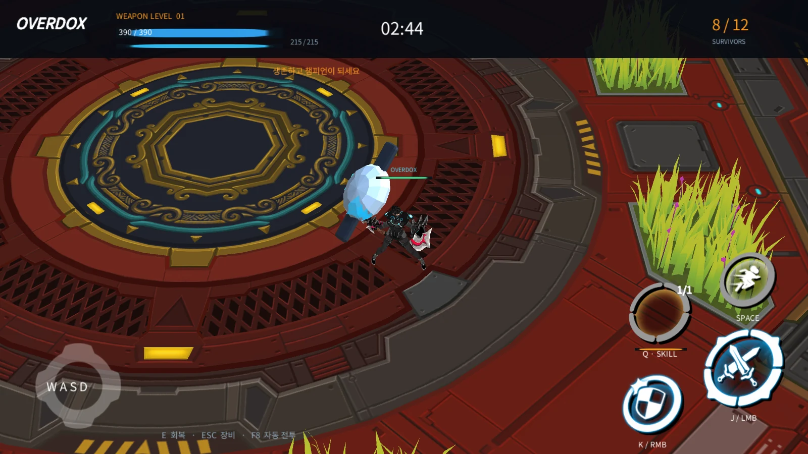
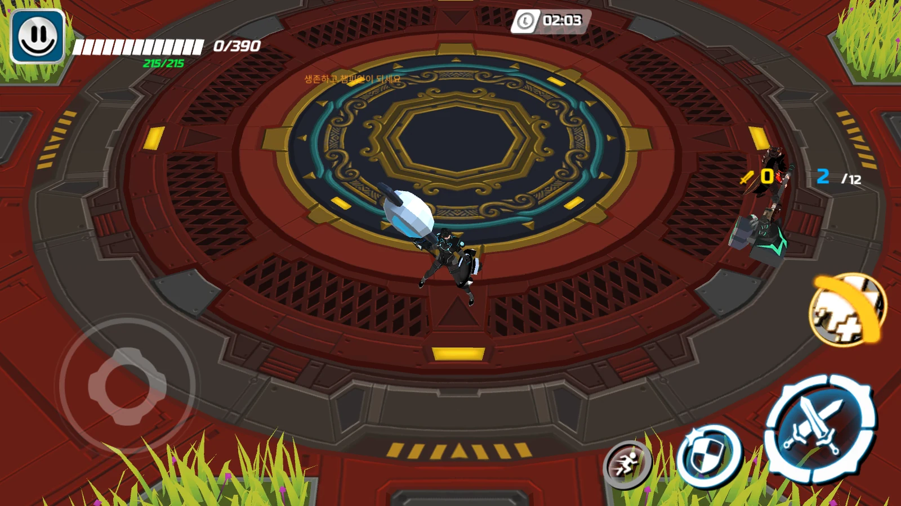
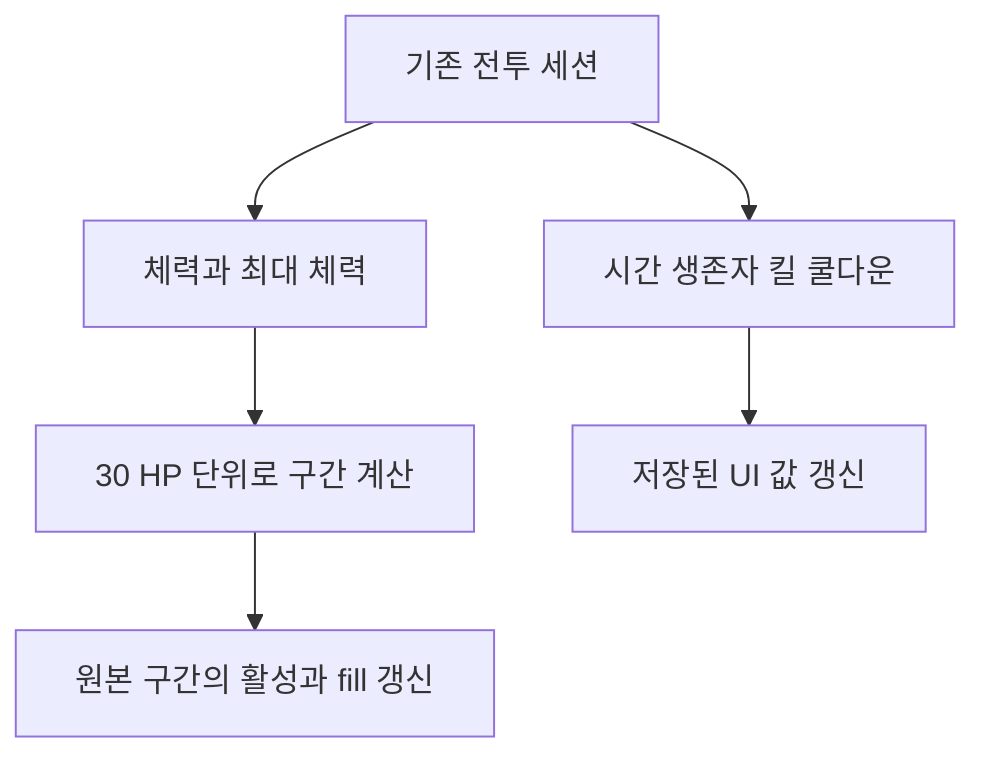
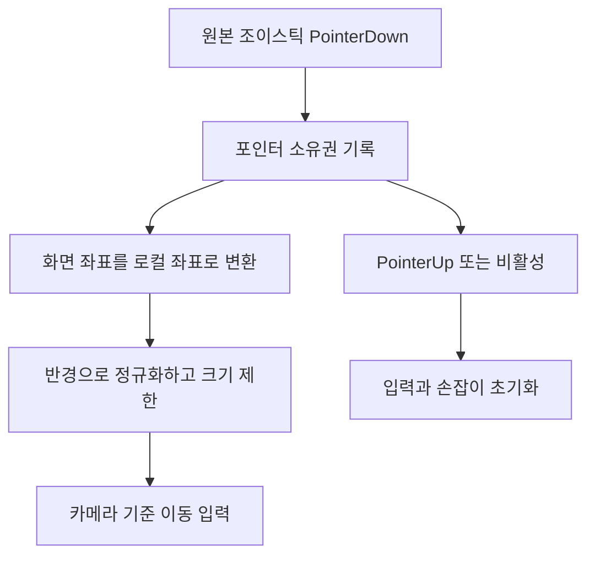

## 작업 결과

원본 배치의 체력 구간·시간·킬·생존자 표시와 공격·가드·회피·스킬 버튼을 로컬 세션에 연결했습니다. 정적 위치·폰트·그림은 씬에 저장하고 동적 수치만 갱신합니다. 원작 HeroInfoUI 생성자 RVA0x1A0DF00에서 오프셋0x68에30을 저장하고, ChangeHitPointMaxAmount RVA0x1A0D8E8에서 이를 나누는 구조를 확인했습니다. 체력390이면13칸을 사용합니다.





서로 다른 전투 시점·무기이며 HUD 교체 범위 비교용입니다. 수정 후 화면은0HP 상태입니다.



`Assets/Scripts/UI/RestoredCombatHud.cs` 전체:

```csharp
using UnityEngine;
using UnityEngine.UI;

namespace Overdox
{
    /// <summary>저장된 원본 전투 HUD의 수치와 체력 구간을 갱신한다.</summary>
    public sealed class RestoredCombatHud : MonoBehaviour
    {
        public Text health, stamina, timer, alive, total, kills;
        public Image[] healthSegments;
        public Text skillTime, dashTime;
        public Image skillCharge, dashCooldown;
        public GameObject[] skillCountRings;
        private void LateUpdate()
        {
            var session = ArenaSession.Instance;
            if (session == null || session.Player == null) { return; }
            var player = session.Player;
            health.text = $"{player.Health:0}/{player.MaxHealth:0}";
            stamina.text = $"{player.Stamina:0}/{player.MaxStamina:0}";
            timer.text = $"{Mathf.FloorToInt(session.Remaining / 60):00}:{Mathf.FloorToInt(session.Remaining % 60):00}";
            alive.text = session.AliveCount.ToString();
            total.text = session.Fighters.Count.ToString();
            kills.text = player.Kills.ToString();
            // HeroInfoUI native constructor: _hpUnitValue = 0x1e (30 HP).
            int count = Mathf.Min(healthSegments.Length, Mathf.CeilToInt(player.MaxHealth / 30));
            float segments = player.Health / 30;
            for (int index = 0; index < healthSegments.Length; index++)
            {
                healthSegments[index].transform.parent.gameObject.SetActive(index < count);
                healthSegments[index].fillAmount = Mathf.Clamp01(segments - index);
            }
            if (count > 0)
            {
                var unit = (RectTransform)healthSegments[count - 1].transform.parent;
                var position = health.rectTransform.anchoredPosition;
                position.x = unit.anchoredPosition.x + healthSegments[count - 1].rectTransform.rect.width + 8;
                health.rectTransform.anchoredPosition = position;
            }
            float skillRemaining = Mathf.Max(0, player.SkillReadyAt - Time.time);
            skillTime.text = skillRemaining > 0 ? Mathf.CeilToInt(skillRemaining).ToString() : "";
            dashTime.text = player.DashRemaining > 0 ? Mathf.CeilToInt(player.DashRemaining).ToString() : "";
            skillCharge.fillAmount = player.SkillChargeFraction;
            dashCooldown.fillAmount = player.DashCooldownFraction;
            for (int index = 0; index < skillCountRings.Length; index++)
            {
                skillCountRings[index].SetActive(index == player.SkillCharges - 1);
            }
        }
    }
}

```

## 변경 내용

### 적용 내용



`Assets/Scripts/UI/RestoredMoveStick.cs` 전체:

```csharp
using UnityEngine;
using UnityEngine.EventSystems;

namespace Overdox
{
    public sealed class RestoredMoveStick : MonoBehaviour, IPointerDownHandler, IDragHandler, IPointerUpHandler
    {
        public RectTransform knob, arrow;
        public float radius = 60;
        private int _pointer = int.MinValue;
        public void OnPointerDown(PointerEventData data)
        {
            if (_pointer != int.MinValue) { return; }
            _pointer = data.pointerId;
            OnDrag(data);
        }
        public void OnDrag(PointerEventData data)
        {
            var session = ArenaSession.Instance;
            if (_pointer != data.pointerId || session == null || !session.IsFighting) { return; }
            if (!RectTransformUtility.ScreenPointToLocalPointInRectangle((RectTransform)transform, data.position, data.pressEventCamera, out var point)) { return; }
            var value = Vector2.ClampMagnitude(point / radius, 1);
            session.TouchMove = value;
            knob.anchoredPosition = value * radius;
            arrow.gameObject.SetActive(value.sqrMagnitude > .01f);
            arrow.localRotation = Quaternion.Euler(0, 0, Mathf.Atan2(value.y, value.x) * Mathf.Rad2Deg - 90);
        }
        public void OnPointerUp(PointerEventData data)
        {
            if (_pointer == data.pointerId) { Release(); }
        }
        private void OnDisable() { Release(); }
        private void Release()
        {
            _pointer = int.MinValue;
            if (ArenaSession.Instance != null) { ArenaSession.Instance.TouchMove = Vector2.zero; }
            if (knob != null) { knob.anchoredPosition = Vector2.zero; }
            if (arrow != null) { arrow.gameObject.SetActive(false); }
        }
    }
}

```

## 검증

고정 Windows Build20에서 Splash → Lobby → Battle → 원본 HUD Arena → Escape → Lobby를 Computer Use로 확인했습니다. 생존자12→8→3→2와 시간 감소,390→66→0 체력 표시에 따라 파란 구간이 줄어드는 것을 관찰했습니다. 조이스틱 드래그와 회피 버튼을 조작했고 전투 중 위치 변화가 나타났습니다. 스킬 버튼은 사망 후 눌려 효과를 검증하지 못했습니다. 버튼 입력 각각의 이동량·명중·쿨다운 정확도는 추가 검증 대상입니다.

[Build20 공개 요약 로그](../assets/native-ui20/build20-manual-player.log) · [전투 UI 연결기 전체](../assets/native-ui20/RestoredCombatUiBuilder.cs). 빌드 성공253718046bytes, 런타임 DLL SHA256 `1ECCB61CE5C9F4B33DF2929750494E4D75C04FFD076EBA9511BD45237B2FB665`. 현재 빌드에 원작 FX의 누락 MonoBehaviour 경고1건이 남습니다. 파티클 모듈 비활성 경고는 제거됐습니다.

요청 기록(개별 메시지 시각은 미기록): 사용자는 원작 카메라·조작감·이펙트·UI 복원을 요청했고, 앱 창 조작을 다시 허용한 뒤 중단 지시까지 계속하도록 요청했습니다. 이후 데이터 원본은 수식이 있는 Excel, 진입은 스플래시 → 로비 → 인게임으로 지정했고, 마지막으로 “컴퓨터 유즈 써가며 최대한 복원하도록해”라고 요청했습니다. 이 보고서는 해당 지속 작업의 중간 결과입니다.

## 남은 사항

원본 미니맵·버프·피격 체력 잔상·장비 레벨·관전·결과 화면, 스킬별 아이콘과 버튼 제스처를 추가 연결해야 합니다. 기본 수치와 조작 연결만으로 원작 조작감 동일성을 주장하지 않습니다. 현재 사망 자세·전투 FX·음향·봇 균형은 추가 복원 대상입니다. 이번10시간 검증은 새 Build20에서 수행하지 않았습니다. 이전 Build11의10시간 결과와 별도 구간입니다. UI 풀의 불필요한 비활성 객체와 기존 HUD의 숨은 갱신 비용은 측정 후 개선할 예정입니다.

## 작업 시간

- 제안 시간: 2026-11-13 17:50 KST 시작, 전투 HUD와 장비 화면 후속 회차45–75분 예상. 이 문서는 먼저 끝난 HUD 실행 구간을 기록합니다.
- 실제로 완료된 시간: HUD 구현·실행 구간17:50–18:07 KST 약17분. Build20 런타임 DLL 생성18:03:53 KST, 실제 Windows Arena 시작18:05:04 KST, Lobby 복귀18:06:19 KST. 장비 화면 후속 작업은 진행 중입니다.
- XERJ: 미사용 — XERJ 연결 확인을 포함해 사용하지 않았습니다. rg, 보존된 원작 배포 자료와 실제 Unity·Windows 화면 및 로그로 확인했습니다.
