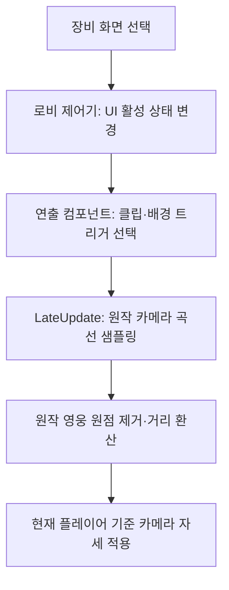
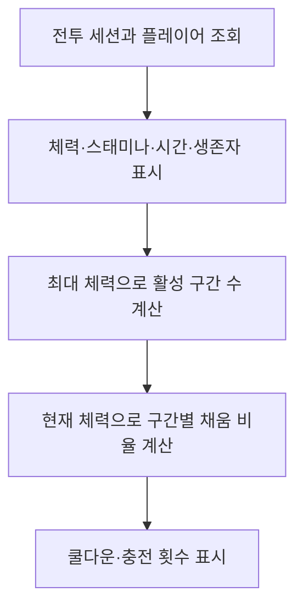

## 작업 결과

로컬 SampleProjectForUnity의 AGENTS.md, 네이밍02·함수03·클래스12·주석17장과 실제 SceneEntry.cs를 함께 읽었습니다. 확인한 로컬 커밋은 `c7b40e5cff3f8310d6f58fa51e54d77dc507bd31`이며 원격 최신과의 동일성은 미확인입니다. 제품에 샘플 의존성을 추가하지 않았습니다.

로비 제어·카메라·장비 카드·전투 HUD·가상 스틱에 한국어 XML 요약, 처리 이유·전제 주석, 중괄호, 생명주기 함수 배치를 반영했습니다. 기존 직렬화 필드를 보존하고 좌표 배율과30HP 구간을 같은 값의 이름 있는 상수로 정리했습니다.

개발 다큐먼트는 다음6개 원문으로 구성했습니다. 프로젝트 구조 → 흐름 → 개발된 기능 → 작성 규칙 순서이며, 실제 구현과 미확인 항목을 구분합니다.

- [01-architecture](../assets/coding-documentation/01-architecture.md)
- [02-flows](../assets/coding-documentation/02-flows.md)
- [03-features](../assets/coding-documentation/03-features.md)
- [04-coding-rules](../assets/coding-documentation/04-coding-rules.md)
- [05-history](../assets/coding-documentation/05-history.md)
- [README](../assets/coding-documentation/README.md)

## 변경 내용

### 적용 내용

### 적용 기준

private 필드 `_camelCase`, 함수·타입 PascalCase, 상수 UPPER_SNAKE_CASE,4칸 들여쓰기, 다음 줄 중괄호를 적용합니다. summary는3줄로 작성하며 역할·입력 전제·부작용·처리 이유를 설명합니다. 기존 직렬화 필드와 공개 콜백은 씬·프리팹 참조를 확인한 후 변경합니다.

### 화면 제어 흐름



핵심 화면 전환 메서드 전체:

```csharp
public void OpenEquipment()
        {
            home.SetActive(false);
            equipment.SetActive(true);
            profile.SetActive(false);
            back.SetActive(true);
            windowTitle.text = "캐릭터";
            presentation?.Transition(true);
            Refresh();
        }
```
```csharp
public void OpenHome()
        {
            home.SetActive(true);
            equipment.SetActive(false);
            profile.SetActive(true);
            back.SetActive(false);
            presentation?.Transition(false);
        }
```

카메라 적용 메서드 전체:

```csharp
private void LateUpdate()
        {
            var session = ArenaSession.Instance;
            if (session == null || !session.IsLobby || session.Player == null || _clip == null || sampledPose == null)
            {
                return;
            }

            // UI 전환은 전투 시간 배율과 독립적으로 재생하며 클립 끝에서 자세를 유지한다.
            _time = Mathf.Min(_time + Time.unscaledDeltaTime, _clip.length);
            _clip.SampleAnimation(sampledPose.gameObject, _time);
            // 클립의 절대 좌표에서 원작 영웅 원점을 제거한 뒤 현재 플레이어 위치에 더한다.
            transform.SetPositionAndRotation(session.Player.transform.position + (sampledPose.localPosition - nativeHeroOrigin) * NATIVE_POSITION_SCALE, sampledPose.localRotation);
        }
```

### 대화 기록

사용자: “코드 작성 규칙 샘플 프로젝트 참고해줄래? 주석은 최대한 남겨주고 다큐먼트도 만들어야해”. 응답 후 로컬 샘플을 찾아 확인하고 첫 적용을 진행했습니다. 요청 메시지의 개별 시각은 미기록입니다.

## 검증

Unity6000.0.83f1 실제 에디터에서 컴파일한 Overdox.Runtime.dll의 갱신 시각은18:53:36 KST입니다. 이후 Play에 재진입해18:54:13 KST 세션 시작과 실제 로비 화면을 확인했습니다. 이 회차는 주석·형식 정리이며 새 자동 테스트를 작성하지 않았습니다. Windows 신규 빌드는 아직 만들지 않았습니다.

전투 HUD의 핵심 갱신 메서드 전체입니다.30HP 구간과 표시값은 기존 동작을 유지합니다.

```csharp
private void LateUpdate()
        {
            var session = ArenaSession.Instance;
            if (session == null || session.Player == null)
            {
                return;
            }
            var player = session.Player;
            health.text = $"{player.Health:0}/{player.MaxHealth:0}";
            stamina.text = $"{player.Stamina:0}/{player.MaxStamina:0}";
            timer.text = $"{Mathf.FloorToInt(session.Remaining / 60):00}:{Mathf.FloorToInt(session.Remaining % 60):00}";
            alive.text = session.AliveCount.ToString();
            total.text = session.Fighters.Count.ToString();
            kills.text = player.Kills.ToString();
            // 최대 체력으로 필요한 구간 수를 정하고 마지막 구간에는 남은 체력 비율을 표시한다.
            int count = Mathf.Min(healthSegments.Length, Mathf.CeilToInt(player.MaxHealth / HEALTH_PER_SEGMENT));
            float segments = player.Health / HEALTH_PER_SEGMENT;
            for (int index = 0; index < healthSegments.Length; index++)
            {
                healthSegments[index].transform.parent.gameObject.SetActive(index < count);
                healthSegments[index].fillAmount = Mathf.Clamp01(segments - index);
            }
            if (count > 0)
            {
                // 원작의 가변 길이 구간 뒤에 수치가 이어지도록 마지막 활성 구간을 기준으로 둔다.
                var unit = (RectTransform)healthSegments[count - 1].transform.parent;
                var position = health.rectTransform.anchoredPosition;
                position.x = unit.anchoredPosition.x + healthSegments[count - 1].rectTransform.rect.width + 8;
                health.rectTransform.anchoredPosition = position;
            }
            float skillRemaining = Mathf.Max(0, player.SkillReadyAt - Time.time);
            // 사용 가능 상태에서는 숫자를 비워 준비된 버튼 그림을 가리지 않는다.
            skillTime.text = skillRemaining > 0 ? Mathf.CeilToInt(skillRemaining).ToString() : "";
            dashTime.text = player.DashRemaining > 0 ? Mathf.CeilToInt(player.DashRemaining).ToString() : "";
            skillCharge.fillAmount = player.SkillChargeFraction;
            dashCooldown.fillAmount = player.DashCooldownFraction;
            for (int index = 0; index < skillCountRings.Length; index++)
            {
                // 링 배열은 충전 횟수별 그림이므로 현재 횟수에 해당하는 하나만 표시한다.
                skillCountRings[index].SetActive(index == player.SkillCharges - 1);
            }
        }
```



코드·문서 변경은 화면 배치를 바꾸지 않아 별도의 전후 화면을 생성하지 않았습니다. 별도로 진행 중인 로비 맵 복원의 화면을 이 코드 정리의 전후 증거로 사용하지 않습니다.

## 남은 사항

전투 본체·에디터 생성 도구 등 나머지 프로젝트 소유 코드 적용은 진행 중입니다. 전체 코드가 이미 규칙을 충족한다고 판정하지 않습니다. 화면 왕복·전투 입력의 후속 실제 실행과 Windows 빌드 확인은 별도 회차에 기록합니다. 문서의 원작 셰이더 차이·미구현 메뉴·장비 데이터 관계도 계속 갱신합니다.

[로비 제어기 전체](../assets/coding-documentation/RestoredLobbyController.cs) · [로비 연출 전체](../assets/coding-documentation/RestoredLobbyPresentation.cs) · [장비 카드 전체](../assets/coding-documentation/RestoredGearCard.cs) · [HUD 전체](../assets/coding-documentation/RestoredCombatHud.cs) · [가상 스틱 전체](../assets/coding-documentation/RestoredMoveStick.cs).

전역 지침 변경 없음. 기존 샘플 규칙의 제품 적용이므로 새 공통 패턴의 검증 결과가 없어 샘플 환류는 보류했습니다. 원작 추출 자산에는 일괄 서식 변경을 적용하지 않았습니다.

## 작업 시간

- 제안 시간: 2026-11-13 18:46:15 KST 시작. 샘플 확인과 첫 적용20–40분 예상. 전체 복원과 전 코드 정리는 이후에도 계속합니다.
- 실제로 완료된 시간: 첫 코드·문서 구현과 Unity 컴파일은18:53:36 KST까지 약7분21초. Play 재진입은18:54:13 KST에 확인했습니다. 보고서 등록·공개 확인과 후속 작업 시간은 별도입니다.
- XERJ: 미사용 — XERJ 연결 확인 없이 로컬 샘플 문서·예제 소스, rg, Unity 실제 컴파일과 Play 화면을 사용했습니다.
