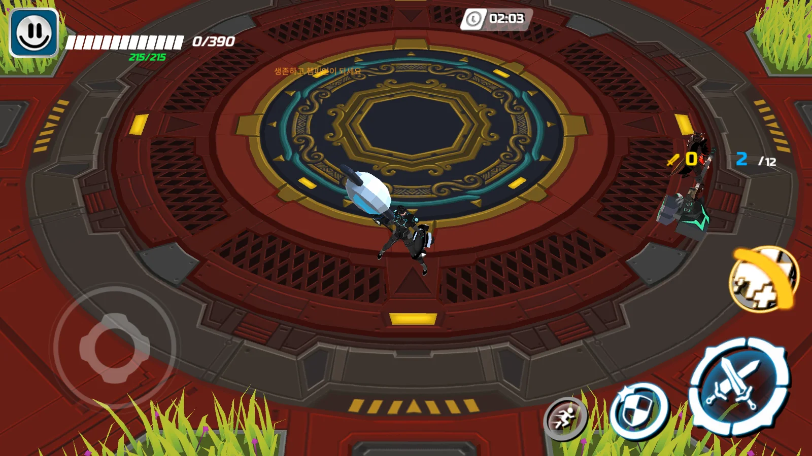
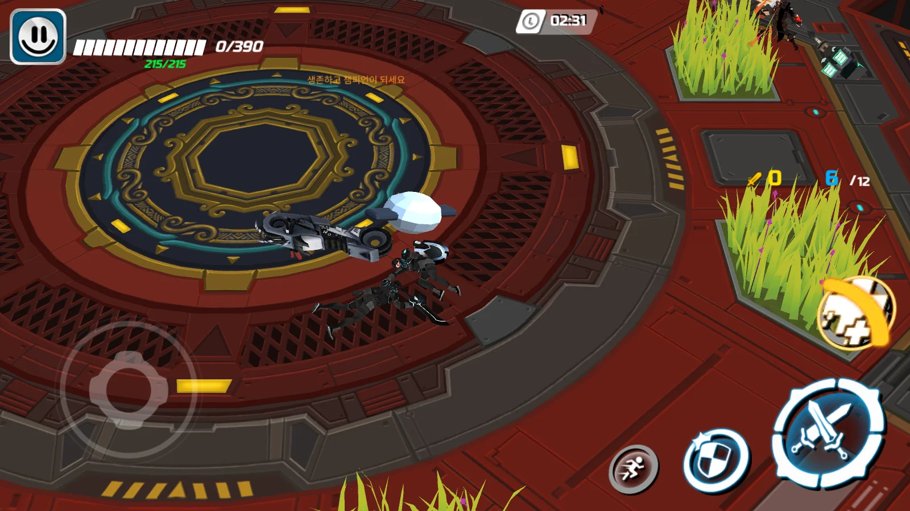
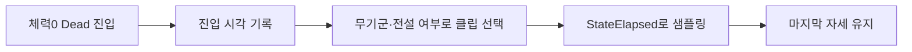

## 작업 결과

기존 Die_01은 몬스터 뼈 경로를 사용해 영웅 리그에서330개 커브가 모두 연결되지 않았습니다.8개 무기군별 사망 클립과 확인되는 전설 전용 클립을 연결했습니다. 원본은 보존하고 시각 라이브러리 참조를 수정했습니다.





같은 맵의0HP 상태 비교입니다. 수정 전은Build20, 수정 후는Build22이며 무기·전투 시각·주변 봇 배치가 다릅니다. Build21 후보 화면은121HP여서 이 비교에서 제외했습니다.

```csharp
private static AnimationClip SelectHeroDeathClip(IEnumerable<AnimationClip> clips, string family, bool isLegendary)
        {
            var clip = clips.Where(candidate => candidate.name.IndexOf("_die", StringComparison.OrdinalIgnoreCase) >= 0)
                .Where(candidate => (candidate.name.IndexOf("_LE", StringComparison.OrdinalIgnoreCase) >= 0) == isLegendary)
                .OrderBy(candidate => candidate.name.Length).FirstOrDefault();
            if (clip == null)
            {
                if (isLegendary)
                {
                    return null;
                }
                throw new InvalidOperationException($"영웅 사망 클립 누락: {family}");
            }

            // 같은 이름의 몬스터 클립이 섞여도 실제 영웅 뼈 경로를 확인해 잘못된 연결을 막는다.
            bool hasHeroBinding = AnimationUtility.GetCurveBindings(clip).Any(binding => binding.path.StartsWith("motion/Bip001", StringComparison.Ordinal));
            if (!hasHeroBinding)
            {
                throw new InvalidOperationException($"영웅 리그와 다른 사망 클립: {clip.name}");
            }
            return clip;
        }
```

## 변경 내용

### 적용 내용

사망 상태는 지속 시간이0이므로 StateProgress 대신 진입 이후의 StateElapsed를 사용합니다. 첫 프레임에서 클립 마지막으로 건너뛰는 문제를 수정하고 끝 자세를 유지합니다. 전체 전투 클립1,293개를 로드하는 대신 경로에서 사망 후보18개를 먼저 거릅니다.



핵심 실행 메서드 전체:

```csharp
private void LateUpdate()
        {
            if (_fighter == null || _animations == null) { return; }
            bool hidden=_fighter.IsHidden;
            if(hidden!=_wasHidden&&_allRenderers!=null)
            {
                _wasHidden=hidden;
                var properties=new MaterialPropertyBlock();
                properties.SetColor("_OccludedColor",_fighter.isPlayer?new Color(.1f,.75f,1,.6f):new Color(1,.25f,.15f,.5f));
                properties.SetFloat("_Opacity",hidden ? (_fighter.isPlayer ? .28f : .03f) : 1);
                foreach(var renderer in _allRenderers) { renderer.SetPropertyBlock(properties); }
            }
            AnimationClip source;
            bool loop = false;
            float time = _fighter.AttackElapsed * _fighter.AnimationRate;
            switch (_fighter.State)
            {
                case CombatState.Windup:
                case CombatState.Active:
                case CombatState.Recovery:
                {
                    source = AttackClip(_fighter.ComboIndex, _fighter.IsSkillAttack);
                    break;
                }
                case CombatState.Guard:
                {
                    source = _animations.guard;
                    time = Time.time;
                    loop = true;
                    break;
                }
                case CombatState.Dash:
                {
                    source = _animations.dash;
                    time = _fighter.StateProgress * (source != null ? source.length : 1);
                    break;
                }
                case CombatState.Dead:
                {
                    // 최종 프레임으로 즉시 건너뛰지 않고 사망 상태 진입 시각부터 재생한다.
                    source = _fighter.weapon.rarity == 4 && _animations.legendaryDeath != null ? _animations.legendaryDeath : _animations.death;
                    time = _fighter.StateElapsed;
                    break;
                }
                default:
                {
                    source = ArenaSession.Instance != null && ArenaSession.Instance.IsLobby && _animations.lobbyIdle != null
                        ? _animations.lobbyIdle : _fighter.MoveIntent.sqrMagnitude > .01f ? _animations.move : _animations.idle;
                    time = Time.time;
                    loop = true;
                    break;
                }
            }
            if (source == null) { source = _animations.idle; }
            if (source == null) { return; }
            if (!CLIPS.TryGetValue(source, out var clip))
            {
                clip = Instantiate(source);
                clip.name = source.name + " (visual adapter)";
                clip.events = Array.Empty<AnimationEvent>();
                clip.legacy = true;
                CLIPS.Add(source, clip);
            }
            float sample = loop && clip.length > 0 ? time % clip.length : Mathf.Min(time, clip.length);
            // 비반복 클립은 마지막 자세에 머문다. 사망 상태는 Idle로 자동 복귀하지 않는다.
            clip.SampleAnimation(gameObject, sample);
            transform.localPosition = Vector3.zero;
            transform.localRotation = Quaternion.identity;
        }
```

## 검증

Unity 실제 AnimationUtility 커브와 남녀 리그를 사용해8개 일반·1개 전설 클립의18경우를 검사했습니다.18개 모두 포즈 회전 변화가 있었고13개는 커브가 모두 연결됐습니다.5개에는 추가 머리카락·성별 뼈·회수되지 않은 해시 경로가 남습니다. 포즈 변화만으로 완전한 원작 일치를 판정하지 않습니다. Build22 실제 Windows 경기에서 남성 검·방패 캐릭터가0HP에서 쓰러지는 것을 확인했습니다. 다른 무기군·성별은 리그 검사 범위입니다.

[리그별 결과·누락 경로](../assets/native-ui22/rig-bindings.json) · [Windows 확인 요약](../assets/native-ui22/build22-verification.json) · [고정 빌드 해시](../assets/native-ui22/build22-manifest.json). 이번 빌드의 새10시간 검증은 수행하지 않았습니다.

보고용5장은 실제 Affinity 3.3.3 GUI에서1600×900 고품질 WebP로 내보냈습니다. 원본 PNG와 별도 AF5개를 보존하고 실제 닫기·재열기 후5개 모두 clean 상태를 확인했습니다. SDK 저장·내보내기는 PERMISSION_DENIED로 실패하여 GUI를 사용했고 보안 설정은 변경하지 않았습니다.

## 남은 사항

추가 커브 경로5경우, 나머지 무기군·성별의 실제 경기, 사망 FX·페이드·결과 화면이 남았습니다. 이번 회차에는 Blender·Affinity 자산 편집을 수행하지 않았습니다. 샘플 규칙의 전체 코드 적용도 진행 중이며 기존 압축 작성 코드 일부는 남습니다.

[클립 선택·연결 전체](../assets/native-ui22/RestoredDeathBuilder.cs) · [리그 검사 전체](../assets/native-ui22/RestoredDeathVerification.cs) · [시각 어댑터 전체](../assets/native-ui22/RestoredFighterVisual.cs) · [개발 문서](../assets/native-ui22/06-equipment-and-death.md).

## 작업 시간

- 제안 시간: 2026-11-13 19:11:05 KST 시작. 캐러셀·사망 클립 구현과 첫 실행 확인40~60분 예상. 지속 목표는 중단 지시까지 유지합니다.
- 실제로 완료된 시간: 구현·Windows 실행 확인19:11:05~19:44:06 KST, 실측33분1초. 첫 컴파일19:23:37, Build22 런타임 DLL19:36:31, 수동 실행 확인 종료19:44:06 KST. 문서·공개 보고 작성 시간은 별도이며 전체 프로젝트 완료가 아닙니다.
- XERJ: 미사용 — XERJ는 연결 확인을 포함해 사용하지 않았습니다. 보존된 자료의 직렬화 필드, Unity API, 실제 Windows 실행 화면과 로그를 사용했습니다.
