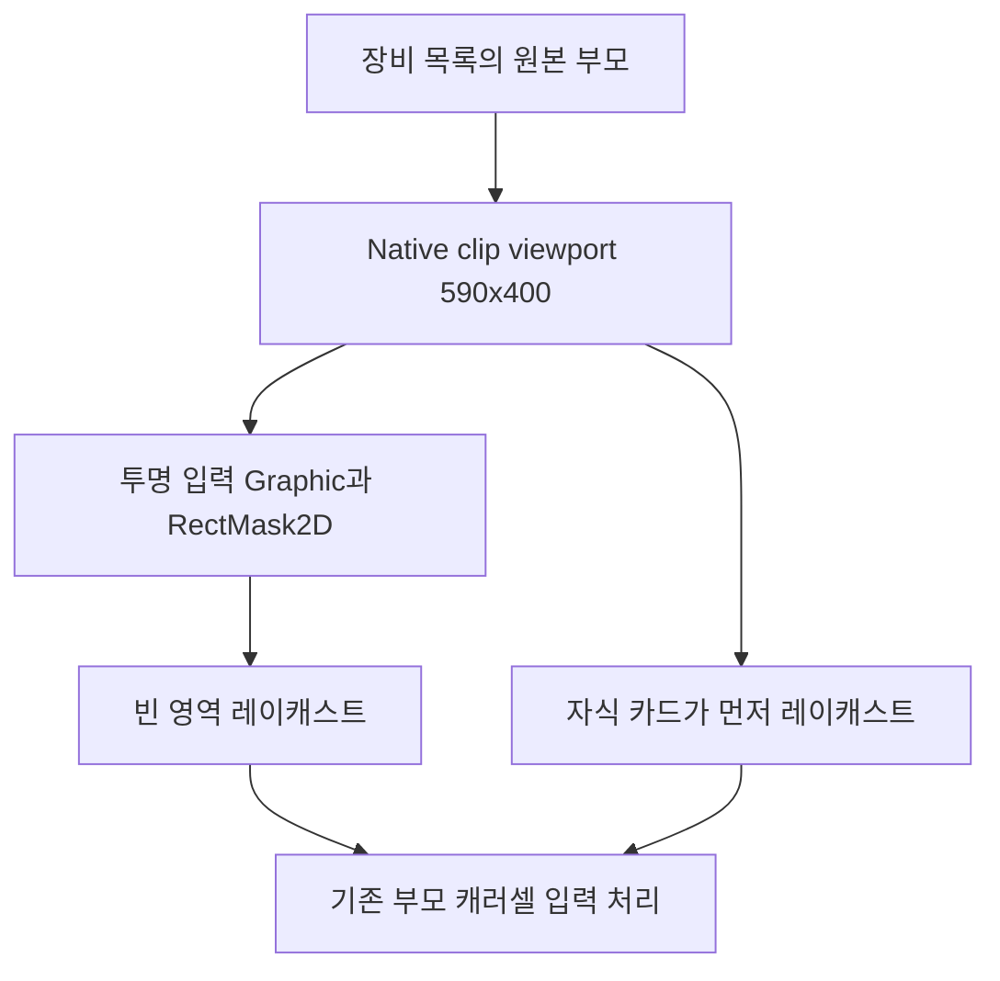

## 작업 결과

Build22의 연결기는 투명 입력 이미지를 기본100×100 부모 Rect에 붙였습니다. 원작590×400 클리핑 범위는 Native clip viewport 자식에 저장되어 있어 카드 밖 빈 영역의 입력 범위가 작았습니다. 투명 이미지를 마스크와 같은 자식에 옮겨 씬에 저장했습니다. 이 변경은 이미지·카메라 배치를 바꾸지 않는 입력 영역 수정입니다.

[수정 전후 실제 Rect 크기](../assets/equipment-hitarea23/hit-area.json)에서100×100 →590×400과 마스크·입력 Rect 동일성을 확인할 수 있습니다. 실제 실행 캡처는 프로젝트의 equipment-hitarea-editor-after.png와 equipment-hitarea-build23-after.png에 보존했습니다.

[이전 캐러셀·장착 보고](2026-11-13-result-20261113111406784-v1.0.0.html)의 고정 Build22 첨부는 덮어쓰지 않았습니다.

## 변경 내용

### 적용 내용

빈 영역은 투명 Graphic이, 카드 위는 자식 카드 Graphic이 먼저 레이캐스트됩니다. 실제 드래그 수신 컴포넌트는 기존 Scroll View 부모에 유지합니다.



수정한 씬 연결 메서드 전체:

```csharp
public static void RestoreEquipmentCarousel()
        {
            if (EditorApplication.isPlaying || SceneManager.GetActiveScene().isDirty)
            {
                throw new InvalidOperationException("현재 씬을 저장하고 재생을 종료하세요.");
            }
            var setup = EditorSceneManager.GetSceneManagerSetup();
            var scene = EditorSceneManager.OpenScene("Assets/Scenes/OverdoxLobby.unity", OpenSceneMode.Single);
            var controller = UnityEngine.Object.FindFirstObjectByType<RestoredLobbyController>();
            var document = controller.GetComponent<RestoredUiDocument>();
            var viewport = document.Find(37814);
            var carousel = viewport.GetComponent<RestoredEquipmentCarousel>() ?? viewport.gameObject.AddComponent<RestoredEquipmentCarousel>();
            carousel.owner = controller;
            carousel.items = controller.cards.Select(card => (RectTransform)card.transform.parent).ToArray();
            carousel.cellWidth = 210;
            carousel.springStrength = 16;
            carousel.neighborScale = .65f;
            controller.carousel = carousel;

            // 원본 UIPanel의 부모 Rect는 기본 크기다. 실제 원작 클리핑 크기는 별도 자식에 저장된다.
            var clipViewport = viewport.Find("Native clip viewport") as RectTransform;
            if (clipViewport == null || clipViewport.GetComponent<RectMask2D>() == null)
            {
                throw new InvalidOperationException("장비 목록의 원작 클리핑 영역을 먼저 복원하세요.");
            }
            var previousSize = viewport.rect.size;
            var previousHitArea = viewport.GetComponent<Image>();
            if (previousHitArea != null)
            {
                UnityEngine.Object.DestroyImmediate(previousHitArea);
            }

            // 투명 Graphic을 마스크와 같은 Rect에 둔다. 빈 곳도 입력을 받되 자식 카드가 우선한다.
            var hitArea = clipViewport.GetComponent<Image>() ?? clipViewport.gameObject.AddComponent<Image>();
            hitArea.color = Color.clear;
            hitArea.raycastTarget = true;
            Wire(document.Find(36204), controller.EquipFocused);
            document.Find(34159).gameObject.SetActive(false);
            document.Find(36204).gameObject.SetActive(true);
            EditorSceneManager.SaveScene(scene);
            var hitAreaResult = new EquipmentHitAreaResult
            {
                utc = DateTime.UtcNow.ToString("o"),
                previousSize = previousSize,
                clipSize = clipViewport.rect.size,
                hitSize = hitArea.rectTransform.rect.size,
                sharesClipRect = hitArea.transform == clipViewport,
                raycastTarget = hitArea.raycastTarget
            };
            Directory.CreateDirectory("Docs/Verification/EquipmentCarousel");
            File.WriteAllText("Docs/Verification/EquipmentCarousel/hit-area.json", JsonUtility.ToJson(hitAreaResult, true));
            EditorSceneManager.RestoreSceneManagerSetup(setup);
            Debug.Log("OVERDOX_EQUIPMENT_CAROUSEL_READY cards=10 spacing=210 spring=16");
        }
```

## 검증

Unity 에디터 컴파일20:23:17 KST, 실제 씬 저장20:22:40 KST입니다.20:24:32 KST의 실제 EventSystem 레이캐스트에서 중앙 카드는 EquipmentElement (6), 네 모서리는 Native clip viewport를 먼저 맞췄고 모두 Scroll View 캐러셀로 전달됐습니다.20:25:56 KST의 별도 이벤트 재생은0→1 이동을 통과했습니다.

Windows Build23은20:27:12 KST 성공258,961,274B이며150파일 고정 사본과 전체 해시를 보존했습니다. 실제 Windows에서 카드 밖 우측 위 빈 영역(1180,230)의 휠 입력으로 열람3→4를 확인했습니다. 히드라를 열람해도 장착 모델과 공격력50은 유지됐고 로비 뒤로가기가 동작했습니다. OS 드래그 자동 조작에서는 시작·종료 로그가0건이므로 성공을 판정하지 않습니다.

[실제5개 입력 경로](../assets/equipment-hitarea23/input-routes-with-clip.json) · [이벤트 재생](../assets/equipment-hitarea23/drag-events-with-clip.json) · [Windows 실행 범위](../assets/equipment-hitarea23/build23-verification.json) · [고정 빌드 해시](../assets/equipment-hitarea23/build23-manifest.json). 씬 연결 변경이므로 런타임 DLL은Build22와 같으며 DLL 해시만으로 이 변경을 검증하지 않았습니다.

## 남은 사항

OS 마우스 드래그·원작 관성·장비119개 전수 화면·전체 UI와 효과의 동일성은 남습니다. Build23 새10시간 검증은 미실행입니다. Windows 확인은 빈 영역 휠·열람 중 장착 유지·로비 뒤로가기 범위이며 전투·사망은 이번 빌드에서 재검증하지 않았습니다.

[연결기·입력 검사 전체 소스](../assets/equipment-hitarea23/RestoredEquipmentBuilder.cs) · [갱신된 개발 문서](../assets/equipment-hitarea23/06-equipment-and-death.md). 한국어 주석으로 실제 클리핑 자식에 연결하는 이유와 OS 입력·이벤트 재생 검증의 차이를 남겼습니다. 전역 지침 변경 없음, 제품 고유 자산 계층 전용 수정이므로 샘플 환류는 보류합니다.

## 작업 시간

- 제안 시간: 2026-11-13 19:57:25 KST 게시·첫 입력 확인30~60분 예상으로 시작한 지속 회차. 입력 영역 후속 구현은20:21 KST에 시작했습니다.
- 실제로 완료된 시간: 입력 영역 구현·Windows 확인20:21:01~20:30:37 KST, 실측9분36초. 빌드20:27:12, 실행 확인 기록20:30:37 KST. 보고 게시 시간은 별도이며 전체 복원은 진행 중입니다.
- XERJ: 미사용 — XERJ 연결 확인 없음. 기존 소스·실제 Unity API 레이캐스트·Windows 고정 빌드로 확인했습니다.
