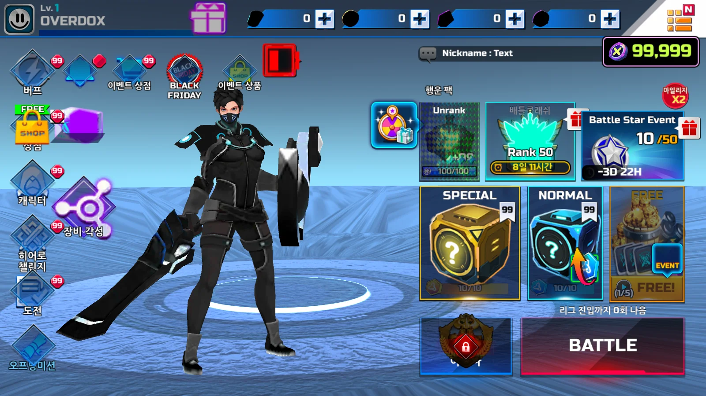
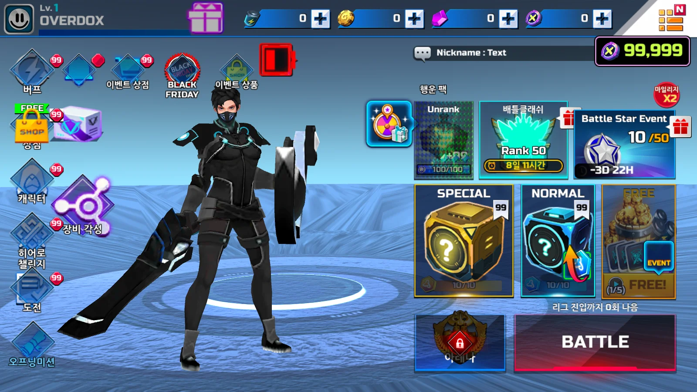
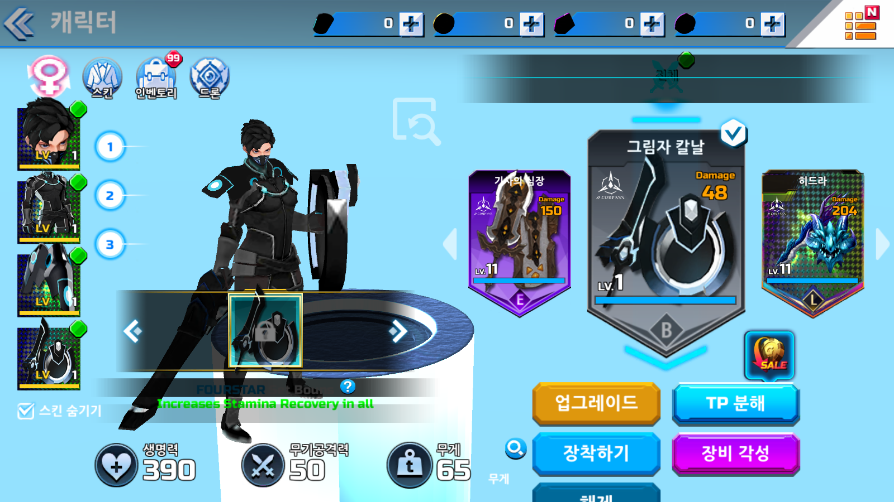
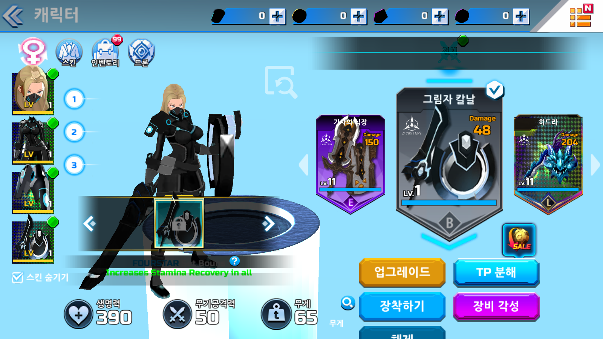
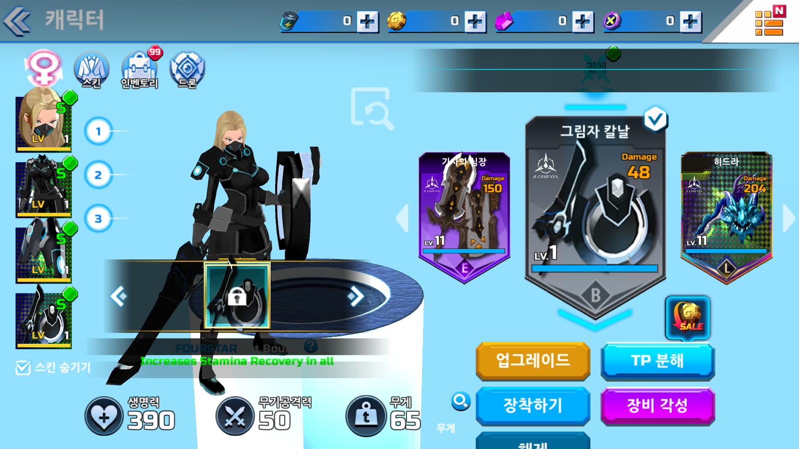
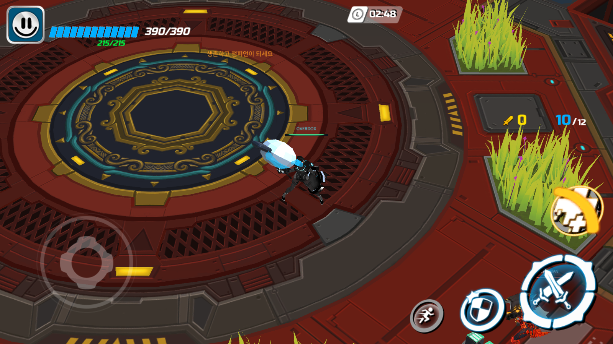
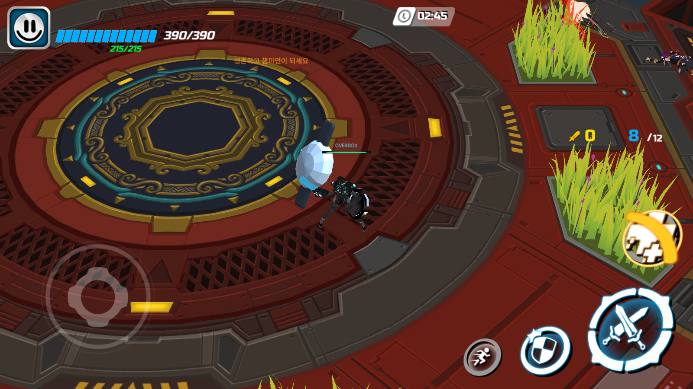
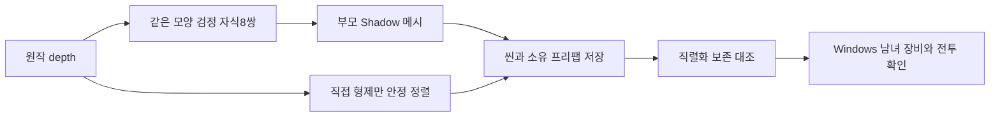

## 작업 결과

원작 NGUI의 Widget.depth가 uGUI 변환에서 누락됐고, 낮은 depth 검정 자식이 부모 아이콘을 덮었습니다. 동일 모양8쌍은 뒤쪽 Shadow 메시로, 직접 형제는 원작 depth로 정렬했습니다. 재화·상점 상자·채팅 아이콘이 드러났습니다.

수정 전은 보존한 Build25를 실제 실행해 재현 촬영했습니다. 장비는10140 기본 상태입니다. 전투 두 화면은 타이머02:46/02:42·생존 수10/8과 봇 위치가 다른 별도 매치이므로 UI 배치만 비교합니다.

로비 재화·상점·채팅:






남성 장비:




여성 장비:






전투 HUD:





## 변경 내용

### 적용 내용

원본 Transform·Image·바인딩·좌표를 보존하고 동일 스프라이트 검정 자식만 비활성화했습니다. 별도 Canvas나 매 프레임 위치 동기화는 추가하지 않습니다. 기존 변환기에도 연결했습니다.



그림자 변환 핵심 메서드 전체:

```csharp
        private static int[] RestoreNativeShadows(Layout layout, Dictionary<int, RectTransform> objects)
        {
            var nodes = layout.transforms.ToDictionary(node => node.id);
            var widgets = layout.widgets.ToDictionary(widget => widget.transformId);
            var repaired = new List<int>();
            foreach (var shadow in layout.widgets)
            {
                var node = nodes[shadow.transformId];
                if (!widgets.TryGetValue(node.parentId, out var icon) || shadow.depth >= icon.depth ||
                    shadow.type != "UISprite" || icon.type != "UISprite" || shadow.sprite != icon.sprite || shadow.atlas != icon.atlas ||
                    shadow.width != icon.width || shadow.height != icon.height || shadow.pivot != icon.pivot || shadow.flip != icon.flip ||
                    shadow.color.r != 0 || shadow.color.g != 0 || shadow.color.b != 0 ||
                    node.scale != Vector3.one || Quaternion.Angle(node.rotation, Quaternion.identity) > .001f)
                {
                    continue;
                }
                if (!objects.TryGetValue(icon.transformId, out var iconRect) || !objects.TryGetValue(shadow.transformId, out var shadowRect))
                {
                    continue;
                }
                var iconImage = iconRect.GetComponent<Image>();
                var shadowImage = shadowRect.GetComponent<Image>();
                if (iconImage == null || shadowImage == null)
                {
                    throw new InvalidOperationException("원본 그림자 쌍의 Image가 없습니다: " + shadow.transformId);
                }
                // NGUI는 자식도 depth로 먼저 그릴 수 있지만 uGUI는 부모 Graphic 뒤에 자식을 그린다.
                // 동일 스프라이트 쌍은 Shadow 메시를 사용하면 계층·클리핑·동적 아이콘 참조를 유지할 수 있다.
                var effect = iconRect.GetComponent<RestoredNativeShadow>() ?? iconRect.gameObject.AddComponent<RestoredNativeShadow>();
                effect.effectColor = shadow.color;
                effect.effectDistance = new Vector2(node.position.x, node.position.y);
                effect.useGraphicAlpha = false;
                effect.enabled = node.active && shadow.enabled;
                shadowImage.enabled = false;
                EditorUtility.SetDirty(iconRect.gameObject);
                EditorUtility.SetDirty(shadowImage);
                repaired.Add(icon.transformId);
            }
            return repaired.ToArray();
        }
```

## 검증

Unity6000.0.83f1, 실제 적용21:41:27.800 KST. Lobby 프리팹178·씬168, GameRoom 프리팹·Arena 씬 각160개 부모 그룹 순서를 바꿨습니다. Lobby 양쪽에 그림자8쌍씩 적용했습니다. 네 대상의 기존 직렬화 객체 전체 대조에서 순서·Shadow 추가·Image 비활성화 외 변경0건입니다. 현재 남녀 프리팹·비주얼 라이브러리·스크립트·본 메타데이터5파일 해시는 같습니다. 사용자께서 언급한 별도 리깅 변경의 구체적 차이는 미확인입니다.

Build26은21:43:41 KST 성공258,962,218B.150파일 해시 보존. 실제 Windows에서 Splash→Lobby→장비→남녀 전환, 여성10150 장착 공격력50→214→10140 복구50→남성→전투→Esc 로비 복귀를 확인했습니다. 공격 버튼 후 스태미나215→210 관찰. 대시 직후 관찰은 보존되지 않아 수동 성공 미확인. 집계는 봇을 포함하므로 수동 입력 증거로 대체하지 않습니다. 이후 탈락 결과와 로비 복귀를 관찰했습니다.

직접 형제 순서 핵심 메서드 전체:

```csharp
        private static int[] RestoreSiblingDepth(Layout layout, Dictionary<int, RectTransform> objects)
        {
            var depthById = layout.widgets.ToDictionary(widget => widget.transformId, widget => widget.depth);
            var idByRect = objects.ToDictionary(pair => pair.Value, pair => pair.Key);
            var changedParents = new List<int>();
            foreach (var group in objects.Where(pair => depthById.ContainsKey(pair.Key) && pair.Value.parent != null).GroupBy(pair => pair.Value.parent))
            {
                var original = group.Key.Cast<Transform>().ToArray();
                var selected = group.Select(pair => (Transform)pair.Value).ToHashSet();
                var ordered = original.Where(selected.Contains).OrderBy(child => depthById[idByRect[(RectTransform)child]]).ThenBy(child => child.GetSiblingIndex()).ToArray();
                var desired = original.ToArray();
                int cursor = 0;
                for (int index = 0; index < desired.Length; index++)
                {
                    if (selected.Contains(desired[index]))
                    {
                        desired[index] = ordered[cursor++];
                    }
                }
                if (original.SequenceEqual(desired))
                {
                    continue;
                }
                // 원본 위젯끼리의 그리기 순서만 변경한다. 원본 ID·부모·Rect·비위젯 자식 슬롯은 유지한다.
                for (int index = 0; index < desired.Length; index++)
                {
                    desired[index].SetSiblingIndex(index);
                }
                changedParents.Add(idByRect.TryGetValue(group.Key as RectTransform, out int parentId) ? parentId : 0);
            }
            return changedParents.ToArray();
        }
```

[적용 기록](../assets/ui-depth26/shadow-repair.json) · [직렬화 대조](../assets/ui-depth26/serialized-preservation.json) · [아바타 해시](../assets/ui-depth26/avatar-preserved.json) · [빌드 해시](../assets/ui-depth26/build26-manifest.json) · [실제 흐름](../assets/ui-depth26/build26-flow.log)

## 남은 사항

전체 UI 동일성은 미완료입니다. 다른 모양·크기의 낮은 depth 부모·자식 후보 Lobby90·GameRoom56과 다른 가지 사이 순서는 추가 점검이 필요합니다. 후보 전부가 오류라는 뜻은 아닙니다. 녹색S등급·일부 브랜드 문자열은 원본 템플릿의 동적 바인딩 미완료입니다. 전체119장비·모든 남녀 리깅·카메라·FX·새 Build26의10시간은 검증하지 않았습니다.

[핵심 전체 소스](../assets/ui-depth26/RestoredUiShadowBuilder.cs) · [개발 문서](../assets/ui-depth26/09-ui-depth.md). 원본 PNG8장을 보존했고 로비 WebP는 실제 Affinity에서 내보냈습니다. 나머지 PNG의 추가 압축은 미완료이며 원본 해상도로 제공합니다. 전체 복원 목표는 유지합니다.

### 대화 기록
사용자는 재화 이미지와 그림자 depth 역전 및 추가 UI 겹침을 지적했고 남녀 아바타·리깅 변경을 참고하라고 요청했습니다. 현재 아바타 참조 보존과 실제 남녀 전환을 확인했습니다. 전역 지침 변경 없음. 프로젝트 전용 지침에는 확인된 depth 변환 경계를 기록합니다.

## 작업 시간

- 제안 시간: 2026-11-13 21:28:21 KST 시작, 첫 수정·실행 확인20~40분. 이미지·공개 보고에15~25분 추가 예상 안내. 전체 복원 완료 예상과 구분합니다.
- 실제로 완료된 시간: 구현·저장21:41:27.800, 빌드21:43:41 KST(시작부터15분20초), 실제 흐름 마지막 로비 복귀21:55:58 KST(27분37초). 문서·이미지·공개 게시 진행 중이며 회차 종료 시각은 별도 기록합니다.
- XERJ: 미사용 — XERJ 연결·검색 없이 추출 UI 데이터와 실제 Unity·Windows 화면으로 확인했습니다.
