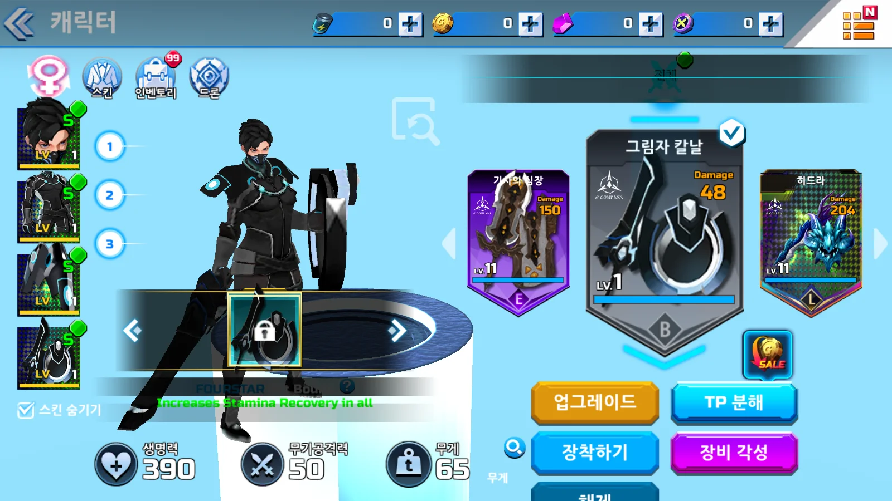
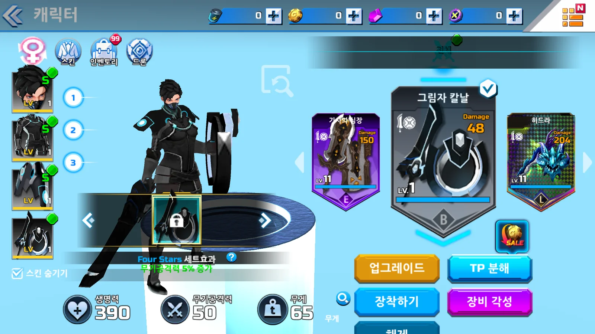
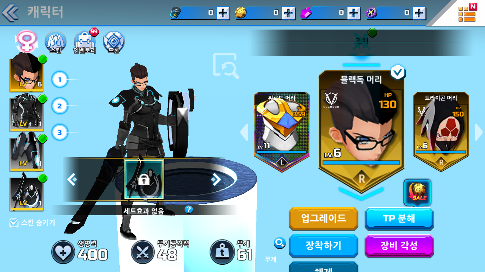
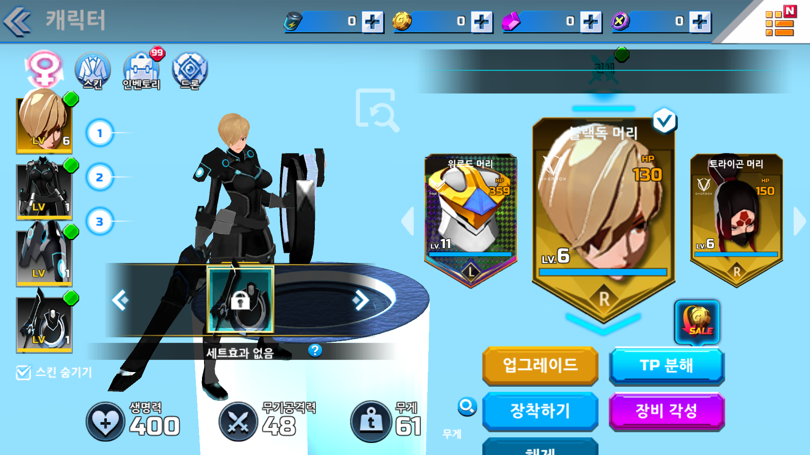
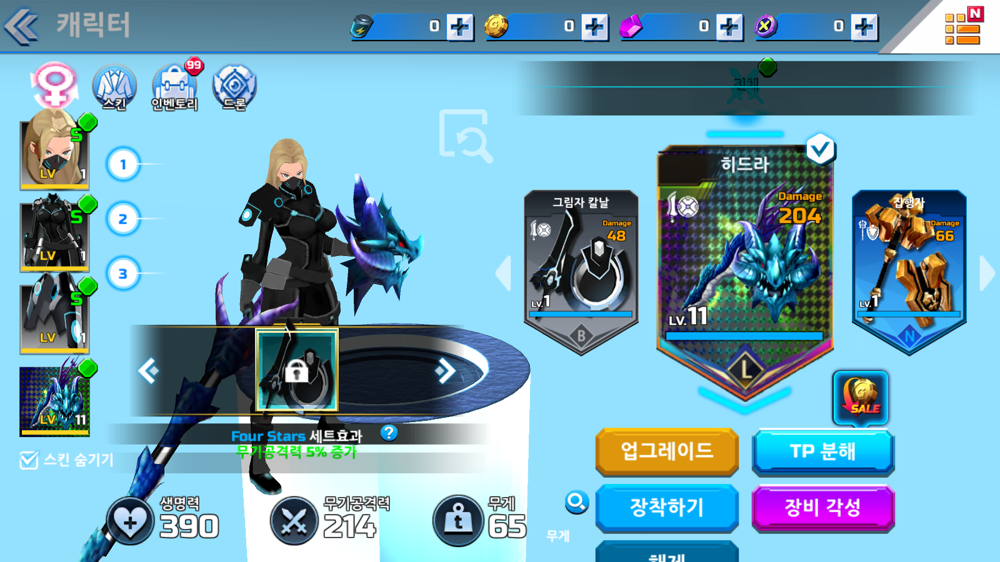
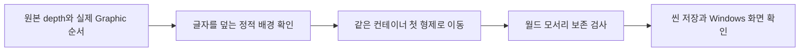
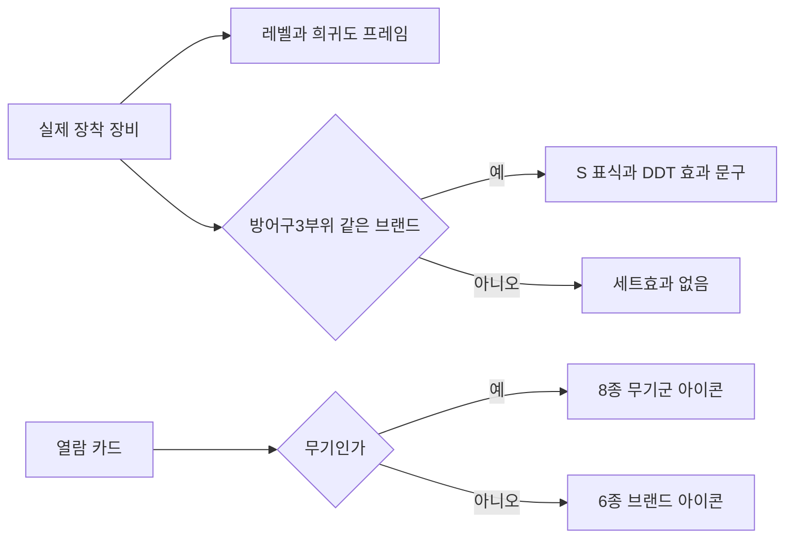

## 작업 결과

검정 그라데이션이 제목을 덮는 순서를 바로잡아 Four Stars 세트효과와 무기공격력5% 증가가 읽힙니다. 다른 브랜드 머리를 장착하면 세트효과 없음·Lv6·공격력48로, 기본 머리 복구 후50으로 바뀝니다. 여성 전설 무기는 Lv11·공격력214를 확인했습니다. 실제 카메라 캡처1600×900이며 전후 캐릭터 포즈 시점은 다릅니다.











## 변경 내용

### 적용 내용

원본 제목35057 depth100의 자식38064 배경 depth5가 uGUI 실제 순서273→274로 글자를 덮었습니다. 플레이용 정적 배경만 SetOption38500의 첫 형제로 옮겨55→57로 수정했습니다. 월드 모서리 최대 차이9.536743E-07. 원본 파일·ID·Image·문서 바인딩은 보존하고 별도 Canvas·복제 이미지·프레임 동기화는 추가하지 않았습니다. 다른 가지까지 일반 적용하지 않습니다.



RestoredEquipmentDisplayBuilder.cs 핵심 메서드 전체:

```csharp
        private static void RestoreSetTitleBackdrop(RestoredUiDocument document, Layout layout)
        {
            // NGUI 원본: 글자35057 depth100, 검정 Gradation38064 depth5.
            // 실제 uGUI 진단은 두 Graphic만 제목 중심과 겹쳤고 검정 배경이 나중에 그려졌음을 확인했다.
            var title = document.Find(35057);
            var backdrop = document.Find(38064);
            var before = new Vector3[4];
            backdrop.GetWorldCorners(before);
            if (backdrop.parent == title)
            {
                // 이 배경에는 입력·동적 바인딩·애니메이션이 없다. 객체 ID·Image·원본 문서 참조는 유지한다.
                // 같은 Canvas의 정적 형제로 옮겨 추가 Canvas·복제 Graphic·매 프레임 동기화를 피한다.
                backdrop.SetParent(title.parent, true);
            }
            if (backdrop.parent != title.parent)
            {
                throw new InvalidOperationException("세트 배경의 예상 계층과 다릅니다. 사용자 변경을 보존합니다.");
            }
            backdrop.SetAsFirstSibling();
            var after = new Vector3[4];
            backdrop.GetWorldCorners(after);
            float cornerDelta = Enumerable.Range(0, 4).Max(index => Vector3.Distance(before[index], after[index]));
            if (cornerDelta > .001f)
            {
                throw new InvalidOperationException("배경의 화면 배치가 변경됐습니다: " + cornerDelta);
            }
            // 앞선 진단용 Anchor-Bottom 가지 이동은 원인이 아니었으므로 원본 순서로 복구한다.
            document.Find(38386).SetSiblingIndex(layout.transforms.Single(node => node.id == 38386).order);
            Debug.Log($"OVERDOX_EQUIPMENT_BACKDROP_RESTORED sourceId=38064 sourceDepth=5 parent=38500 worldCornerDelta={cornerDelta}");
        }
```

이전 보고의 ‘녹색S등급’은 잘못된 해석이었습니다. 원본 EquippedItemSlot.UpdateUI(RVA0x1831BB8)는 같은 브랜드 방어구3부위에 SetMark를 켜고 무기에는 끕니다. Build26에서 바인딩이 미완료였다는 관찰은 맞지만 희귀도로 지칭한 판단을 정정합니다. 희귀도는 원본 STRONG Color32·전설 전용 프레임으로 구분합니다.

브랜드·세트 문구는 저장 XLSX→기존 DDT의 ArmorBrand·EquipmentSetAbility·LocalizedText로 읽습니다. 원본4302행 중 한국어14키만 캐시하며 최초 읽기는 전체 기존 리더입니다. 측정한 메모리·FPS 개선량은 없습니다. 무기 카드의 잘못된 DCompany 로고는 원작 ELF 문자열 포인터로 확인한8무기군 아이콘으로 교체했습니다.



세트 조건과 단위 변환 전체:

```csharp
        private void UpdateSetText(GearRow[] armor)
        {
            // 카탈로그 brand는0부터, 원본 EquipmentCategory와 ArmorBrand ID는1부터다.
            int brandId = armor[0].brand + 1;
            int count = armor.Count(row => row.brand + 1 == brandId);
            var effects = _abilities.Values.Where(row => row.SetRequireStatus == 1 && row.ConditionType == 1 &&
                row.ConditionValue1 == brandId && count >= row.SetRequireCount).OrderBy(row => row.Id).ToArray();
            bool isActive = effects.Length > 0;
            if (!isActive)
            {
                setTitle.text = TextFor("armor_set_2");
                setDescription.text = string.Empty;
                setDescription.gameObject.SetActive(false);
                return;
            }
            string brandName = TextFor(_brands[brandId].NameKey);
            setTitle.text = RichText(string.Format(CultureInfo.InvariantCulture, TextFor("armor_set_1"), brandName));
            setDescription.text = string.Join("\n", effects.Select(FormatEffect));
            setDescription.gameObject.SetActive(true);
        }
```

```csharp
        private string FormatEffect(EquipmentSetAbility effect)
        {
            // 현 원본 세트 표에서9·35·59는 비율이며 원작 GetSetEffect의 배율 표도100을 사용한다.
            bool isPercent = effect.AbilityType == 9 || effect.AbilityType == 35 || effect.AbilityType == 59;
            string value = (effect.AbilityValue1 * (isPercent ? 100 : 1)).ToString("0.##", CultureInfo.InvariantCulture);
            return RichText(string.Format(CultureInfo.InvariantCulture, TextFor(effect.ExplanationKey), value));
        }
```

```csharp
        public void Bind(GearRow row, int gearLevel, Color32 color, bool matchingSet)
        {
            level.text = gearLevel.ToString(CultureInfo.InvariantCulture);
            setMark.SetActive(matchingSet);
            bool isLegendary = row.rarity == 4;
            normalFrame.gameObject.SetActive(!isLegendary);
            normalFrame.color = color;
            legendaryFrame.SetActive(isLegendary);
        }
```

## 검증

실제 저장 DDT Equipment119행(무기38·방어구81)의 레벨·희귀도·분류와 카드풀10개의8무기군·6브랜드 Sprite 참조 경로가 오류0건입니다. 첫 진단은 Sprite.name의 LobbyUI_ 접두어를 놓쳐20건 실패했고 실제 에셋 경로 비교로 검사기를 수정했습니다. 실패 기록도 보존합니다. 전 장비 실행 판정은 아닙니다.

Unity6000.0.83f1 Windows Build27은22:38:04 KST 성공258,972,186B. 고정 사본150파일 해시 보존. 기존 FX 누락 스크립트 경고1건이 남습니다. 현재 남녀 프리팹·비주얼 라이브러리·코드4파일 SHA256 동일. 기본 세트→같은 브랜드 다른 머리(S유지)→다른 브랜드(S숨김)→남녀 전환→기본 복구→여성 전설 무기 장착을 실제 조작했습니다. 조사 예외 패턴0건입니다.

[DDT 참조 대조](../assets/equipment-display27/ddt-display-verification.json) · [수동 흐름](../assets/equipment-display27/build27-flow.log) · [아바타 해시](../assets/equipment-display27/avatar-preserved.json) · [빌드 해시](../assets/equipment-display27/build27-manifest.json)

실제 장착 값 갱신과 캐시 준비 전체:

```csharp
        public void Refresh(Fighter player, int trainingOffset)
        {
            EnsureData();
            bool isMatched = player.armor[0].brand == player.armor[1].brand && player.armor[1].brand == player.armor[2].brand;
            for (int index = 0; index < slots.Length; index++)
            {
                var row = index == 3 ? player.weapon : player.armor[index];
                int level = Mathf.Clamp(row.startLevel + trainingOffset, 1, row.maxLevel);
                slots[index].Bind(row, level, rarityColors[row.rarity], index < 3 && isMatched);
            }
            UpdateSetText(player.armor);
        }
```

```csharp
        private void EnsureData()
        {
            if (_texts != null)
            {
                return;
            }
            _brands = DataLoader.ReadBinaryDictionary<ArmorBrand>(armorBrandBinary.bytes, GearCatalog.BINARY_KEY);
            _abilities = DataLoader.ReadBinaryDictionary<EquipmentSetAbility>(setAbilityBinary.bytes, GearCatalog.BINARY_KEY);
            // 제작용 DDT 리더를 그대로 사용하되 표시용14개 키만 유지한다. 전체4302행·영어 문자열은 캐시하지 않는다.
            var requiredKeys = new HashSet<string>(_brands.Values.Select(row => row.NameKey).Concat(_abilities.Values.Select(row => row.ExplanationKey)))
            {
                "armor_set_1", "armor_set_2"
            };
            _texts = DataLoader.ReadBinaryDictionary<LocalizedText>(localizedTextBinary.bytes, GearCatalog.BINARY_KEY).Values
                .Where(row => requiredKeys.Contains(row.Key)).ToDictionary(row => row.Key, row => row.Korean);
        }
```

무기군·브랜드 카드 연결 전체:

```csharp
        public void Bind(RestoredLobbyController owner, int index, GearRow row, Sprite icon, bool selected, bool weapon, int gearLevel, float value)
        {
            _owner = owner;
            _index = index;
            title.text = row.name;
            level.text = gearLevel.ToString();
            stat.text = value.ToString("0");
            if (statName != null)
            {
                statName.text = weapon ? "Damage" : "HP";
            }
            if (legendaryEffect != null)
            {
                legendaryEffect.SetActive(row.rarity == 4);
            }
            // 배열은 현재 카탈로그의 0 이상 희귀도·브랜드 값으로 구성한다.
            if (frame != null && rarityFrames != null && row.rarity >= 0 && row.rarity < rarityFrames.Length)
            {
                frame.sprite = rarityFrames[row.rarity];
            }
            // 원작 무기 제목은 무기군 아이콘을 쓰며, 방어구 제목에만 브랜드를 표시한다.
            var titleIcons = weapon ? weaponTitleIcons : brandIcons;
            int titleIndex = weapon ? row.family : row.brand;
            if (brand != null)
            {
                brand.sprite = titleIcons != null && titleIndex >= 0 && titleIndex < titleIcons.Length ? titleIcons[titleIndex] : null;
                brand.enabled = brand.sprite != null;
            }
            thumbnail.sprite = icon;
            thumbnail.enabled = icon != null;
            selectedMark.SetActive(selected);
        }
```

Affinity 전후2개 AF 원본을 모두 닫고 재열어 확인했으며 dirty=false입니다. 작업 문서만 닫고 기존6개 문서를 보존했습니다.

## 남은 사항

전체 UI 동일성은 미완료입니다. 추가 부모·자식과 가지 간 depth, NEW99·업그레이드·TP 템플릿, 모든 장비 실제 전투·남녀 리깅·카메라·FX·새 Build27의10시간 완료는 미확인입니다. 왼쪽 이전 버튼 좌표 입력은 변화가 기록되지 않아 히트 영역을 추가 확인합니다. 빈 영역 휠 이전 선택은 실제 동작했습니다. OS 드래그 성공으로 해석하지 않습니다. 이번 빌드의 전투 재진입은 미실행입니다.

원본 PNG5장 보존, 실제 Affinity에서 전후2장 원본AF 저장·WebP 내보내기. 나머지3장 압축은 미완료입니다. 원작명 비공개 개발일지에는 실행 이미지를 게시하지 않고 기존 구조도 썸네일을 유지합니다.

[런타임 전체 클래스](../assets/equipment-display27/RestoredEquipmentPresentation.cs) · [에디터 연결 전체](../assets/equipment-display27/RestoredEquipmentDisplayBuilder.cs) · [카드 전체 코드](../assets/equipment-display27/RestoredGearCard.cs) · [개발 문서](../assets/equipment-display27/10-equipment-display.md). SampleProjectForUnity c7b40e5 관련 문서 기준 한국어 XML·중괄호·Runtime/Editor 책임 분리를 유지했습니다. 원작 고유 ID와 스키마에 의존해 샘플 환류는 보류했습니다. 전역 지침 변경 없음, 프로젝트 지침에 확인된 SetMark와 정적 배경 교정 범위를 통합했습니다.

[새 Build27 장시간 시작](../assets/equipment-display27/build27-soak-arena-start.json):23:04:31 KST 실제 Arena 1라운드·캡처·텔레메트리 확인,10시간 완료 전입니다. 최초 샌드박스 실행은 낮은 무결성으로 종료됐고, 일반 권한 분리 실행3개는 샌드박스 조회에서 누락됐습니다. 정확한 경로·PID로 모두 정리했습니다. 로비 자동 시작은 로딩 중 진입 거부를 확인해 기존 Arena 직접 진입 옵션을 사용했습니다. 직접 진입으로 로비 흐름 문제를 해결했다고 보고하지 않습니다.

대화 기록: 사용자는 남녀 아바타·리깅 변경을 참고하고 추가 UI depth를 점검하라고 요청했습니다(요청 시각 미기록). 현재 참조 보존·세트 제목 수정·장착 표시 실행 근거를 보고했습니다. 잘못 지칭한 S등급을 세트 표식으로 정정했습니다.

## 작업 시간

- 제안 시간: 2026-11-13 22:11:09 KST 시작. 구현·실행30~60분 예상. 핵심 실행 후 이미지·공개 보고15~25분 추가 안내. 전체 복원 완료 예상과 구분합니다.
- 실제로 완료된 시간: 구현22:32:55 KST(21분46초),DDT 확인22:36:21,빌드22:38:04(26분55초). 수동 장비·남녀·전설 표시 확인22:50 KST 무렵. 문서·공개 게시 후 회차 실제 종료를 별도 기록합니다. 설치·새 장시간 완료를 포함하지 않습니다.
- XERJ: 미사용 — XERJ 연결·검색 없음. 원작 추출 표·ELF의 읽기 전용 분석과 실제 Unity·Windows 화면을 사용했습니다. REA 호출 도구가 없는 환경이며 일반 분석을 REA 실행으로 표시하지 않았습니다.
