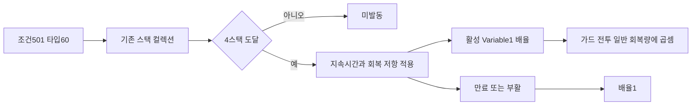
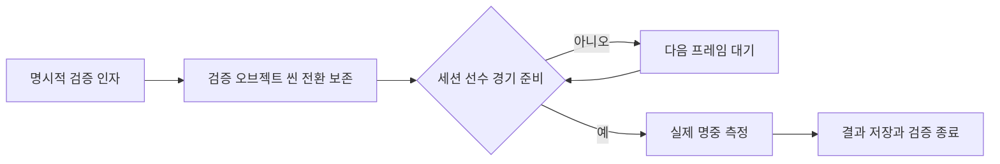
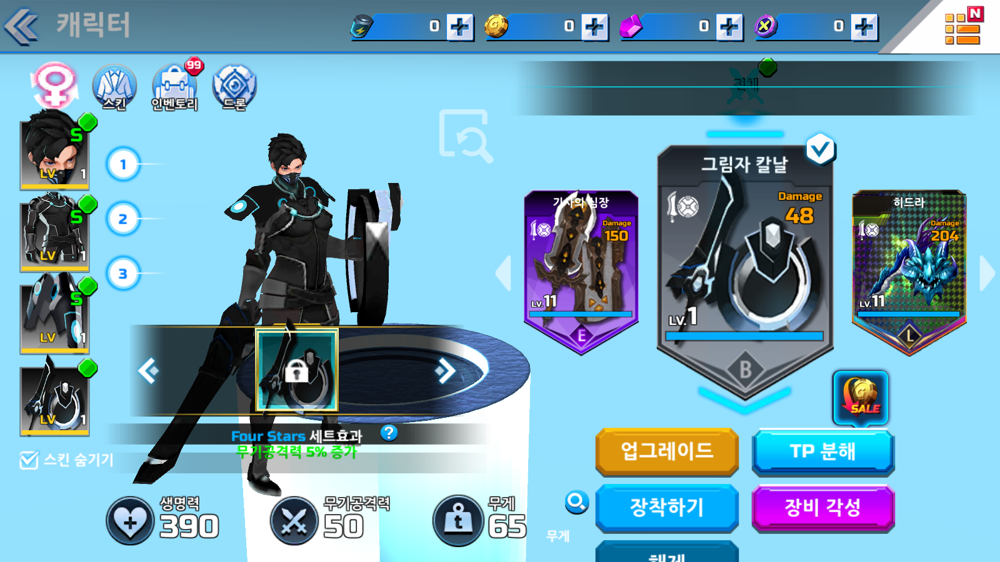
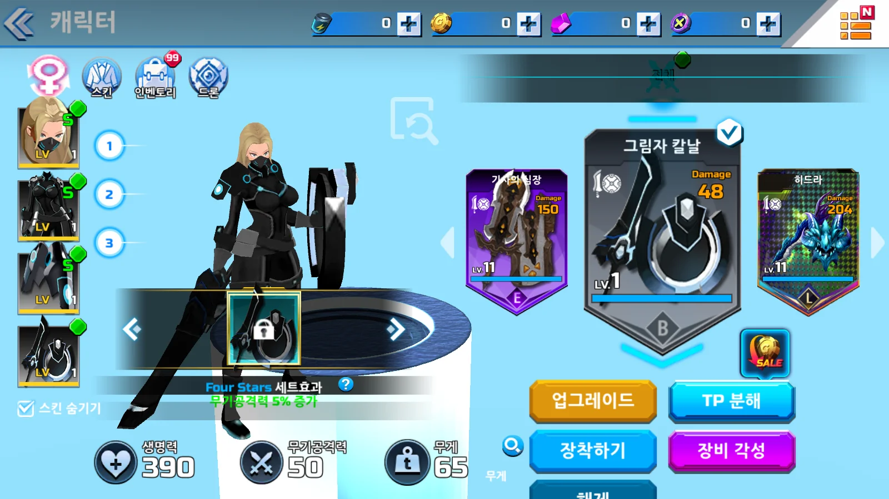

## 작업 결과

탈진을 전달해도 버리던 조건60을 지원합니다. 실제 Fighter.Update에서0.6초간 측정한 수정 전·후입니다. 모의 계산이나 히드라 실제 명중 검증으로 확대하지 않습니다.

|자세|기준 회복/초|수정 전 조건 적용|수정 후 조건 적용|
|---|---:|---:|---:|
|가드|30|30|6|
|전투|35|35|7|
|일반|60|60|12|

세 자세에 공통 배율을 적용한 Fighter.Update 전체:

```csharp
        private void Update()
        {
            if (!IsAlive) { return; }
            float dt = Time.deltaTime;
            if(ArenaSession.Instance!=null&&ArenaSession.Instance.IsFighting) { _skillCharge=Mathf.Min(MaxSkillCharges*_skillChargeTime,_skillCharge+dt); }
            bool inCombat = Time.time - Mathf.Max(_lastDamage, _lastAttack) < 5;
            if (Time.time - _lastSpend > .7f)
            {
                float regen = State == CombatState.Guard ? _regenGuard : inCombat ? _regenCombat : _regenNormal;
                // 탈진은 세 자세의 회복량에 공통 적용한다. 장비 회복 보너스와 별도 배율이다.
                float recoveryMultiplier = _conditions.StaminaRecoveryMultiplier(Time.time);
                Stamina = Mathf.Min(MaxStamina, Stamina + dt * regen * (1 + Effects.Sum(18)) * recoveryMultiplier);
            }
            if (!inCombat&&!HasCondition(3)) { Health = Mathf.Min(MaxHealth, Health + dt * Effects.Sum(26)); }
            if (Effects.Sum(41) > 0 && Time.time >= _nextOrbAt)
            {
                int count = 0;
                foreach (var entry in Effects.Entries) { if (entry.type == 41) { count++; } }
                _nextOrbAt = Time.time + 20;
                MaxHealth += 20 * count; Health += 20 * count;
            }
            TickStatus();
            TickSpecialEffects();
            TickState();
            if (ArenaSession.Instance == null || !ArenaSession.Instance.IsFighting) { Animate(); return; }
            if (CombatRules.CanAct(State))
            {
                if (DashIntent && !HasCondition(25) && Time.time >= _dashReady && Spend(22))
                {
                    _dashDirection = MoveIntent.sqrMagnitude > .01f ? MoveIntent.normalized : transform.forward;
                    _dashReady = Time.time + _dashCooldown * (HasBuffType(11) ? 1 + BuffValue(11) : 1);
                    SetState(CombatState.Dash, .24f);
                    ArenaSession.Instance.Record("dash");
                }
                else if (SkillIntent && SkillCharges>0 && Time.time >= SkillReadyAt && Spend(AttackCost(true)))
                {
                    _skillCharge-=_skillChargeTime;
                    SkillReadyAt = Time.time + weapon.cooldown * Mathf.Max(.1f, 1 - Effects.Sum(32));
                    if (!ExecuteUtilitySpecial()) { BeginAttack(true); }
                    ArenaSession.Instance.RecordAction("skill",this);
                }
                else if (AttackIntent && Spend(AttackCost(false))) { BeginAttack(false); }
                else if (GuardIntent && Stamina > 0)
                {
                    if (State != CombatState.Guard) { _guardStart = Time.time; SetState(CombatState.Guard, 0); }
                }
                else if (State == CombatState.Guard) { SetState(CombatState.Idle, 0); }
            }
            if (State == CombatState.Dash) { Move(_dashDirection * (_dashDistance / .24f) * dt); }
            else if (State == CombatState.Idle || State == CombatState.Guard)
            {
                float slow = _conditions.MovementMultiplier(Time.time);
                float speed = State == CombatState.Guard ? _guardSpeed : inCombat ? MoveSpeed : _normalSpeed;
                speed *= SpecialMovementMultiplier;
                Move(Vector3.ClampMagnitude(MoveIntent, 1) * speed * slow * dt);
            }
            else if (State == CombatState.Active) { Move(transform.forward * dt * (_skillAttack ? 4.5f : 1.5f)); }
            if (State != CombatState.Active && State != CombatState.Stunned && State != CombatState.Dash && AimIntent.sqrMagnitude > .01f)
            {
                transform.rotation = Quaternion.RotateTowards(transform.rotation, Quaternion.LookRotation(AimIntent), dt * 850);
            }
            DashIntent = false;
            SkillIntent = false;
            Animate();
        }
```

## 변경 내용

### 적용 내용

ConditionEffect501은4스택·10초·Variable1=0.2입니다. APK87 BuffStat.Init의 회복 배율 초기값1,AddToBuffStat 타입60의 곱셈,HeroInfo.UpdateStat의 세 자세 소비를 확인했습니다.0.2는 남는 회복량이며20% 감소로 해석하지 않습니다. main81 표와 APK87 클라이언트의 조합이고 APK2.2.1 바이너리는 해시가 다릅니다. 동일 버전·서버 일치는 미확인입니다.



조건 수신과 배율 조회 전체:

```csharp
        public void ApplyCondition(Overdox.OriginalData.ConditionEffect condition, int count = 1)
        {
            string label;
            switch (condition.ConditionType)
            {
                case 1:
                {
                    if (Effects.Sum(36) > 0) { return; }
                    label = "화상";
                    break;
                }
                case 2:
                {
                    label = "동상";
                    break;
                }
                case 3:
                {
                    if (Effects.Sum(37) > 0) { return; }
                    label = "출혈";
                    break;
                }
                case 4:
                {
                    label = "감전";
                    break;
                }
                case 25:
                {
                    label = "속박";
                    break;
                }
                case 60:
                {
                    label = "탈진";
                    break;
                }
                default:
                {
                    return;
                }
            }
            if (_conditions.Add(condition, count, Time.time, _conditionRecovery))
            {
                Impact?.Invoke(this, label, 0);
                ArenaSession.Instance.Record("condition-" + condition.ConditionType);
            }
        }
```

```csharp
        public float StaminaRecoveryMultiplier(float now)
        {
            return TryActive(60, now, out var exhaustion) ? exhaustion.Variable1 : 1;
        }
```

[네이티브 주소·해시·버전 경계](../assets/exhaustion30/native-calculation.json) · [제품 전체 소스](../assets/exhaustion30/Fighter.cs)

## 검증

Build29 제품 DLL은 Build28과 동일합니다. 수정 전 실패를 보존했고 Build30은3스택 미발동·4스택 발동·비율0.2·실제10초 만료·부활 초기화를 통과했습니다. Build30의 별도 전체 무기 검증도38/38 일반 공격 명중을 확인했습니다. 고유 스킬의 피해·회복·효용 동작과 원작 동일성은 별도입니다.

스플래시에서 ArenaSession을 즉시 요구하던 예외를 수정한 검증기 전체 시작 흐름입니다.



```csharp
        private static void Install()
        {
            if(!Environment.GetCommandLineArgs().Contains("-gear-combat-review")) { return; }
            var runner = new GameObject("Verification · all weapon contact");
            DontDestroyOnLoad(runner);
            runner.AddComponent<GearCombatReview>();
        }
```

```csharp
        private IEnumerator Start()
        {
            // AfterSceneLoad는 스플래시에서도 실행된다. 실제 경기 세션과 선수 생성까지 기다린다.
            // 씬 전환 중의 이전 Lobby 세션을 붙잡거나 경기 시작을 중복 요청하지 않는다.
            while (ArenaSession.Instance == null || ArenaSession.Instance.Player == null || !ArenaSession.Instance.IsFighting)
            {
                yield return null;
            }
            _session = ArenaSession.Instance;
            var report=new Report { startedUtc=DateTime.UtcNow.ToString("O"), scope="Isolated stationary target, four normal-attack distances and one special activation per weapon. Verifies actual hit callbacks, not original server parity." };
            _session.enabled=false; // 검증 동안만 구역 피해·승패·자동 재시작을 정지합니다.
            foreach(var fighter in _session.Fighters) { fighter.GetComponent<FighterBrain>().enabled=false; }
            _actor=_session.Player;_target=_session.Fighters[1];
            foreach(var fighter in _session.Fighters.Skip(2)) { fighter.gameObject.SetActive(false); }
            var floor=GameObject.CreatePrimitive(PrimitiveType.Cube);
            floor.name="Verification fixture floor";floor.transform.position=_origin+Vector3.down*.55f;floor.transform.localScale=new Vector3(60,1,60);
            _target.Impact+=OnImpact;
            var results=new List<Result>();
            for(int i=0;i<_session.catalog.Weapons.Count;i++)
            {
                _session.ChangeWeapon(i-_session.SelectedWeapon);
                var weapon=_actor.weapon;
                _current=new Result { id=weapon.id, family=weapon.family, name=weapon.name, specialName=weapon.skill };
                _special=false;
                foreach(float distance in new[]{.65f,1f,1.4f,1.8f})
                {
                    _distance=distance;ResetActors();
                    _actor.AttackIntent=true;
                    yield return new WaitForSeconds(2.5f);
                    _actor.AttackIntent=false;
                }
                _current.normalPassed=_current.normalHits>0;
                _special=true;_distance=1.2f;ResetActors();
                _actor.Receive(null,_actor.MaxHealth*.4f,0);
                _current.healthBefore=_actor.Health;
                _current.chargesBefore=_actor.SkillCharges;
                _actor.SkillIntent=true;
                yield return new WaitForSeconds(6);
                _current.healthAfter=_actor.Health;_current.chargesAfter=_actor.SkillCharges;
                _current.hidden=_actor.IsHidden;
                _current.targetCondition=Enumerable.Range(1,4).Any(_target.HasCondition);
                _current.specialObservation=_current.specialHits>0?"damage observed":_current.healthAfter>_current.healthBefore?"recovery observed":"activation only; utility behavior requires separate assertion";
                _session.Capture("gear-contact-"+weapon.id);
                results.Add(_current);
                Debug.Log($"GEAR_CONTACT id={weapon.id} normalHits={_current.normalHits} normalDamage={_current.normalDamage} specialHits={_current.specialHits} charges={_current.chargesBefore}->{_current.chargesAfter}");
                Save(report,results,false);
            }
            Save(report,results,true);
            Debug.Log($"GEAR_CONTACT_COMPLETE passed={results.Count(r=>r.normalPassed)}/{results.Count}");
            Application.Quit();
        }
```

## 남은 사항

[수정 전 실패](../assets/exhaustion30/before-review.json) · [수정 후 통과](../assets/exhaustion30/after-review.json) · [전38무기 실제 결과](../assets/exhaustion30/gear-contact-results.json) · [전후 로그](../assets/exhaustion30/after.log)

기존 Build27 장시간 실행은 시작 예외1건 때문에3742.600초·마지막31라운드에서 중단했습니다. 이전 보고의 진행 중·고정 파일 보존은 맞는 관찰이며 무오류 통과는 아닙니다. 오류 발견 후 중단 기록을 추가했고 이전 결과를 바꾸지 않았습니다. Build30Soak은2026-11-14 00:17:33 KST부터 기본Splash→Lobby→Arena로36000초 실행을 다시 시작했습니다. 예정10:17경이며 아직 완료가 아닙니다. 이전 시간을 합산하지 않습니다.

[이전 중단과 예외](../assets/exhaustion30/build27-interrupted.json) · [새 시작](../assets/exhaustion30/soak-start.json) · [새 진행 관찰](../assets/exhaustion30/soak-progress.json) · [148파일 고정 해시](../assets/exhaustion30/build30-manifest.json) · [장시간 고정 사본 대조](../assets/exhaustion30/soak-build-match.json)

현행 남녀 아바타4파일·수식XLSX 해시는 보존했습니다. 아래는 실제 Windows 장비 창의 보존 점검 화면이며 탈진의 시각 전후 증거가 아닙니다. 이번 제품 수정은 회복 계산입니다. 상단 어두운 전설 템플릿·추가depth·전119장비 능력·리깅·카메라·FX 일치는 미완료입니다.





[아바타·수식Excel 보존](../assets/exhaustion30/preservation.json) · [실제 Affinity 두AF 재열기](../assets/exhaustion30/affinity-reopened.json) · [기존6문서 보존](../assets/exhaustion30/affinity-cleanup.json) · [개발 문서](../assets/exhaustion30/12-exhaustion-and-verification-lifecycle.md). 실제 Affinity에서 두AF 저장·닫기·재열기 dirty=false와 여성WebP139132B를 확인했습니다. 남성PNG 추가압축 미완료. 기존 FX 누락 스크립트 경고도 남습니다. 히드라의 실제 명중에서 조건60 발동과 원본FX·퍼센트 치환은 별도 검증이 필요합니다.

샘플 SceneEntry·한국어XML·분기 규칙을 참고했습니다. 게임 고유 조건ID는 환류하지 않으며 초기화 준비 원칙은 기존 샘플과 중복돼 환류 보류입니다. 전역 지침 변경 없이 프로젝트 교훈만 통합했습니다.

대화 요약:사용자는 중단 지시 전 지속 복원,남녀 아바타·리깅 변경 참고와 추가UI depth점검을 요청했습니다(발언 시각 미기록). AI는 원본 계산 추적 뒤0.2배를 적용하고 실제 측정 결과를 보고했습니다. 장시간 시작 예외 발견·기존 실행 중단·새10시간 재시작 및 예정 변경을 알렸습니다. 전체UI·원작동일성 완료로 판정하지 않았습니다.

## 작업 시간

- 제안 시간: 2026-11-13 23:48:02 KST 시작,첫 구현·실행 확인45~75분 예상. 전체 복원 종료와 구분합니다.
- 실제로 완료된 시간: 수정 전 검증00:03:42.403,수정 후 통과00:06:12.671,전체38무기 종료00:17:02.683,새10시간 시작00:17:33.660 KST(2026-11-14). 핵심 회복 검증까지18분10.7초. 문서·공개 확인 종료는 별도 기록합니다. 설치·전체복원·10시간 완료를 포함하지 않습니다.
- XERJ: 미사용 — XERJ 연결·검색 없음. 보존된 main81 표·APK87 ELF/Capstone와 실제 Windows 측정 사용. REA 도구는 제공되지 않아 해당 출력으로 표시하지 않습니다.
