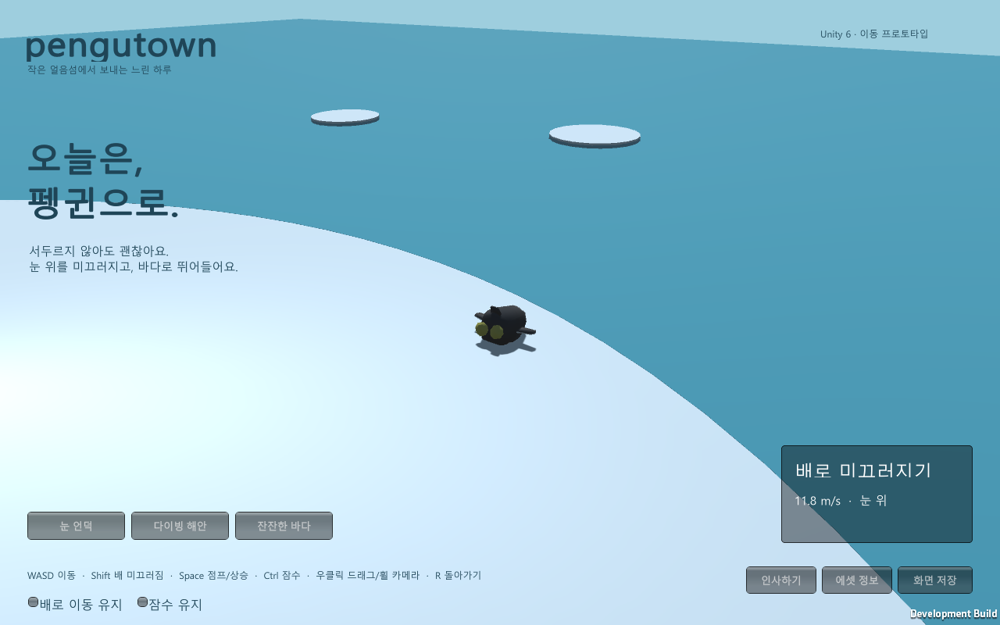
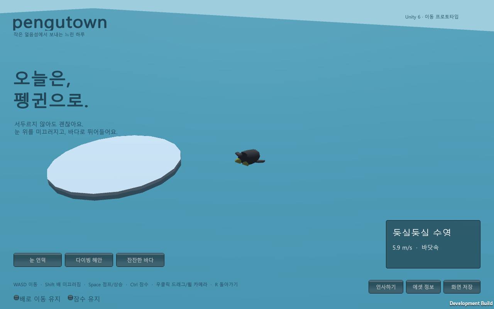
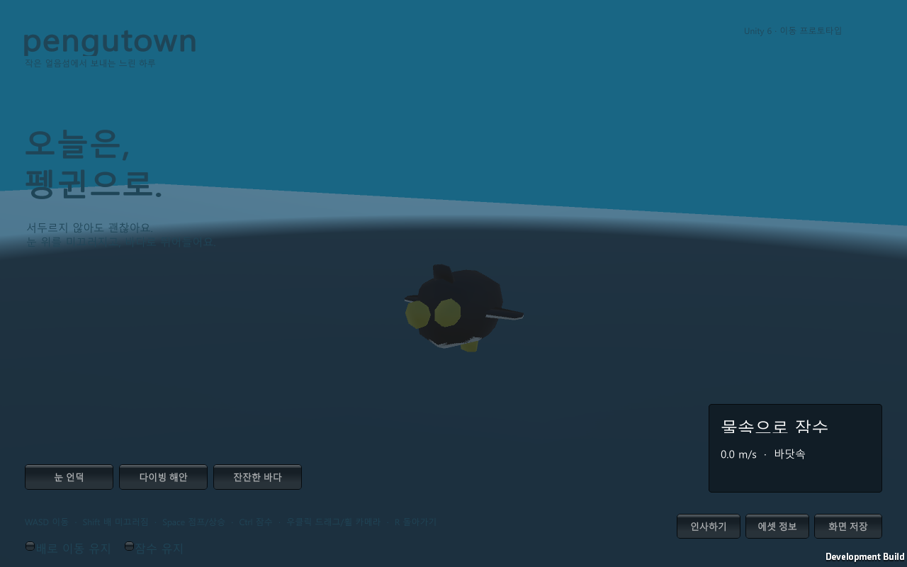

## 작업 결과

Unity 6000.0.83f1의 기본 플레이 가능한 프로토타입을 구현하고 Windows 빌드와 실제 그래픽 실행을 검증했습니다. 걷기, 배 미끄러짐, 경사 가속, 해안 이탈과 다이빙, 수영·잠수·부력 복귀, 카메라와 인사 UI가 포함됩니다.

주변 펭귄은 NPC입니다. 서버 멀티플레이가 구현된 것으로 표시하지 않았습니다.

## 변경 내용

### 적용 내용

에셋은 [joyfulsquirrel의 Penguin / OpenGameArt](https://opengameart.org/content/penguin-0)를 확보했습니다. CC0이며 원본 ZIP·Blender·텍스처를 보존했습니다. 걷기·대기·수영은 실제 원본 클립이고 Slide/Dive 전용 클립은 없습니다.

구매 후보는 [Blocky Penguin](https://sandial.itch.io/blocky-penguin-pack)(Walk/Swim/Slide 포함, 조회 가격 $2.50), [Penguin Squad](https://outoftokensstudio.itch.io/penguin-squad)(24클립, 조회 가격 $1.99, 수영 전용 클립 없음), [RifatBilalov Penguin](https://www.fab.com/listings/411d0928-3110-404e-9ebe-c92215b0e9fa)(68클립, walk/slip/swim, 가격·라이선스 등급 미확인)입니다. 유료 파일은 구매·검증하지 않았습니다.

공유 공개 기획의 브라우저 소셜 공간을 확인하고 웹 초안을 작성했으나, 사용자 후속 지시에 따라 기존 프로젝트들의 ProjectVersion.txt와 같은 Unity 버전으로 전환했습니다. 웹 초안은 별도로 보존했으며 Unity 빌드와 구분합니다.

실제 Rigidbody·MeshCollider로 중력과 관성·충돌을 계산하고 물속에서 부력·저항·추진력을 적용했습니다. Blender 액션 표기 범위 1~2와 실제 키프레임 1~23의 차이를 검증해 클립 길이를 0.917초로 복원했습니다. FBX 단위 설정으로 생긴 리그·메시 크기 불일치는 FBX_SCALE_ALL로 수정했습니다.

## 검증

Unity 실제 PhysX QA에서 걷기·미끄러짐·공중·수영·잠수 전환이 모두 통과했습니다. 경사 최고 속도 14.01m/s, 잠수 깊이 -3.80m, 부력 복귀 높이 -0.38m입니다.

Windows 그래픽 플레이어 자동 조작에서도 다섯 상태가 모두 관찰됐으며 잠수 깊이는 -3.80m입니다. 원본 키 길이와 출력 재생 길이를 Unity 임포트 로그로 대조했습니다.

[실제 물리 QA JSON](../assets/physics-qa.json) · [그래픽 실행 QA JSON](../assets/runtime-qa.json)

캡처는 게임의 ScreenCapture로 직접 저장한 원본 PNG입니다. 그림을 제작하거나 변형하지 않았습니다. slide.png: 1280×800, 160212바이트; swim.png: 1280×800, 104345바이트; dive.png: 1280×800, 103264바이트. 실제 표시 품질을 직접 확인했습니다.

## 남은 사항

서버 멀티플레이·공개 채팅·계정·꾸미기·모바일 조작은 미구현입니다. 배 미끄러짐·다이빙은 전용 애니메이션이 아닌 초기 자세 보정이며 물 효과·카메라 전환·조작감은 추가 다듬기 대상입니다. 현재 Windows용 플레이어이며 Unity WebGL 빌드는 수행하지 않았습니다.

로고 원본 미확인으로 프로젝트 로고는 null입니다. 교훈 검토: 전역 지침 변경 없음. Blender 5.2와 이 에셋의 범위·단위 변환 검증 내용은 프로젝트 지침과 조사 기록에 보존했습니다.

## 작업 시간

- 제안 시간: 조사 5~10분, 기본 구현·검증 추가 20~40분 (처음 제시한 예상)
- 실제로 완료된 시간: 시작 2026-11-01 16:33:54 KST. 구현·실행 검증 및 보고서 생성 시점 2026-11-01 16:56:58 KST, 누적 23분 4초. 보고서 푸시·공개 배포·외부 접근은 이후 별도 확인합니다.
- XERJ: 미사용 — 빈 프로젝트이며 제공된 XERJ MCP·검색 스크립트가 없어 현재 파일과 로그를 직접 검사하고 rg를 사용했습니다.
