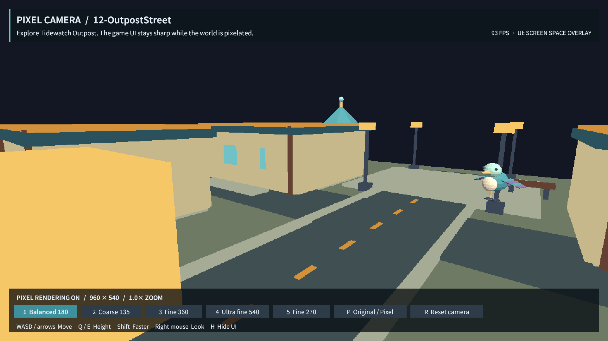
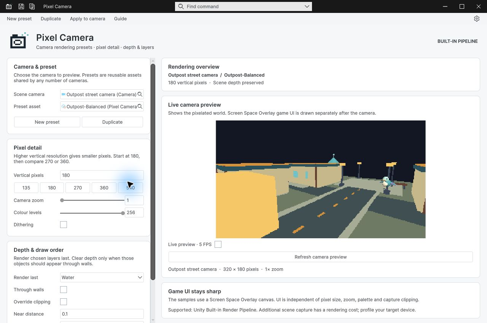
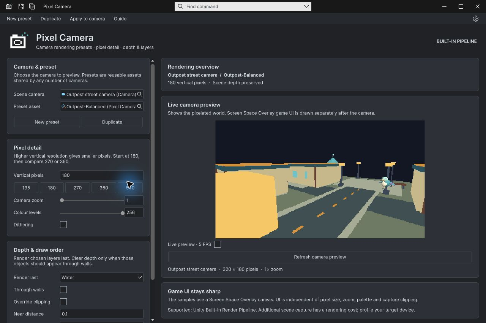

## 작업 결과

구현·현재 Unity 실행·패키지 내보내기는 완료했습니다. 설정 팝업의 네이티브 입력 라운드트립은 미검증으로 유지합니다.

960×540 월드 픽셀과 선명한 Overlay UI. 실제 4키 전환 후 캡처입니다.

## 변경 내용

### 적용 내용

12개 씬 모두 항구·도로·광장·건물3채·Pixora 모델4종의 인스턴스9개를 포함하도록 구성했습니다. 각 씬에 WASD 자유 카메라와 Overlay UI를 넣었습니다. 135/180/270/360/540 세로 해상도를 키와 버튼으로 비교할 수 있습니다.

설정 창을 카드와 카메라 정보·실제 미리보기로 구성하고 지연 생성되는 입력 필드의 라이트 테마 대비를 수정했습니다. 로고는 실제 Affinity 3.3.1.4940에서 벡터 도형으로 제작하고 편집 원본 .af와 투명 PNG를 프로젝트에 저장했습니다.

스크린샷은 실제 English UI입니다. 아홉 언어 UI 배치를 시각 검증했다는 뜻은 아닙니다.

## 검증

현재 TurnRoom / Unity6000.0.83f1 Built-in에서 전체12개 씬 실제 렌더 및 Play 통과: 각각 렌더러292·Overlay Canvas1·텍스트12·버튼7. native Game 입력 4키→referenceHeight540, UI버튼→270, P키→pixelEnabled false 값 재조회. [전체 Play 근거](../assets/2026-11-01-filled/play-all-03.json), [렌더 근거](../assets/2026-11-01-filled/all-scenes-render-02.json).

9개 언어 문서 링크·이미지·새 캡처 원본 해시 통과. 이미지 5개 모두 원본 PNG 200KB 이하. 0.2.0-preview 패키지 9,583,796바이트·에셋353개·제품 원본144개 해시 일치, 씬12개·가이드9개·Development/Pixora 외부 의존성 제외.

첫 렌더 QA의08번 단색 실패는 카메라 위치를 변경한 뒤 재렌더 통과했습니다. 개발용 브리지 컴파일 실패 및 오래된 도메인이 명령을 처리한 시도는 통과 근거로 쓰지 않습니다. filled-v5는 실제 에디터/브리지 모듈ID를 기록하고 미등록 명령을 거부합니다.

## 남은 사항

설정 팝업에서 실제 값 편집→Undo/Redo 네이티브 라운드트립은 미검증입니다. 컴퓨터 유즈가 부모 창을 활성화해 팝업을 가리는 현상을 반복 확인했으며 utility 호스트에서도 재현됐습니다. 전체 메뉴얼을 완료 처리하지 않았습니다. 새 패키지의 별도 프로젝트 재임포트는 이번 범위에서 실행하지 않았습니다. Unity 리로드 중 invalid font reference 경고2개가 관찰됐고 원인은 미확인입니다.

교훈 검토: 오래된 에디터 도메인의 QA 처리 금지와 소스 빌드 확인은 기존 전역/프로젝트 지침에 이미 있으므로 새 규칙을 중복 추가하지 않았습니다. 검증 브리지에 리비전·모듈ID와 명령 검사를 보강했습니다. 전역 지침 변경 없음.

## 작업 시간

- 제안 시간: 이번 후속 20~30분, 범위 확대 후 35~50분. 시작 2026-11-01 01:57:51 KST.
- 실제로 완료된 시간: 2026-11-01 01:57:51 KST 시작. 구현·12개 Play·9개 언어 문서·패키지 원본 대조 확인 02:35:01 KST(37분 10초). 설정 팝업 네이티브 입력 QA가 남아 전체 완료 시각은 없습니다.
- XERJ: 실패 — Status: node not running. Search 시작 실패: data 디렉터리 node.lock이 다른 프로세스에서 사용 중. 기존 프로세스를 중단하지 않고 rg와 현재 소스 대조로 계속했습니다.
