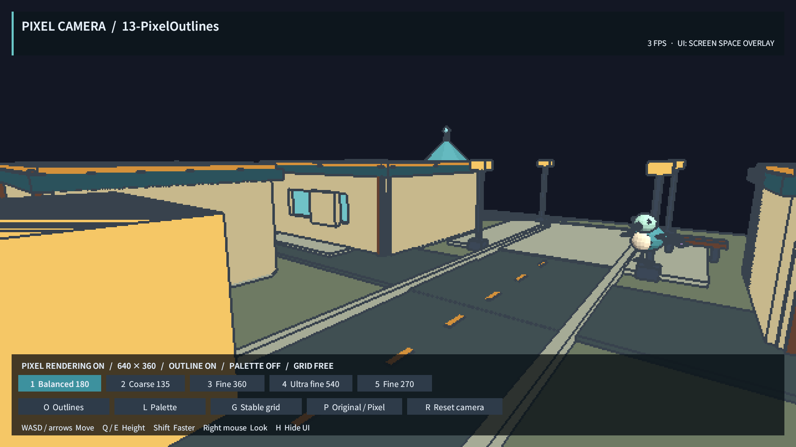
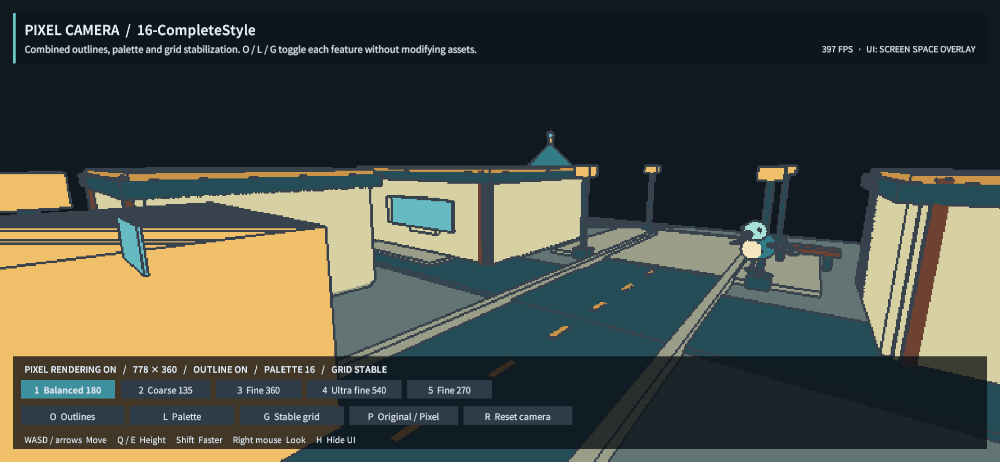
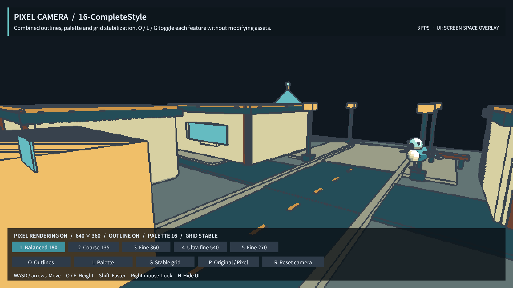
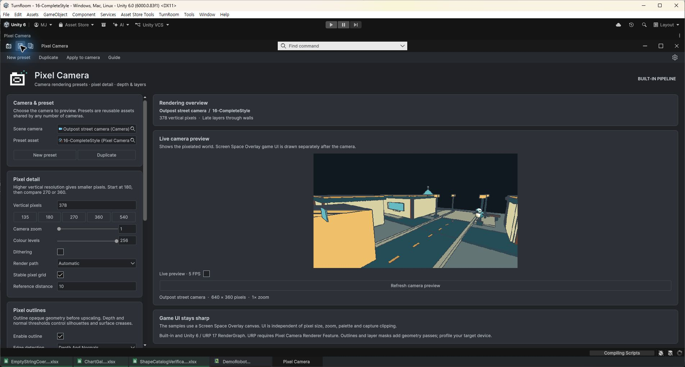
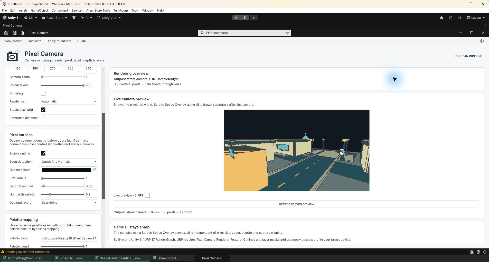
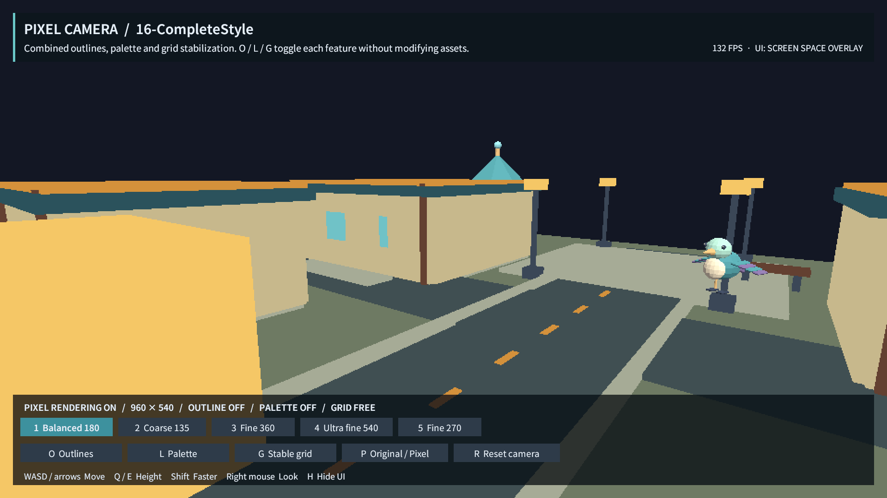

## 작업 결과

구현·설치·실행 검증을 완료했습니다. 이 기록의 공개 배포와 외부 접근 확인을 진행합니다. 가격 책정과 스토어 판매 등록은 수행하지 않았습니다.

## 변경 내용

### 적용 내용

프리셋에 아웃라인 색상/불투명도/반경/깊이·노멀 감도/대상 레이어, 팔레트 에셋과 혼합, 격자 안정화와 원근 기준 거리를 추가했습니다. Automatic은 가능한 설정에서 원본 영상을 재사용합니다. URP17 선택 통합, Renderer Feature 설치 메뉴와 창 미리보기를 추가했습니다. 기존12개 맵을 유지하고13~16번 비교 맵을 추가했으며 O/L/G 키와 UI 버튼은 원본을 바꾸지 않는 Play 프리셋 복제본을 사용합니다. 별도 도킹 설정 창과 공유 Inspector를 적용하고 기존 Affinity 벡터 로고를 유지했습니다.

## 검증

Unity6000.0.83f1 Built-in 핵심 22검사, URP17.0.4 RenderGraph 32검사(24회 반복 렌더 포함), 기존TurnRoom16개맵 Play/Overlay UI10버튼과16맵렌더, URP16맵렌더·미리보기·실제Play, 네이티브 키보드 입력/Undo/Redo/저장·재열기, 9개언어 문서 링크·실제캡처 소스해시 검사를 통과했습니다. 10626796바이트 패키지의 제품 에셋174개를 원본 대조했고 새 Built-in 프로젝트에 해당 패키지만 설치해16맵렌더와 셰이더 컴파일을 통과했습니다. SHA-256 e8f332b75af037256cf5d5a40ad9ea9f5f20f0117d5425aa106a34f43dc636c1. 상세 QA JSON은 각 테스트 화면 옆 근거 경로에 보존했습니다.

### PC_CORE · 아웃라인·팔레트·안정화와 자동 렌더 경로

분류: Pixel Camera 0.3.0 · 결과: **통과**

| 항목 | 내용 |
| --- | --- |
| 실행 절차 | 원본 씬을 보존한 격리 장면에서 실제 Camera.Render 픽셀을 비교 |
| 기대값 | 윤곽선 반경·레이어·가림, 격자 이동, 정확한 팔레트 색과0중복 렌더 |
| 실제 결과 | 22개 통과. 원본/재캡처 일치, 팔레트 RGB·강도0·정상 노멀·벽 관통 조합 확인. |
| 원본 출처·버전 | Unity6000.0.83f1; core-qa.json |

**수정 후 실제 실행**

화면 근거: 새 기능 구현 검증이며 동일 조건의 구현 전 화면은 없습니다. 실제 구현 후 실행 화면과 수치 검증 근거를 첨부했습니다.

### PC_URP · URP17 RenderGraph와 반복 프레임

분류: Pixel Camera 0.3.0 · 결과: **통과**

| 항목 | 내용 |
| --- | --- |
| 실행 절차 | 별도 소유권 검증 프로젝트에서 RenderRequest와 Renderer Feature 실행 |
| 기대값 | Compatibility Mode 없이 동작하며 임시 자원·RendererList 오류 없음 |
| 실제 결과 | 32개 통과.24캡처, 렌즈/컬링 갱신,0중복 경로, 팔레트·관통·아웃라인 통과. |
| 원본 출처·버전 | URP17.0.4; urp-qa.json, urp-maps.json |

**수정 후 실제 실행**

화면 근거: 새 기능 구현 검증이며 동일 조건의 구현 전 화면은 없습니다. 실제 구현 후 실행 화면과 수치 검증 근거를 첨부했습니다.

### PC_MAPS · 16개 플레이 가능한 맵과 UI 분리

분류: Pixel Camera 0.3.0 · 결과: **통과**

| 항목 | 내용 |
| --- | --- |
| 실행 절차 | 기존TurnRoom에서 각 맵 Play→상태읽기→게임캡처→Stop |
| 기대값 | 맵마다292렌더러, Overlay Canvas1개, 버튼10개 |
| 실제 결과 | 16개 모두 통과.13~16 새 기능 샘플과 기존맵 유지. Overlay UI는 효과 밖에서 선명하게 표시. |
| 원본 출처·버전 | play-all-16.json |

**수정 후 실제 실행**

화면 근거: 새 기능 구현 검증이며 동일 조건의 구현 전 화면은 없습니다. 실제 구현 후 실행 화면과 수치 검증 근거를 첨부했습니다.

### PC_NATIVE · 설정 입력·Undo/Redo·저장과 게임 키

분류: Pixel Camera 0.3.0 · 결과: **통과**

| 항목 | 내용 |
| --- | --- |
| 실행 절차 | 도킹창360→378입력, CtrlZ/CtrlY, 저장·닫기·재열기. 게임O/L/G와4키 입력 |
| 기대값 | 실제 바인딩 값과 저장 내용 일치; Play 원본 에셋 보존 |
| 실제 결과 | 378저장·재열기,360복구. O/L/G OFF와540픽셀 선택. Play 전후 원본 프리셋SHA256동일. |
| 원본 출처·버전 | native-qa.json; English Windows UI |

**수정 후 실제 실행**

화면 근거: 새 기능 구현 검증이며 동일 조건의 구현 전 화면은 없습니다. 실제 구현 후 실행 화면과 수치 검증 근거를 첨부했습니다.

### PC_DOCS · 라이트/다크 설정과9개언어 문서

분류: Pixel Camera 0.3.0 · 결과: **통과**

| 항목 | 내용 |
| --- | --- |
| 실행 절차 | 실제 Unity창 캡처·육안검토 후 문서생성/링크/이미지·소스해시검사 |
| 기대값 | 현재 기능·지원범위·샘플16개와 캡처 일치 |
| 실제 결과 | 9개언어 가이드와9개실제캡처 해시 통과. 모든이미지200KB이하, 직접캡처 원본으로 별도 이미지편집 없음. |
| 원본 출처·버전 | Documentation/ScreenshotManifest.json; 영어 UI만 시각검증 |

**수정 후 실제 실행**

화면 근거: 새 기능 구현 검증이며 동일 조건의 구현 전 화면은 없습니다. 실제 구현 후 실행 화면과 수치 검증 근거를 첨부했습니다.

### PC_INSTALL · 최종 패키지 새 프로젝트 설치

분류: Pixel Camera 0.3.0 · 결과: **통과**

| 항목 | 내용 |
| --- | --- |
| 실행 절차 | 제품코드 사전복사 없이 최종unitypackage를 새 Built-in 프로젝트에 import |
| 기대값 | 컴파일 성공·16맵 렌더·셰이더 오류 없음 |
| 실제 결과 | 새 설치 통과. 패키지393에셋,4모델,16맵,9가이드. Development/Pixora 종속성 제외. |
| 원본 출처·버전 | fresh-install-qa.json; package-verification.json |

**수정 후 실제 실행**

화면 근거: 새 기능 구현 검증이며 동일 조건의 구현 전 화면은 없습니다. 실제 구현 후 실행 화면과 수치 검증 근거를 첨부했습니다.

## 남은 사항

공개 배포 확인 진행 중. 지원 범위: Built-in과 URP17 RenderGraph의 비XR 기본 카메라. HDRP·카메라 스택·URP Compatibility Mode·다른 이미지 이펙트 통합은 지원하지 않습니다. 투명 표면·사용자 정의 알파 클리핑 아웃라인은 별도 통합이 필요합니다. 원근 격자 안정화는 기준 거리 평면을 사용하며 모든 깊이를 동시에 고정하지 않습니다. 프리셋 전환 블렌딩은 이번 구현 범위에 포함하지 않았습니다. FPS 표시는 에디터 상태값이며 하드웨어 성능 보장이 아닙니다. 영어 UI만 시각 검증했습니다. 교훈 검토: RenderGraph 풀 데이터 초기화, 기본 투영/컬링 행렬 복원, 검증 도구 참조 누락과 파일 명령 경합은 프로젝트 검증 기록에 남겼습니다. 기존 전역 근거·검증·포커스 규칙으로 충분하여 전역 지침 변경 없음.

## 작업 시간

- 제안 시간: 60~90분 (2026-11-01 03:26:13 KST 시작)
- 실제로 완료된 시간: 구현·검증 2026-11-01 04:21:22 KST까지 완료, 약55분9초. 공개 배포 확인은 진행 중이며 완료 시각을 별도 기록합니다.
- XERJ: 사용 — 권한이 있는 로컬 연결에서 TemplateAssetInspector 검색5개 후보 반환. XERJ 범위 밖 PixelCamera 런타임·셰이더는 현재 파일 직접 읽기와 rg로 대조했습니다. 기본 샌드박스의 로컬 노드 접근 실패를 노드 중단으로 단정하지 않았습니다.
