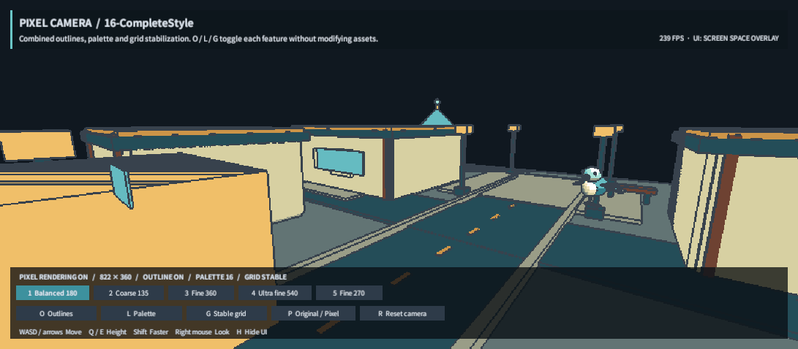

## 작업 결과

제출 후보 1.0.0 패키지와 스토어 입력 자료를 준비했습니다. 실제 스토어 업로드·심사 제출·출시는 수행하지 않았으며, 전체 제출 준비는 아직 완료되지 않았습니다.

Unity 6000.0.83f1에서 샘플 16의 실제 플레이 화면을 캡처했습니다. 픽셀 월드와 오버레이 UI가 함께 보이며, 이 화면을 변경된 설정 창의 검증으로 취급하지 않습니다.

## 변경 내용

### 적용 내용

원본 제품/공유 소스는 보존하고 격리 스테이징에 Pixel Camera 1.0.0, Templete 1.5.1 공개 API 제출 빌드를 만들었습니다. Unity 내부 API 의존을 공개 EditorWindow API로 바꾸고 메뉴를 Tools/TurnRoom으로 정리했습니다.

영문 설명·제약·릴리스 노트·AI 도구 공개·심사자 노트·지원 문서·폰트 OFL 및 제3자 고지를 작성했습니다. 아홉 언어 안내의 메뉴 경로와 버전을 수정했으나, 변경 UI의 스크린샷은 재촬영하지 않았습니다.

실제 Affinity에서 커버/카드/아이콘/소셜 네 구성을 제작했습니다. Cover.af/Cover.png, Social.af 저장을 확인했습니다. 나머지 출력은 미완료입니다.

## 검증

공식 Asset Store Tools 11.3.1 실행: 27 Pass, 2 Warning, Fail 없음. 두 경고는 의도된 모델 부품 회전과 설명서 JPG입니다. 심사자 노트에 예외 근거를 기록했으며 Unity의 승인 여부는 미확인입니다.

Built-in 16맵, URP 17.0.4 RenderGraph 16맵 렌더링 통과. URP 반복 프레임/기능 검사 통과. Windows 11·Direct3D11·Unity 6000.0.83f1 범위입니다. [공식 검사](../assets/store-20261101/official-validator.json), [URP 기능](../assets/store-20261101/urp-qa.json), [URP 16맵](../assets/store-20261101/urp-maps.json).

최종 패키지 429개 에셋을 스테이징 원본 바이트와 대조했습니다. 샘플 16개, 프리셋 19개+팔레트 1개, 라이선스·지원 문서를 확인했으며 최장 에셋 경로는 97자입니다. [패키지 해시/전수 대조](../assets/store-20261101/PackageAudit.json). 최종 압축본의 새 프로젝트 설치 검증은 미실행입니다.

기준: [공식 제출 지침](https://marketplace.unity.com/publishing/submission-guidelines), [공식 업로드 안내](https://docs.unity.com/en-us/asset-store/publishing/asset-packages/upload).

교훈 검토: 포커스 제한·실제 Affinity 검증·미실행 QA 구분은 기존 전역 지침에 이미 있으므로 전역 변경 없음. 이번 제출 전용 변환과 두 경고의 상세 근거는 프로젝트 기록에 보존했습니다.

## 남은 사항

Affinity 전경 전환 허용 후 미저장 이미지 저장·원본 재열기/출력 검증. 변경 설정 UI 양 테마 재촬영과 아홉 언어 문서/manifest 갱신. 최종 압축본 새 프로젝트 설치. 판매자 이름·공개 지원 연락처·가격 확정 후 Publisher Portal 업로드/심사 제출.

자동 승인 검토가 Affinity 전경 활성화를 이전 포커스 금지 지시 위반으로 거부했습니다. 같은 동작을 다른 수단으로 우회하지 않고 GUI 작업을 중지했습니다. 포커스 전환 재허용이 있어야 네이티브 저장·UI 캡처를 계속할 수 있습니다. 가격·판매자/지원 필드도 아직 미정입니다.

## 작업 시간

- 제안 시간: 30~50분
- 실제로 완료된 시간: 2026-11-01 11:37:25 KST 시작. 2026-11-01T03:12:46.679Z 현재 작업 중; 전체 완료 시각 미기록.
- XERJ: 사용 — XERJ Status와 Export Product Packages 검색 5개 후보 확인. 현재 소스와 대조했고 제출 스테이징/범위 밖 런타임은 rg·직접 읽기로 검증.
