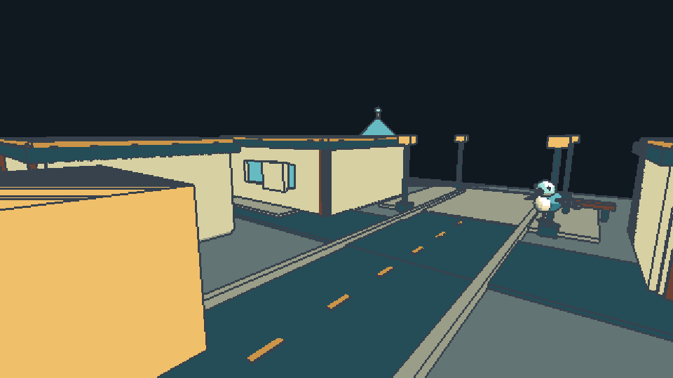

## 작업 결과

사용자가 추가한 창문 문제를 수정해 1.0.0 제출 후보 패키지를 갱신했습니다. 스토어 업로드/심사 제출은 하지 않았고 전체 제출 준비는 아직 완료되지 않았습니다.

## 변경 내용

### 적용 내용

일반 샘플 두 프리셋과 재생성 스크립트 수정, 9개 가이드 설명과 실제 렌더 증거 추가, 압축본/등록 자료 갱신. 커버1950×1300·소셜1200×630 PNG는 실제 저장본을 열어 시각 검사했습니다. 아이콘/카드의 최종 PNG와 원본 재열기 검증은 미완료입니다.

## 검증

[실제 Unity 프리셋·전후 비교](../assets/store-final-20261101/window-occlusion-qa.json): 일반 16번 false, coarse135 false, 09번 true. 전체 3,197픽셀, 좌측 1,436픽셀 변화. 원본과 결과를 직접 시각 비교해 사용자가 표시한 왼쪽 관통 영역이 사라진 것을 확인했습니다.

[22개 핵심 검사](../assets/store-final-20261101/core-qa.json), [16개 맵 회귀](../assets/store-final-20261101/maps-qa.json) 통과. [최종 패키지 전수 대조](../assets/store-final-20261101/PackageAudit.json) 통과. 코드가 실제로 새 QA 명령을 처리한 개발 어셈블리 ac8291f1-7b89-4c18-b36f-28f1b2d7d9ce를 기록했습니다. 최초 구형 도메인의 Unknown QA action 실패는 로컬 이력에 보존했고 이후 기존 핵심 검사 중 AssetDatabase.Refresh를 거쳐 새 어셈블리를 로드했습니다.

교훈: 해상도 선택이 관통 모드를 함께 켜지 않도록 제품 생성 규칙을 분리했습니다. 제품별 교훈이며 기존 전역의 증거·포커스 규칙과 중복되므로 전역 지침 변경 없음.

이전 공식 Asset Store Tools11.3.1 검사 27 Pass·2 Warning·0 Fail과 URP17.0.4 검사는 과거 버전 근거로 보존합니다. 이번 최종 패키지를 새 프로젝트에 설치하거나 공식 검사 도구로 재실행한 것으로 보고하지 않습니다. XERJ 연결 실패와 Affinity 실제 연결 거부를 확인했습니다. 원본 공유 템플릿과 다른 제품은 변경하지 않았습니다.

## 남은 사항

아이콘/카드 네이티브 Affinity 저장·원본 재열기 검증, 제출용 공유 설정 UI 재촬영 및 해당 문서 해시 갱신, 최종 새 프로젝트 설치, 판매자 정보·공개 지원 연락처·가격 확정. 화면 포커스 전환은 사용자 요청으로 보류. 실제 스토어 업로드/심사 제출은 하지 않았습니다. 현재 Affinity MCP 연결이 거부되고 열린 Affinity 창도 없습니다. 사용자께서 이번에도 포커스 전환 없이 진행하라고 명시하여 앱을 실행하거나 화면을 전환하지 않았습니다. 최신 메뉴얼과 실패/미실행 근거를 보존했습니다.

## 작업 시간

- 제안 시간: 이번 후속 20~35분 (최초 제출 준비 30~50분)
- 실제로 완료된 시간: 후속 시작 2026-11-01 15:20:55 KST. 2026-11-01T06:30:12.384Z 현재 기록; 전체 제출 준비 미완료.
- XERJ: 실패 — Status 실행 결과 XERJ node is not running. 새 백그라운드 콘솔 실행은 no-focus 제한 아래 보류하고 rg/현재 소스 및 실제 Unity 실행으로 대조했습니다.
