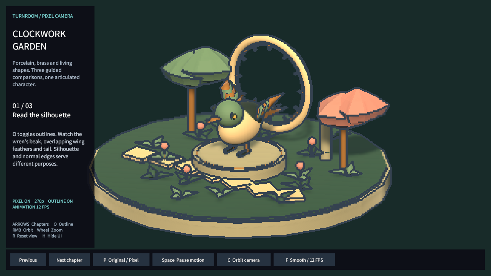
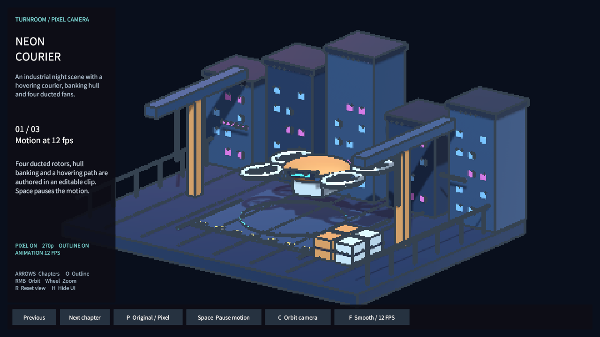
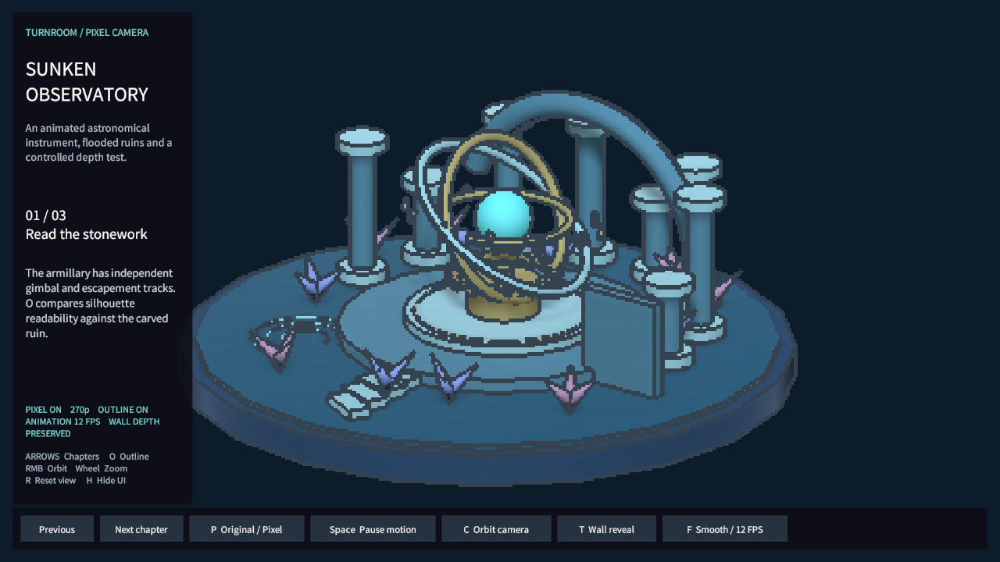

## 작업 결과

반복된 항구16개 예제를 주 예제3개로 교체했습니다. 장면·주역 모델·재질·편집 가능한 관절 클립이 각각 다릅니다. 현재 제품을 ProPixelizer와 기능 동등이라고 소개하지 않습니다. 핵심 격차는 카메라 필터를 넘어선 물체별 픽셀화/움직임 안정화·재질 저작 체계입니다.

[실제 Unity 애니메이션 포즈 재생·탐색](../assets/showcase-20261101/MotionPreview.ko.html)

**Clockwork Garden** — 포슬린/황동 기계 새, 머리·날개·꼬리의 독립된 움직임.

**Neon Courier** — 별도 산업 환경, 드론 호버·기체 기울임·팬4개.

**Sunken Observatory** — 천문 장치의 짐벌·기어와 명시적 가림/투시 비교.

이미지는 실제 기존 Unity가 월드와 native UGUI를 렌더한 결과입니다. 캡처 때만 Overlay Canvas를 별도 UI 카메라로 렌더했으며 데스크톱 Play 화면 캡처가 아닙니다. 런타임 Overlay 모드와 API 결과는 별도 검사했습니다. 새 GUI 실행·창 활성화/포커스 API 호출 없이 진행했으며 OS 포커스 이벤트 모니터링을 수행한 것은 아닙니다.

## 변경 내용

### 적용 내용

기존 Samples/Scenes·Artwork·Presets·Runtime과 Samples 메뉴를 재사용했습니다. 세 주 씬, 세 hero prefab/anim,9개 챕터 프리셋,3개 팔레트를 만들었습니다. 기존16씬과 아트는 Development/LegacySamples에 보존하고 고객 패키지에서 제외했습니다. 별도 제품 루트/프리미엄 관리 구조를 만들지 않았습니다.

각 챕터는 무엇이 달라지는지·왜 필요한지·비교할 조작을 안내합니다. P 원본, Space 정지, F 부드러운/12FPS, O 외곽선, C/RMB 회전, 휠 확대, R초기화, H숨김, 천문대 T투시를 제공합니다. 런타임 프리셋은 개인 복제본이며 원본 저장 에셋을 바꾸지 않습니다.9개 언어 가이드와 실제 포즈 미리보기를 새로 생성했습니다.

URP 샘플 재질 변환이 모두 Unlit으로 바뀌던 코드를 수정해 Lit/Unlit 의도·금속도·거칠기 대응·발광을 보존하도록 했습니다. 이 변경은 아직 URP 실행 검증을 하지 않았습니다. 스토어 문구/AI 공개/패키지와 제출 준비 상태도 갱신했습니다. 예전 항구 키이미지를 새 예제 이미지로 오인하지 않도록 후보 ZIP에서 제외했습니다.

확인: 2026-11-01 KST. ProPixelizer 공개 문서 2.0.3과 현재 로컬 소스를 대조했습니다. 상대 제품을 설치하거나 성능/출력 품질을 같은 장치에서 비교한 결과는 아닙니다.

| 항목 | ProPixelizer 공식 문서 | 현재 Pixel Camera | 격차 |
| --- | --- | --- | --- |
| 오브젝트별 픽셀 크기·일반 3D 혼합 | 재질별 픽셀 확장 및 선택 필터 | 카메라 전체 저해상도 렌더 | 핵심 부재. 후순위 레이어는 선택적 픽셀화가 아님 |
| 움직이는 물체의 픽셀 크리프 | 오브젝트 위치/각도 스냅·계층 정렬 및 Pixel Expansion | 카메라 이동 스냅만 있음 | 물체별 스냅·서브픽셀 이동 없음. 원근 완전 안정화도 보장하지 않음 |
| 픽셀 크기 기준 | 월드 단위·다운스케일 비율·고정 높이 | 고정 세로 픽셀 수 | 월드 단위·비율 모드 부재 |
| 외곽선 | 오브젝트 ID/재질별 색·깊이 검사·하이라이트·광원 반응 bevel | 카메라 공통 색·깊이/노멀·레이어 선택 | 오브젝트 ID/개별 색과 광원 반응 bevel 없음 |
| 조명 | 전용 Uber Shader의 툰 램프·그림자 틴트·ambient 제어 | 원래 재질의 조명 결과를 픽셀화 | 조명이 없는 것은 아님. 전용 툰 조명 도구가 없음 |
| 팔레트·디더 | LUT 제작·이미지 색 추출·RGB/HSV 매칭·사용자 4×4 패턴 | 최대64색 Color 배열·색 혼합·고정2×2 디더 | LUT 저작/추출/패턴 편집기 없음 |
| Shader Graph | 전용 SubTarget 및 예제 | 전용 HLSL 후처리·Renderer Feature | Shader Graph 확장 계약 없음 |
| 애니메이션 | 기존 클립을 단계형으로 복제·변환하는 도구 | 애니메이션 결과도 렌더 가능. 이번 샘플은 실제 .anim과12fps 샘플러 추가 | 일반 애니메이션 변환 도구와 Animator blend 제어는 없음 |
| 파이프라인·호환 | 현재 목록 URP, 2022.3.62/6000.6.1 표기 | Built-in, Unity6000.0.83f1/URP17.0.4 RenderGraph 검증 이력 | Built-in 지원은 우리 범위. Forward+·WebGL·카메라 스택·후처리 조합의 현재 동등성은 미확인/미지원 |
| 예제 설명 | 기능별 예제·문제 해결·기술 문서·플레이 데모 | 같은 항구를16번 사용했던 예제 | 사용자 지시에 따라 다른 자산·관절 클립·단계 설명의3개 쇼케이스로 교체 |

우선순위: (1) 물체별/선택적 픽셀화와 움직임 안정화, (2) 물체별 외곽선/조명 반응 및 팔레트·디더 저작, (3) Shader Graph·URP 조합 호환 및 플랫폼 실측. 현재 상품을 ProPixelizer와 기능 동등으로 소개하지 않습니다. 이번 작업의 구현 범위는 세 샘플의 실제 품질·애니메이션·설명 개선이며, 위 렌더 엔진 기능이 전부 추가된 것은 아닙니다.

공식 근거:

- https://assetstore.unity.com/packages/vfx/shaders/fullscreen-camera-effects/propixelizer-realtime-3d-pixel-art-177877
- https://propixelizer.github.io/docs/usage/pixelization/
- https://propixelizer.github.io/docs/usage/eliminate-pixel-creep/
- https://propixelizer.github.io/docs/usage/outlines/
- https://propixelizer.github.io/docs/usage/palette-tools/
- https://propixelizer.github.io/docs/usage/stepped-animation/
- https://propixelizer.github.io/docs/technical/propixelizer-camera/
- https://propixelizer.github.io/docs/technical/ubershader/

현재 소스: Runtime/PixelCameraPreset.cs, PixelCameraEffect.cs, PixelCameraRenderUtility.cs, Resources/TurnRoom/PixelCamera 셰이더, Integrations/URP/PixelCameraRendererFeature.cs. 샘플: Samples/Runtime/ShowcaseMotion.cs·ShowcaseTour.cs. 코드/설정의 존재와 네이티브 UI·특정 플랫폼 실행 검증을 구분합니다.

## 검증

Unity6000.0.83f1, 기존 Built-in 에디터에서 실제 씬 생성/로딩/카메라 렌더 및 실제 클립 샘플링을 수행했습니다.

| 씬 | clip 채널 | 실제 기록 포즈 | 두 포즈 변경 픽셀 | 실제 생성 버튼 |
| --- | --- | --- | --- | --- |
| 01-ClockworkGarden | 15 | 24 | 22,736 | 6 |
| 02-NeonCourier | 18 | 24 | 34,042 | 6 |
| 03-SunkenObservatory | 12 | 24 | 30,785 | 7 |

[실제 Unity QA](../assets/showcase-20261101/showcase-qa.json): 원본/팔레트/정지/샘플링 모드 API 전환, Overlay 속성, 버튼 글자 높이>20, 천문대 가림/투시2,736픽셀 차이 통과. 이는 실제 키보드 단축키나 마우스 클릭 검증을 대신하지 않습니다.

[자산 참조 격리](../assets/showcase-20261101/resource-isolation.json): 각 씬의 Artwork 의존 폴더가 자신의 테마 하나뿐임을 검사했습니다. 엔진 기본 프리미티브·런타임 코드·공통 글꼴은 공유합니다.

[최종 패키지 바이트/메타 대조](../assets/showcase-20261101/PackageAudit.json):582에셋, 정확한3씬·3anim·9챕터 preset+3palette, GUID중복 없음, 개발/옛FBX 제외. 기존 Unity 원본 asset/meta로 tar unitypackage를 구성했으며 최종 압축본의 신규 프로젝트 설치는 미실행입니다.9개 가이드·9개 모션 페이지·기존9개 진입 URL과 이미지 링크를 검사했습니다. 녹화 미리보기 HTML의 브라우저 레이아웃/실제 버튼 입력은 미실행입니다.

촬영 원본은1280×720 PNG, 이미지당200KB 미만을 확인했습니다. 변형·재압축하지 않고 동일 바이트를 보존했습니다. 촬영 소스/clip/씬 해시와 실제 어셈블리51c6eb5f-53b5-4aef-8cd4-4497e56015c4를 기록했습니다. 과거 screenshot hash를 새 소스로 바꾸지 않았습니다.

교훈 검토: 반복 예제를 줄이고 기존 폴더/진입점과 자산 의존성을 확인하는 요구는 최신 전역 지침에 이미 있으므로 전역 변경 없음. 첫 렌더의 버튼 높이0과 가림/조명 문제를 실제 화면에서 확인해 고쳤으며 해당 첫 QA를 보존합니다. 개발 빌더의 프로젝트 QualitySettings 직접 쓰기는 제거했습니다. 기존 ProjectSettings의 다른 미완성 변경은 리셋하거나 게시하지 않았습니다.

## 남은 사항

네이티브 Play 키보드/마우스와 새 URP 장면/변경된 조명 재질 변환, 최종 신규 설치 검증 미실행. 스토어 키 이미지 신규 장면 반영은 실제 Affinity·포커스 제한 아래 대기. 기존 전역 폴더 재사용·증거 구분 규칙에 해당하므로 전역 추가 없음. 설치·키이미지·판매자 정보/가격·스토어 실제 업로드/심사 제출은 이전 준비 작업의 남은 사항입니다. 이번 구현을 전체 스토어 제출 준비 완료로 처리하지 않았습니다.

## 작업 시간

- 제안 시간: 40~70분
- 실제로 완료된 시간: 2026-11-01 16:25:21 KST 시작. 구현·오프스크린 검증·문서·패키지 자료 작성 2026-11-01 17:01:04 KST (35분 43초). 공개 배포는 이후 확인하며 전체 네이티브 검증은 미완료.
- XERJ: 실패 — Status 실행에서 XERJ node is not running. 새 콘솔/GUI 실행을 피하고 rg와 현재 소스·공식 문서·실제 Unity 결과를 대조했습니다.
