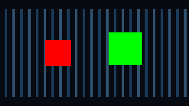

## 작업 결과

선택 오브젝트 합성 셰이더의 _MainTex 속성을 선언했습니다. 실제 동일 장면 검사에서 빨간 오브젝트 픽셀이 0→1,936으로 복구됐습니다.

## 변경 내용

### 재현 조건

Unity 6000.0.83f1 · Windows · Built-in; URP17.0.4 RenderGraph 별도 회귀 검사

### 재현 순서

독립된 빨간/초록 불투명 루트에 4px/8px 크기를 지정하고 동일 카메라에서 선택 오브젝트 합성을 실행합니다.

### 기대 동작

양쪽 오브젝트가 원래 머티리얼과 각각의 픽셀 크기로 보여야 합니다.

### 실제 동작

수정 전에는 빨간 오브젝트 픽셀 수가 0이었고 Native QA가 실패했습니다.

### 원인

실제 셰이더/렌더 검사와 수정 전후 대조로 _MainTex Properties 선언 누락을 확인했습니다.

### 적용 내용

PixelCameraObjects.shader에 _MainTex 속성을 추가했습니다. 일반 머티리얼·원본 배경·렌더러 상태를 보존했습니다.

## 검증

수정 후 동일 Built-in 장면의 빨간 픽셀1,936·초록 픽셀3,080을 확인했습니다. 선택 오브젝트·깊이·윤곽선·복원 17개 검사와 URP17 RenderGraph 17개 검사가 통과했습니다.

## 남은 사항

투명 합성·사용자 정점 변형·HDRP·XR은 이 수정의 검증 범위 밖입니다. Affinity의 애니메이션 GIF 내보내기는 검증하지 못해 정지 전후 화면을 제공합니다.

## 작업 시간

- 제안 시간: 4개 제품 전체 작업 예산 최대10시간에 포함.
- 실제로 완료된 시간: 수정 후 Native 검사 완료 2026-11-02 02:57:06 KST. 전체 작업과 별도의 정확한 수정 착수 시간은 기록되지 않았습니다.
- XERJ: 사용 — 공통 Editor 검색에 XERJ를 사용했습니다. 해당 Runtime/Shader는 인덱스 범위 밖이므로 rg와 실제 Unity 렌더 검사를 사용했습니다.
