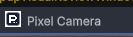

## 작업 결과

카메라 전용 컬러·흰색 로고 연결을 복원했습니다. 화면 조작은 재개하지 않았으며 현재 Unity 화면 반영은 미확인입니다.

변경 전: Pixel Camera 옆에 Studio P 심볼이 표시됐습니다.

## 변경 내용

### 적용 내용

창 제목과 사용자 정의 헤더가 Studio 심볼 경로를 직접 참조했습니다. GetToolIcon은 해당 titleContent를 그대로 반환했습니다. 기존 PixelCameraLogo.png/White.png 로더를 공통화하고 창 목록의 배경 명도에 맞게 전용 아이콘을 반환하도록 했습니다. 테마·효과·프리셋·팔레트·오브젝트 Inspector는 공통 베이스에서 카메라 로고를 상속합니다. 기존 로고 이미지와 GUID는 변경하지 않았습니다.

## 검증

Runtime·Samples·Editor·Development·URP·URP.Editor 6개 어셈블리 Roslyn 컴파일 통과. 기존 Affinity 출력 로고 2개 SHA256 일치. 수정 대상 소스의 Studio 심볼 참조 0건.

[검증 근거](../assets/logo-binding-20261104/verification.json)

## 남은 사항

실제 Unity 전후 화면 대조는 미실행입니다. 이전 Esc 중단 이후 화면 조작을 재개하지 않았으므로 수정 후 캡처는 없으며 화면 검증 완료로 표시하지 않습니다. 검토 패키지 재출력은 이번 수정 범위에 포함하지 않았습니다.

교훈 검토: 모듈 고유 브랜드를 유지한다는 사용자 정정을 적용했습니다. 프로젝트의 로고 연결 문제로 기록하며 전역 지침은 변경하지 않았습니다.

## 작업 시간

- 제안 시간: 3~5분
- 실제로 완료된 시간: 2026-11-04 15:28:12 KST 시작. 로고 연결 수정 및 6개 어셈블리 컴파일 완료. 공개 배포 확인 시각은 최종 채팅에 기록.
- XERJ: 실패 — Search와 Status 실행 실패. 데이터 디렉터리 node.lock 점유 로그 확인. 잠금 삭제·기존 프로세스 종료 없이 rg와 현재 소스로 대조.
