## 작업 결과

11개 씬의 실제 실행 화면을 촬영했습니다. 아래 GIF는 생성 이미지가 아니라 Unity가 렌더링한 프레임입니다. 기존 구현 보고의 화면 미확보 상태를 이번 촬영 근거로 보완합니다.

### 01-MeadowBreeze · 초원과 꽃 포인트

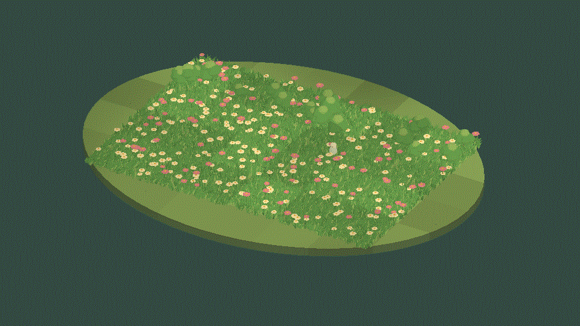

[같은 씬 정지 원본](../assets/scene-captures-20261103/01-MeadowBreeze.png) · 960×540 · 24프레임 · 3.48MB

### 02-BlossomWalk · 꽃밭과 비워 둔 산책길

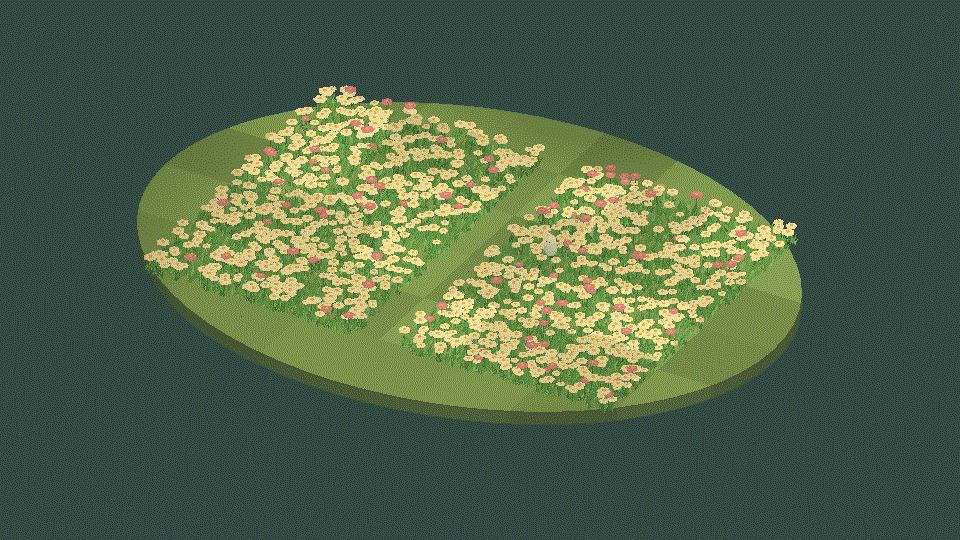

[같은 씬 정지 원본](../assets/scene-captures-20261103/02-BlossomWalk.png) · 960×540 · 24프레임 · 3.67MB

### 03-ShrubGarden · 관목과 하층 잔디

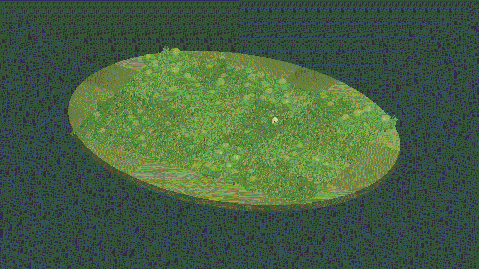

[같은 씬 정지 원본](../assets/scene-captures-20261103/03-ShrubGarden.png) · 960×540 · 24프레임 · 3.35MB

### 04-YoungWoodland · 나무와 수관·하층 식생

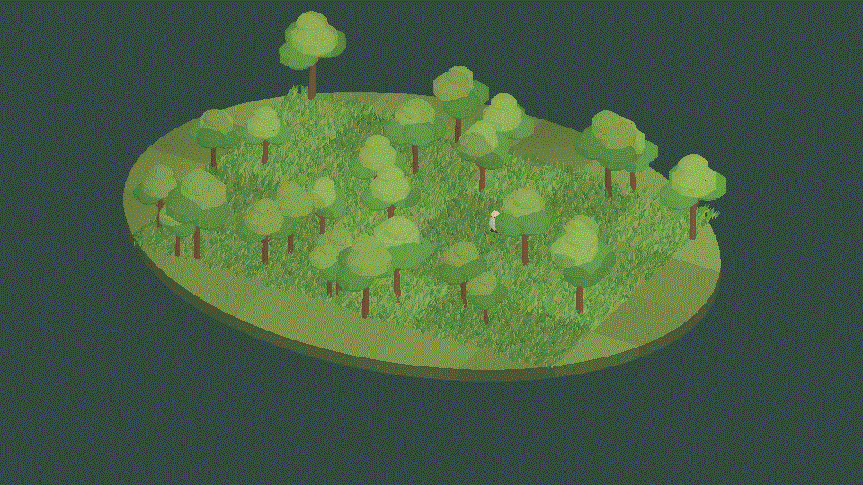

[같은 씬 정지 원본](../assets/scene-captures-20261103/04-YoungWoodland.png) · 960×540 · 24프레임 · 3.48MB

### 05-ContactTrail · 방문자가 이동하는 접촉 예제

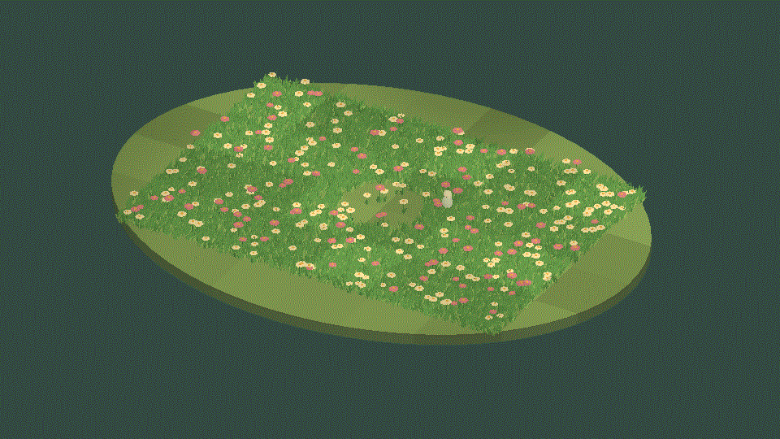

[같은 씬 정지 원본](../assets/scene-captures-20261103/05-ContactTrail.png) · 960×540 · 24프레임 · 3.49MB

### 06-SteppedRhythm · 4개 잔디 구역의 단계별 시간 예제

[같은 씬 정지 원본](../assets/scene-captures-20261103/06-SteppedRhythm.png) · 960×540 · 24프레임 · 3.26MB

### 07-SharedGusts · 여러 식생의 공통 돌풍 예제

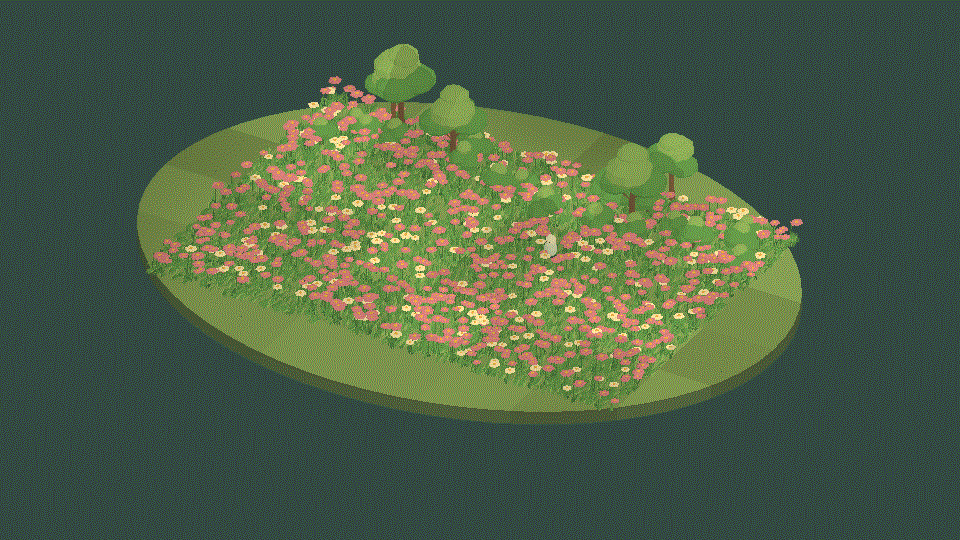

[같은 씬 정지 원본](../assets/scene-captures-20261103/07-SharedGusts.png) · 960×540 · 24프레임 · 3.70MB

### 08-CloudLight · 구름 명암을 공유하는 초원

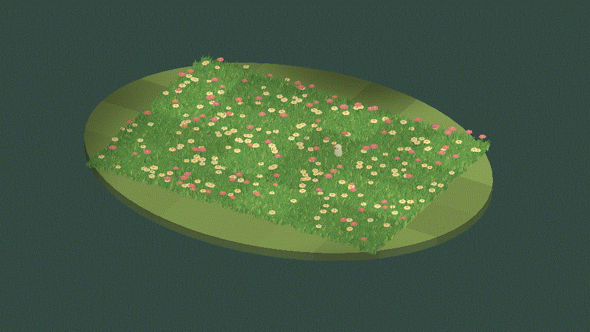

[같은 씬 정지 원본](../assets/scene-captures-20261103/08-CloudLight.png) · 960×540 · 24프레임 · 3.49MB

### 09-MixedGarden · 잔디·꽃·관목·나무 종합 정원

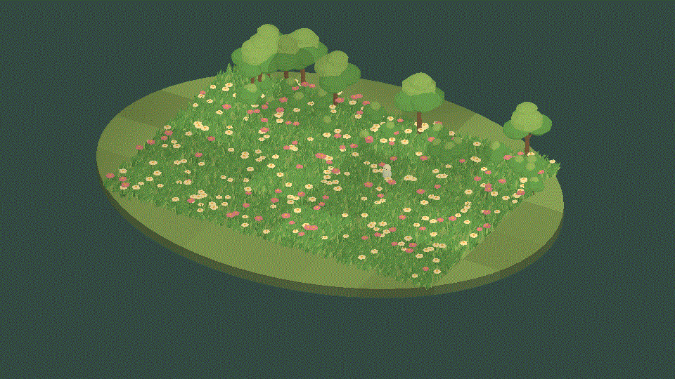

[같은 씬 정지 원본](../assets/scene-captures-20261103/09-MixedGarden.png) · 960×540 · 24프레임 · 3.60MB

### 10-ExtensionGrove · 나무 배치를 확장한 숲

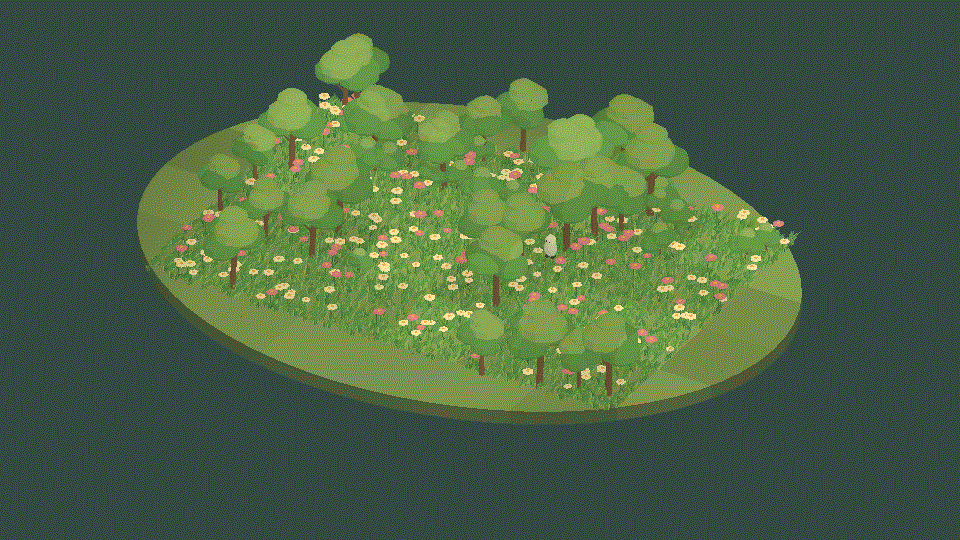

[같은 씬 정지 원본](../assets/scene-captures-20261103/10-ExtensionGrove.png) · 960×540 · 24프레임 · 3.56MB

### 11-PixelCameraGarden · Pixel Camera 픽셀 출력 연동

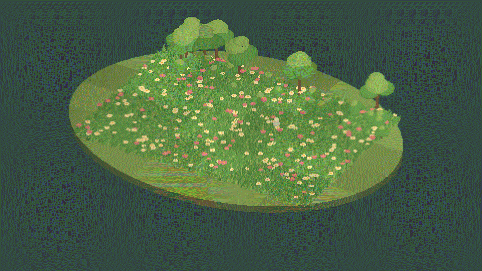

[같은 씬 정지 원본](../assets/scene-captures-20261103/11-PixelCameraGarden.png) · 960×540 · 24프레임 · 3.59MB

## 변경 내용

### 적용 내용

[이전 구현 보고서](2026-11-03-result-20261103114755800-v1.0.0.html)를 보존한 후속 버전입니다.

첫 실행에서 식생이 자홍색으로 표시되어 재질의 m_Shader 참조를 확인했습니다. 같은 Shader GUID를 가리키는 직렬화 참조가 type: 2여서 type: 3으로 수정하고 생성 도구도 함께 수정했습니다. 수정 후 전 씬을 재촬영했으며 재발 방지 정적 검사를 추가했습니다.

960×540 출력과 원본 프레임을 유지했습니다. 정지 PNG는 편집 없이 보존했습니다. 일부 PNG는200KB 목표를 조금 넘지만 작은 식생의 확인을 위해 원본을 유지했습니다. GIF는24프레임의 짧은 루프로 구성했습니다.

### 재질 참조 수정 전후 · 같은01번 씬

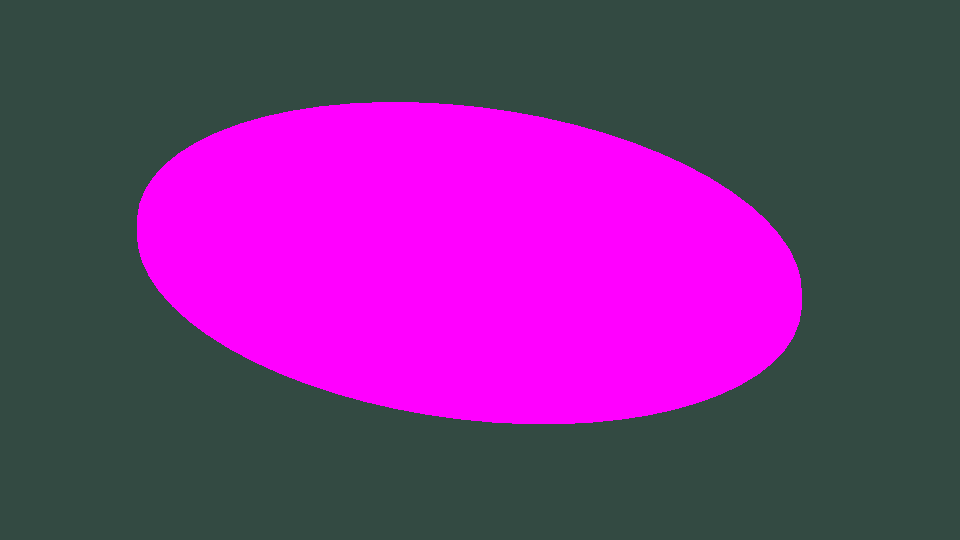

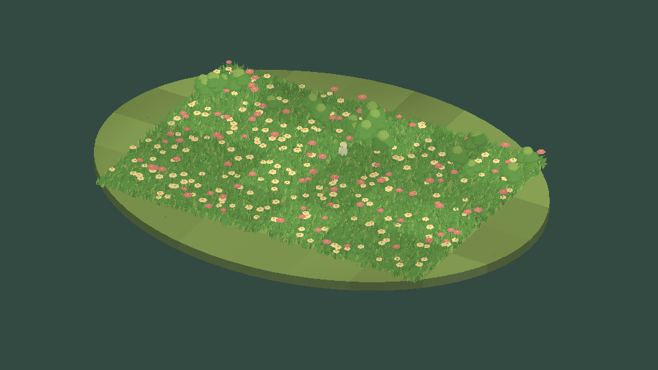

같은 씬·카메라·출력 크기입니다. 별도 실행이므로 방문자 위치와 바람 시간은 다릅니다.

## 검증

Unity6000.0.83f1·Windows DX11·Built-in에서 별도 검증 프로젝트에 같은 Runtime/샘플 소스를 복사해11개 씬 Play와 촬영을 수행했습니다. 사용자 프로젝트의 활성 씬과 빌드 설정은 변경하지 않았습니다.

11개 정지 화면을 직접 확인했고 GIF 전부960×540·24프레임·서로 다른24프레임으로 디코딩됨을 확인했습니다. GIF의 약5fps 촬영 간격은 제품 성능 측정값이 아닙니다. 따라서06번의0·3·5·8fps 설정 차이를 정밀 비교하는 고속 촬영으로 보시면 안 됩니다.

사용자가 지정한 설치 ScreenToGif2.43.2의 실제 GifEncoder API로 원본 PNG를 GIF로 묶었습니다. FFmpeg는 사용하지 않았습니다. [인코더·파일 해시](../assets/scene-captures-20261103/manifest.json), [프레임 검증](../assets/scene-captures-20261103/animation-validation.json)을 보존했습니다.

씬11은 Camera가 적용된 픽셀 출력의 실제 촬영입니다. 별도 URP·HDRP·모바일·출시 패키지 설치 검증을 뜻하지 않습니다.

## 남은 사항

이번 요청 범위인11개 씬 촬영과 보고서 첨부를 처리했습니다. 제품 전체의9언어 UI 전환, 표면 배치 Undo/Redo, 네이티브 패키지 설치, 성능 프로파일링, 자체 로고 제작, 공식 판매 검증은 별도 남은 작업입니다.

교훈 검토: 정적 컴파일로 확인되지 않는 재질 참조 오류를 실제 Play로 확인해 수정했습니다. 기존 실행 검증 규칙과 중복되므로 전역 지침 변경 없음. 프로젝트 생성 도구와 회귀 검사에 반영했습니다.

## 작업 시간

- 제안 시간: 20~40분
- 실제로 완료된 시간: 시작2026-11-03 22:04:01 KST.11개 씬 재촬영 완료22:14:24 KST, ScreenToGif 인코딩22:17:36 KST. 공개 배포 검증은 후속 메뉴얼에 실제 완료 시각을 기록합니다.
- XERJ: 미사용 — 촬영 중심 작업. 수정한 재질·생성 도구는 프로젝트 XERJ의 Editor 인덱스 범위 밖이므로 현재 파일과 실제 실행을 직접 대조했습니다.
