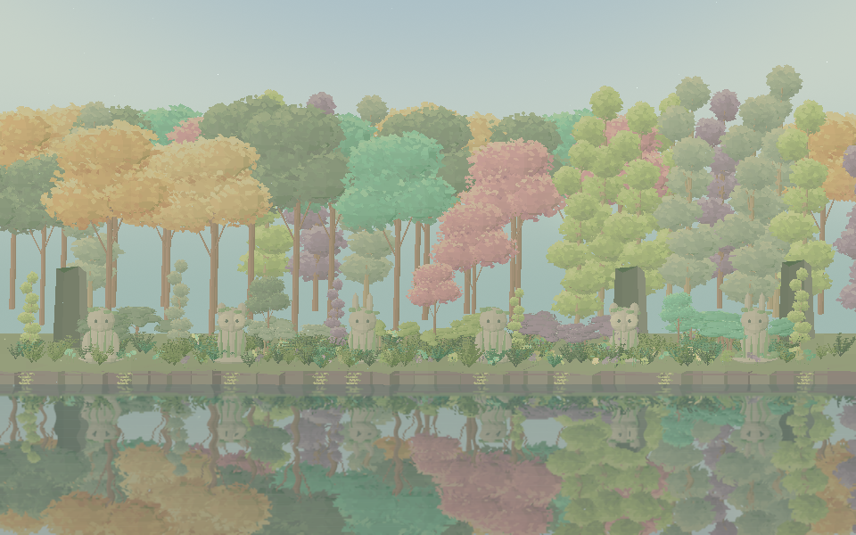
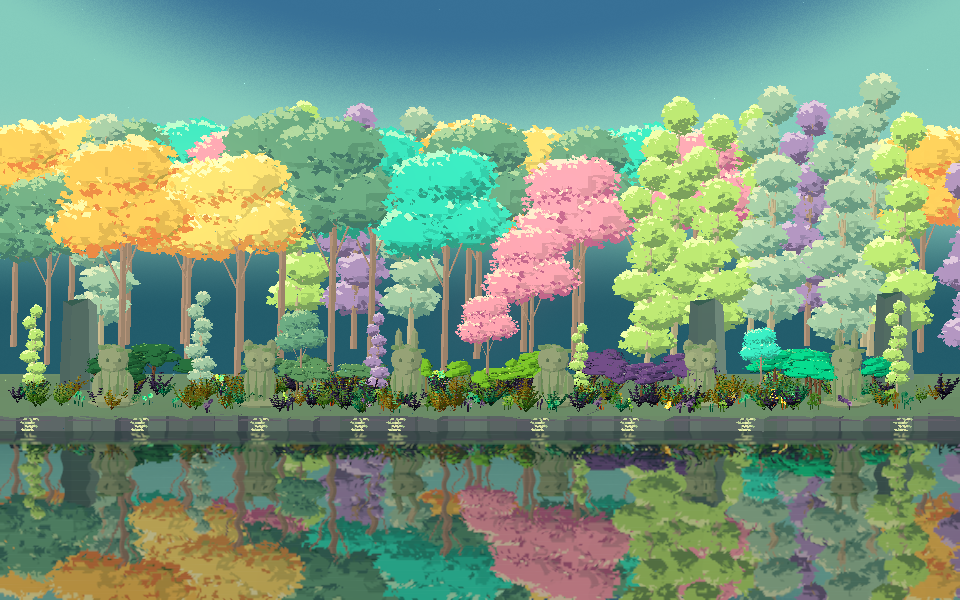
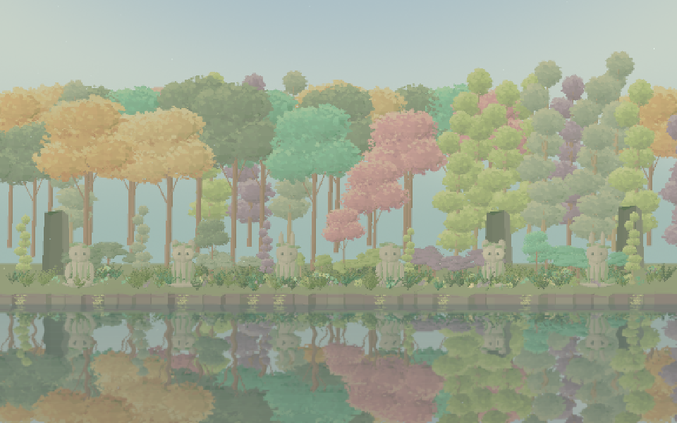
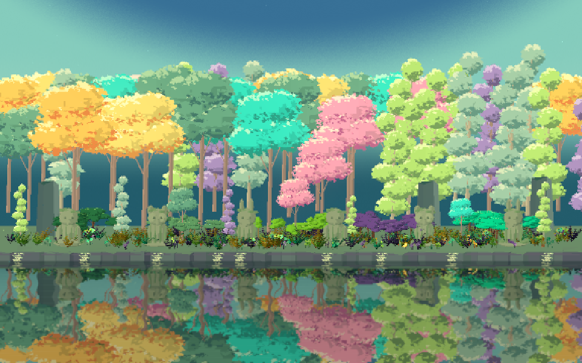

## 작업 결과

라이트만의 문제가 아니었습니다. 원본 프로젝트는 Linear, 기존 격리 QA는 Gamma였으며 같은 씬을 Linear로 렌더하자 사용자가 지적한 흐린 결과가 재현됐습니다. 이전 검증에서 색 공간 차이를 놓친 점을 정정합니다. Woodland 전용 재질과 메시 색·하늘·후처리를 수정했고 두 Woodland 씬의 Built-in Linear 렌더를 직접 확인했습니다.

변경 전: 원본과 같은 Linear에서 수관과 하늘이 밝고 흐리게 보였습니다.

변경 후: 노랑·청록·분홍·보라 수관의 밝은 면·중간 면·어두운 면, 파랑 상단·민트 중간·청록 지평선을 구분했습니다. 원본과 배치·구도까지 동일한 재현이라고 주장하지 않습니다.

## 변경 내용

### 적용 내용

- 잎 RGB에 적용됐던 파스텔 혼합을 되돌리고 8종 수관을 각각3가지 색으로 정리했습니다. 정점 위치·법선·바람 가중치·UV·인덱스는 보존했습니다.
- 예제 전용 Woodland Vegetation 재질은 공통 바람·접촉·셰이딩 코드를 공유하면서 제작 RGB를 Linear 출력에 맞게 처리합니다. 공통 Runtime 셰이더와 다른 예제의 재질은 변경하지 않았습니다.
- Woodland 프로필의 lightBands5→3, lightSoftness0.95→0.08. 색 단계는 팔레트로 제작한 표현이며 실시간 물리 그림자3회 연산이라는 뜻이 아닙니다.
- 하늘을 파랑·민트·청록 지평선으로 나눴고, 후처리의 sqrt 기반 전체 그림자 띄우기를 제거했습니다. 조명색·블룸 문턱·노출은 이 두 씬에만 조정했습니다. 밝은 동상·바닥의 색을 낮췄습니다.
- 9언어 가이드의 Woodland 설명과 기존 샘플 문서를 갱신했습니다.
- 다른 예제에서도 사용하는 동상3종의 기존 프로필은 복원했습니다. 두 Woodland 씬만 동일 메시를 사용하는 별도 프로필을 참조합니다. 변경된 메시·프로필의 다른 예제 참조0건을 검사했습니다.

## 검증

- Unity6000.0.83f1 Built-in, 실제 실행 값Linear, 동일 카메라·960×600·동일 바람 시간에서 전후 렌더2쌍을 확인했습니다. 두 씬 모두 Native shader errors0.
- 수관8종의 잎 RGB 각3종을 실제 메시 데이터로 검증했습니다. 총29개 메시/씬 구조 검사를 통과했고 나무 배치·카메라 값은 유지했습니다.
- 실제 Unity 헤더 기반 D3DCompile26개 셰이더 엔트리, Roslyn6어셈블리 및 기존 에셋/어셈블리/언어 검사12건 통과. 기존 공통 함수에 대한 uninitialized-variable 경고는 남으며 오류0입니다. URP 셰이더 컴파일과 실제 URP 씬 검증을 구분합니다.

[검증 근거·소스 해시](../assets/colour-20261104/verification-final.json)

통합 예제 변경 전입니다.

같은 Pixel Camera 설정을 유지한 변경 후입니다. 픽셀 카메라 모듈 자체를 수정한 결과가 아닙니다.

실제 Unity 렌더 원본 PNG를 보존했습니다. 픽셀·명암 판독을 위해 일부 파일은200KB 목표를 넘으며, 외부 이미지 도구로 편집·색 보정하지 않았습니다.

## 남은 사항

원본 레퍼런스와 동일한 구성·볼류메트릭 라이트·실제 프레임 성능·URP 반사/블룸·다른 플랫폼은 검증하지 않았습니다. Gamma 분기는 컴파일에 포함되지만 최종 Gamma 외형을 별도 승인한 것은 아닙니다. 원본 TurnRoom의 활성 씬·빌드 설정은 바꾸지 않고 격리 QA 프로젝트에서 검증했습니다. 검토 패키지는 이번 소스로 재포장하지 않았습니다.

교훈 검토: 기존 전역의 동일 상태 대조 원칙을 유지하고 프로젝트 PixoraAuthoring 지침에 원본/격리 색 공간·파이프라인 실행 값 대조를 구체화했습니다. 전역 지침 변경 없음. 최초 제한된 프로세스 조회에서 Unity가 없다고 판단했으나 권한 범위를 넓힌 조회에서 기존 인스턴스를 확인했습니다. 이번 작업에서 만든 중복 실행 오류 창만 닫고 기존 사용자 인스턴스는 종료하지 않았습니다.

## 작업 시간

- 제안 시간: 15~25분
- 실제로 완료된 시간: 2026-11-04 15:44:02 KST 시작 · 16:04 KST 최종 구현·렌더·검증 기록. 배포 확인은 최종 채팅에 기록.
- XERJ: 실패 — Status 노드 미실행. 직전 Search node.lock 점유로 실패. 소스는 rg로 검증.
