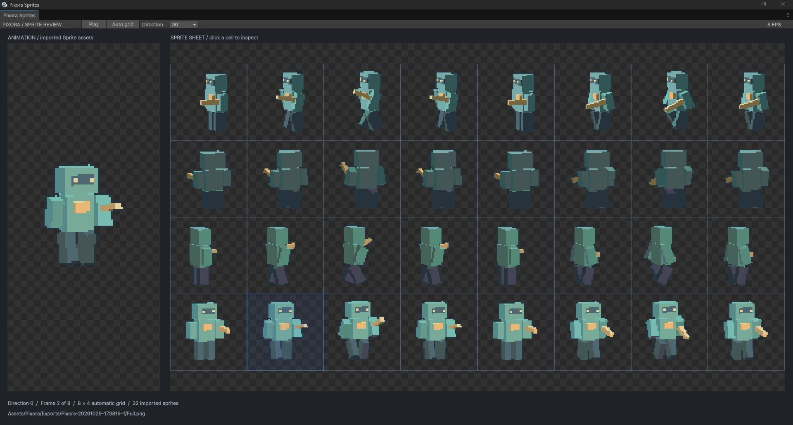
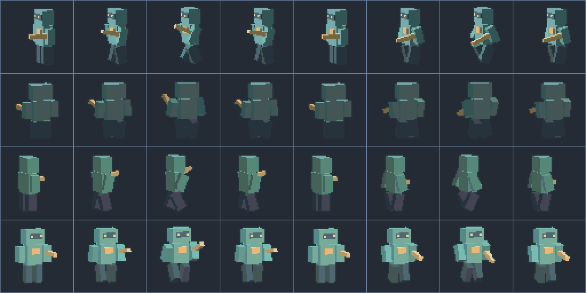
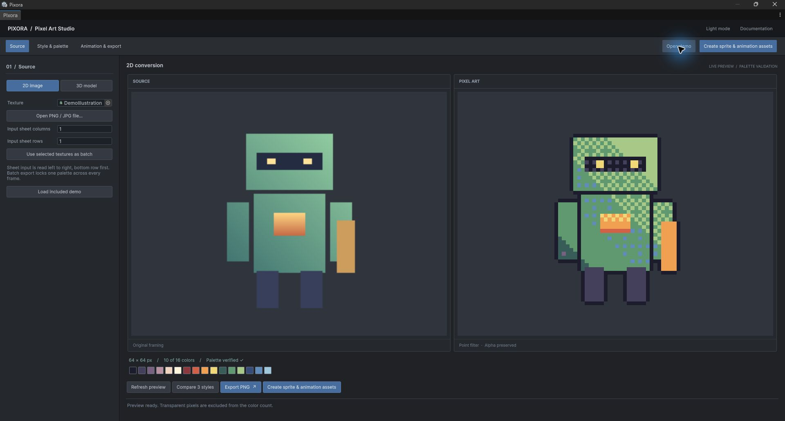
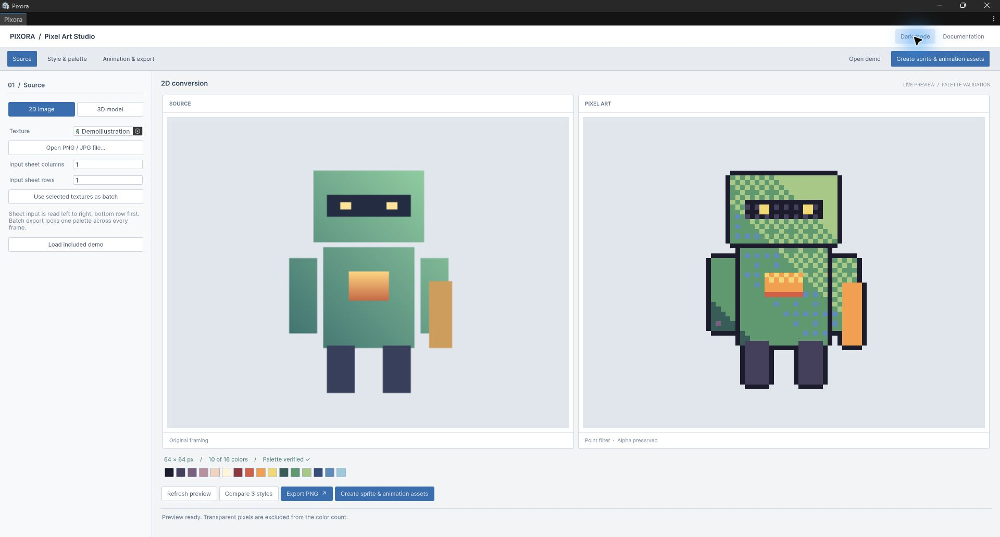

Unity 6000.0.83f1 프로젝트 생성, 기능 구현, 실제 에디터 검증과 GitHub 업로드를 완료했습니다. 아래 움직임은 실제 출력한 스프라이트에서 만들었습니다.

- 보고서 버전: v1.0.1 / 시제품 버전: v1.0.0
- 작성 시각: 2026-10-29T17:53:07+09:00 (Asia/Seoul, KST UTC+09:00)
- 프로젝트: [MDJ0126/Pixora](https://github.com/MDJ0126/Pixora)
- 확인한 원격 커밋: [107aaf5](https://github.com/MDJ0126/Pixora/commit/107aaf5adae5f5aed13937b5b70dfedc57dae897)

## 움직이는 캐릭터와 자동 격자

64×64 px, 방향별 8프레임, 4방향, 8 FPS의 보행 로봇입니다. 팔·다리 스윙과 몸의 상하 움직임을 가진 자체 제작 3D 모델·클립을 실제로 촬영했습니다. 전체 묶음에 최대 16색 공통 팔레트를 적용했습니다. GIF는 내보낸 PNG를 순서대로 표시한 자료이며 런타임 화면 녹화나 AI 보간 영상은 아닙니다. 체커와 방향 라벨은 보고서의 시연 배경입니다.

생성한 시트는 8열×4행으로 자동 분할되며 Sprite 32개가 Unity에 임포트됩니다. 검토 창에서 방향별 재생, 격자 표시, 셀 선택과 해당 Sprite 확인이 가능합니다.

## 공유 대화에서 확인한 요구와 반영 결과

출처는 [사용자께서 제공한 공유 대화](https://chatgpt.com/share/6ae2fc0d-3164-83e8-9232-986661cde09a)입니다. 비슷한 에셋의 존재 여부를 추정하는 대신, 대화에서 합의한 비AI 시제품과 이후 이 채팅에서 추가하신 요구를 구현했습니다.

- 2D 이미지·일러스트 변환: 원본 읽기 복사, 종횡비 유지, 해상도·명암·투명도·외곽선·디더링과 PNG 출력을 구현했습니다.
- 3D 캐릭터 변환: 복제 모델을 격리 미리보기 씬에서 고정 직교 카메라로 촬영합니다. 방향별·AnimationClip 프레임별 출력이 됩니다.
- 무기·장비 분리: 전체 합본과 활성 Renderer별 출력을 같은 카메라·캔버스·중앙 피벗으로 생성합니다. 개별 부위에도 애니메이션 프리팹이 생성됩니다.
- 정해진 색상 집합: 자동 추출, 사용자 지정, 공유 팔레트 에셋을 모두 지원합니다. 외곽선과 디더링 적용 후의 최종 RGB도 팔레트 포함 여부와 색상 수를 검사합니다.
- 충분한 프리셋: 8·16·24·32·48·64·96·128·192·256의 10개 해상도와 Retro 16·Classic RPG·Modern Pixel 스타일을 제공합니다. 커스텀 크기는 8~512 범위입니다.
- 프리셋 수정·저장: 기본값의 복사본을 편집하고 새 ScriptableObject로 저장합니다. JSON 교환 시 공유 팔레트를 실제 RGB 목록으로 풀어 넣습니다.
- 결과 비교: 같은 실제 원본을 세 가지 스타일로 변환해 나란히 표시합니다.
- 원본 보존: 원본 이미지·임포터·프리팹을 변경하지 않습니다. 기존 출력도 덮어쓰지 않고 새 이름과 폴더를 사용합니다.
- 에디터 전용: 모든 도구 코드는 Editor 전용 asmdef에 배치했습니다. 생성된 Sprite·AnimationClip·AnimatorController·프리팹은 에디터 도구 스크립트에 의존하지 않습니다.
- 스프라이트 파일과 애니메이션: PNG 시트뿐 아니라 개별 Sprite PNG, 실제 .anim, .controller, SpriteRenderer+Animator 프리팹과 확인 씬까지 생성합니다.
- Window 메뉴와 테마: Window → Pixora에서 열며 Source, Style & palette, Animation & export로 작업을 나눴습니다. 라이트·다크 모드 즉시 전환과 선택 저장을 구현했습니다.
- 움직이는 캐릭터·자동 그리드: 4방향×8프레임 보행 예제를 생성했고, 출력 프레임 수와 방향 수를 기준으로 자동 격자와 Sprite Import를 적용했습니다.
- 작성 방식·문서: SampleProjectForUnity의 네이밍·Class·Function·Enum·주석 지침을 읽고 반영했습니다. DesignDataTable의 저장된 Unity UI 화면과 현재 테마 소스를 참고했습니다. README와 Markdown 기반 9개 장의 오프라인 HTML 문서를 작성했습니다.
- AI 재해석: 공유 대화에서 후속 확장으로 분류된 항목입니다. 이번 결과는 비AI 방식의 실제 변환 도구이며 AI로 새 캐릭터를 그리는 기능은 구현하지 않았습니다.

## 실제 생성 파일과 사용 방법

걷기 예제 폴더는 Pixora 저장소의 Assets/Pixora/Exports/Pixora-20261029-173819-1입니다. [생성 결과 폴더](https://github.com/MDJ0126/Pixora/tree/main/Assets/Pixora/Exports/Pixora-20261029-173819-1)에서 내려받을 수 있습니다.

- Sprites/Full_d0_f0.png 등 개별 Sprite PNG 32개와 .meta
- Full.png 및 자동 격자·셀 이름·중앙 피벗을 기록한 Full.json
- Full_Direction0.anim ~ Full_Direction3.anim
- Full.controller — Direction 정수 파라미터와 방향별 상태
- FullAnimated.prefab — SpriteRenderer와 Animator 연결
- FullPreview.prefab 및 FullPreview.unity — 카메라가 포함된 재생 확인용 구성
- Profile.json — 해당 출력 묶음에서 실제 사용한 공통 RGB 팔레트

Unity Sprite는 PNG를 임포트하면서 생성되는 서브에셋입니다. 별도의 .sprite 확장자 대신 실제 Sprite Import 설정과 프리팹·클립의 Sprite 참조까지 연결했습니다. FullAnimated.prefab을 씬에 넣거나 FullPreview.unity를 열고 Play하면 사용할 수 있습니다. 컨트롤러의 Direction을 0~3으로 바꾸면 방향별 클립을 선택합니다. 이동 입력을 처리하는 게임 컨트롤러는 포함하지 않습니다.

Window → Pixora → Open Demo로 변환 데모를 열고, Walking Sprite Demo로 완성된 자동 격자·Sprite 재생 창을 열 수 있습니다. 새 출력은 Create sprite & animation assets에서 만듭니다. Unity 에셋 생성은 프로젝트 Assets 내부 출력에서 지원합니다.

## 라이트·다크 실제 화면

두 화면은 같은 입력과 변환 설정에서 테마만 전환한 실제 Unity 창입니다. 영어 UI와 현재 Windows 환경에서 확인했습니다. 새 테마의 모든 외부 DPI·해상도 배치까지 검증했다는 의미는 아닙니다.

## v1.0.1 추가 확인

v1.0.0 보고서를 보존하고 최종 기록을 추가했습니다. 시제품 코드는 변경하지 않았습니다. HTML 보고서 사이트의 검색·빈 결과 표시·이미지 포함과 로컬 링크 48개를 검사했습니다. 보고서와 시연 자료를 설정 저장소에 업로드했으며 다른 채팅의 미커밋 기록은 보존했습니다. 로컬 보고서 생성과 Git 업로드를 완료했으며 별도의 웹사이트 공개 배포는 수행하지 않았습니다.

## 검증 근거

- Unity 6000.0.83f1에서 최종 88개 자동 검사 통과. 기록: [Artifacts/Verification.json](https://github.com/MDJ0126/Pixora/blob/main/Artifacts/Verification.json).
- 2·4·16·32색 자동 추출, 사용자 RGB 소속, 외곽선·디더링 후 색상 제한, 투명 입력, 결정적 변환과 직사각 캔버스를 검사했습니다.
- 원본 PNG·meta·프리팹 보존, Point·PPU·mipmap, 프로필 복사와 공유 팔레트 JSON 교환을 검사했습니다.
- 실제 캡처 픽셀의 비어 있지 않음·투명도·방향 변화·애니메이션 변화를 검사했습니다. 전체와 부위별 시트의 공통 팔레트도 검사했습니다.
- .anim Sprite 키프레임과 루프, 컨트롤러 상태, 프리팹 Sprite 연결을 검사했습니다. 실제 AnimatorController PlayableGraph를 평가해 시간 진행에 따른 Sprite 변경과 Direction 조건 전환을 확인했습니다.
- 생성한 확인 씬을 OpenPreviewScene으로 실제 불러와 카메라·Animator 프리팹이 연결되어 있는지 확인했습니다. 사용자의 미저장 씬은 교체하지 않았습니다.
- 실제 Sprite Review 창의 8×4 자동 격자와 재생 프레임 변화, 라이트·다크 전환을 확인하고 화면을 저장했습니다.
- 문서 9개 장·이미지 링크 5개·해시 기반 목차와 이전 장 복귀를 Node VM에서 실행 검사했습니다. 기록: [DocumentationVerification.json](https://github.com/MDJ0126/Pixora/blob/main/Artifacts/DocumentationVerification.json).
- 최종 소스의 SHA-256은 [SourceManifest.json](https://github.com/MDJ0126/Pixora/blob/main/Artifacts/SourceManifest.json)에 기록했습니다.
- GitHub push 후 로컬 HEAD와 원격 main이 107aaf5adae5f5aed13937b5b70dfedc57dae897로 일치함을 확인했습니다.

## 미확인·한계와 남은 확장

- AI 형태 재해석, 의미 기반 배경 제거, 외부 유료 에셋과의 동일 원본 품질 비교는 미구현 또는 미확인입니다. 배경 제거는 단색 키잉입니다.
- 부위 분리는 Renderer 단위입니다. 하나의 SkinnedMeshRenderer 안에 합쳐진 몸체·장비를 자동으로 나누지 않습니다. 개별 부위 합성으로 원래 깊이 가림까지 복원하지 않습니다.
- 자동 격자는 생성 시트의 프레임·방향 설정에 기반합니다. 임의의 외부 시트에서 캐릭터 경계를 자동 인식하는 기능은 없으며 입력 열·행은 사용자가 지정합니다.
- 테스트는 Built-in Render Pipeline과 자체 모델·클립 기준입니다. 외부 Humanoid 리그, 런타임 IK·물리, URP/HDRP 전용 셰이더 호환성은 미확인입니다.
- 생성 컨트롤러의 실제 평가와 Sprite 재생은 확인했으나 별도 배포용 게임 빌드와 외부 PC 실행은 수행하지 않았습니다.
- 브라우저 도구가 file 프로토콜을 차단하여 오프라인 문서의 브라우저 시각 렌더링은 미확인입니다. 로컬 파일을 다른 웹 주소로 우회하지 않고 문서 스크립트 실행·내용·링크를 검사했습니다.
- 보고서는 설정 저장소의 Markdown 원본에서 HTML로 생성한 로컬 기록입니다. 인터넷 사이트 공개 배포와는 구분합니다. 인증정보·개인 로그·세션 기록은 포함하지 않습니다.

## 작업 시간과 검색 기록

- 시작 기록: 2026-10-29 16:58:45.771 KST (UTC+09:00)
- 제안 시간: 자료 확인 1~3분, 전체 구현·Unity 검증 40~70분
- 실제로 완료된 시간: 54분 22초 — 2026-10-29T17:53:07+09:00 KST (UTC+09:00)
- 완료 범위: 구현·Unity 실행 검증·화면 확인·문서·Sprite 결과 생성·Pixora GitHub 업로드. 이 보고서 생성 시점을 완료 기록으로 사용합니다.
- XERJ: 실패 — 참조 프로젝트의 노드가 중지되어 있었고 재시작 로그 경로 쓰기가 거부되어 현재 소스와 rg로 대체 검색했습니다. 실제 XERJ 검색 결과를 사용했다고 기록하지 않았습니다.
