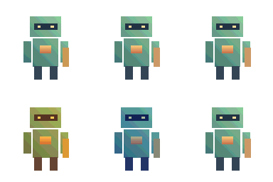

## 작업 결과

공통 톤 통일·애니메이션 보정 잠금·실제 크기 줌을 구현하고 프로젝트에 푸시했습니다. 실제 Unity 배치 모드에서 변환 출력과 정렬·줌 계산을 검증했습니다. 새 줌 버튼의 직접 화면 조작은 컴퓨터 유즈 취소 요청에 따라 미실행입니다.

위쪽은 보정 결과이며 아래쪽은 보정 전 원본과 공통 기준입니다. 이전의 따뜻한 보정값을 전부에 일괄 적용하는 방식은 사용자가 의도한 톤 통일과 달라 수정했습니다.

## 변경 내용

### 적용 내용

### 원본마다 다른 색감을 공통 기준으로

참고 이미지 하나를 공통 기준으로 지정합니다. 서로 다른 이미지 각각의 가시 RGB 평균·표준편차를 기준 통계에 맞춘 뒤 전체 묶음에서 하나의 팔레트를 추출합니다. 프레임마다 별도 보정하는 방식과 구분합니다.

- 2D 원본 시트는 시트 전체에서 한 보정값을 계산해 모든 셀에 공유합니다.
- 선택 파일이 하나의 애니메이션이면 해당 옵션을 켭니다. 첫 파일의 보정값을 전체 파일에 고정합니다.
- 3D는 전체 모델 첫 출력 프레임의 보정값을 모든 방향·프레임·장비에 공유합니다. 장비만 따로 재보정하지 않습니다.
- 기준 통계와 보정 사용·강도·잠금 옵션은 프로필 JSON으로 공유합니다.

### 픽셀 크기와 점무늬

미리보기는 기본 100%이며 디스플레이 배율을 고려해 실제 픽셀 크기를 계산합니다. 25·50·100·200·400·800%와 화면 맞춤을 구분합니다. 큰 이미지는 스크롤하고 Ctrl+휠로 확대합니다. 줌은 PNG 출력 크기를 변경하지 않습니다. 기본 프리셋 디더링은 0이며, 저장된 사용자 프로필 값은 보존합니다.

### 3D 장비와 샘플

전체 출력 자세·방향·장비의 경계로 카메라를 고정합니다. 스킨 메시 경계도 BakeMesh로 계산합니다. 시트와 개별 PNG는 같은 셀 크기·중앙 피벗·FullRect를 유지하며 가장자리 잘림은 차단합니다.

Window/Pixora/Tone Matching Demo(Ctrl+Shift+F11)에 서로 다른 색감의 WarmVariant·CoolVariant와 CommonReference 예제를 넣었습니다. 9개 언어 안내도 갱신했습니다.

[최종 프로젝트 커밋](https://github.com/MDJ0126/Pixora/commit/f7a9da45d69c0dafe58bcffa2015f2760ce169dd)

## 검증

| 대상 | 실제 결과 | 근거 |
| --- | --- | --- |
| Unity 배치 모드 / Direct3D11 | 실제 렌더링·변환 실행 통과 | [실행 환경](../assets/common-tone-v2/CommonToneHeadlessVerification.json) |
| 전용 검사 | 403/403 통과, 2026-10-29 22:17 KST | [원본 결과](../assets/common-tone-v2/CommonToneVerification.json) |
| 기본 변환·3D·애니메이션 | 88/88 통과, 같은 배치 실행 | [원본 결과](../assets/common-tone-v2/Verification.json) |
| 문서 | 10장·이미지 5개, 9개 언어·주요 54장·코드 예시 54개 통과 | VerifyDocs.mjs / VerifyLocalizedGuides.mjs |

403개에는 다국어 키 232개 검사와 프레임·스킨·톤·줌 계산·개별 PNG 검사가 포함됩니다. 서로 다른 색감의 시험 원본이 공통 기준으로 수렴했고 양자화 전 색상 차이가 90% 이상 감소했습니다. 최종 일괄 출력도 공통 32색 팔레트를 지켰습니다. 모든 사용자 이미지에서 같은 감소율을 보장한다는 뜻은 아닙니다.

같은 애니메이션 파일 옵션에서는 상대적인 프레임 색 차이가 보존되는 것을 확인했습니다. 4방향×4프레임의 몸체·장비 알파 합집합과 합본의 위치 차이는 16개 모두 0픽셀이었습니다. 시트 Sprite와 개별 PNG 48개의 48×32 셀·중앙 (24,16) 피벗·사각 메시를 확인했습니다.

100%가 자동 확대되지 않는 계산, 정수 배율, 화면 맞춤 구분, 기본 프리셋의 디더링 0을 검사했습니다. 결과 비교 PNG를 직접 시각 확인했으며 새 줌 UI를 직접 조작한 검증과는 구분합니다.

## 남은 사항

컴퓨터 유즈 취소 이후 새 줌 버튼·스크롤·Ctrl+휠의 실제 창 조작과 모든 DPI 화면 배치는 미확인입니다. 구현·컴파일·줌 계산 검사는 완료했습니다. 통계 기반 톤 보정은 의미별 재질 분류가 아니며 사용자 지정 팔레트가 목표 색감을 제한할 수 있습니다. 임의 사용자 모델·URP/HDRP·런타임 IK·물리는 별도 검증이 필요합니다. 부위 위치 정렬과 3D 깊이 가림은 다르며 평면 레이어 합성으로 가림을 복원하지 않습니다.

## 작업 시간

- 제안 시간: 최초 20~35분. 사용자 의도 정정과 줌 요청에 따라 추가 수정·검증 15~25분을 제시했습니다.
- 실제로 완료된 시간: 시작 2026-10-29 21:34:10 KST. 최종 배치 검증 22:17 KST, 프로젝트 푸시 22:21 KST 완료. 보고서 생성 2026-10-29T22:22:49+09:00, 전체 경과 48분 39초. 새 줌 UI 직접 조작은 취소 요청에 따라 미실행이며 공개 배포는 후속 Actions로 확인합니다.
- XERJ: 실패 — Xerj.ps1 Status가 XERJ node is not running으로 실패해 rg·현재 소스·실행 검증으로 대체했습니다.
