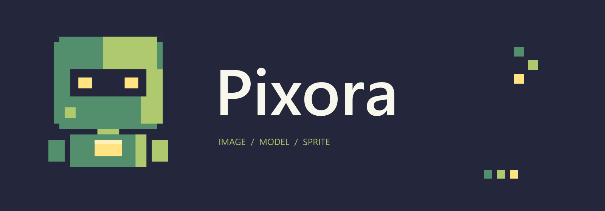

## 작업 결과

초록·연두·노랑·남색 로봇 로고를 제작하고 README와 Unity 창에 적용했습니다. 편집 가능한 Affinity 원본과 PNG를 함께 저장했으며 프로젝트 main에 푸시했습니다.

## 변경 내용

기존 보라색 P 심볼을 사용자 제공 로봇의 사각 머리·눈·가슴 패널에서 가져온 로봇으로 교체했습니다. 초록 #548F6D, 연두 #AEC96E, 노랑 #FFE481, 남색 #24263B를 모두 사용했습니다. 이전 원본은 보존했습니다.

- Affinity 원본: Design/Brand/Robot의 심볼·배너 .af 파일.
- 심볼 512×512, 배너 1600×560 PNG를 Unity 에디터와 README에서 공유합니다.
- [프로젝트 변경](https://github.com/MDJ0126/Pixora/commit/ba523bb3344106944dacaeb9df1fa133bede9558)
- [설정 창 후속 수정](2026-10-29-setup-reference-v1.0.0.html)

## 검증

| 대상 | 실행 결과 | 근거 |
| --- | --- | --- |
| 실제 Affinity | 3.3.1.4940 연결·문서 생성·저장·출력 확인 | .af와 PNG 실파일 |
| PNG | 크기·바이트·네 색상·배포 복사본 해시 확인 | [검증 자료](../assets/robot-setup-v1/RobotBrandVerification.json) |
| Unity | 6000.0.83f1의 창 로고 표시 확인 | 설정 창 후속 보고서 화면 |
| 문서 | 10개 장·5개 로컬 이미지 검사 통과 | [검증 자료](../assets/robot-setup-v1/DocumentationVerification.json) |

## 남은 사항

다른 OS와 디스플레이 배율에서의 출력은 미확인입니다. Affinity의 로컬 MCP만 사용했으며 추가 파일·네트워크 MCP 권한은 켜지 않았습니다.

## 작업 시간

- 제안 시간: 15~25분. 진행 중 설정 창 재작업이 추가되었습니다.
- 실제로 완료된 시간: 구현·Unity 검증·프로젝트 푸시는 2026-10-29 21:30 KST에 완료했습니다. 보고서 작성 시점 2026-10-29T21:30:56+09:00, 시작부터 23분 27초입니다. 아카이브 배포는 후속 Actions로 확인합니다.
- XERJ: 실패 — 노드 중지 오류를 확인하여 rg와 실제 소스로 대체했습니다.
