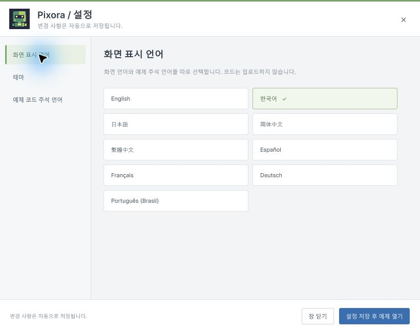
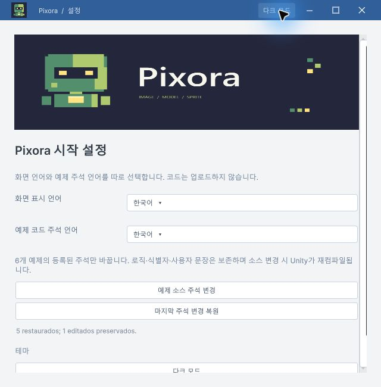
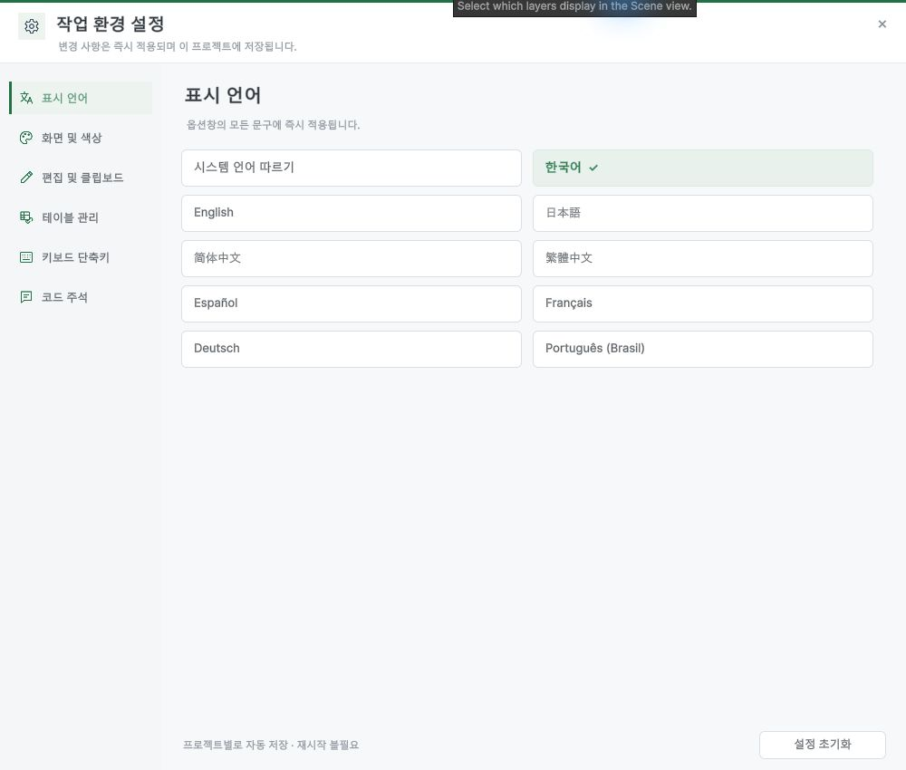
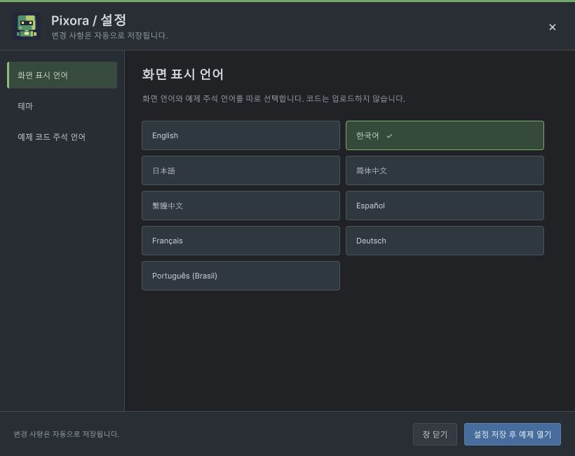
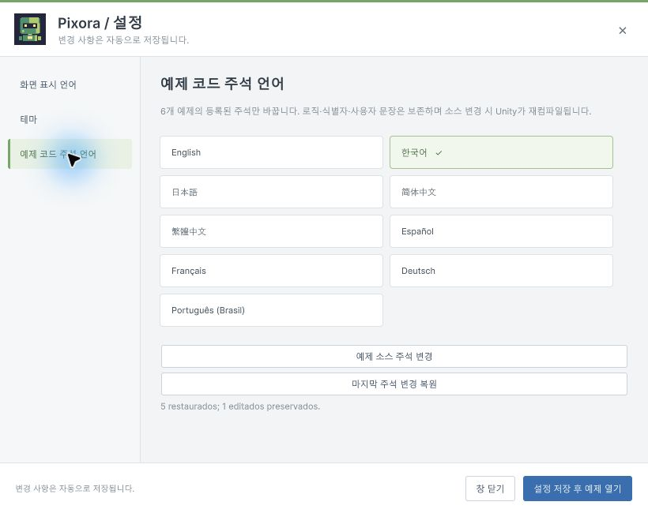

## 작업 결과

시작 설정 창을 DesignDataTable의 실제 Preferences 화면과 소스에 맞춰 다시 구성했습니다. 큰 배너를 없애고 비율을 고정한 작은 로봇 심볼로 교체했습니다. Unity에서 라이트·다크 전환과 분류 이동을 확인했고 프로젝트 main에 푸시했습니다.

## 변경 내용

### 재현 조건

Unity 6000.0.83f1의 Window / Pixora / Settings and First Setup을 열면 기존 설정 상단에 큰 가로 배너가 표시되었습니다.

### 기대 동작

사용자가 지정한 DesignDataTable 설정처럼 낮은 헤더, 작은 아이콘, 왼쪽 분류, 오른쪽 설정 카드와 고정 하단 버튼을 제공합니다. 로고의 원래 비율을 유지합니다.

### 실제 동작

기존 창은 큰 배너와 세로로 나열한 언어·테마 버튼으로 구성되어 참고 프로젝트의 설정 구조와 달랐습니다. 사용자가 이미지가 찌그러져 보인다고 지적했습니다.

### 원인

참고 프로젝트와 달랐던 배치는 PixoraSetupWindow의 Banner 호출과 단일 ScrollView 구성에서 확인했습니다. 원본 배너는 1600×560이고 USS 높이는 160px였습니다. 이미지 변형을 일으킨 정확한 렌더링 원인은 미확인입니다.

### 수정 내용

- 실제 DataTablePreferences.cs와 WorkbookWindowTheme.cs 및 열린 Preferences 화면을 대조했습니다.
- 72px 헤더·178px 왼쪽 분류·2열 언어 카드·고정 하단 영역으로 변경했습니다.
- 심볼은 ScaleToFit과 40×40 최소·최대 크기, 축소 방지 설정을 사용합니다.
- 화면 언어·테마·예제 주석 언어를 별도 페이지로 나누고 자동 저장 안내를 9개 언어에 추가했습니다.
- 설정 창은 닫기 버튼만 두고, 본창의 최소화 제외 상태는 유지합니다.
- [프로젝트 변경](https://github.com/MDJ0126/Pixora/commit/c633fd0)

## 검증

- 수정 전: 큰 배너와 단일 세로 배치 화면을 저장했습니다.
- 수정 후: 실제 Unity의 820×650 설정 창에서 작은 정사각 로고, 2열 카드, 하단 버튼, 가로 스크롤 제거를 확인했습니다.
- 라이트·다크 전환 및 표시 언어·테마·주석 언어 페이지 이동을 직접 실행했습니다.
- 사용 예제 회귀 검사: 2026-10-29 21:29:14 KST 실행 완료, **2,376/2,376 통과**. [실행 결과](../assets/robot-setup-v1/TutorialVerification.json)
- git diff --check 통과. 새로운 언어 문자열은 총 214개 키 × 9개 언어 카탈로그로 생성했습니다.

## 남은 사항

다른 DPI·OS와 모든 창 크기 조합은 미확인입니다. 이번 회귀 검사는 사용 예제 범위이며 과거의 전체 코어 검사 결과를 재실행 결과로 포함하지 않았습니다.

## 작업 시간

- 제안 시간: 15~25분. 진행 중 설정 창 재작업이 추가되었습니다.
- 실제로 완료된 시간: 구현·Unity 검증·프로젝트 푸시는 2026-10-29 21:30 KST에 완료했습니다. 보고서 작성 시점 2026-10-29T21:30:56+09:00, 시작부터 23분 27초입니다. 아카이브 배포는 후속 Actions로 확인합니다.
- XERJ: 실패 — 노드 중지 오류를 확인하여 rg와 실제 소스로 대체했습니다.
