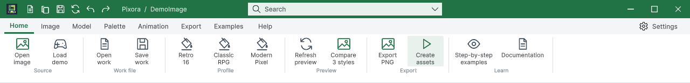

## 작업 결과

언두·리두 코드와 Templete1.2.2 패키지 구현/백그라운드 검증 및574455b1 푸시 완료. 전체 GUI QA는 미완료입니다.

## 변경 내용

### 재현 조건

Windows · Unity6000.0.83f1 · Templete1.2.2/API1

### 재현 순서

Pixora에서 디자인 값을 바꾼 후 제목줄 Undo/Redo 또는 Ctrl+Z/Y를 사용합니다.

### 기대 동작

현재 Studio의 디자인만 취소/재실행되고 다른 창과 출력 파일은 보존됩니다.

### 실제 동작

기존 Pixora에는 이력과 실행 취소/다시 실행 명령 연결이 없었습니다. 구현 중 첫 Ctrl+Z 이후 UI 재구성 다음 Ctrl+Y가 명시적으로 문서 포커스를 주기 전에는 전달되지 않는 상태를 관찰했습니다.

### 원인

초기 소스의 상태 변경 콜백은 값 변경과 미리보기 갱신만 수행했고 편집 이력·Undo/Redo 명령은 없었습니다. 키보드 경로는 문서 루트 포커스 유무에 따라 실제 입력 결과가 달랐음을 확인했습니다. 최종 포커스 지연 복원은 구현했지만 네이티브 키 재시험은 보류 상태입니다.

### 적용 내용

Templete에 직렬화 가능한 EditHistory<T>를 추가하고, Pixora 창마다100단계 디자인 스냅샷을 보관합니다. 입력·격자·팔레트·톤·프로필·촬영·애니메이션·출력 옵션을 기록하며 새 편집은 Redo 분기를 대체합니다. 탭/줌·미리보기 재생은 별도 상태입니다. 저장 시 이력이 참조하는 내장 이미지/팔레트를 유지하고 저장 자체는 취소 항목을 추가하지 않습니다.

DataTable 원본 아이콘 search.undo/search.redo를 제목줄에 사용하고 Ctrl+Z, Ctrl+Y, Ctrl+Shift+Z 및 검색 명령을 연결했습니다. UI 재구성 이후 포커스를 이벤트 처리 다음 시점에도 복원하도록 수정했습니다. DataTable의 기존 워크북 이력은 변경하지 않았습니다. Templete1.2.2/API1, Pixora 최소1.2.2, DataTable 최소1.2.1을 유지합니다.

교훈 검토: 실제 단축키 전달과 명시적 대상의 합성 이벤트는 구분해야 합니다. UI 재구성 뒤 연속 입력 및 저장 후 이력 참조 보존을 프로젝트 AGENTS에 추가했습니다. 전역은 실제 실행/증거 우선 규칙에 이미 포함되므로 중복 추가 없이 변경 없음입니다. 새 아트워크 제작 없이 DataTable 원본을 재사용했습니다.

## 검증

화면 제어 보류 전 실제 Unity에서 값·상태61항목을 검사했습니다. 팔레트/톤/프로필/격자/카메라/프레임/방향/클립/부위 Undo→Redo, 새 분기, 다중 창 분리, 저장 후 이미지 참조 유지가 통과했습니다.

최종 코드의 별도 batchmode/nographics 프로세스에서16항목 통과: 저장 후 취소, 실제 스크립트 도메인 재로드 후 직렬화 이력 유지, UI Toolkit에 명시적으로 전달한 Ctrl+Z/Y/Shift+Z 이벤트, 버튼 활성 상태 및 창 분리. 이 결과는 OS 키보드 전달이나 최종 화면 검증을 대신하지 않습니다. 실행 중 MainWindowHandle0도 확인했습니다.

공식 Unity6.0 [키보드 이벤트 문서](https://docs.unity3d.com/6000.0/Documentation/Manual/UIE-Keyboard-Events.html)를 대조했습니다. 초기 빈 이력 역직렬화 예외는 방어 처리 후 회귀했으며, 실패 기록과 중간 GUI 재로드 준비 검사 실패도 보존했습니다. 최종 키보드 연속 입력은 NativePending.json으로 보류했습니다.

9언어117개 장/90개 예제 코드, 개발 문서12개 장/이미지7링크 통과. 배포 패키지3개 현재 C#/JSON, 공유 GUID19개 보존, 예제10씬 포함 검사가 통과했습니다. Pixora 패키지776파일·Templete35파일의 원본 바이트도 대조했으며 개발용.xerjignore는 배포 제외로 구분했습니다.

위 이미지는 중간 빌드의 실제 Unity 화면입니다. 최종 포커스 수정 이후 재캡처는 하지 않았습니다.

## 남은 사항

사용자의 “나 컴쓴다 제어 ㄴㄴ” 지시 이후 마우스·키보드·창 포커스 및 표시 중인 Unity QA 명령을 중단했습니다. 최종 네이티브 Ctrl+Z→Ctrl+Y 반복, 두 버튼 클릭, 교차 창과 두 테마 화면 재확인이 남았습니다. 제품 가이드의 기존 캡처 해시는 유지하고 재확인 대기로 표시했습니다. 전체 GUI QA 통과나 버그 해결 완료로 등록하지 않았습니다.

## 작업 시간

- 제안 시간: 20~40분
- 실제로 완료된 시간: 30.7분 · 구현/백그라운드 검증 및 코드 푸시 2026-10-30 21:53:28 KST. 최종 네이티브 입력·현재 화면 검증은 사용자 제어 보류로 미완료.
- XERJ: 사용 — XERJ Undo 검색 후 DataTable 및 현재 Pixora 소스를 직접 대조했습니다.
